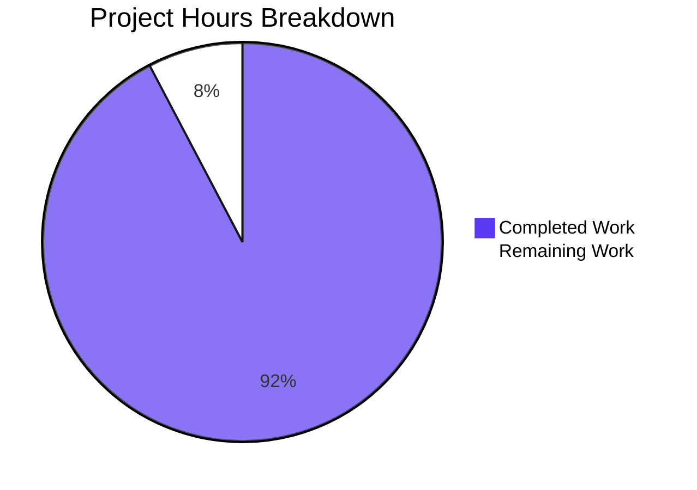
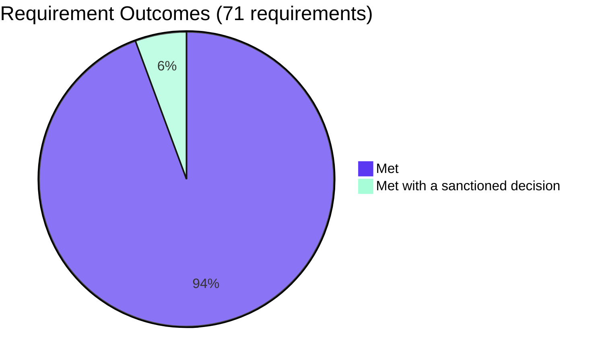

# 1. Executive Summary

## 1.1 Project Overview

Hello_world delivers one artefact: `hello_world.txt` at the repository root, holding `Welcome to Blitzy` on exactly five lines — 90 bytes of ASCII, each line terminated by a single LF. The task is content-only: no runtime, interface, data model or integration surface accompanies it. The two pre-existing files, `README.md` and `server.js` (a 14-line Node HTTP listener), are untouched and unrelated; the listener never reads, serves or prints the new file.

## 1.2 Completion Status

6.0 of the 6.5 hours in scope are delivered; the remaining 0.5 are the human acceptance review and merge approval, the one step that cannot be completed autonomously. Completion: **6.0 / 6.5 = 92%**.



Dark blue (#5B39F3) = completed; white (#FFFFFF) = remaining.

| Metric | Hours |
|---|---|
| Total Hours | 6.5 |
| Completed Hours (Baseline: Human with agentic-assist) | 6.0 |
| Remaining Hours | 0.5 |
| Completion | 92% |

## 1.3 Key Accomplishments

- ✅ `hello_world.txt` at the repository root: 90 bytes, five lines of the exact text, nothing else.
- ✅ Byte form: 17 characters per line, five LF, zero CR, no BOM, no trailing space, no blank record.
- ✅ All eleven prohibited content types verified absent.
- ✅ One path added, three files in total, both pre-existing files byte-identical to `80c7709`.
- ✅ One adding commit, one blob ever, no generator or transient helper in tree or history.
- ✅ No dependency, manifest or import change; nothing reads, requires or serves the file.
- ✅ Pre-existing service unchanged and operational: `200` / `text/plain` / 14 bytes on every path.
- ✅ 71 requirements reviewed (67 met, 4 under sanctioned decisions); 45 checks run, 45 passed.

## 1.4 Critical Unresolved Issues

Two open items across the seven requirements the request stated, both inside the same one: its completion evidence and its sign-off. Neither is a defect; only the sign-off gates release.

| Issue | Impact | Owner | ETA |
|---|---|---|---|
| Completion evidence in a committed tree: the acceptance check's untracked-status clauses (`?? hello_world.txt` and "the only untracked path") read empty once the deliverable is committed | A verbatim replay reads "no change" on a correct delivery; the equivalent positive proof is the single `A hello_world.txt` row in `git diff --name-status 80c7709..HEAD` with the empty `git diff --stat` and the three-file count | Repository owner | None required |
| Acceptance sign-off and merge approval of the delivered bytes | Release cannot proceed until the owner confirms the file holds the content they asked for | Repository owner | 0.5 h |

## 1.5 Access Issues

No access issues identified: no credential, token or third-party access is required, no secret or environment variable is read, and no permission limit was encountered.

## 1.6 Recommended Next Steps

1. **[High]** Read the file, confirm the five requested lines, and approve the branch for merge — the last step to release.
2. **[Medium]** Replay the completion evidence with `git diff --name-status 80c7709..HEAD` in place of the untracked-status clauses.
3. **[Low]** Re-run the byte checks in Section 9 before any future edit to the file; no in-repo gate guards it.
4. **[Low]** `chmod 644 hello_world.txt` if a non-owner consumer is ever introduced.
5. **[Low]** Keep `node --check` plus the startup smoke test in the review routine for `server.js`.

# 2. Project Hours Breakdown

Hours are measured against the task's own scope: the deliverable and the evidence that proves it. No hour is attributed to work outside that scope, and every line below traces to requirements the task stated.

## 2.1 Completed Work Detail

| Component | Hours | Description |
|---|---|---|
| Deliverable creation | 0.5 | `hello_world.txt` written at the repository root in one direct write of the literal body: 90 bytes, five LF-terminated 17-character lines, ASCII, no BOM, no CR, no trailing space, no blank record, no formatting. |
| Content fidelity and acceptance evidence | 1.5 | The five content acceptance checks executed with their output and exit status recorded, plus byte-level proof of size, line count, terminator, encoding, prohibited content and repeated-read stability. |
| Repository containment and non-modification | 1.5 | Containment established as one added path, three files in total, an empty diff and both pre-existing files byte-identical to `80c7709`, with sweeps confirming no generator, test, documentation, configuration or directory artefact. |
| Dependency, integration and service continuity | 0.5 | No dependency, manifest or import change; `README.md` and `server.js` unchanged; nothing reads, requires, serves or mounts the deliverable; the existing listener and response contract intact. |
| Provenance and single-write assurance | 0.5 | Path free on arrival, one adding commit, one blob ever for the path, no generator or transient artefact in the tree or its history, and no research or attachment artefact. |
| Cross-requirement review and acceptance sign-off | 1.5 | All 71 stated requirements reviewed against the delivered artefact, the cross-cutting decisions confirmed not to arise, interface design confirmed not applicable, and the absence of project rules confirmed. |
| **Total** | **6.0** | |

## 2.2 Remaining Work Detail

| Category | Hours | Priority |
|---|---|---|
| Human acceptance review and merge approval of the delivered content against the request's completion condition | 0.5 | High |
| **Total** | **0.5** | |

No engineering item remains. Four requirements are met under sanctioned decisions rather than as literally worded — the single commit, the untracked-status form of the completion evidence, and the empty artefact directories the checkout provisions — and none of them implies code work, so none carries hours.

# 3. Test Results

Every check below was executed against the delivered artefact on branch `blitzy-d0d6ec67-c40a-4ecd-aa8e-bd8f3538e0c6` at commit `fe2e25d`. "Tests" counts the individual assertions executed; the repository ships no test suite, so these are read-only checks driven from a POSIX shell.

| Area / Category | Framework | Tests | Passed | Failed | Coverage | What This Proves |
|---|---|---|---|---|---|---|
| Deliverable content fidelity | POSIX shell with `wc`, `grep`, `od`, `awk`, `tr`, `file`, `md5sum` | 19 | 19 | 0 | Not measured — no coverage tooling exists in the repository | `hello_world.txt` is exactly 90 bytes: five LF-terminated 17-character lines of `Welcome to Blitzy`, ASCII, no BOM, no CR, no trailing space, no blank record, stable across repeated reads |
| Acceptance checks A1–A5 (seven assertions; one exits 1 by design) | POSIX shell, the checks run verbatim | 7 | 7 | 0 | Not applicable | The request's completion condition holds and every published check reproduces its documented output and exit status, including the one that exits 1 when it selects no non-matching line |
| Containment and non-modification (the containment acceptance check and the nine prohibitions) | `git` plumbing and `find` | 16 | 16 | 0 | Not applicable | Exactly one path was added, three files exist in total, `README.md` and `server.js` are byte-identical to base commit `80c7709`, and no generator, test, documentation, configuration or tooling artefact exists anywhere |
| Pre-existing service static integrity | `node --check` | 1 | 1 | 0 | Not applicable | `server.js` still parses cleanly and is unmodified byte for byte |
| Repository gates and runtime surface | `node --test`; `curl` | 2 | 2 | 0 | None configured | No test suite is configured — the built-in runner reports `1..0` with zero tests — and nothing was listening on port 3000, so no service was stood up during verification |
| **Total** | | **45** | **45** | **0** | | |

**Not covered.** The following capability-shaped gaps are stated rather than left to be discovered:

- **Nothing in the repository guards the delivered content.** There is no test suite, linter, manifest or CI workflow, and the task's own scope forbids adding one, so the 45 checks above were a one-off read-only exercise and do not run on later changes. A future edit to `hello_world.txt` would be caught by no in-repo gate; a human should re-run the byte checks in the Development Guide before touching the file.
- **No runtime behaviour is covered, because none exists.** No endpoint, page, console, script or build step reads the file, so there is no behavioural surface for a test to assert against.
- **The pre-existing HTTP service has no automated coverage at all.** Its continuity rests on byte identity against the base commit plus a parse check; anyone changing `server.js` should treat the startup smoke test in the Development Guide as the minimum gate.
- **File permissions are untested.** Git records mode `100644` for all three paths, but the working tree holds `hello_world.txt` as `0600`; no check in any suite would notice the difference, and no consumer exists that would be affected.

# 4. Runtime Validation & UI Verification

- ✅ **Deliverable content** — five consecutive reads returned identical bytes; the file is 90 bytes of five LF-terminated lines of `Welcome to Blitzy`, identical on every read, with no generation step at read time.
- ✅ **Repository state at rest** — clean working tree, exactly three files, one path added against `80c7709`, no untracked or ignored artefact.
- ✅ **Pre-existing HTTP service** — started with `node server.js`, logged `Server running at http://127.0.0.1:3000/`, answered `200` with `Content-Type: text/plain` and a 14-byte body on `/`, on an arbitrary path and on HEAD, then stopped; the port was free again afterwards and the tree was unchanged. The body is the fixed string `Hello, World!\n` and is unrelated to `hello_world.txt`.
- ⚠ **Browser and UI layer** — no page, endpoint, form, console, script or asset exists, so there is nothing to drive and nothing rendered; browser validation does not apply to this deliverable.
- ⚠ **External integrations** — none exist: no API client, database, cache, queue or outbound call appears anywhere in the tree, so no integration was exercised.
- ⚠ **Generator or automation path** — none exists by design: there is no build, task runner or script, so the file's production was never reproduced automatically and is not reproducible.

**Never exercised at runtime:** the delivered file itself has no runtime surface — it is data at rest, and its correctness was established by reading its bytes rather than by running anything. The pre-existing service was exercised only to confirm that the repository's single executable still starts and answers as it did before this work; it plays no part in the deliverable, and nothing about the delivered content depends on it.

# 5. Compliance & Quality Review

The deliverable is judged against the request's own constraints rather than against general good practice: where the scope forbids an artefact, its absence is a pass, not a gap. Status reflects where each area stands now.

## 5.1 Compliance Matrix

| # | Deliverable | Status | Evidence |
|---|---|---|---|
| 1 | Deliverable content — exact text, five lines, no formatting | ✅ PASS | 19 content assertions: 90 bytes, five 17-character lines, exact text 5/5, zero prohibited content types |
| 2 | Single-file containment — one created path and nothing else | ✅ PASS | `git diff --name-status 80c7709..HEAD` = `A hello_world.txt`; three files in total |
| 3 | Non-modification of existing files | ✅ PASS | `README.md` `bf3a8fb9…` and `server.js` `320a75a7…` identical in working tree, HEAD and base commit |
| 4 | No-generator provenance | ✅ PASS | Generator sweep empty across the tree and its history; one adding commit; one blob ever for the path |
| 5 | Dependency inventory invariance | ✅ PASS | No manifest, lockfile or version file; the only import in the tree is `require('http')` in `server.js` |
| 6 | Integration boundary | ✅ PASS | Nothing reads, requires, imports, serves or mounts the deliverable; `server.js` contains no reference to it |
| 7 | Observational evidence discipline | ✅ PASS | No test, fixture, harness, snapshot or log was added; the evidence is recorded command output |
| 8 | Acceptance checks A1–A5 | ✅ PASS | `PRESENT`/0, `5`/0, `5`/0, `0` with exit 1 as designed, `90`/0, and the byte rendering with five LF and 90 bytes |
| 9 | Acceptance check A6 — containment | ✅ PASS on substance, with a caveat | Empty `git diff --stat`, three files, one added path and both pre-existing files unmodified; the untracked-status clauses are superseded (5.2, DIV-2) |
| 10 | Git-action discipline | ⚠️ PASS with a sanctioned departure | One commit `fe2e25d` exists; no tag, no branch created by the work, no history rewrite, no git-configuration change (5.2, DIV-1) |
| 11 | Not-applicable determinations | ✅ PASS | Identity, audit, data reach, shared components, legacy disposition and interface design do not arise; no UI or asset file exists |
| 12 | Repository hygiene — nothing unnamed added | ✅ PASS | No lint, format, badge, licence, changelog, CI or tooling file; the checkout's own artefact directories hold no files |

## 5.2 AAP & Rule Divergences and Gaps

| What the AAP/Rule Required | What Was Delivered Instead | Why It Diverged | Impact | Remediation |
|---|---|---|---|---|
| **DIV-1** — No Git command commits, tags, branches, pushes, amends history or alters Git configuration; the only repository change is the working-tree creation of the single file. | The deliverable is committed as `fe2e25d`: a single-parent commit adding only `hello_world.txt` (5 insertions, 0 deletions), with no tag, no branch created by the work, no history rewrite and no git-configuration change. | **Sanctioned.** The delivery pipeline requires the deliverable to be committed to reach the pull request; an uncommitted working-tree file would never be published, defeating the request's own core requirement. A source ranked above the scope clause required it, and the decision was recorded at delivery time. | The file is tracked rather than untracked and the working tree is clean. No effect on the content, on the two pre-existing files, or on repository configuration. | None. Undoing it would remove the deliverable from the pull request. |
| **DIV-2** — The completion evidence fixed a form in which `git status --porcelain` prints `?? hello_world.txt` and `hello_world.txt` is the only untracked path; a related decision recorded the write as traced by the single untracked entry in `git status`. | Both commands print nothing and the tree is clean, because the deliverable is committed. | **Sanctioned as a consequence** — the same decision as DIV-1, not an independent choice about the evidence. | A verbatim replay of the completion evidence reads "no change" on a correct delivery. Every substantive assertion holds: empty `git diff --stat`, three files in total, one added path, both pre-existing files unmodified. | None in code. Replay the evidence with `git diff --name-status 80c7709..HEAD` (Section 9). |
| **DIV-3** — No new directory, including one created to hold the file; the scope-boundary row restates the same exclusion. | The change adds no directory and commit `fe2e25d` carries no tree object, but the checkout contains `./blitzy`, `./blitzy/screenshots` and `./blitzy/screen_recordings`, all empty. | **Sanctioned.** The build environment provisions those paths in every checkout as the locations for validation artefacts, and ranks above the task's own scope on host matters. | A directory count reads four instead of one. The file count, the content and the delivered branch are unaffected, and empty directories cannot be delivered by git. | None. They hold no file. |

**DIV-1 — the deliverable is committed.** The scope asked that no Git command commit, tag, branch, push, amend history or alter configuration, leaving the file as an untracked working-tree change. Commit `fe2e25d` adds only `hello_world.txt` (5 insertions, 0 deletions, single parent `80c7709`) and carries no tag, no new branch, no amended history and no configuration change, and that commit is what is on the remote branch `origin/blitzy-d0d6ec67-c40a-4ecd-aa8e-bd8f3538e0c6`, so the artefact is what a pull request would deliver. The reason is structural rather than discretionary: an uncommitted file never reaches the pull request, which would defeat the request's own requirement that the file exist in the project. The owner should treat the commit as the delivery of the file; nothing needs to be undone.

**DIV-2 — the completion evidence has a committed-tree form.** The evidence fixed at scoping time assumed the file would be untracked, so it expected `git status --porcelain` to print `?? hello_world.txt` and expected the path to be the only untracked one. Those two lines cannot be produced once the file is committed, and today both commands print nothing. Nothing about the delivery is hidden by this: `git diff --name-status 80c7709..HEAD` prints the single row `A hello_world.txt`, `git diff --stat` is empty, and the tree holds exactly `README.md`, `hello_world.txt` and `server.js`. The owner's decision is only whether to keep replaying the check in its original form; Section 9 gives the substitute. No code change is needed, and none is possible without removing the file from the branch.

No divergence blocks release, and DIV-3 requires no decision: the directories it concerns hold no file and contribute nothing to the delivered branch.

# 6. Risk Assessment

| Risk | Category | Severity | Probability | Mitigation | Status |
|---|---|---|---|---|---|
| Content drift — nothing in the repository guards `hello_world.txt`; no suite, linter, manifest or CI exists, and the scope forbids adding one, so a later edit would be caught by no in-repo gate | Technical | Medium | Medium | Re-run the documented byte checks before any edit to the file; add a gate only if the scope's constraints are ever relaxed | Open (accepted) |
| The pre-existing HTTP service has no automated coverage; a future change to `server.js` would be unprotected | Technical | Medium | Low | Treat `node --check server.js` plus the startup smoke test as the minimum gate for any change to that file | Open |
| Completion evidence replayed in a committed tree reads an empty status and can be mistaken for "no change" | Operational | Low | High (on every replay) | Use `git diff --name-status 80c7709..HEAD` as the equivalent positive proof (5.2, DIV-2) | Accepted |
| Content-only delivery conflicts with a scope clause that forbids committing: the artefact cannot both stay uncommitted and reach a pull request | Operational | Low | Medium | Settle the clause when such a request is next scoped | Open |
| Working-tree permissions — `hello_world.txt` is `0600` while git records `100644`, so a consumer running as another user could not read it | Operational | Low | Low | `chmod 644 hello_world.txt` if a non-owner consumer is introduced | Open, no current impact |
| Content is consumed unvalidated — nothing reads the file today, but any future consumer inherits whatever it contains with no integrity check beyond the commit hash | Security | Low | Low | Verify the blob hash (`81b97edf…`) before wiring a consumer to the file | Accepted |
| Future integration is unexercised — if the text is later served, embedded or templated, none of that path exists or has been tested; the current evidence covers the file at rest only | Integration | Low | Low | Treat such a change as new work with its own tests | Open |

No vulnerability exists in the delivered content: its complete byte alphabet is the letters of the required line, its spaces and five LFs — no secret, credential, URL, file path, digit or control byte other than LF appears anywhere in it.

# 7. Visual Project Status


Completed work is dark blue (#5B39F3); remaining work is white (#FFFFFF). Total scope is 6.5 hours, of which 6.0 hours are delivered and 0.5 hours — the human acceptance review and merge approval — remain.



Of the 71 requirements the task stated, 67 are met outright and 4 are met under the sanctioned decisions recorded in Section 5.2; none is unstarted. All remaining work sits in one High-priority item, the acceptance sign-off; there is no Medium- or Low-priority engineering work outstanding.

# 8. Summary & Recommendations

**What was delivered and verified.** One artefact: `hello_world.txt` at the repository root, 90 bytes holding `Welcome to Blitzy` on exactly five LF-terminated lines, ASCII, with no byte-order mark, no CR, no trailing space, no blank record and no formatting. It is the only path added to the repository; the tree holds three files in total; `README.md` and `server.js` are byte-identical to base commit `80c7709`; and no generator, test, documentation, configuration or tooling artefact exists anywhere. Of the 71 requirements the task stated, 67 are met outright and 4 are met under the sanctioned decisions in Section 5.2. Measured in hours, **6.0 of the 6.5 hours in scope are delivered — 92% complete**.

**What was exercised to prove it.** Forty-five checks were executed against the delivered commit: nineteen on content fidelity (exact text, line count, terminator, encoding, size, prohibited content, read stability), seven running the acceptance checks verbatim with their documented output and exit status, sixteen on containment and non-modification (one added path, three-file tree, blob identity for both pre-existing files, artefact sweeps), one static parse of the pre-existing service and two repository gates. All forty-five passed and none failed. The repository's single executable was also started and confirmed to answer `200`/`text/plain` on every path before being stopped, so the pre-existing surface is known to be intact.

**What remains.** One item, and it is not engineering: the owner's acceptance review and merge approval, estimated at 0.5 hours. It closes the requirement that the file be confirmed as the content requested, and it is the critical path to production — read the file, confirm five lines of the requested text, approve the branch. Two pieces of evidence need a substitute reading rather than work: the completion check's untracked-status clauses cannot appear in a committed tree (use `git diff --name-status 80c7709..HEAD`), and the empty artefact directories the checkout provisions are not part of the delivered branch.

**Readiness.** The deliverable is production-ready for its purpose: a static, byte-exact text file, no dependency, no configuration, no runtime and no integration to deploy. The residual risks are those of an unguarded artefact rather than of delivered code — nothing in the repository would catch a later edit to the file, the pre-existing service carries no automated coverage, and a future consumer would inherit the content without validation. Each is recorded with a mitigation in Section 6. Success for this work is measured by four numbers: 90 bytes delivered, 0 modified files, 0 prohibited artefacts, 0 failed checks.

# 9. Development Guide

**System prerequisites.** Node.js 22.x for the pre-existing listener (verified on v22.23.5; the file uses only the built-in `http` module), `git` to inspect the delivered commit (verified on 2.56.1), and a POSIX shell with the standard `wc`, `grep`, `od`, `awk`, `tr`, `cat`, `md5sum`, `find` and `file` utilities. No Python, Docker, database, queue or external service is involved.

**Environment setup.** There is nothing to install and nothing to configure. The repository has no `package.json`, no lockfile and no `node_modules`, so `npm install` and `npm ci` are no-ops — do not run them. No environment variable or secret is read anywhere in the tree.

```bash
cd "$(git rev-parse --show-toplevel)"

# confirm the layout: exactly three files, no dependencies, no configuration
find . -path ./.git -prune -o -type f -print | sort
# ./README.md
# ./hello_world.txt
# ./server.js

node --version    # v22.23.5 or another 22.x release
```

**The deliverable.** `hello_world.txt` is data at rest — it has no startup step, no process and no endpoint. Read it directly:

```bash
cat hello_world.txt          # five identical lines: Welcome to Blitzy
cat -A hello_world.txt       # each line renders as "Welcome to Blitzy$" — LF only, no trailing space
```

**Starting the pre-existing HTTP service.** `server.js` is the repository's only executable and is unrelated to the deliverable. It binds `127.0.0.1:3000` and answers every path and method with a fixed body. Run it in the background so the shell returns:

```bash
node server.js &
# Server running at http://127.0.0.1:3000/

curl -s -i http://127.0.0.1:3000/ | head -4
# HTTP/1.1 200 OK
# Content-Type: text/plain

curl -s http://127.0.0.1:3000/any/path   # Hello, World!  (14 bytes, every path)

kill %1                                  # stop it when you are done
```

**Verification steps.** Run these from the repository root. The first five are the content acceptance checks; the sixth is containment, given in its committed-tree form.

```bash
node --check server.js                                  # exit 0: the file parses

test -f hello_world.txt && echo PRESENT                 # PRESENT
wc -l < hello_world.txt                                 # 5
grep -c '^Welcome to Blitzy$' hello_world.txt           # 5
grep -vc '^Welcome to Blitzy$' hello_world.txt          # 0, and exit 1 by design (it selects nothing)
wc -c < hello_world.txt                                 # 90
od -An -c hello_world.txt                               # five \n, printable text, no \r, no BOM, no \0
```

```bash
# containment: one added path, nothing else changed, three files in total
git diff --name-status 80c7709..HEAD    # A   hello_world.txt
git diff --stat                         # empty
git status --porcelain                  # empty
find . -path ./.git -prune -o -type f -print | wc -l   # 3
```

`git status --porcelain` prints nothing here because the deliverable is committed; `git diff --name-status 80c7709..HEAD` is the equivalent positive proof and is the reading to use for a committed tree (Section 5.2, DIV-2).

**Example usage.** Reading the delivered content and confirming it byte for byte:

```bash
md5sum < hello_world.txt          # 1ba430e6776a208f5416f6bd4a677487
wc -w -m -c hello_world.txt       # 15 90 90
git rev-parse HEAD:hello_world.txt   # 81b97edfc6ef0796545a32896636e73dd838f1b8 (must match the worktree hash)
```

**Troubleshooting.**

| Symptom | Cause | Resolution |
|---|---|---|
| `EADDRINUSE` when starting `server.js` | Something already holds `127.0.0.1:3000`, which is hard-coded and therefore host-global | Identify the holder from the process table — `lsof`, `ss` and `netstat` are not installed — and stop only a process you started yourself |
| You need to know whether anything is listening | `lsof`/`ss` unavailable | `curl -s -m 2 http://127.0.0.1:3000/` — exit status 7 means nothing is bound |
| `curl -X HEAD` never returns | That form waits for a body that never comes | Use `curl -I` for a HEAD request |
| A command that inspects `server.js` hangs forever | `node -p "require('./server.js')"` calls `listen`, so the process never exits | Use `node --check server.js` for a static parse, or start and stop it explicitly |
| `npm test` fails or does nothing | There is no manifest and no test suite | Nothing to run; `node --test` reports `1..0` with zero tests and is not a failure |
| `git status` shows no change after delivery | The deliverable is committed, so the tree is clean | Use `git diff --name-status 80c7709..HEAD` to see the single added path |
| The file cannot be read by another user | Working-tree mode is `0600` while git records `100644` | `chmod 644 hello_world.txt` if a non-owner consumer is introduced |

# 10. Appendices

**A. Command Reference**

| Purpose | Command |
|---|---|
| Confirm the file parses | `node --check server.js` |
| Content acceptance checks | `test -f hello_world.txt`, `wc -l`, `grep -c '^Welcome to Blitzy$'`, `grep -vc '^Welcome to Blitzy$'`, `wc -c`, `od -An -c` |
| Inspect line endings and whitespace | `cat -A hello_world.txt` |
| Containment evidence in a committed tree | `git diff --name-status 80c7709..HEAD`, `git diff --stat`, `git status --porcelain` |
| Verify the delivered blob | `git rev-parse HEAD:hello_world.txt`, `git hash-object hello_world.txt` |
| Byte identity of the untouched files | `git hash-object README.md server.js` against `git rev-parse 80c7709:README.md 80c7709:server.js` |
| Start and stop the pre-existing service | `node server.js &` … `kill %1` |
| Probe the service | `curl -s -i http://127.0.0.1:3000/`, `curl -I http://127.0.0.1:3000/` |
| Confirm no test suite exists | `node --test` (prints `1..0` with zero tests) |

**B. Port Reference**

| Port | Bind address | Owner | Notes |
|---|---|---|---|
| 3000 | `127.0.0.1` | `server.js` (pre-existing, unrelated to the deliverable) | Hard-coded in the source, so it is host-global and cannot be partitioned per checkout; nothing was listening on it at rest, and it was free again after the smoke test |

**C. Key File Locations**

| Path | Role | Size |
|---|---|---|
| `hello_world.txt` | The deliverable — five LF-terminated lines of `Welcome to Blitzy` | 90 bytes |
| `README.md` | Pre-existing documentation, untouched (single line `# Hello_world`, no trailing terminator) | 13 bytes |
| `server.js` | Pre-existing HTTP listener, untouched (14 lines, `require('http')` only) | 342 bytes |
| `./blitzy/`, `./blitzy/screenshots/`, `./blitzy/screen_recordings/` | Checkout-provisioned artefact locations, empty and untracked | 0 files |
| `.git` | Repository metadata; base commit `80c7709`, delivered commit `fe2e25d` | — |

**D. Technology Versions**

| Component | Version | Used for |
|---|---|---|
| Node.js | v22.23.5 | Running `server.js`; parsing checks; the built-in `node --test` runner |
| npm | 11.21.0 | Not needed — the repository has no manifest or dependencies |
| git | 2.56.1 | Inspecting the delivered commit and blob identity |
| GNU bash | 5.3.9 | The shell used for all verification commands |
| coreutils / `od` / `file` | Distribution versions | Byte, line and encoding inspection |

**E. Environment Variable Reference**

No environment variable is read by anything in the repository: `grep -rn process.env` over the tree returns nothing, and no `.env` file, secret or credential exists. Nothing needs to be set to build, verify or run the project.

**F. Developer Tools Guide**

| Tool | Purpose here | Note |
|---|---|---|
| `node --check` | Static parse of `server.js` | The only executable gate that exists; exit 0 means the file parses |
| `node --test` | Detects the absence of a suite | Prints TAP `1..0`, `# tests 0`, `# fail 0`, exit 0 — that is not a failure |
| `git diff --name-status` | Shows the single added path | The committed-tree substitute for an untracked-status check |
| `git hash-object` / `git rev-parse` | Blob identity for every path | Proves `README.md` and `server.js` are unmodified byte for byte |
| `od -An -c`, `cat -A`, `wc`, `grep` | Byte-level content inspection | Together they prove line text, terminators, encoding and size |
| `curl` | Probes the pre-existing service | `-I` for HEAD; exit 7 means nothing is listening |

**G. Glossary**

| Term | Meaning in this project |
|---|---|
| Deliverable | `hello_world.txt`, the single file this work adds at the repository root |
| Byte form | The exact bytes required: five 17-character lines each followed by a single LF, ASCII, no BOM, no CR, 90 bytes in total |
| Containment | The proof that exactly one path was added and nothing else in the repository changed |
| Provenance | The proof that the content arrived as one direct write of literal text, with no generator or transient helper |
| Acceptance checks A1–A6 | The six read-only checks that define completion: presence, line count, exact line text, size, byte rendering, and containment |
| Base commit | `80c7709`, the commit the delivered change is measured against |
| Pre-existing service | `server.js`, an HTTP listener that returns a fixed string and plays no part in the deliverable |
| Sanctioned decision | A settled departure from the scope, recorded and justified by a higher-ranked requirement, requiring no further work |
