# Technical Specification

# 1. Introduction

## 1.1 Executive Summary

This Technical Specification documents the `Hello_world` repository in its entirety. A scope statement is warranted at the outset: the repository consists of exactly two tracked files — `server.js` and `README.md` — and contains no directories, no dependency manifest, and no build, test, or deployment tooling. This specification therefore documents a genuinely minimal system, and every statement below is drawn from those two files, from the repository's Git history, and from direct execution of the code. Where a subject area customary to a technical specification has no counterpart in the repository, that absence is stated explicitly rather than filled with assumed behaviour.

#### Project Overview

The project is a single-file HTTP service written for the Node.js runtime. `server.js` imports Node's built-in `http` module, binds a listener to the fixed address `127.0.0.1:3000`, and answers every inbound request with HTTP status `200`, a `Content-Type` of `text/plain`, and the fourteen-byte body `Hello, World!\n`. On successful bind it writes a single readiness line, `Server running at http://127.0.0.1:3000/`, to standard output. The accompanying `README.md` is one line of thirteen bytes containing only the heading `# Hello_world`; it supplies the project's label and nothing else.

The implementation is the canonical "Hello World" HTTP server: it establishes that a request can be received and a response returned, and it deliberately stops there. It has no routing, no request parsing, no persistence, no authentication, no configuration surface, and no third-party dependencies of any kind.

| Attribute | Observed Value | Evidence |
|---|---|---|
| Tracked files | 2 (`server.js`, `README.md`) | Repository root; `git ls-tree` on both branches |
| Executable artifacts | 1 (`server.js`, 14 lines) | `server.js` |
| Third-party dependencies | None; Node.js built-in `http` only | `server.js` line 1; no manifest present |
| Bind address | `127.0.0.1:3000`, hard-coded | `server.js` lines 3–4, 12 |
| Response | `200`, `text/plain`, `Hello, World!\n` | `server.js` lines 7–9 |
| Commit history | 2 commits, 57 seconds apart | `git log` |

#### Core Business Problem Being Solved

The repository does not state a business problem. `README.md` contains no problem statement, no goals, and no usage guidance, and there is no other documentation in the repository. Rather than infer a commercial purpose that the artifacts do not evidence, this specification characterises the problem the code demonstrably addresses.

The functional problem solved by `server.js` is the establishment of a working HTTP request/response cycle with the smallest possible amount of code and zero external dependencies. Three concrete needs are met by the implementation as written:

- **Runtime and toolchain validation.** Executing the file proves that a Node.js runtime is installed and functional, that it can bind a TCP port, and that it can serve HTTP — verified end to end by the readiness log line and a successful response.
- **A dependency-free starting point.** Because the only import is a Node built-in, the service runs immediately after checkout with no install step, no lockfile resolution, and no network access to a package registry. The absence of `package.json` and any lockfile is a verified property of the repository, not an oversight in this document.
- **A reference for the minimal server idiom.** The fourteen lines demonstrate the complete `require` → `createServer` → `listen` sequence that larger Node.js services elaborate upon.

The corresponding problem the system explicitly does *not* solve is the delivery of any application behaviour. Because the request object is accepted by the handler but never read, the service cannot distinguish one caller, path, or method from another. Direct verification confirms this: requests to `GET /`, `POST /anything`, `DELETE /a/b/c?q=1`, and `PUT /admin` all returned byte-identical responses.

#### Key Stakeholders and Users

No stakeholder, team, owner, or audience is named anywhere in the repository; there is no `LICENSE`, no `CONTRIBUTING.md`, and no ownership metadata. The following groups are therefore inferred from the code's observable interfaces and from Git authorship, and are labelled accordingly.

| Stakeholder | Relationship to the System | Basis in Repository |
|---|---|---|
| Repository author | Sole committer of both files | Git history: both commits by `lakshya-blitzy <lakshya@blitzy.com>` |
| Local operator / developer | Starts the process and reads the readiness line on stdout | `server.js` lines 12–14 |
| HTTP client on the same host | Sole consumer of the service's response | `server.js` lines 6–10; loopback bind at line 3 |
| Reader of this specification | Consumes the documented behaviour and boundaries | This document |

One boundary materially constrains the user population. Because the listener is bound to the loopback address `127.0.0.1` rather than to all interfaces, the service is reachable only from processes on the same host. This was confirmed empirically: a TCP connection to `127.0.0.1:3000` succeeded while a connection to the same port on the host's routable interface address was refused with `ECONNREFUSED`. There are consequently no remote users, no multi-tenant considerations, and no external consumers unless the bind address is changed or a reverse proxy is introduced — neither of which exists in the repository.

#### Expected Business Impact and Value Proposition

The repository defines no business objectives, revenue expectations, adoption targets, or service commitments, and this specification does not assert any. The value the artifact delivers is verifiable and narrow:

- **Immediate executability.** With no install step and no dependency graph to resolve, the service starts from a bare checkout on any host with Node.js available. Verification for this specification was performed on Node.js v22.23.2, where `http` was confirmed to be a built-in module.
- **A minimal attack and maintenance surface.** Zero third-party packages means no transitive dependency vulnerabilities, no lockfile drift, and no upgrade treadmill. The loopback-only bind further limits exposure to the local host.
- **Complete comprehensibility.** The entire behaviour of the system is contained in fourteen lines, making it fully auditable at a glance and a dependable teaching and validation reference.
- **A clean extension point.** The `createServer` handler is the single, obvious place where routing, parsing, or business logic would be introduced, giving any future work an unambiguous starting position.

These benefits are inseparable from the corresponding limitations, which are documented rather than minimised. The service has no error handling: `server.js` registers no `error` listener on the server object, so a port conflict terminates the process. This was verified by launching a second instance, which exited with code `1` and the unhandled error `listen EADDRINUSE: address already in use 127.0.0.1:3000`. Together with the hard-coded port, this means only one instance can run per host without modifying the source. Section 1.3 enumerates these boundaries in full.


## 1.2 System Overview

### 1.2.1 Project Context

#### Business Context and Market Positioning

The repository contains no business context. `README.md` holds a single heading and no prose; there is no `LICENSE`, no roadmap, no design document, and no issue or discussion artifact tracked in the repository. No market, customer segment, competitor, or commercial positioning is expressed anywhere in the two files. This specification does not supply one.

What the repository's own history does establish is the nature of the effort. The project consists of two commits authored 57 seconds apart on 2026-08-26, carrying GitHub's default web-interface commit messages: `Initial commit`, which added `README.md`, and `Add files via upload`, which added `server.js`. There is no iterative development history, no branching strategy beyond the two branch tips, no pull-request trail, and no tagged release. Both branch tips (`main` and `2608_01`) contain the identical two-file tree. The artifact is best positioned as a reference or bootstrap implementation rather than a product with a market.

The one positioning claim the code supports is technical: among Node.js HTTP servers, this implementation occupies the zero-dependency extreme. It uses only the `http` module bundled with the runtime, which places it below any framework-based service (Express, Fastify, Koa or similar) in both capability and operational cost. No such framework appears in the repository.

#### Current System Limitations

The repository shows no evidence of replacing or upgrading a predecessor system: there is no migration script, no compatibility shim, no deprecation notice, and no reference to any prior implementation. The limitations documented here are therefore the limitations of the current implementation itself, each traced to a specific verified property of the code.

| Limitation | Root Cause in Code | Verification |
|---|---|---|
| Reachable only from the same host | Bind to `127.0.0.1` (line 3) | Loopback connection succeeded; routable-interface connection refused with `ECONNREFUSED` |
| No configurability without editing source | `hostname` and `port` are hard-coded constants; no `process.env` reference | `server.js` lines 3–4; no `.env` or manifest in repository |
| One instance per host maximum | Fixed port with no fallback | Second instance exited code `1` with `EADDRINUSE` |
| Port conflict is a fatal crash | No `server.on('error')` handler registered | Unhandled `Error: listen EADDRINUSE` observed on second launch |
| Cannot differentiate callers or requests | Handler accepts `req` but never reads it | Identical `200`/`text/plain`/`Hello, World!\n` returned for `GET /`, `POST /anything`, `DELETE /a/b/c?q=1`, `PUT /admin` |
| No shutdown or lifecycle management | No signal handlers; no `server.close()` path | `server.js` contains no `process.on` registration |
| Not consumable as a library | No `module.exports`; binds on load | `server.js` has no exports; `listen` executes at line 12 |
| No operational documentation | `README.md` is a single 13-byte heading | `README.md` |

#### Integration with Existing Enterprise Landscape

The system integrates with nothing. Semantic search of the repository for authentication, persistence, and external-service integration logic returned no results, and there are no folders in the repository at all. The complete inventory of integration points is as follows.

| Integration Surface | Direction | Status |
|---|---|---|
| TCP/HTTP listener on `127.0.0.1:3000` | Inbound | The system's only interface |
| Standard output (readiness line) | Outbound | Single `console.log` at line 13 |
| Databases, caches, message queues | Outbound | None — no client library present |
| Upstream or third-party APIs | Outbound | None — no HTTP client code present |
| Identity provider / auth service | Inbound | None — no authentication code present |
| Configuration or secrets service | Inbound | None — no environment variable is read |
| Container orchestration or CI/CD | Operational | None — no `Dockerfile`, `.github/`, or pipeline config |
| Telemetry, metrics, or log aggregation | Outbound | None — stdout only, in plain text |

The practical consequence is that placing this service into an enterprise landscape would require additions on every axis: a network-accessible bind address or proxy, externalised configuration, a container or deployment descriptor, a health endpoint distinguishable from the fixed response, and structured telemetry. None of these are present.

### 1.2.2 High-Level Description

#### Primary System Capabilities

The system has one capability, expressed in two behaviours: it accepts inbound HTTP connections on a fixed loopback address, and it returns one fixed plain-text response to every request. Both were verified by execution.

| Capability | Implementation | Observed Behaviour |
|---|---|---|
| HTTP listener lifecycle | `server.listen(port, hostname, cb)` (line 12) | Binds `127.0.0.1:3000`; logs readiness on success |
| Uniform request handling | Inline handler (lines 6–10) | Returns `200`, `text/plain`, `Hello, World!\n` for any method and path |
| Readiness signalling | `console.log` template literal (line 13) | Emits `Server running at http://127.0.0.1:3000/` |

Notably absent as capabilities — each confirmed by inspection of the only executable file — are routing, request body or query parsing, content negotiation, input validation, authentication and authorization, session or state management, persistence, caching, rate limiting, compression, TLS termination, error handling, and graceful shutdown.

#### Major System Components

The system has no module decomposition: `server.js` is the single source file and defines no exports, classes, or named functions. The "components" below are therefore the internal constructs within that one file plus the runtime facilities it relies on.

| Component | Type | Role |
|---|---|---|
| `server.js` | Source module (CommonJS) | Sole entrypoint; executes on load |
| Node.js `http` module | Runtime built-in, required at line 1 | Supplies `createServer` and the server object |
| Configuration constants | `hostname`, `port` (lines 3–4) | Fixed bind target, compiled into the source |
| Server instance | `http.Server` from `createServer` | Owns the socket and dispatches to the handler |
| Request handler | Inline arrow function (lines 6–10) | Writes status, header, and body |
| Listen callback | Inline arrow function (lines 12–14) | Emits the readiness line to stdout |

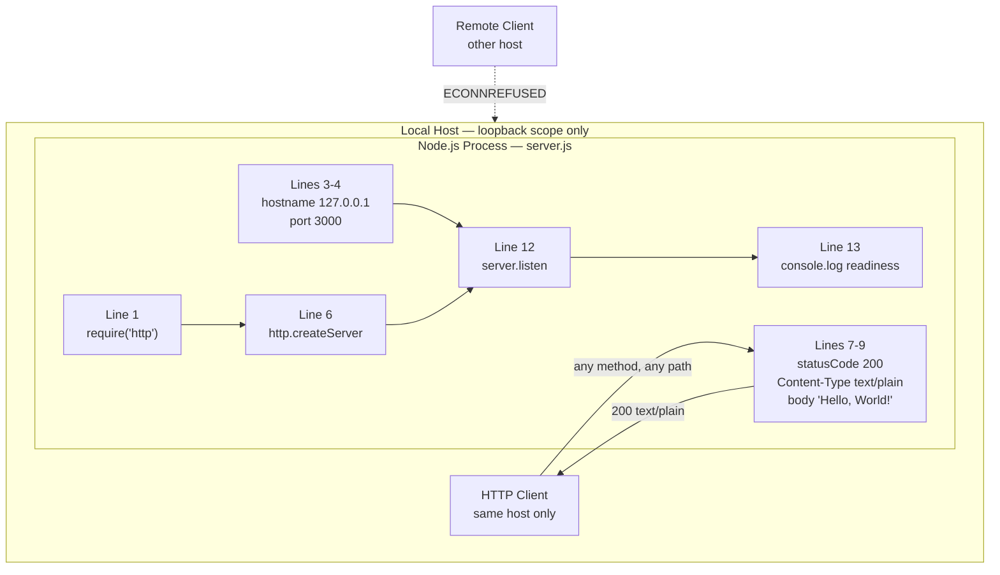

The diagram reflects two verified constraints. First, every inbound request converges on the same handler and receives the same response, because the handler branches on nothing. Second, the dashed edge marks the confirmed refusal of connections originating outside the host, a direct consequence of the loopback bind.

#### Core Technical Approach

The technical approach is deliberate minimalism, characterised by five choices visible in the source:

- **Runtime built-ins only.** The sole `require` targets `http`, confirmed present in the runtime's built-in module list. There is no dependency manifest, so no installation step precedes execution.
- **CommonJS with load-time side effects.** The module uses `require` rather than ESM `import`, and performs its work at load: the socket bind occurs as a side effect of running the file. Nothing is exported, so the file is an entrypoint and cannot be imported for reuse.
- **Compile-time configuration.** Bind parameters are `const` declarations in the source. Changing the address or port requires editing and redeploying the file; no environment variable, flag, or config file is consulted.
- **Stateless, branchless request handling.** The handler holds no state between requests and performs no conditional logic, which is what makes the response uniform across all inputs.
- **Console-based observability.** The single operational signal is one plain-text line on stdout at startup. There is no request logging, no metrics, no health endpoint, and no structured log format.

The resulting execution model is Node's standard single-threaded event loop with no clustering, no worker threads, and no process manager, since none is configured in the repository.

### 1.2.3 Success Criteria

The repository defines no success criteria. There are no tests, no CI configuration, no benchmark or load-test scripts, no service-level objectives, no coverage thresholds, and no monitoring definitions — each verified individually as absent. **No KPI, SLA, or performance target stated in this subsection originates from the repository, because none exists there.** The criteria below are derived exclusively from behaviour observed during direct execution, and are presented as verifiable acceptance conditions for the code as written. Any organisation adopting this service would need to define its own targets.

#### Measurable Objectives

Each objective below was confirmed by running `server.js` and observing the result. These are functional pass/fail conditions, not performance goals.

| Objective | Acceptance Condition | Status |
|---|---|---|
| Process starts without dependency installation | `node server.js` runs from a bare checkout | Verified (Node.js v22.23.2) |
| Listener binds successfully | Socket accepts connections on `127.0.0.1:3000` | Verified |
| Readiness is signalled | stdout shows `Server running at http://127.0.0.1:3000/` | Verified |
| Correct status code | Every response carries `200` | Verified across 4 request variants |
| Correct content type | Every response carries `Content-Type: text/plain` | Verified across 4 request variants |
| Exact response body | Every response body is `Hello, World!\n` (14 bytes) | Verified across 4 request variants |
| Uniformity across inputs | Method and path variation produce identical output | Verified (`GET`, `POST`, `DELETE`, `PUT`) |

#### Critical Success Factors

The factors below are the conditions on which correct operation depends, each traceable to a property of the implementation rather than to policy.

- **An available Node.js runtime.** The repository declares no engine constraint — there is no `package.json` and no `.nvmrc` — so the runtime version is entirely an environment concern. The code relies only on the long-stable `http` API surface.
- **An unoccupied port 3000 on the target host.** Because the port is hard-coded and no `error` listener is registered, contention is fatal rather than recoverable; this is the single most likely startup failure and was reproduced as `EADDRINUSE` with exit code `1`.
- **Co-location of client and server.** All consumers must run on the same host, as the loopback bind refuses external connections.
- **Preservation of the response contract.** The exact byte sequence `Hello, World!\n`, the `200` status, and the `text/plain` header constitute the whole of the system's observable contract; any change to them is a breaking change.
- **External supervision for availability.** Nothing in the repository restarts the process after a crash — no process manager, container restart policy, or systemd unit is configured — so continuous availability depends entirely on tooling outside this codebase.

#### Key Performance Indicators

No KPIs are defined in the repository, and none are asserted here. What can be stated instead is which indicators the current implementation is capable of supporting without modification, since this determines the measurement work any future operator must undertake.

| Candidate Indicator | Measurable Today? | Reason |
|---|---|---|
| Process availability / uptime | Externally only | No health endpoint; stdout emits nothing after startup |
| Request count and rate | No | No request logging or counters in the handler |
| Response latency | Externally only | No timing instrumentation in the code |
| Error rate | Not applicable | Only one code path exists; it always returns `200` |
| Response payload size | Yes, fixed | Constant 14-byte body |
| Startup success | Yes | Presence of the readiness line and a successful bind |
| Throughput under load | Externally only | No load-test harness or benchmark in the repository |

The pattern is consistent: every quantitative indicator would require either external probing or new instrumentation in the handler. Introducing that instrumentation is out of scope for the current implementation, as recorded in Section 1.3.


## 1.3 Scope

Scope here describes what the repository as it exists today does and does not implement. The repository contains no requirements document, backlog, or roadmap, so nothing below represents a planning decision recorded by the project; the in-scope items are the implemented behaviours and the out-of-scope items are verified absences.

### 1.3.1 In-Scope

#### Core Features and Functionalities

**Must-Have Capabilities**

The implemented feature set is fully enumerated by the following three items, which together account for all fourteen lines of `server.js`.

| Capability | Implementation Detail | Line Reference |
|---|---|---|
| Bind an HTTP listener to a fixed address | `server.listen(3000, '127.0.0.1', cb)` | 12 |
| Answer every request with a fixed response | `200` + `text/plain` + `Hello, World!\n` | 7–9 |
| Announce readiness on standard output | `console.log` of the formatted server URL | 13 |

No further capability is in scope, because no further capability is implemented.

**Primary User Workflows**

Two workflows are supported end to end, both verified by execution.

| Workflow | Steps | Outcome |
|---|---|---|
| Start the service | Operator runs `node server.js` on the host | Port bound; readiness line printed to stdout |
| Retrieve the response | Local client issues any HTTP request to `127.0.0.1:3000` | `200`, `text/plain`, `Hello, World!\n` |

Stopping the service is achieved only by terminating the process externally; the code registers no signal handler and provides no in-band shutdown path.

**Essential Integrations**

Exactly one integration is essential and present: the Node.js `http` built-in module, required at line 1 and confirmed to be part of the runtime rather than an installed package. Because it ships with Node.js, the service has no package installation step, no lockfile, and no registry dependency. A second, one-directional integration is the process's standard output stream, used once at startup. No other integration is in scope.

**Key Technical Requirements**

| Requirement | Value in Repository | Source |
|---|---|---|
| Runtime | Node.js with the `http` module available | `server.js` line 1 |
| Module system | CommonJS (`require`) | `server.js` line 1 |
| Declared engine version | None declared | No `package.json`, no `.nvmrc` |
| Bind address and port | `127.0.0.1:3000`, fixed in source | `server.js` lines 3–4 |
| Response contract | `200`, `text/plain`, 14-byte body | `server.js` lines 7–9 |
| Installation / build step | None required | No manifest, lockfile, or build config |
| Execution model | Single-threaded event loop, single process | No clustering or worker code present |

#### Implementation Boundaries

**System Boundaries**

The system boundary is the Node.js process started from `server.js`, and it is narrow in both directions. Inbound, the boundary is the single TCP listener on `127.0.0.1:3000`; every request that crosses it is treated identically. Outbound, the boundary is crossed exactly once — the readiness line written to stdout — and never during request handling. The process makes no outbound network calls, opens no files, and reads no environment variables. Anything beyond the process is external: the runtime installation, the host's network stack, any supervisor that restarts the process, and any client that calls it.

**User Groups Covered**

Coverage is determined by the loopback bind rather than by any access-control logic, of which there is none.

| User Group | Covered | Determining Factor |
|---|---|---|
| Processes on the same host | Yes | `127.0.0.1` accepts local connections |
| Local operator running the process | Yes | Startup workflow and stdout readiness line |
| Clients on other hosts or networks | No | Verified `ECONNREFUSED` on the routable interface |
| Authenticated or role-based user classes | Not applicable | No authentication or authorization code exists |

The service performs no identification of callers whatsoever, so within the covered group all users are indistinguishable and equally privileged.

**Geographic and Market Coverage**

Geographic coverage is confined to the single host on which the process runs; the loopback bind precludes any multi-region, multi-host, or internet-facing deployment without code change. Correspondingly, no market coverage is defined: there is no localization, no internationalization, no character-set handling beyond the ASCII response literal, no time-zone logic, and no region-specific configuration in the repository. The response is a fixed English-language string served identically regardless of any `Accept-Language` header, which the handler never reads.

**Data Domains Included**

The system holds and processes no data. There is no database, no file I/O, no in-memory store, and no session state; the handler retains nothing between requests. The complete set of data the system deals with is the following.

| Data Element | Nature | Persistence |
|---|---|---|
| `Hello, World!\n` response body | Hard-coded literal, 14 bytes | Compiled into source |
| `hostname` / `port` constants | Hard-coded configuration values | Compiled into source |
| Readiness log line | Derived from the constants at startup | Transient, stdout only |

No user data, personal data, credentials, or business records enter the system, which is why the repository contains no data-protection, encryption, or retention logic.

### 1.3.2 Out-of-Scope

Every exclusion below corresponds to a capability verified as absent from `server.js` and `README.md` — the repository's only two files. These are statements of current fact, not commitments about future work.

**Excluded Features and Capabilities**

| Excluded Area | Specific Exclusions | Verified Absence |
|---|---|---|
| Request handling | URL routing, method dispatch, path parameters, query parsing, body parsing, header inspection | `req` is accepted but never read |
| Response handling | Multiple content types, JSON, templating, static files, compression, caching headers, custom status codes | Only `200` + `text/plain` is ever written |
| Security | Authentication, authorization, TLS/HTTPS, CORS, CSRF protection, input validation, rate limiting, security headers | No security code; plain `http` only |
| Data | Databases, ORMs, migrations, caching layers, file storage, session state | No client libraries and no I/O |
| Reliability | Error handling, `error` event listener, timeouts, retries, circuit breakers, graceful shutdown | Fatal `EADDRINUSE` crash reproduced |
| Configuration | Environment variables, CLI flags, config files, secrets management, per-environment settings | Values hard-coded at lines 3–4 |
| Observability | Structured logging, request logs, metrics, tracing, health and readiness endpoints, alerting | One `console.log` at startup |
| Quality tooling | Unit/integration/E2E tests, linting, formatting, type checking, coverage | No test files or tool configuration |
| Delivery | Dependency manifest, lockfile, build pipeline, containerization, CI/CD, deployment descriptors | 25 common artifacts individually confirmed absent |
| Scaling | Clustering, worker threads, load balancing, multi-instance operation | Single fixed port; second instance cannot bind |
| Interface breadth | Web UI, static assets, API documentation, OpenAPI schema, WebSockets, HTTP/2 | No such files or code |

**Future Phase Considerations**

The repository defines no phases, milestones, or roadmap, and contains no `TODO` comments, feature flags, stubs, or commented-out code that would indicate planned work. No future phase is therefore documented, and this specification does not create one. The only statement supportable from the code is architectural: the inline handler at lines 6–10 is the single insertion point at which request differentiation would have to begin, and the constants at lines 3–4 are the single point at which configurability would have to be introduced. Whether such work is ever undertaken is not addressed by the repository.

**Integration Points Not Covered**

| Integration Point | Status |
|---|---|
| Reverse proxy, API gateway, or load balancer | Not covered; loopback bind assumes direct local access |
| Identity providers (OAuth, OIDC, SAML, LDAP) | Not covered; no authentication code |
| Datastores, caches, and message brokers | Not covered; no client libraries |
| Third-party or upstream HTTP APIs | Not covered; no outbound client code |
| Log aggregation, APM, and metrics backends | Not covered; plain stdout only |
| Container orchestration and service discovery | Not covered; no image or manifest |
| Secrets and configuration services | Not covered; no environment variable is read |
| Package registries | Not applicable; zero third-party dependencies |

**Unsupported Use Cases**

- **Remote or internet-facing access.** Connections from any other host are refused, as verified; the service cannot serve external traffic without changing the bind address or fronting it with a proxy.
- **Serving differentiated content.** Any use case requiring different responses per path, method, header, or caller is unsupported, since the handler branches on nothing.
- **Production operation without external scaffolding.** With no error handling, no health endpoint, no structured logs, and no restart mechanism, unattended production use is not supported by the codebase alone.
- **Horizontal scaling on a single host.** The hard-coded port permits only one instance; a second launch terminates with `EADDRINUSE`.
- **Multi-environment promotion.** Because configuration is compiled in, the same artifact cannot be promoted across environments without source edits.
- **Reuse as a library or framework.** `server.js` exports nothing and binds a socket on load, so it cannot be imported into another application.
- **Any use case involving user data.** With no storage, no validation, and no transport encryption, the system is unsuitable for handling personal, sensitive, or regulated data.


## 1.4 References

Every factual claim in Section 1 derives from the sources below. The repository contains only two files, both of which were read in full.

### 1.4.1 Repository Files Examined

- `server.js` — The repository's sole executable artifact (14 lines, 342 bytes). Established the CommonJS `require('http')` dependency on the Node.js built-in (line 1); the hard-coded `hostname = '127.0.0.1'` and `port = 3000` constants (lines 3–4); the inline `http.createServer` handler that sets status `200`, `Content-Type: text/plain`, and the body `Hello, World!\n` while leaving the request object unread (lines 6–10); and the `server.listen` call with its `console.log` readiness callback (lines 12–14). Also established, by what it omits: no exports, no `process.env` access, no `error` listener, no signal handlers, and no routing or validation logic.
- `README.md` — A single 13-byte line containing only the heading `# Hello_world`. Established the project's label and the total absence of setup, usage, configuration, deployment, security, and operational documentation.

### 1.4.2 Repository Structure Examined

- `` (repository root) — Confirmed via folder listing that the root contains exactly two children, both files, and no directories. This is the entire repository; there are no subfolders to examine at any depth.

### 1.4.3 Verified Absences

The following artifacts were each individually confirmed absent from the repository and underpin the exclusions documented in Sections 1.2 and 1.3: `package.json`, `package-lock.json`, `yarn.lock`, `pnpm-lock.yaml`, `npm-shrinkwrap.json`, `.nvmrc`, `Dockerfile`, `docker-compose.yml`, `Makefile`, `.gitignore`, `.env`, `.env.example`, `LICENSE`, `CONTRIBUTING.md`, `tsconfig.json`, `.eslintrc`, `.prettierrc`, `jest.config.js`, `.github/`, `.circleci/`, `.gitlab-ci.yml`, `Procfile`, `app.json`, `vercel.json`, and `netlify.toml`.

Semantic searches of the repository returned no results for configuration and deployment settings, for source/test/route directories, and for authentication, persistence, or external-service integration logic. A search for an HTTP server entrypoint returned only `server.js`, confirming it is the single executable artifact.

### 1.4.4 Repository Metadata and Runtime Verification

- Git commit history — Established the two-commit provenance: `d5373cb` ("Initial commit", adding `README.md`) and `80c7709` ("Add files via upload", adding `server.js`), authored 57 seconds apart on 2026-08-26 by a single author. Supported the characterisation of the project's maturity and web-interface origin in Section 1.2.1.
- Git branch and tree listing — Confirmed that both branch tips (`main` and `2608_01`) contain the identical two-file tree, establishing that no additional code exists on any branch.
- Direct execution of `server.js` — Verified the readiness line `Server running at http://127.0.0.1:3000/`; verified byte-identical `200`/`text/plain`/`Hello, World!\n` responses to `GET /`, `POST /anything`, `DELETE /a/b/c?q=1`, and `PUT /admin`; verified that `127.0.0.1:3000` accepts connections while the host's routable interface address refuses them with `ECONNREFUSED`; and verified that a second concurrent instance terminates with exit code `1` and the unhandled error `listen EADDRINUSE: address already in use 127.0.0.1:3000`. Runtime used for verification: Node.js v22.23.2, in which `http` was confirmed present in the built-in module list.

### 1.4.5 External Sources

No external sources are cited. Web searches for the Node.js release and LTS schedule returned no results, so Section 1 makes no claims about runtime version currency or support status beyond the locally verified facts recorded above.


# 2. Product Requirements

## 2.1 Feature Catalog

The repository contains no requirements document, backlog, issue tracker export, or roadmap — its complete content is `server.js` (14 lines) and `README.md` (1 line). Every feature and requirement in Section 2 is therefore **reverse-engineered from the source code and from direct execution of it**, not transcribed from a specification the project authored. Each entry below is traced to specific lines of `server.js` or to `README.md`, and each is stated so that it can be tested against a running process.

Four features account for the entirety of the repository. Three are runtime behaviours implemented in `server.js`; the fourth is the single documentation artifact. There is no fifth feature, because there is no further code.

| Feature ID | Feature Name | Category | Priority |
|---|---|---|---|
| F-001 | HTTP Listener Lifecycle and Port Binding | Runtime and Network Service | Critical |
| F-002 | Uniform Fixed Plain-Text HTTP Response | HTTP Request Handling | Critical |
| F-003 | Startup Readiness Announcement | Operator Feedback / Observability | Medium |
| F-004 | Project Label Documentation | Repository Documentation | Low |

| Feature ID | Status | Primary Evidence | Introduced In |
|---|---|---|---|
| F-001 | Completed | `server.js` lines 1, 3–4, 6, 12 | `80c7709` |
| F-002 | Completed | `server.js` lines 6–10 | `80c7709` |
| F-003 | Completed | `server.js` lines 12–14 | `80c7709` |
| F-004 | Completed | `README.md` (13 bytes) | `d5373cb` |

All four features carry the status **Completed**: each is fully implemented in the tracked code and was verified working (F-001 to F-003 by execution, F-004 by file inspection). No feature in this catalog is *Proposed*, *Approved*, or *In Development*, because the repository contains no planning artifact, no `TODO` comment, no stub, no feature flag, and no commented-out code from which a pending feature could be identified. Priority levels are assigned by the criticality of each feature to the system's observable behaviour, not by any priority the project recorded — F-001 and F-002 are Critical because removing either leaves no service at all, F-003 is Medium because its removal leaves the service functional but silent, and F-004 is Low because it affects no runtime behaviour.

### 2.1.1 F-001 — HTTP Listener Lifecycle and Port Binding

#### Feature Metadata

| Attribute | Value |
|---|---|
| Unique ID | F-001 |
| Feature Name | HTTP Listener Lifecycle and Port Binding |
| Feature Category | Runtime and Network Service |
| Priority Level | Critical |
| Status | Completed |

#### Description

**Overview.** F-001 is the feature that makes the process a server. Line 6 of `server.js` creates an `http.Server` via `http.createServer`, and line 12 calls `server.listen(port, hostname, callback)` with the constants declared at lines 3–4, binding a TCP listener to `127.0.0.1:3000`. Binding happens as a side effect of loading the module — there is no `main()` guard, no CLI parsing, and no export — so `node server.js` is the whole of the startup procedure. Once bound, the listener holds the Node event loop open, and the process remains resident and serving until it is terminated from outside; verification confirmed the process stays alive indefinitely and that `kill -TERM` ends it immediately, releasing the port.

**Business Value.** The feature delivers the one thing the repository exists to demonstrate: a working HTTP endpoint reachable with zero installation steps. Because the only import is a runtime built-in (line 1), there is no dependency resolution, no lockfile, and no registry access between checkout and a listening socket, which is what makes the artifact usable as a runtime/toolchain validation probe and as a bootstrap baseline.

**User Benefits.** For the local operator identified in Section 1.1, the benefit is a single-command start with no prerequisites beyond a Node.js runtime. For a local HTTP client, the benefit is a predictable, always-available endpoint at a well-known address.

**Technical Context.** The implementation is CommonJS (`require` at line 1) and single-process: there is no `cluster`, no `worker_threads`, and no process manager configuration anywhere in the repository (grep for `cluster` and `worker` in `server.js` returns zero occurrences). Bind parameters are compile-time constants, so the address and port cannot be changed without editing the source. No `error` listener is registered on the server object, which makes bind failure fatal — a second concurrent instance exits with code `1` and the unhandled error `EADDRINUSE: address already in use 127.0.0.1:3000`.

#### Dependencies

| Dependency Type | Detail |
|---|---|
| Prerequisite Features | None. F-001 is the root feature; it depends on no other feature in this catalog. |
| System Dependencies | A Node.js runtime providing the built-in `http` module (`server.js` line 1); an available TCP port 3000 on the loopback interface; the host network stack's loopback device. |
| External Dependencies | None. No third-party package, service, datastore, or network peer is referenced anywhere in the repository — there is no dependency manifest at all. |
| Integration Requirements | Exactly one inbound integration surface: the TCP/HTTP listener on `127.0.0.1:3000`. Consumers must run on the same host; a connection attempt to the host's routable address was refused during verification. Continuous availability requires an external supervisor, since the code contains no restart or recovery path. |

### 2.1.2 F-002 — Uniform Fixed Plain-Text HTTP Response

#### Feature Metadata

| Attribute | Value |
|---|---|
| Unique ID | F-002 |
| Feature Name | Uniform Fixed Plain-Text HTTP Response |
| Feature Category | HTTP Request Handling |
| Priority Level | Critical |
| Status | Completed |

#### Description

**Overview.** F-002 is the request-handling behaviour defined by the inline arrow function at `server.js` lines 6–10. For every request that reaches it, the handler executes exactly three statements — `res.statusCode = 200` (line 7), `res.setHeader('Content-Type', 'text/plain')` (line 8), and `res.end('Hello, World!\n')` (line 9) — and then returns. There are no branches: a grep for `if (` in `server.js` returns zero occurrences, and the `req` parameter declared at line 6 is never dereferenced anywhere in the file. Verification confirmed byte-identical responses for `GET /`, `POST /anything` (with a request body), `PUT /admin`, `DELETE /a/b/c?q=1`, `PATCH`, and `OPTIONS`, and for a request carrying `Accept: application/json`, `Authorization: Bearer …`, and `Accept-Language: fr-FR`.

**Business Value.** The fixed response is the system's entire observable contract, and its constancy is the property that makes the service useful as a probe: any client that receives `200`, `text/plain`, and the 14 bytes `Hello, World!\n` has proved the full request/response path end to end.

**User Benefits.** Consumers need no schema, no content negotiation, and no error handling — the response is deterministic and requires no parsing beyond reading a short string. The corresponding limitation, stated plainly, is that no caller can obtain anything else from the service.

**Technical Context.** The handler is stateless: it closes over nothing mutable, allocates no shared structure, and retains nothing between invocations. Application code sets only the status line and one header; the `Date`, `Content-Length: 14`, `Connection: keep-alive`, and `Keep-Alive: timeout=5` headers observed on the wire are supplied by the Node `http` runtime's response serializer rather than by `server.js`. Two classes of request never reach this handler at all, because the runtime's HTTP parser answers them first: requests using a method outside the 35 entries of `http.METHODS` and malformed request lines receive `400 Bad Request`, and a request header block exceeding Node's default 16 KB limit receives `431`. These are runtime behaviours, not application features.

#### Dependencies

| Dependency Type | Detail |
|---|---|
| Prerequisite Features | F-001. The handler is only reachable through the listener created at line 6 and bound at line 12; with no bound socket the handler is never invoked. |
| System Dependencies | The Node.js `http` module's `ServerResponse` implementation, which supplies `statusCode`, `setHeader`, and `end` and performs HTTP framing and connection management. |
| External Dependencies | None. No template engine, serializer, validation library, or downstream service participates in producing the response. |
| Integration Requirements | Serves the same single inbound surface as F-001 (`127.0.0.1:3000`). No outbound integration occurs during request handling: the handler performs no I/O other than writing the response, reads no file, opens no socket, and emits no log line. |

### 2.1.3 F-003 — Startup Readiness Announcement

#### Feature Metadata

| Attribute | Value |
|---|---|
| Unique ID | F-003 |
| Feature Name | Startup Readiness Announcement |
| Feature Category | Operator Feedback / Observability |
| Priority Level | Medium |
| Status | Completed |

#### Description

**Overview.** F-003 is the single operational signal the system produces. The callback passed to `server.listen` at lines 12–14 executes once, after the bind succeeds, and writes one line to standard output via `console.log` with a template literal: `Server running at http://127.0.0.1:3000/`. Verification confirmed the stream contains exactly this one line at startup and that it remains at one line after all subsequent request traffic — there is no per-request logging.

**Business Value.** The line is the only in-band confirmation that the bind succeeded, which makes it the practical readiness gate for a human operator or a start-up script that greps stdout. It also documents the effective address at runtime, which matters because the address exists nowhere else outside the source file.

**User Benefits.** The operator learns, without probing the port, that the service is up and where to reach it. The message is self-describing and requires no log configuration to appear.

**Technical Context.** The announcement is unstructured plain text on stdout — there is no log level, no timestamp, no JSON envelope, no log file, and no logging library (the repository has no dependency manifest). The URL is interpolated from the same `hostname` and `port` constants used for the bind at line 12, so the announced address cannot drift from the bound address. Because the message is emitted from the `listen` callback, its presence is itself proof of a successful bind; conversely, on bind failure nothing is written to stdout and the process aborts on the unhandled `error` event.

#### Dependencies

| Dependency Type | Detail |
|---|---|
| Prerequisite Features | F-001. The callback is invoked by `server.listen` only after the socket is bound, so the announcement cannot occur without a successful bind. |
| System Dependencies | The process `stdout` stream and the `console.log` global provided by the Node.js runtime. |
| External Dependencies | None. No log shipper, collector, metrics backend, or alerting system is referenced anywhere in the repository. |
| Integration Requirements | One outbound, one-directional, write-once surface: standard output. Any consumer that needs machine-readable readiness must wrap the process externally — the codebase exposes no health endpoint distinguishable from the fixed F-002 response. |

### 2.1.4 F-004 — Project Label Documentation

#### Feature Metadata

| Attribute | Value |
|---|---|
| Unique ID | F-004 |
| Feature Name | Project Label Documentation |
| Feature Category | Repository Documentation |
| Priority Level | Low |
| Status | Completed |

#### Description

**Overview.** F-004 is the whole of the repository's documentation: `README.md`, a 13-byte file containing one unterminated line, `# Hello_world`. It supplies the project's name as a level-one Markdown heading and nothing else — no description, install steps, usage, configuration, deployment, security, or contribution guidance.

**Business Value.** The file gives the repository a rendered title on any Git hosting surface, which is the minimum needed for the project to be identifiable in a listing. No further documentation value is claimed, because none is present.

**User Benefits.** A reader can identify the project by name. A reader cannot learn from the repository how to run it, configure it, or extend it; that information exists only in the source and in this specification.

**Technical Context.** The file is static Markdown with no links, code blocks, or badges, and it is not consumed by any build, test, or documentation pipeline — the repository contains no such tooling. It was added by commit `d5373cb` ("Initial commit"), 57 seconds before `server.js`, and has not been modified since.

#### Dependencies

| Dependency Type | Detail |
|---|---|
| Prerequisite Features | None. F-004 is independent of the runtime features and is not read by any code. |
| System Dependencies | None at runtime. A Markdown renderer is required only for presentation. |
| External Dependencies | None. |
| Integration Requirements | None. No documentation generator, site build, or CI job consumes this file; the repository contains no `.github/` directory or pipeline configuration. |

### 2.1.5 Capabilities Absent From the Catalog

The following are recorded here so the catalog is not mistaken for a partial extract. Each was verified absent from the repository's two files and therefore yields no feature entry: routing and method dispatch, request parsing of any kind (path, query, headers, body), content negotiation, multiple content types, input validation, authentication and authorization, TLS, CORS, rate limiting, session or application state, persistence and caching, configuration by environment variable or flag, error handling and graceful shutdown, health and readiness endpoints, metrics and tracing, request logging, tests, linting, build and packaging, containerization, and CI/CD. Section 1.3.2 enumerates these exclusions with their supporting evidence; this catalog documents only what exists.


## 2.2 Functional Requirements

Thirteen requirements are documented below, distributed across the four catalogued features. Each is written as an assertion that can be checked against a running process or against a file in the checkout, and each acceptance criterion states the observable outcome rather than the implementation. Priority values (Must-Have / Should-Have / Could-Have) express how essential the requirement is to the behaviour the code actually delivers; complexity values reflect the effort embodied in the existing implementation. **No performance target, throughput figure, or latency budget in this subsection is a commitment made by the repository — the repository states none.** Where numbers appear, they are measurements taken during verification on a single host running Node.js v22.23.2 and are labelled as observations.

| Feature | Requirement IDs | Count |
|---|---|---|
| F-001 HTTP Listener Lifecycle and Port Binding | F-001-RQ-001 … F-001-RQ-004 | 4 |
| F-002 Uniform Fixed Plain-Text HTTP Response | F-002-RQ-001 … F-002-RQ-005 | 5 |
| F-003 Startup Readiness Announcement | F-003-RQ-001 … F-003-RQ-003 | 3 |
| F-004 Project Label Documentation | F-004-RQ-001 | 1 |

### 2.2.1 F-001 — HTTP Listener Lifecycle and Port Binding

#### Requirement Details

| Requirement ID | Description | Priority | Complexity |
|---|---|---|---|
| F-001-RQ-001 | On execution of `server.js`, the process shall bind an HTTP listener to host `127.0.0.1` on TCP port `3000`, using the constants at lines 3–4. | Must-Have | Low |
| F-001-RQ-002 | The listener shall accept connections originating on the same host only; it shall not be reachable from any other host or interface. | Must-Have | Low |
| F-001-RQ-003 | After a successful bind the process shall remain resident and continue accepting requests until terminated by an external signal. | Must-Have | Low |
| F-001-RQ-004 | If the bind cannot be completed, the process shall fail fast rather than continue in a non-serving state. | Must-Have | Low |

| Requirement ID | Acceptance Criteria |
|---|---|
| F-001-RQ-001 | Running `node server.js` from a bare checkout — with no install step — results in a socket accepting TCP connections on `127.0.0.1:3000`. Verified: connection accepted; an HTTP request returned `200`. |
| F-001-RQ-002 | A request to `http://127.0.0.1:3000/` succeeds while a request to the same port on the host's routable address fails to connect. Verified: loopback `200`; routable address (`10.76.1.55:3000`) connection refused. |
| F-001-RQ-003 | With no client traffic, the process is still listed as running and still answers requests after an extended idle period; it exits only when signalled. Verified: process resident across the full verification session; `kill -TERM` ended it and the port was released (subsequent connection refused). |
| F-001-RQ-004 | Starting a second instance while the first holds the port terminates the second process with a non-zero exit code and an error identifying the port conflict. Verified: exit code `1` with unhandled `error` event `EADDRINUSE: address already in use 127.0.0.1:3000`; no retry, no fallback port, and no partial start. |

#### Technical Specifications

| Aspect | Specification |
|---|---|
| Input Parameters | None from any external source. The only inputs are the in-source constants `hostname = '127.0.0.1'` and `port = 3000` (lines 3–4). No command-line argument is parsed, no environment variable is read (zero `process.env` occurrences), and no configuration file exists. |
| Output / Response | A bound TCP listener on the loopback interface, plus the F-003 readiness line on success. On failure, an uncaught `Error` with `code: 'EADDRINUSE'` on stderr and process exit code `1`. |
| Performance Criteria | None specified by the repository. Observed: the process becomes ready and answers its first request immediately after launch; idle resident set size measured at approximately 58 MB (`ps` RSS) for the single Node process. |
| Data Requirements | Two scalar constants compiled into the source. No persistent state, no file handles, no state directory — the process reads and writes no files during its lifetime. |

#### Validation Rules

| Rule Class | Rule |
|---|---|
| Business Rules | Exactly one instance can run per host, because the port is fixed and no fallback exists. Availability beyond the process lifetime is the responsibility of external supervision; the repository contains no restart policy, service unit, or process-manager configuration. |
| Data Validation | None applicable. The bind parameters are literals in the source and are never validated at runtime — validation is unnecessary because they cannot be supplied externally. Any invalid value would have to be introduced by editing the source. |
| Security Requirements | No authentication, authorization, or transport encryption is implemented. The loopback bind is the only access control present, and it is a network-scope consequence rather than a policy check. Anything reaching the port is served. |
| Compliance Requirements | None stated in the repository and none applicable: the listener processes no personal, financial, or regulated data, and no compliance artifact (licence, policy, audit configuration) exists in the checkout. |

### 2.2.2 F-002 — Uniform Fixed Plain-Text HTTP Response

#### Requirement Details

| Requirement ID | Description | Priority | Complexity |
|---|---|---|---|
| F-002-RQ-001 | Every well-formed HTTP request using a method supported by the runtime shall receive status `200`, irrespective of method, path, query string, headers, or body. | Must-Have | Low |
| F-002-RQ-002 | Every response shall declare `Content-Type: text/plain`. | Must-Have | Low |
| F-002-RQ-003 | Every response body shall be exactly the 14 bytes `Hello, World!\n`. | Must-Have | Low |
| F-002-RQ-004 | Each response shall be completed in a single terminal write so that the runtime frames it with an accurate `Content-Length` and keeps the connection reusable. | Must-Have | Low |
| F-002-RQ-005 | The handler shall retain no state between requests; responses shall not vary with request order, count, or timing. | Must-Have | Low |

| Requirement ID | Acceptance Criteria |
|---|---|
| F-002-RQ-001 | Requests spanning multiple methods and paths all return `200`. Verified for `GET /`, `POST /anything` (with body `name=x&big=1234567890`), `PUT /admin`, `DELETE /a/b/c?q=1`, `PATCH /x/y?z=1`, `OPTIONS /x/y?z=1`, and `HEAD /`, plus a request carrying `Accept: application/json`, `Authorization: Bearer …`, and `Accept-Language: fr-FR`. |
| F-002-RQ-002 | The `Content-Type` response header equals `text/plain` on every response. Verified across all method and header variants above, including `HEAD`. |
| F-002-RQ-003 | The response body is byte-for-byte `Hello, World!\n` and its length is 14. Verified: `Content-Length: 14`, download size 14 bytes, and an identical SHA-256 body digest across `GET`, `POST`, `PUT`, `DELETE`, `PATCH`, and `OPTIONS`. For `HEAD` the body is correctly zero bytes. |
| F-002-RQ-004 | A single response is written with no chunked framing and the connection remains usable for a following request. Verified: response headers include `Content-Length: 14`, `Connection: keep-alive`, and `Keep-Alive: timeout=5`; a client issuing three sequential requests reused one connection for the second and third. |
| F-002-RQ-005 | Repeated identical requests return identical responses, and no response reflects any earlier request. Verified: 2,000 requests produced uniform `200`/`text/plain`/14-byte responses with no variation and no accumulation of state. |

#### Technical Specifications

| Aspect | Specification |
|---|---|
| Input Parameters | The handler signature accepts `(req, res)` at line 6, but `req` is never dereferenced anywhere in the file. Functionally, therefore, the feature accepts **no** input: method, URL, query, headers, and body are all ignored. Confirmed empirically — a POST body and an `Authorization` header changed nothing about the response. |
| Output / Response | Status `200`; headers set by application code: `Content-Type: text/plain`. Headers added by the Node `http` runtime on the wire: `Date`, `Content-Length: 14`, `Connection: keep-alive`, `Keep-Alive: timeout=5`. Body: `Hello, World!\n`. Response line observed as `HTTP/1.1 200 OK`. |
| Performance Criteria | None specified by the repository. Observed on the verification host: 2,000 requests at concurrency 50 over keep-alive connections completed in 142 ms (≈14,000 requests/second) with p50 ≈2 ms and p99 ≈31 ms. These figures describe one machine under one synthetic load and are not a service commitment. |
| Data Requirements | One immutable 14-byte string literal at line 9. No request data is read, stored, logged, or forwarded; no database, cache, file, or in-memory structure participates in the response path. |

#### Validation Rules

| Rule Class | Rule |
|---|---|
| Business Rules | The response contract — status `200`, `Content-Type: text/plain`, body `Hello, World!\n` — is the system's entire observable interface; any change to those three values is a breaking change for every consumer. Uniformity is a rule, not an accident: because the handler branches on nothing, differentiated responses are impossible without new code. |
| Data Validation | None implemented, and none required by the current behaviour: no request field is read, so there is nothing to validate. Requests that violate the HTTP protocol itself are rejected by the runtime before the handler executes — an unsupported method or malformed request line yields `400`, and a header block over Node's default 16 KB limit yields `431` (both verified). These responses originate in the runtime, not in `server.js`. |
| Security Requirements | No authentication, authorization, input sanitisation, output encoding, rate limiting, or security header is present. The response is a constant, so it carries no injection or data-leakage risk of its own; the absence of TLS means all traffic is plaintext, mitigated in practice only by the loopback scope inherited from F-001. |
| Compliance Requirements | None applicable. The feature processes and retains no user, personal, or regulated data, and it emits no audit record. |

### 2.2.3 F-003 — Startup Readiness Announcement

#### Requirement Details

| Requirement ID | Description | Priority | Complexity |
|---|---|---|---|
| F-003-RQ-001 | After the listener is bound, the process shall write the line `Server running at http://127.0.0.1:3000/` to standard output exactly once. | Must-Have | Low |
| F-003-RQ-002 | The announced URL shall be derived from the same constants used to perform the bind, so that it cannot disagree with the bound address. | Should-Have | Low |
| F-003-RQ-003 | No further output shall be written during request handling; the readiness line shall remain the process's only stdout content under normal operation. | Should-Have | Low |

| Requirement ID | Acceptance Criteria |
|---|---|
| F-003-RQ-001 | Immediately after start, stdout contains exactly one line whose text is `Server running at http://127.0.0.1:3000/`. Verified byte-wise (single trailing newline, no additional characters); stderr was empty. On a failed bind no readiness line is written. |
| F-003-RQ-002 | The host and port shown in the message match the socket actually bound. Verified: message reports `127.0.0.1:3000`, which is where the accepted connection was established; both values interpolate the `hostname` and `port` constants passed to `server.listen`. |
| F-003-RQ-003 | After serving a substantial volume of requests across many methods and paths, the stdout stream still contains exactly one line. Verified: line count remained 1 throughout the verification session. |

#### Technical Specifications

| Aspect | Specification |
|---|---|
| Input Parameters | None external. The message is built from the `hostname` and `port` constants (lines 3–4) inside a template literal at line 13; the `listen` callback receives no arguments. |
| Output / Response | A single unstructured UTF-8 text line on file descriptor 1, terminated by a newline. No log level, timestamp, request ID, or structured field is emitted, and no log file is written. |
| Performance Criteria | None specified by the repository. Observed: the line appears at startup, before the first request is served, and exactly one write occurs for the lifetime of the process. |
| Data Requirements | Derived transient data only — the interpolated URL string. Nothing is persisted; the line exists only in whatever stream the operator attached to the process. |

#### Validation Rules

| Rule Class | Rule |
|---|---|
| Business Rules | Presence of the line is the sole in-band readiness indicator, and its absence is the sole in-band startup-failure indicator. Any tooling that gates on readiness must parse stdout, because no health endpoint exists — a request to any path returns the F-002 response whether or not it constitutes a health check. |
| Data Validation | None applicable. The message contains no external input and no user data; there is no format contract beyond the literal text, which is itself the acceptance criterion. |
| Security Requirements | The line discloses only the bind address and port, which are already public in the source file; no credential, token, path, or environment detail is logged. Because nothing is logged per request, no request data can leak through logs. |
| Compliance Requirements | None applicable. No log retention, redaction, or audit-trail obligation is defined anywhere in the repository, and no log is persisted by the process. |

### 2.2.4 F-004 — Project Label Documentation

#### Requirement Details

| Requirement ID | Description | Priority | Complexity |
|---|---|---|---|
| F-004-RQ-001 | The repository shall provide its project label as a level-one Markdown heading in `README.md`. | Should-Have | Low |

| Requirement ID | Acceptance Criteria |
|---|---|
| F-004-RQ-001 | `README.md` exists at the repository root and its content is the single heading `# Hello_world`. Verified: 13 bytes, one unterminated line, no other content; the file renders as a level-one heading reading "Hello_world". |

#### Technical Specifications

| Aspect | Specification |
|---|---|
| Input Parameters | Not applicable — a static file, read by no code in the repository. |
| Output / Response | Rendered project title on any Markdown-rendering surface. |
| Performance Criteria | Not applicable. |
| Data Requirements | 13 bytes of static Markdown; no runtime data. |

#### Validation Rules

| Rule Class | Rule |
|---|---|
| Business Rules | The label is the repository's only self-description; operational knowledge (how to run, configure, or extend the service) is deliberately not covered by this requirement because the file does not contain it. |
| Data Validation | None. No schema, front-matter, or lint rule applies — the repository has no Markdown linter or documentation build. |
| Security Requirements | The file contains no credentials, endpoints, or sensitive detail; verified by full read of its 13 bytes. |
| Compliance Requirements | None satisfied and none claimed. Notably, there is no `LICENSE` file, so the repository carries no stated licence terms, and no `CONTRIBUTING.md` or code-of-conduct artifact exists. |

### 2.2.5 Runtime Behaviours Outside the Requirement Set

Three observed behaviours are deliberately **not** expressed as requirements of this system, because they are produced by the Node.js `http` runtime rather than by any line of `server.js`, and would occur identically for any server built on `http.createServer`:

| Observed Behaviour | Origin | Verified Result |
|---|---|---|
| Request using a method outside `http.METHODS` (35 entries) | Node HTTP parser, before the handler | `400 Bad Request`, empty body |
| Malformed request line (e.g. `GARBAGE\r\n\r\n`) | Node HTTP parser, before the handler | `HTTP/1.1 400 Bad Request` |
| Request header block larger than the default 16 KB limit | Node HTTP parser, before the handler | `431` |

They are documented because they qualify the otherwise absolute statement that every request receives the same response: the uniformity guaranteed by F-002-RQ-001 applies to well-formed requests using a supported method. Requests that never reach the handler are answered by the runtime, and `server.js` neither configures nor overrides that behaviour — it registers no `clientError` handler and sets no parser options.


## 2.3 Feature Relationships

All relationships below are read directly from the fourteen lines of `server.js` and from the file inventory. Because there is a single source file with no modules, no exports, and no imports other than the `http` built-in, the relationship graph is small and fully enumerable: three runtime features connected by two dependencies, one documentation feature connected to nothing, and five shared elements.

### 2.3.1 Feature Dependency Map

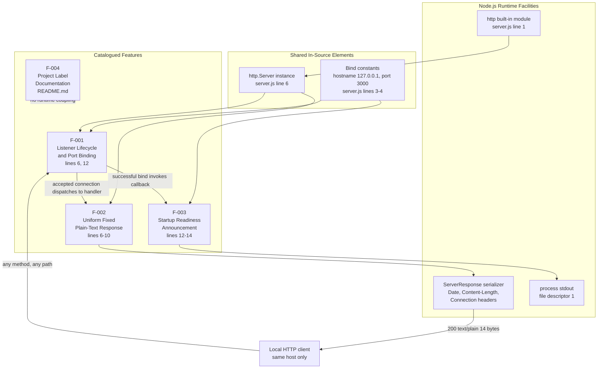

The map encodes exactly two feature-to-feature dependencies, both mediated by `server.listen` at line 12:

| Relationship | Direction | Code Evidence |
|---|---|---|
| F-003 depends on F-001 | Readiness announcement occurs only after a successful bind | `console.log` (line 13) sits inside the `server.listen` callback (lines 12–14) |
| F-002 depends on F-001 | The handler is invoked only for connections accepted by the bound listener | Handler defined at lines 6–10 on the server object that line 12 binds |
| F-004 is independent | No runtime coupling in either direction | `README.md` is read by no code; `server.js` references no file |

There are no cyclic, optional, or conditional dependencies, and no feature can be disabled by configuration — each exists unconditionally whenever the file is executed.

### 2.3.2 Integration Points

The system has exactly two integration points, one inbound and one outbound. Both are visible in Section 1.2.2's component flowchart, which traces the same request path from the client through the handler.

| Integration Point | Direction | Participating Features | Contract |
|---|---|---|---|
| TCP/HTTP listener on `127.0.0.1:3000` | Inbound | F-001 (accepts), F-002 (answers) | Any well-formed HTTP request; response is `200` + `text/plain` + `Hello, World!\n` |
| Standard output stream | Outbound | F-003 | One unstructured text line, written once at startup |

No other integration exists in either direction. Verified absent: outbound HTTP or socket clients, database or cache clients, message-broker clients, file I/O, environment-variable reads, and any telemetry export. Section 1.2.1 records the same inventory from the system-context perspective.

### 2.3.3 Shared Components

"Shared" here means used by more than one feature, or supplied by the runtime to a feature. The complete list is five items.

| Shared Component | Location | Consumed By |
|---|---|---|
| Bind constants `hostname`, `port` | `server.js` lines 3–4 | F-001 (passed to `listen`, line 12) and F-003 (interpolated into the message, line 13) |
| Node `http` module | required at `server.js` line 1 | F-001 (`createServer`, `listen`) and F-002 (`ServerResponse` API) |
| `http.Server` instance (`server`) | created at `server.js` line 6 | F-001 binds it; F-002 is the handler registered on it |
| `ServerResponse` serializer | Node runtime | F-002 — supplies `Date`, `Content-Length: 14`, `Connection: keep-alive`, `Keep-Alive: timeout=5` |
| Process stdout | Node runtime | F-003 — the single `console.log` write |

The constants at lines 3–4 are the only genuinely shared *application* state, and their sharing is what makes F-003-RQ-002 hold: the announced URL and the bound socket cannot diverge because both read the same two identifiers. Editing either constant changes both features simultaneously — a coupling worth noting for anyone modifying the file.

### 2.3.4 Common Services

The repository implements no common services and consumes none beyond the Node.js runtime itself. There is no middleware chain, no router, no dependency-injection container, no configuration service, no logging framework, no error-handling layer, and no shared utility module — `server.js` defines no named functions or exports at all, and the repository has no dependency manifest through which such a service could be introduced. Cross-cutting concerns that a larger system would delegate to common services are, in this system, either inlined into the handler (status and content type, lines 7–8), delegated implicitly to the runtime (HTTP framing, connection keep-alive, parser-level request rejection), or simply absent (authentication, validation, retry, metrics).


## 2.4 Implementation Considerations

The considerations below describe what the current implementation imposes on anyone operating or modifying it. They are derived from the code and from verification runs; none is a policy the repository states, because the repository states none.

### 2.4.1 F-001 — HTTP Listener Lifecycle and Port Binding

| Consideration | Detail |
|---|---|
| Technical Constraints | Bind address and port are `const` declarations (lines 3–4), so retargeting requires a source edit and redeploy — there is no environment variable, flag, or config file to override them. The loopback bind confines all consumers to the same host. The module binds on load and exports nothing, so it can only be executed as an entrypoint, never imported. No engine version is declared anywhere (no `package.json`, no `.nvmrc`), leaving runtime selection entirely to the host. |
| Performance Requirements | None specified. The observed cost is a single listening socket in a single-threaded event loop; idle RSS measured at approximately 58 MB. Because Node applies its default socket and header limits unchanged (no `server.timeout`, `headersTimeout`, `keepAliveTimeout`, or `maxHeaderSize` is set in `server.js`), connection-level behaviour is entirely the runtime's defaults — `Keep-Alive: timeout=5` was observed on the wire. |
| Scalability Considerations | Horizontal scale-out on one host is impossible without changing the source: the fixed port admits exactly one instance, and a second launch dies with `EADDRINUSE`. There is no `cluster` or `worker_threads` usage (zero occurrences in the file), so only one CPU core serves traffic. Scaling would require externalised configuration plus a process manager or proxy, none of which exists in the repository. |
| Security Implications | The loopback bind is the only barrier to access, and it is incidental rather than enforced — anything able to reach the port is served without identification. No TLS is available (`http`, not `https`), so all traffic is plaintext. Changing `hostname` to `0.0.0.0` would expose an unauthenticated, unencrypted endpoint to every reachable network, which is the single highest-impact edit a maintainer could make to this file. |
| Maintenance Requirements | Failure recovery is entirely external: with no `error` listener and no signal handling, a port conflict is a hard crash and a stop is an abrupt kill with no connection drain. Operators must supply their own supervision, log capture, and restart policy. The file has not changed since commit `80c7709`; there is no test to protect the bind behaviour during future edits. |

### 2.4.2 F-002 — Uniform Fixed Plain-Text HTTP Response

| Consideration | Detail |
|---|---|
| Technical Constraints | The handler is a single unconditional path with no branching, no request inspection, and no extensibility seam — there is no middleware chain or route table to register into. Any differentiation of behaviour must begin by editing lines 6–10, which Section 1.3.2 identifies as the system's sole insertion point. The response body, status, and content type are literals, so all three are compile-time decisions. |
| Performance Requirements | None specified. Observed throughput on the verification host was ≈14,000 requests/second at concurrency 50 over keep-alive connections (2,000 requests in 142 ms, p50 ≈2 ms, p99 ≈31 ms). The handler performs no I/O and no allocation beyond the response, so latency is dominated by the runtime's HTTP framing rather than by application work. These numbers characterise one machine and one synthetic load; they are not a commitment. |
| Scalability Considerations | The stateless, share-nothing handler would replicate trivially — nothing in the response path would need coordination, cache invalidation, or session affinity. The limiting factor is not the handler but F-001's fixed single-port bind and the single-threaded event loop. |
| Security Implications | With no request field read, the handler has no injection, deserialisation, or path-traversal surface of its own, and the constant response cannot leak data. Equally, it applies no authentication, no rate limiting, and no security headers, so it offers no protection against volumetric abuse; concurrency and header-size protection come only from Node's defaults. Protocol-level abuse is answered by the runtime (`400`, `431` as verified), not by application code, and `server.js` registers no `clientError` handler to alter that. |
| Maintenance Requirements | The 14-byte body, the `200` status, and the `text/plain` header form the whole public contract; any edit to them breaks every consumer and there is no test suite to signal it. Because the handler ignores `req`, a maintainer adding routing must also introduce the validation, error handling, and status-code vocabulary that do not yet exist. |

### 2.4.3 F-003 — Startup Readiness Announcement

| Consideration | Detail |
|---|---|
| Technical Constraints | Output is unstructured text on stdout with no level, timestamp, or correlation field, and it is written exactly once — there is no logger abstraction to swap, no log file, and no way to raise verbosity. Consumers must scrape stdout, since the process exposes no readiness endpoint distinguishable from the F-002 response. |
| Performance Requirements | None specified. A single synchronous-style `console.log` at startup adds no measurable steady-state cost, and no logging occurs on the request path, which is why request handling emits nothing (stdout stayed at one line across all verification traffic). |
| Scalability Considerations | Multi-instance operation would produce indistinguishable readiness lines, as the message contains no instance identifier, PID, or timestamp — though multi-instance operation is precluded on one host by F-001's fixed port anyway. Log aggregation would require an external collector attached to the process's stdout. |
| Security Implications | The message discloses only the bind address and port, values already present in the source; no secret, token, or user data is printed. Because nothing is logged per request, no request content can leak through logs — but equally, there is no audit trail of who called the service. |
| Maintenance Requirements | The message text is the de facto readiness contract for any wrapper script that greps it, so changing the wording is a breaking change for such tooling. Maintainers must keep the interpolation tied to the `hostname`/`port` constants; hard-coding the URL string would allow the announcement to drift from the actual bind. |

### 2.4.4 F-004 — Project Label Documentation

| Consideration | Detail |
|---|---|
| Technical Constraints | The file's 13 bytes carry a title and nothing else; it is not generated, validated, or consumed by tooling, and there is no documentation pipeline in the repository. |
| Performance Requirements | Not applicable — a static file with no runtime role. |
| Scalability Considerations | Not applicable. |
| Security Implications | None. The file contains no credentials, hostnames, or operational detail, verified by full read. |
| Maintenance Requirements | The practical gap is what the file omits: how to start the service, which port it binds, that it is loopback-only, and that a port conflict is fatal. Until this specification, none of that was recorded anywhere except in the source. Any change to the constants at lines 3–4 would leave the README no less accurate — because it says nothing — which is precisely the maintenance risk. |

### 2.4.5 Cross-Feature Constraints and Documented Assumptions

The following constraints apply to the system as a whole and to any requirement in Section 2.2. They are stated so that no reader mistakes an inference for a project commitment.

| Item | Statement |
|---|---|
| Assumption — provenance of requirements | The repository contains no requirements artifact, backlog, or roadmap. Every feature and requirement here is reverse-engineered from `server.js`, `README.md`, git metadata, and direct execution. |
| Assumption — runtime availability | A Node.js runtime exposing the `http` built-in must be present on the host. No version is declared by the repository; verification used Node.js v22.23.2, where `http` was confirmed built in. |
| Assumption — port availability | TCP port 3000 on `127.0.0.1` must be free at start time. This is a precondition, not something the code checks or recovers from. |
| Assumption — client co-location | Consumers must run on the same host, as verified by the refused connection to the routable interface. |
| Constraint — configuration is compile-time | Address, port, status, content type, and body are all literals; every behavioural change is a code change, so the same artifact cannot be promoted across environments unmodified. |
| Constraint — single instance per host | Enforced implicitly by the fixed port and the absence of an `error` listener. |
| Constraint — no automated verification | The repository has no tests, linter, type checker, or CI configuration, so every acceptance criterion in Section 2.2 must be checked manually against a running process. |
| Constraint — runtime-owned behaviour | HTTP framing, keep-alive, and parser-level rejections (`400`, `431`) belong to the Node runtime. They are documented in Section 2.2.5 as observations and are not requirements this codebase implements or can be held to. |


## 2.5 Traceability and Requirement Governance

### 2.5.1 Requirement-to-Source Traceability Matrix

Every requirement traces to specific lines of the repository's two files. The "Verification" column names how the acceptance criterion in Section 2.2 was confirmed.

| Requirement ID | Source Evidence | Verification |
|---|---|---|
| F-001-RQ-001 | `server.js` lines 3–4, 6, 12 | Executed `node server.js`; connection to `127.0.0.1:3000` accepted and answered |
| F-001-RQ-002 | `server.js` line 3 (`hostname`), line 12 | Loopback request returned `200`; request to host routable address refused |
| F-001-RQ-003 | `server.js` line 12 (listener holds the event loop); absence of `process.on` and `server.close` | Process remained resident and served throughout the session; `kill -TERM` terminated it and released the port |
| F-001-RQ-004 | `server.js` — no `server.on('error')` registered | Second instance exited code `1` with unhandled `EADDRINUSE: address already in use 127.0.0.1:3000` |
| F-002-RQ-001 | `server.js` line 7 (`res.statusCode = 200`); `req` never read | `200` observed for `GET`, `POST` (with body), `PUT`, `DELETE`, `PATCH`, `OPTIONS`, `HEAD`, and header-bearing requests |
| F-002-RQ-002 | `server.js` line 8 | `Content-Type: text/plain` present on every observed response |
| F-002-RQ-003 | `server.js` line 9 | `Content-Length: 14`, 14-byte download, identical body digest across six methods |
| F-002-RQ-004 | `server.js` line 9 (`res.end` single write) | Headers included `Content-Length: 14`, `Connection: keep-alive`, `Keep-Alive: timeout=5`; connection reused across sequential requests |
| F-002-RQ-005 | `server.js` lines 6–10 — no closure state, no module-level mutable data | 2,000 requests produced uniform responses with no variation |
| F-003-RQ-001 | `server.js` lines 12–14 | stdout contained exactly `Server running at http://127.0.0.1:3000/`; stderr empty |
| F-003-RQ-002 | `server.js` line 13 template literal over lines 3–4 constants | Announced address matched the address that accepted the connection |
| F-003-RQ-003 | `server.js` — no logging call inside the handler | stdout line count remained 1 after all request traffic |
| F-004-RQ-001 | `README.md` (13 bytes, `# Hello_world`) | Full file read; single level-one heading, no other content |

### 2.5.2 Feature-to-Specification Cross-References

| Feature | Related Specification Content |
|---|---|
| F-001 | Section 1.2.2 (component inventory and the request-path flowchart, which depicts the bind and the refused external connection); Section 1.3.1 (in-scope capability "bind an HTTP listener", startup workflow, technical-requirements table); Section 1.2.1 (limitations table: loopback reach, single instance, fatal port conflict) |
| F-002 | Section 1.2.2 (handler component and flowchart convergence of all requests on one handler); Section 1.3.1 (response contract, retrieval workflow); Section 1.3.2 (excluded request- and response-handling capabilities); Section 1.2.3 (measurable objectives for status, content type, body) |
| F-003 | Section 1.2.2 (listen-callback component); Section 1.3.1 (readiness announcement capability and stdout integration); Section 1.2.3 (KPI feasibility table, which records that no post-startup signal exists) |
| F-004 | Section 1.1 (README establishes the project label and the absence of documentation); Section 1.4.1 (file-level evidence) |

The flowchart referenced above is the one in Section 1.2.2; it is the system's only process diagram and traces the same path this section documents as F-001 → F-002 → response. Section 2.3.1 adds the feature-level dependency view of the same code.

### 2.5.3 Coverage Completeness

| Tracked Artifact | Mapped To | Unmapped Content |
|---|---|---|
| `server.js` lines 1, 3–4, 6, 12 | F-001 (with lines 3–4 shared into F-003) | None |
| `server.js` lines 6–10 | F-002 | None |
| `server.js` lines 12–14 | F-003 | None |
| `README.md` | F-004 | None |

Every executable line of the repository is attributed to a feature, and every feature is attributed to executable lines or to the documentation file. Lines 2, 5, and 11 are blank, and line 10 closes the handler. There is no orphaned code, no dead code, and no unattributed file — a claim that is verifiable here only because the repository is 15 lines in total.

### 2.5.4 Requirement Versioning Basis

The repository carries no version metadata: there is no `package.json` version field, no tag, no `CHANGELOG`, and no release. Requirement provenance is therefore expressed through git history, which contains exactly two commits by a single author.

| Commit | Content Added | Requirements Established |
|---|---|---|
| `d5373cb` "Initial commit" | `README.md` (1 insertion) | F-004-RQ-001 |
| `80c7709` "Add files via upload" | `server.js` (14 insertions) | F-001-RQ-001 … F-003-RQ-003 |

Both commits landed on 2026-08-26, 57 seconds apart, and every branch tip in the repository (`main`, `2608_01`, and their `origin` counterparts) contains the identical two-file tree. No requirement has been revised since introduction, so each requirement is at its first version, and the current baseline is `80c7709`. Any future change to a requirement in this section must be accompanied by a change to `server.js` or `README.md`, since the requirements have no other source.


## 2.6 References

Every claim in Section 2 derives from the sources below. Both tracked files were read in full, and all runtime behaviour was verified by executing the code.

### 2.6.1 Repository Files Examined

- `server.js` — Sole executable artifact, 14 lines / 342 bytes. Established F-001 (line 1 `require('http')`; lines 3–4 the `hostname`/`port` constants; line 6 `http.createServer`; line 12 `server.listen`), F-002 (lines 7–9: `statusCode = 200`, `Content-Type: text/plain`, `res.end('Hello, World!\n')`), and F-003 (lines 12–14: the `console.log` readiness line). Also established, by what it omits, the validation and implementation constraints in Sections 2.2 and 2.4: zero occurrences of `process.env`, `module.exports`/`exports`, `server.on('error')`, `process.on`, `req.`, `if (`, `try`/`catch`, `server.close(`, `cluster`, and `worker`, and exactly one `require(`.
- `README.md` — 13 bytes, one unterminated line containing `# Hello_world`. Established F-004 and F-004-RQ-001, and the documentation-gap maintenance risk in Section 2.4.4.

### 2.6.2 Repository Structure Examined

- `` (repository root) — Folder listing confirmed exactly two file children and zero directories, which bounds the feature catalog at four entries and underpins the coverage-completeness claim in Section 2.5.3.

### 2.6.3 Repository Metadata

- Git commit history — `d5373cb` ("Initial commit", `README.md`, 1 insertion) and `80c7709` ("Add files via upload", `server.js`, 14 insertions), authored 57 seconds apart on 2026-08-26 by a single author. Established the requirement-versioning basis in Section 2.5.4.
- Git branch and tree listing — All branch tips (`main`, `2608_01`, `origin/main`, `origin/2608_01`) contain the identical two-file tree, confirming no additional feature code exists anywhere in the repository.
- Verified absences underpinning "not applicable" statements throughout Sections 2.2 and 2.4: `package.json`, `package-lock.json`, `yarn.lock`, `pnpm-lock.yaml`, `.nvmrc`, `Dockerfile`, `Makefile`, `.gitignore`, `.env`, `LICENSE`, `tsconfig.json`, `jest.config.js`, `.github/`, `.circleci/`.

### 2.6.4 Runtime Verification Performed

All acceptance criteria in Section 2.2 were confirmed against a running process on Node.js v22.23.2, in which `http` was verified present in the runtime's built-in module list:

- Startup — stdout contained exactly `Server running at http://127.0.0.1:3000/` with an empty stderr; the line count remained 1 after all subsequent traffic.
- Response uniformity — `GET /`, `POST /anything` (body `name=x&big=1234567890`), `PUT /admin`, `DELETE /a/b/c?q=1`, `PATCH /x/y?z=1`, `OPTIONS /x/y?z=1`, and a request carrying `Accept: application/json`, `Authorization: Bearer …`, and `Accept-Language: fr-FR` all returned `200`, `Content-Type: text/plain`, and a 14-byte body with an identical SHA-256 digest; `HEAD /` returned `200` with a zero-byte body.
- Emitted header set — `HTTP/1.1 200 OK`, `Content-Type: text/plain`, `Date`, `Connection: keep-alive`, `Keep-Alive: timeout=5`, `Content-Length: 14`; used to separate application-set headers from runtime-set headers in Section 2.2.2.
- Network scope — `127.0.0.1:3000` accepted connections while the host's routable address on the same port refused them, establishing F-001-RQ-002.
- Runtime-level rejections — an unsupported method (`FOO`, absent from the 35 entries of `http.METHODS`) returned `400`; a malformed request line returned `HTTP/1.1 400 Bad Request`; a ~20 KB header block returned `431`. These grounded Section 2.2.5.
- Failure and lifecycle — a second concurrent instance exited with code `1` on an unhandled `EADDRINUSE` error; the running process stayed resident until `kill -TERM`, which terminated it without a drain and released the port.
- Observed performance measurements (Sections 2.2.2 and 2.4.2) — 2,000 requests at concurrency 50 over keep-alive connections completed in 142 ms (≈14,000 requests/second, p50 ≈2 ms, p99 ≈31 ms); idle resident set size approximately 58 MB. Reported strictly as single-host observations, not as targets.

### 2.6.5 Related Specification Sections

- Section 1.1 Executive Summary — stakeholder identification and the value/limitation framing referenced in the feature descriptions.
- Section 1.2 System Overview — component inventory, the request-path flowchart referenced in Sections 2.3.2 and 2.5.2, and the KPI-feasibility analysis referenced in Section 2.4.3.
- Section 1.3 Scope — the in-scope capability, workflow, and technical-requirement tables that Section 2.2 refines into requirements, and the exclusion inventory referenced by Section 2.1.5.
- Section 1.4 References — prior evidence base, consistent with the sources listed here.

### 2.6.6 External Sources

None. No external documentation, standard, or web source was cited; every statement in Section 2 rests on the repository's two files, its git metadata, or direct execution of `server.js`.


# 3. Technology Stack

## 3.1 Programming Languages

The technology stack documented in this section is derived entirely from the two tracked files of the `Hello_world` repository — `server.js` and `README.md` — together with direct execution of the code. The repository contains **no dependency manifest, no lockfile, no build configuration, and no tool configuration of any kind**, a property verified by exhaustive enumeration of the checkout and of the full Git history across all branches. Consequently, several categories that a technology-stack section customarily enumerates have no counterpart here. Where that is the case, this section records the verified absence and its architectural consequence rather than importing a default or assumed technology.

One clarification governs every version number in this section. The repository declares **no version for anything** — there is no `package.json` (and therefore no `engines` field), no `.nvmrc`, and no `.node-version`. Versions cited below are of exactly two kinds, always labelled as such: the **observed verification runtime** (Node.js v22.23.2, the version on which behaviour was confirmed for this specification and in Sections 1.1, 1.2.3 and 2.4.5), and **stable language or protocol lineage** (the ECMAScript edition that introduced a construct actually present in the source; the HTTP version observed on the wire). No claim is made about which Node.js release line is current or supported, because no external source was reachable during authoring to substantiate one.

### 3.1.1 Language Inventory by Component

The repository has no folders and no module decomposition, so "component" below means the tracked artifact and the role it performs. Two languages appear in total, one executable and one documentary.

| Component | Language | Role | Evidence |
|---|---|---|---|
| `server.js` | JavaScript (ECMAScript) | Entire executable system: HTTP listener, request handler, readiness log | `server.js` lines 1–14; `node --check` passes |
| `README.md` | Markdown | Sole documentation artifact; carries the project label only | `README.md`, single line `# Hello_world` |

The distribution is heavily one-sided and worth stating precisely, because it establishes that there is no polyglot boundary to manage anywhere in the system.

| Measure | JavaScript | Markdown |
|---|---|---|
| Tracked files | 1 | 1 |
| Tracked bytes | 342 (≈96.3% of 355) | 13 (≈3.7% of 355) |
| Share of executable code | 100% | 0% — not executed or consumed by any tool |

The following layered view shows the complete stack the language sits within. Every element outside the repository boundary is supplied by the host, not by the project.

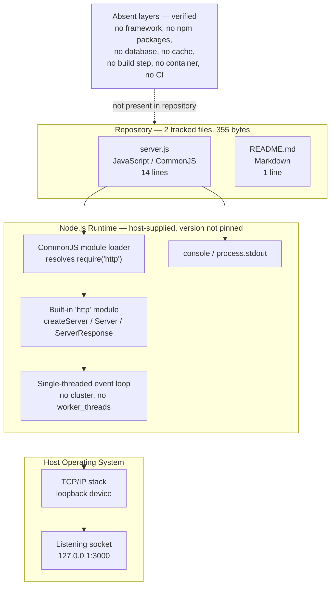

The diagram makes the stack's defining characteristic explicit: between the application source and the operating system there is exactly one layer, and that layer ships with the runtime. There is no framework tier, no dependency tier, and no build or packaging tier to traverse.

#### 3.1.1.1 Languages Verified Absent

The following are recorded so the inventory above is not mistaken for a partial extract. Each was confirmed absent by full recursive enumeration of the checkout and by inspection of every file ever added in Git history.

| Language / Format | Typical Artifact | Status in Repository |
|---|---|---|
| TypeScript | `.ts`, `tsconfig.json` | Absent; `server.js` carries no type annotations and needs no compiler |
| JSX / React dialects | `.jsx`, `.tsx` | Absent; no UI code of any kind |
| HTML / CSS | `.html`, `.css` | Absent; the only response body is a plain-text literal |
| Python | `requirements.txt`, `pyproject.toml`, `.py` | Absent |
| Swift / Kotlin / Objective-C | Xcode or Gradle project files | Absent; no native or mobile target exists |
| SQL / migration DSL | `.sql`, migrations directory | Absent; no datastore is contacted |
| Shell / Makefile | `.sh`, `Makefile` | Absent; no scripted entry point |
| Dockerfile DSL / HCL / YAML | `Dockerfile`, `.tf`, workflow YAML | Absent; no container, IaC, or pipeline definition |

The default technology stack proposed for greenfield work at this organisation (Python with Flask, React with TypeScript, Terraform, and so on) is therefore **not present in this repository in any part**. This section documents the stack as implemented; it does not retrofit the default onto an artifact that predates or sidesteps it.

### 3.1.2 Language Version, Dialect and Module System

No language version is declared anywhere in the repository, so the dialect must be established from the constructs the source actually uses. Every construct present is an ECMAScript 2015 (ES6) feature or older; nothing in the file requires a later edition.

| Construct in `server.js` | Line(s) | Language Lineage |
|---|---|---|
| `const` block-scoped binding | 1, 3, 4, 6 | ES2015 |
| Arrow function (request handler, listen callback) | 6, 12 | ES2015 |
| Template literal with interpolation | 13 | ES2015 |
| `require()` module import | 1 | CommonJS (pre-ES-module Node.js convention) |

Equally informative is what the source does *not* use: there is no `async`/`await`, no Promise, no class, no destructuring, no optional chaining, no nullish coalescing, and no ES-module `import`/`export`. The practical effect is a very wide runtime compatibility envelope — the file's syntax has been valid in Node.js since the ES2015-era releases — and the absence of any transpilation step, since there is nothing to down-level.

**The CommonJS choice is a hard constraint, not a stylistic preference.** This was verified by executing the identical source under the ES-module goal: copied to a `.mjs` file, it fails immediately at line 1 with `ReferenceError: require is not defined in ES module scope, you can use import instead` and exits with code `1`. Two consequences follow for any maintainer:

- Introducing a `package.json` that declares `"type": "module"`, or renaming the file to `server.mjs`, would break startup outright unless line 1 is rewritten as an `import`.
- Because the module also has no `module.exports` and binds its socket as a side effect of loading, it is an entrypoint only. This is the same non-reusability constraint recorded for F-001 in Section 2.4.1, viewed here from the language-tooling side.

The source is ASCII-only, verified by scanning for non-ASCII bytes. No encoding declaration, character-set configuration, or Unicode-normalisation handling is required or present.

### 3.1.3 Selection Criteria and Justification

The repository records no decision rationale — there is no architecture note, no ADR, and a `README.md` that contains only a heading. The justification below is therefore reconstructed from the properties the choice demonstrably delivers, and is presented as analysis of the implemented stack rather than as a decision the project documented.

| Criterion | How JavaScript on Node.js Satisfies It | Supporting Evidence |
|---|---|---|
| Zero-install execution | The only import is a runtime built-in, so a bare checkout runs with no dependency resolution and no registry access | `require('http')` at line 1; `builtinModules.includes('http') === true` |
| Minimum artifact size | The complete HTTP service is 14 lines and 342 bytes | `server.js`; byte census above |
| No build toolchain | Source is executed directly by the interpreter; no compile, bundle, or transpile step exists or is needed | No build config in repository; all ES2015-or-older syntax |
| Native HTTP capability | The standard library provides the server primitive outright, removing the need for a web framework | Section 3.2; `http.createServer` at line 6 |
| Auditability | The entire behaviour of the system is readable at a glance, with no indirection through libraries | 14 lines, single file, no branching |

Two criteria that commonly drive language selection are explicitly **not** served by this choice as implemented, and both are consequences rather than oversights of the minimal approach. First, static type safety is unavailable: JavaScript is dynamically typed and the repository adds no type checker, so no interface contract is machine-verified. Second, nothing constrains the language surface — with no linter or formatter configuration present, style and correctness conventions are unenforced. Given a 14-line single-path file with no request parsing, the exposure from both is small today; both scale directly with any future growth of the handler.

### 3.1.4 Constraints and Dependencies

The language layer imposes the following constraints on anyone operating or extending the system. Each is traced to a verified property of the repository.

| Constraint | Detail and Consequence | Evidence |
|---|---|---|
| Runtime version entirely unpinned | With no `engines` field, `.nvmrc`, or `.node-version`, the executing Node.js version is decided solely by the host. Two hosts can run different runtimes from the same commit, and nothing in the repository detects or rejects an unsuitable one. Verification for this specification used v22.23.2. | Absence of `package.json`, `.nvmrc`, `.node-version`, all individually confirmed |
| Runtime must be present and provide `http` | The language cannot execute without an installed interpreter; the source additionally assumes `http` is built in. This is the system's only true external prerequisite. | `server.js` line 1; `builtinModules` check on v22.23.2 |
| Interpreter must be invoked explicitly | Both files are mode `100644` with no executable bit and no shebang line, so the file cannot be launched as a self-contained command — `node server.js` is required. | `git ls-files -s` reports `100644` for both files; no shebang at line 1 |
| CommonJS resolution is required | The file cannot be loaded as an ES module, constraining any future packaging decision. | `ReferenceError` reproduced under `.mjs` execution |
| Single-threaded language runtime as configured | The code uses no `cluster` and no `worker_threads`, so one CPU core serves all traffic regardless of host capacity. | Zero occurrences of `cluster`/`worker` in `server.js` (Section 2.4.1) |
| No compile-time or load-time validation | With no type checker, linter, or test, the first validation of any language-level error is a runtime failure in production. | No tool configuration and no test files in repository |
| Configuration is compiled into the language artifact | Bind parameters are `const` literals with no `process.env` read anywhere in the file, so environment-specific behaviour requires a source edit. | `server.js` lines 3–4; `grep` for `process.` matches nothing |

The last constraint is the one with the widest downstream reach: because configuration lives in the language artifact rather than in the environment, the same file cannot be promoted unchanged across environments. Sections 3.4 and 3.6 record the corresponding absences — no configuration or secrets service, and no deployment mechanism that could inject values — that leave this constraint unmitigated.

## 3.2 Frameworks &amp; Libraries

**The repository uses no framework and no library.** There is no web framework, no middleware stack, no router, no template engine, no serializer, no validation library, no logging library, and no test framework. This is a verified property rather than an inference: `server.js` contains exactly one `require` call, and its target is a module that ships inside the Node.js runtime.

What performs the role a framework would ordinarily perform is the runtime's own standard library. This subsection therefore documents the Node.js `http` built-in module as the de facto framework layer, records the exact API surface the application binds to, and states the compatibility requirements that surface implies.

### 3.2.1 The Framework Layer: Node.js `http` Built-In Module

| Attribute | Value | Evidence |
|---|---|---|
| Module | `http` (Node.js standard library) | `const http = require('http');` — `server.js` line 1 |
| Acquisition | None; bundled with the runtime | `require('module').builtinModules.includes('http')` returned `true` on v22.23.2 |
| Independent version | None — the module has no version of its own; it is versioned with the runtime | No manifest exists to pin it; it is not an installable package |
| Version observed in verification | The `http` implementation shipped in Node.js v22.23.2 | `process.version` reported during verification |
| Wire protocol served | HTTP/1.1 | Live response line observed as `HTTP/1.1 200 OK` |

This module supplies more of the system's observable behaviour than the application code does, which is the single most important integration fact in this section. The division of responsibility is as follows.

| Concern | Owner | Evidence |
|---|---|---|
| Socket bind and accept loop | `http` module + runtime event loop | `server.listen(port, hostname, cb)` — line 12 |
| HTTP request parsing and framing | `http` module | No parsing code exists in `server.js` |
| Status line and header serialization | `http` module, from values the app sets | Lines 7–8 set values; module writes the wire bytes |
| `Date`, `Content-Length`, `Connection`, `Keep-Alive` headers | `http` module — the application sets none of them | Observed on the wire: `Content-Length: 14`, `Connection: keep-alive`, `Keep-Alive: timeout=5` |
| Connection reuse / keep-alive policy | `http` module defaults, unmodified | No `keepAliveTimeout`, `headersTimeout`, or `server.timeout` set in `server.js` |
| Rejection of malformed requests and oversized headers | `http` module parser, before the handler runs | `400` and `431` behaviour recorded in Sections 2.1.2 and 2.4.5 |
| Status code, content type, response body | Application code | Lines 7–9 |
| Readiness message | Application code via the `console` global | Line 13 |

#### 3.2.1.1 Exact API Surface Consumed

The application's coupling to its "framework" is six call sites. This narrow surface is what makes the compatibility envelope in Section 3.2.3 so wide.

| API | Line | Purpose |
|---|---|---|
| `require('http')` | 1 | Module acquisition |
| `http.createServer(handler)` | 6 | Server construction with the inline request handler |
| `res.statusCode` (setter) | 7 | Response status |
| `res.setHeader(name, value)` | 8 | Response `Content-Type` |
| `res.end(body)` | 9 | Response body write and completion |
| `server.listen(port, host, cb)` | 12 | Bind and readiness callback |

Beyond `http`, the only other runtime facility used is the `console` global (line 13), which writes to `process.stdout`. No other built-in module is required — notably absent are `https`, `fs`, `path`, `crypto`, `cluster`, `worker_threads`, `net`, `url`, and `os`.

### 3.2.2 Frameworks and Libraries Verified Absent

The absences below are enumerated by category because each one shifts a responsibility either onto the runtime or onto the operator. None of these packages appears in the repository, which has no manifest in which they could appear.

| Category | Representative Packages | Consequence of Absence |
|---|---|---|
| Web framework | Express, Fastify, Koa, Hapi, NestJS | No routing, middleware pipeline, or error-handling chain; the inline handler at lines 6–10 is the only extension point (Section 2.4.2) |
| Configuration | dotenv, config, convict | Bind parameters remain source literals; no environment layering |
| Validation / serialization | Zod, Joi, Ajv, class-transformer | No request validation; not currently exploitable, since `req` is never read |
| Logging | Pino, Winston, Bunyan | Observability is one unstructured `console.log` line at startup |
| Security middleware | Helmet, cors, express-rate-limit, csurf | No security headers, no CORS policy, no rate limiting |
| Database / ORM clients | mongodb, mongoose, pg, mysql2, redis | No persistence or caching is possible without new dependencies (Section 3.5) |
| HTTP client | axios, node-fetch, got | No outbound calls; the process makes none |
| Testing | Jest, Mocha, Vitest, Supertest, node:test | No automated verification of any acceptance criterion (Section 2.4.5) |
| Static analysis | ESLint, Prettier, TypeScript | No style, correctness, or type enforcement |
| Process management | pm2, forever, nodemon | No restart, reload, or supervision from within the project |
| Frontend / UI | React, TailwindCSS, React Native, Electron | No user interface exists; the only output is a plain-text body |
| AI / orchestration | LangChain and similar | No such capability is present or implied by the code |

Section 1.2.1 positions this implementation at "the zero-dependency extreme" relative to framework-based Node.js services, and the table above is the concrete inventory behind that positioning.

### 3.2.3 Compatibility Requirements

Because the application binds to only six standard-library call sites, its compatibility requirements are unusually simple to state — and unusually undefended, since nothing in the repository asserts or checks them.

| Requirement | Detail | Risk Posture |
|---|---|---|
| A Node.js runtime exposing `http` as a built-in | The single hard prerequisite; verified satisfied on v22.23.2 | Unchecked at startup — a runtime lacking it fails at line 1 |
| CommonJS module resolution | `require` must be available in the module scope; ESM loading fails outright | Unchecked; would surface as a startup `ReferenceError` |
| ES2015-or-later syntax support | `const`, arrow functions, template literals must parse | Very wide envelope; no transpiler needed (Section 3.1.2) |
| Stability of the six consumed APIs | `createServer`, `statusCode`, `setHeader`, `end`, `listen` are long-established members of the `http` surface | Low coupling: the smaller the surface, the smaller the upgrade exposure |
| Acceptance of runtime defaults | Timeouts, keep-alive, and the header-size limit are inherited, never set | Behaviour can shift between runtime versions without any code change |

The final row deserves emphasis as an integration requirement. Because `server.js` overrides no default, connection-level characteristics observed today — including `Keep-Alive: timeout=5` — are properties of the installed runtime rather than of this codebase. Combined with the unpinned runtime version from Section 3.1.4, this means the system's wire behaviour is only as stable as the host's Node.js installation. Pinning a runtime version is the single highest-value compatibility control the repository currently lacks.

### 3.2.4 Justification for the Framework-Free Approach

No rationale is recorded in the repository. The analysis below sets out what the framework-free choice demonstrably buys and what it demonstrably costs, so that the trade-off is documented rather than implied.

**What it delivers, verified:**

- **No installation or resolution step.** Checkout to listening socket requires no registry access, no lockfile resolution, and no `node_modules` tree — the property that makes the artifact usable as a runtime-validation probe (Section 1.1).
- **No transitive dependency surface.** With zero packages, there are no transitive vulnerabilities to track, no advisory triage, and no upgrade cadence to maintain.
- **Complete auditability.** The whole request path is six call sites and three statements; no library behaviour is hidden behind abstraction.
- **Minimal footprint.** Idle resident memory of approximately 58 MB (Section 2.4.1) reflects the runtime alone, with no framework initialisation.

**What it costs, verified:**

- **No extension seam.** A framework would supply a route table and middleware chain to register into; here, every new behaviour must be hand-written into lines 6–10 (Section 2.4.2).
- **Hand-rolled cross-cutting concerns.** Validation, error handling, security headers, structured logging, and graceful shutdown are all conventionally framework-supplied and are all absent; each would have to be implemented from first principles.
- **Runtime defaults inherited wholesale.** A framework typically imposes explicit, documented timeout and body-limit policies; here those decisions are deferred to the runtime by default rather than by choice.

For an artifact whose entire contract is a fixed 14-byte response, the benefits dominate and the costs are latent. The balance inverts as soon as request differentiation is introduced — which is precisely the threshold at which Section 2.4.2 notes that routing, validation, and a status-code vocabulary would all have to be created.

## 3.3 Open Source Dependencies

**The repository has zero open-source dependencies.** There is no direct dependency, no development dependency, no optional or peer dependency, and no vendored or bundled code. The dependency graph is empty, and it is empty by construction rather than by pruning: no manifest exists in which a dependency could ever have been declared.

### 3.3.1 Dependency Inventory

| Dependency Class | Count | Detail |
|---|---|---|
| Production (`dependencies`) | 0 | No manifest exists |
| Development (`devDependencies`) | 0 | No manifest exists |
| Peer / optional | 0 | No manifest exists |
| Transitive | 0 | No lockfile and no `node_modules/` tree |
| Vendored / bundled source | 0 | Repository contains no directories at all |
| Runtime built-ins consumed | 1 | `http` — bundled with Node.js, not an installable package |

The single import in the codebase is not a dependency in the packaging sense. `require('http')` at `server.js` line 1 resolves to a module inside the runtime, confirmed by `require('module').builtinModules.includes('http')` returning `true` on Node.js v22.23.2. It is acquired with the runtime, cannot be versioned separately, and never traverses a package registry. Section 1.3.1 records the same fact from the integration perspective: because the module ships with Node.js, the service has no installation step, no lockfile, and no registry dependency.

### 3.3.2 Manifests, Lockfiles and Registries — Verified Absent

Every artifact below was checked individually against the checkout and against the complete list of files ever added in Git history. The Git census is conclusive: across all branches, the only files ever added to this repository are `README.md` and `server.js`.

| Artifact | Purpose It Would Serve | Status |
|---|---|---|
| `package.json` | Declare dependencies, scripts, engines, metadata | Absent |
| `package-lock.json` | Pin the exact resolved npm tree | Absent |
| `yarn.lock` / `pnpm-lock.yaml` | Pin the resolved tree for alternative managers | Absent |
| `node_modules/` | Hold installed packages | Absent |
| `.npmrc` | Configure registry endpoints, scopes, auth | Absent |
| `npm-shrinkwrap.json` | Publish-time dependency lock | Absent |
| Non-JavaScript manifests (`requirements.txt`, `pyproject.toml`, `go.mod`, `Cargo.toml`, `pom.xml`, `Gemfile`) | Declare dependencies for other ecosystems | All absent |

A semantic search of the indexed repository for a manifest declaring dependencies, build scripts, or runtime engine versions returned **no results at all**, corroborating the filesystem findings.

| Registry | Configured? | Consequence |
|---|---|---|
| npm public registry (`registry.npmjs.org`) | No | Never contacted; no network access is required between checkout and a listening socket |
| Private or mirrored registry | No | No `.npmrc` and no scoped-registry configuration exists |
| Any non-JavaScript registry (PyPI, Maven Central, crates.io) | No | No manifest for any such ecosystem |

Section 1.3.2 reaches the same conclusion in its integration table, recording package registries as "Not applicable; zero third-party dependencies".

### 3.3.3 Supply-Chain and Security Implications

An empty dependency graph is the strongest available position on several classes of supply-chain risk, and it is worth stating exactly which risks it eliminates and which it merely relocates.

**Risks structurally eliminated:**

| Risk Class | Why It Cannot Apply Here |
|---|---|
| Transitive dependency vulnerabilities | No transitive tree exists to inherit a CVE from |
| Malicious package publication / typosquatting | No package name is ever resolved from a registry |
| Install-time script execution (`postinstall` hooks) | No install step is performed at any point |
| Lockfile drift and non-reproducible installs | No lockfile and nothing to resolve — the checkout is the complete artifact |
| Dependency-confusion attacks | No private-scope resolution and no registry configuration to confuse |
| Abandoned or unmaintained library exposure | No library is depended upon |
| Licence-compatibility conflict between packages | No third-party package licences to reconcile |

**Where the risk actually resides.** With no packages in scope, the entire third-party trust surface collapses onto one component: the Node.js runtime itself. That relocation is not neutral, because the repository exercises no control over it.

| Residual Concern | Detail |
|---|---|
| Runtime is the sole trust anchor | All third-party code executing in this system is runtime code, including the whole `http` implementation (Section 3.2.1) |
| Runtime version is unpinned | No `engines` field, `.nvmrc`, or `.node-version` exists, so the project cannot express a minimum-patched version, and a host running a vulnerable runtime is neither detected nor rejected |
| No scanning or alerting | With no manifest, no lockfile, and no `.github/` directory, dependency-scanning and advisory tooling has nothing to attach to and no pipeline to run in |
| Software bill of materials | An SBOM for this repository would list exactly one component — the Node.js runtime as installed on the host — and the repository provides no means of recording which version that is |

The actionable conclusion is narrow and follows directly from the evidence: because zero packages are consumed, dependency management is a solved problem here, and the only meaningful supply-chain control the project could add is a declared runtime version. Section 3.6 records that no build or deployment mechanism exists in which such a version could currently be enforced.

### 3.3.4 Licensing Posture

The repository contains **no `LICENSE` file** and no licence declaration of any kind — there is no `package.json` `license` field, no SPDX header in `server.js`, and no notice in `README.md`, whose entire content is the heading `# Hello_world`. Two distinct consequences follow, and they should not be conflated:

- **Inbound obligations: none.** With zero third-party packages, there are no attribution, notice, or copyleft obligations arising from dependencies. The Node.js runtime is obtained, installed, and licensed by the host operator entirely independently of this repository, so its terms are an environment concern rather than a project one.
- **Outbound terms: undeclared.** Because no licence is stated, the repository grants no explicit rights to reusers. Any consumer intending to redistribute or build upon the code would need the terms clarified by the repository owner; this specification cannot supply them, as the repository states none.

## 3.4 Third-Party Services

**The system integrates with no third-party service.** It makes no outbound network call of any kind, holds no credential, reads no environment variable, and contacts no external endpoint. This is verified structurally rather than merely by the absence of configuration: `server.js` imports only `http` and never constructs a client, and a `grep` of the file for `process.` matches nothing but line 1's `require`.

### 3.4.1 External Service Inventory

The complete integration surface of the system is one inbound listener and one outbound stdout write. Every service category below is therefore empty.

| Service Category | Provider Configured | Evidence of Absence |
|---|---|---|
| Authentication / identity provider (Auth0, Okta, OAuth, OIDC, SAML, LDAP) | None | No auth code, no client library, no credential, no callback URL anywhere in `server.js` |
| Cloud platform (AWS, GCP, Azure) | None | No SDK import, no region or endpoint value, no credentials file, no IAM reference |
| Upstream or partner HTTP APIs | None | No HTTP client is created; the process makes no outbound request |
| Monitoring / APM (Datadog, New Relic, Sentry, OpenTelemetry) | None | No agent, no instrumentation hook, no exporter; observability is one `console.log` at line 13 |
| Log aggregation (CloudWatch, ELK, Splunk) | None | Logs go to the process's stdout in plain text and nowhere else |
| Error tracking | None | No error reporting call; the process has no `error` listener at all (Section 2.4.1) |
| Email / SMS / notification providers | None | No such client or template exists |
| Payment or billing services | None | No such integration exists |
| Feature-flag or remote-config services | None | Configuration is compiled into the source (lines 3–4) |
| Secrets management (Vault, AWS Secrets Manager, SSM) | None | No secret is read, and no environment variable is consulted |
| CDN / DNS / edge services | None | No such configuration is present in the repository |
| Message brokers / event streams (SQS, Kafka, RabbitMQ) | None | No client library and no publish/consume code |

Section 1.2.1 documents the same inventory as an integration table, and Section 1.3.2 lists these same categories under integration points not covered. This subsection adds the stack-level reading of that finding: the system has no service-provider dependencies to procure, configure, credential, or pay for.

### 3.4.2 Authentication and Authorization

There is no authentication service because there is no authentication. The request handler at lines 6–10 never reads the `req` object, so no credential, token, cookie, or header can influence the response — verified in Section 2.1.2 by requests carrying `Authorization: Bearer …` receiving the same byte-identical response as an unauthenticated `GET /`.

The consequence for the stack is that **the loopback bind is the system's only access control**, and it is a network property rather than an identity decision. Section 2.4.1 characterises this barrier as "incidental rather than enforced": anything able to reach `127.0.0.1:3000` is served without identification. No identity provider could be introduced without adding both a dependency (Section 3.3) and request-inspection logic that does not currently exist.

### 3.4.3 Cloud Services and Hosting

No cloud service is used, and no hosting target is expressed anywhere in the repository. There is no infrastructure-as-code (no Terraform, CloudFormation, or Pulumi configuration), no deployment descriptor, no container image definition, and no platform manifest — each individually confirmed absent.

The hosting model implied by the code is a single operating-system process on a single host, reachable only from that host. Two properties of the stack make cloud adoption a code change rather than a configuration change:

| Barrier to Cloud Deployment | Cause in the Stack |
|---|---|
| Not reachable by a load balancer, ingress, or health prober | Bind is to `127.0.0.1`, so connections from any other host are refused |
| Cannot be configured per environment | Bind parameters are `const` literals with no environment-variable override |
| No container or artifact to deploy | No image definition, build output, or packaging step exists (Section 3.6) |
| No health endpoint for orchestrator probes | Every path returns the same fixed response, indistinguishable from a health check |

### 3.4.4 Monitoring and Observability Tooling

No monitoring tool, agent, or SDK is present. The complete observability stack is the `console` global writing one line to stdout at startup, which Section 2.1.3 documents as feature F-003. There is no metrics endpoint, no tracing, no structured log format, and no per-request logging — verified in Section 2.5.1 by the stdout line count remaining at one after all request traffic.

For the stack, this means any monitoring capability must be supplied entirely from outside the process: an external collector attached to stdout for logs, and external probing for liveness and latency, since the code contains no timing instrumentation. Section 1.2.3 records which indicators are consequently measurable today and which would require new instrumentation.

### 3.4.5 Security Implications of the Zero-Service Posture

The absence of third-party services is a genuine security asset in several respects, and it is worth separating the assets from the exposures that remain.

**Assets, each verified:**

- **No credentials exist to leak.** With no service integration and no environment-variable read, the repository holds no API key, token, connection string, or certificate. The readiness log discloses only the bind address and port, values already visible in the source (Section 2.4.3).
- **No outbound attack path.** The process initiates no connection, so it cannot be used as a pivot to exfiltrate data or to reach an internal service, and it has no server-side request-forgery surface.
- **No third-party availability coupling.** No external outage can degrade the service, because nothing external participates in serving a request.
- **No data leaves the process.** Nothing is transmitted to an analytics, telemetry, or logging vendor.

**Exposures that remain, and are not mitigated by any service:**

| Exposure | Detail |
|---|---|
| No transport encryption | The code uses `http`, not `https`, and no TLS-terminating proxy exists in the repository; all traffic is plaintext |
| No identity or rate control | With no auth service and no rate-limiting middleware, the service applies no caller-level protection whatsoever |
| No audit trail | Because nothing is logged per request, there is no record of who called the service |
| Highest-impact single edit | Section 2.4.1 identifies changing `hostname` to `0.0.0.0` as the most consequential edit available: it would expose an unauthenticated, unencrypted endpoint to every reachable network, with no compensating control anywhere in the stack |

## 3.5 Databases &amp; Storage

**The system uses no database, no cache, and no storage service.** It performs no file I/O, holds no in-memory state between requests, and contacts no datastore. No primary database, no secondary or read-replica database, no object store, and no cache tier exists — there is nothing in the stack to configure, migrate, back up, or secure.

### 3.5.1 Persistence Layer Inventory

| Storage Tier | Technology Configured | Evidence of Absence |
|---|---|---|
| Primary database | None | No client library, connection string, or query anywhere in `server.js`; no manifest in which a driver could be declared |
| Secondary / replica database | None | Not applicable — no primary exists |
| Object / blob storage (S3 or equivalent) | None | No SDK import and no bucket or endpoint reference |
| File system persistence | None | The `fs` module is never required; the process opens no file |
| Cache (Redis, Memcached, in-process cache) | None | No cache client; the handler memoizes nothing |
| Session store | None | No session concept; no cookie is read or written |
| Message queue / durable log | None | No broker client is present |
| Search index | None | No such integration exists |
| Schema, migrations, seed data | None | No migrations directory and no `.sql` file in the repository |
| ORM / query builder | None | No such library; there is no dependency graph at all (Section 3.3) |

The absence is total and structural: the repository has no directories whatsoever, and a semantic search for authentication, database persistence, or external-service integration logic returned no results.

### 3.5.2 Data Persistence Strategy

The persistence strategy is best described precisely: **there is no data to persist.** Section 1.3.1 enumerates the complete set of data the system handles, and all three items are compile-time constants or transient derivations of them.

| Data Element | Nature | Lifetime |
|---|---|---|
| `Hello, World!\n` response body | Source literal, 14 bytes | Lives in the source file; recreated per response |
| `hostname` / `port` constants | Source literals | Live in the source file |
| Readiness log line | Interpolated from the constants at startup | Transient; written once to stdout and never retained |

Two properties of the request handler establish the stateless design at the stack level. First, the handler is a closure over nothing mutable — Section 2.5.1 records that it holds no closure state and no module-level mutable data, verified across 2,000 requests producing uniform responses. Second, no request field is ever read, so no inbound data can enter the process even transiently as application state.

The architectural upside is that the response path requires no coordination whatsoever: Section 2.4.2 notes that the share-nothing handler would replicate trivially, needing no cache invalidation and no session affinity. The limiting factor on scale is the fixed single-port bind, not the data layer — because there is no data layer.

### 3.5.3 Caching Strategy

No caching exists at any level of the stack, and each level is worth distinguishing because the reasons differ.

| Cache Level | Present | Reason |
|---|---|---|
| Application / in-process cache | No | The response is a literal, so there is no computation or lookup worth memoizing |
| Distributed cache (Redis or equivalent) | No | No client library and nothing to cache |
| HTTP response caching | No | The handler sets only `Content-Type`; it emits no `Cache-Control`, `ETag`, `Last-Modified`, or `Expires` header, so caching behaviour is left entirely to client and intermediary defaults |
| CDN / edge cache | No | The loopback bind precludes any edge or intermediary topology |

The absence of cache headers is the one item here with an observable protocol consequence: because the response carries no cache directives, no client or proxy is instructed how to treat it, and the fixed 14-byte body is re-served on every request. Adding cache headers would require editing lines 6–10, the same single insertion point identified in Section 2.4.2.

### 3.5.4 Data Security and Compliance Implications

The zero-storage posture removes entire categories of data-protection obligation, and the reasoning is worth recording explicitly because it is unusually clean.

| Concern | Status | Basis |
|---|---|---|
| Personal or sensitive data | None enters the system | No request field is read; no data is stored |
| Encryption at rest | Not applicable | Nothing is written to any durable medium |
| Encryption in transit | Absent, and material | Traffic is plaintext `http`; nothing in the repository terminates TLS (Section 3.4.5) |
| Backup and recovery | Not applicable | No state exists to back up; recovery means restarting the process |
| Data retention and deletion | Not applicable | Nothing is retained beyond process lifetime |
| Access control on data | Not applicable | There is no data store to protect |
| Audit logging of data access | Absent | Nothing is logged per request (Section 2.4.3) |

Section 1.3.2 draws the corresponding operational boundary: with no storage, no validation, and no transport encryption, the system is unsuitable for handling personal, sensitive, or regulated data. The stack contains no component that would change that assessment, and introducing any datastore would require adding both a dependency and the persistence, validation, and protection logic that do not currently exist anywhere in the codebase.

## 3.6 Development &amp; Deployment

The development and delivery stack consists of exactly two tools, neither of which is configured by the repository: the **Node.js interpreter**, which executes the source directly, and **Git**, which tracks the two files. There is no build system, no test or quality tooling, no containerization, and no CI/CD pipeline. Every element below is stated with the evidence that establishes its presence or its absence.

### 3.6.1 Development Toolchain

| Tool Category | Configured in Repository | Evidence |
|---|---|---|
| Runtime / interpreter | Yes, implicitly — but unpinned | `require('http')` requires Node.js; no `engines`, `.nvmrc`, or `.node-version` exists |
| Version control | Yes — Git | `.git` present; remote is the GitHub repository `lakshya-blitzy/Hello_world` |
| Package manager | No | No `package.json`, no lockfile, no `.npmrc` (Section 3.3.2) |
| Linter / formatter | No | No `.eslintrc*`, `eslint.config.js`, `.prettierrc`, or `.editorconfig` |
| Type checker | No | No `tsconfig.json` or `jsconfig.json`; source carries no type annotations |
| Test framework / test files | No | No test directory, no test file, no test runner configuration |
| Dev server / watcher | No | No `nodemon` configuration and no npm script to invoke one |
| Pre-commit hooks | No | No `.husky/`, no `.pre-commit-config.yaml`; `.git/hooks` holds only stock `*.sample` files |
| Editor / container dev environment | No | No `.vscode/` and no `.devcontainer/` |
| Repository hygiene files | No | No `.gitignore`, `.gitattributes`, `LICENSE`, `CHANGELOG.md`, `SECURITY.md`, `CODEOWNERS`, or contribution guide |

The absence of `.gitignore` is worth one remark at the stack level: it is consistent with a project that has no build output and no `node_modules/` tree to exclude — there is simply nothing generated that would need ignoring.

**Quality-gate consequence.** With no linter, type checker, or test, the repository has no automated verification of any kind. Section 2.4.5 records this as a cross-feature constraint: every acceptance criterion in Section 2.2 must be checked manually against a running process. The response contract — status `200`, `Content-Type: text/plain`, and the exact 14-byte body — is protected by no test, so a regression in any of the three would be caught only by a human running the server and inspecting the output.

### 3.6.2 Build System

**There is no build system, and none is required.** JavaScript is interpreted, the source uses only ES2015-or-older syntax (Section 3.1.2), and there is nothing to resolve, compile, transpile, bundle, or minify. The consequence is unusually clean: **the source file is the deployable artifact.** No intermediate output exists, so there is no `dist/` or `build/` directory, no source map, and no packaging step in which a version could be stamped.

| Build Concern | Status | Consequence |
|---|---|---|
| Compilation / transpilation | Not applicable | No compiler or Babel configuration; syntax needs no down-levelling |
| Bundling / minification | Not applicable | Single file, no module graph to bundle |
| Dependency installation | Not applicable | Zero packages (Section 3.3.1) |
| Task runner / scripts | Absent | No `package.json` `scripts` block and no `Makefile`, so there is no canonical named command |
| Artifact versioning | Absent | No version field, no Git tag, and no `CHANGELOG`; provenance rests solely on commit SHAs (Section 2.5.4) |

### 3.6.3 Execution Model

The run procedure is **derived from the code, not documented by the project** — `README.md` contains only the heading `# Hello_world` and gives no instructions. Three properties of the artifact together determine how it must be launched: the module binds its socket as a side effect of loading, it exports nothing, and it is mode `100644` with no shebang line and no executable bit.

```bash
node server.js    # derived from the code; no documented or scripted alternative exists
```

| Lifecycle Stage | Mechanism | Evidence |
|---|---|---|
| Start | Operator runs the interpreter against the source file | `server.js` line 12 binds on load |
| Readiness signal | One stdout line, `Server running at http://127.0.0.1:3000/` | Line 13; reproduced during verification |
| Steady state | The listening socket holds the event loop open; process stays resident | Verified in Section 2.1.1 |
| Stop | External process termination only | No signal handler and no `server.close()` path exist (Section 2.5.1) |
| Restart after crash | External supervision only | No process manager, restart policy, or supervisor is configured anywhere |

Two operational characteristics follow directly from this model and are documented in Sections 2.4.1 and 1.2.3: a port conflict is fatal rather than recoverable, because no `error` listener is registered; and only one instance can run per host, because the port is a compile-time constant.

### 3.6.4 Containerization

No containerization exists. There is no `Dockerfile`, no `docker-compose.yml`, no `.dockerignore`, and no orchestration manifest — no Kubernetes directory, `Procfile`, `app.yaml`, or `serverless.yml`. The verification of these absences covered each artifact individually.

Beyond the missing image definition, two properties of the application would need to change before containerization could be meaningful, and both are stack-level rather than cosmetic:

| Containerization Blocker | Cause |
|---|---|
| Traffic could not reach the container | The bind to `127.0.0.1` restricts the listener to the container's own loopback interface; published ports would not be served |
| No orchestrator health probe is possible | Every path returns the identical fixed response, so a probe cannot distinguish health from the normal response (Section 3.4.3) |
| Configuration could not be injected | No environment variable is read, so image-level or orchestrator-level config would have no effect |

The first item is the decisive one: a container image built from this source as written would start, log readiness, and remain unreachable from outside the container.

### 3.6.5 CI/CD and Version Control Workflow

**No CI/CD exists.** There is no `.github/` directory of any kind — hence no GitHub Actions workflow — and no `.gitlab-ci.yml`, `Jenkinsfile`, `.circleci/`, `.travis.yml`, `azure-pipelines.yml`, or `bitbucket-pipelines.yml`. There is likewise no infrastructure-as-code (no Terraform configuration) and no deployment descriptor, so nothing automates build, test, security scanning, release, or deployment.

The version-control history reflects a correspondingly manual workflow. The repository holds exactly two commits, 57 seconds apart, both authored by `lakshya-blitzy` on 2026-08-26, carrying the default messages that GitHub's web interface generates: `Initial commit` (adding `README.md`) and `Add files via upload` (adding `server.js`). There are no tags, no active Git hooks, and no pull-request trail; both branch tips (`main` and `2608_01`) contain the identical two-file tree, as recorded in Section 2.5.4.

The following diagram traces the complete path from source to running process, with the conventional stages that are absent shown separately.

```mermaid
flowchart LR
    subgraph Present["Present in the Repository"]
        direction TB
        Author["Author edits<br/>via GitHub web UI"]
        GitRepo["Git repository<br/>2 commits, 2 files, 0 tags"]
        Checkout["Manual checkout<br/>on target host"]
        Run["node server.js<br/>derived command"]
        Proc["Resident process<br/>127.0.0.1:3000"]

        Author --> GitRepo
        GitRepo --> Checkout
        Checkout --> Run
        Run --> Proc
    end

    subgraph AbsentStages["Verified Absent — no configuration exists"]
        direction TB
        NoInstall["Dependency install<br/>no manifest or lockfile"]
        NoLint["Lint / type check<br/>no tool config"]
        NoTest["Automated tests<br/>no test files"]
        NoBuild["Build / package<br/>source is the artifact"]
        NoScan["Dependency / security scan<br/>nothing to attach to"]
        NoImage["Container image<br/>no Dockerfile"]
        NoPipeline["CI/CD pipeline<br/>no workflow files"]
        NoSupervise["Supervision / restart<br/>no process manager"]
    end

    Checkout -.->|"no gate between commit and run"| AbsentStages
    AbsentStages -.->|"all responsibilities fall to the operator"| Proc
```

The diagram's central point is the dashed path: nothing stands between a commit and a running process. Every gate a delivery pipeline would normally impose is the operator's manual responsibility.

### 3.6.6 Integration Requirements and Stack Gaps

The items below are the concrete additions the current stack would require before it could be built, deployed, or operated by automation. They are recorded as gaps observed in the stack, not as planned work — the repository contains no roadmap, no `TODO` comment, and no stub from which planned work could be identified.

| Gap | Required Addition | Blocking Consequence Today |
|---|---|---|
| Runtime version is unspecified | A `package.json` with an `engines` constraint, or a `.nvmrc` | Any host runtime is accepted; behaviour and security patch level are undefined (Sections 3.1.4, 3.3.3) |
| Configuration is compiled in | Environment-variable reads for host and port | The same artifact cannot be promoted across environments |
| Listener is loopback-only | A configurable bind address, or a fronting proxy | Blocks containerization, orchestration, and any remote consumer |
| No named build/run entry point | A `scripts` block or equivalent | The run command exists only as knowledge derived from the source |
| No automated verification | A test runner plus tests for the response contract | Every criterion in Section 2.2 must be checked by hand |
| No pipeline | A CI workflow definition | No stage exists in which lint, test, or scan could be enforced |
| No supervision | A process manager, container restart policy, or service unit | A crash is permanent until a human intervenes |
| No health signal distinguishable from the response | A dedicated health path | Orchestrator and load-balancer probes cannot assess health |

Note that the first four gaps interlock: adding a `package.json` is the natural place to declare both the engine constraint and a run script, yet doing so introduces the ESM hazard identified in Section 3.1.2 — declaring `"type": "module"` in that manifest would break `server.js` at line 1. Any maintainer closing these gaps must therefore keep the module type as CommonJS or convert the import in the same change.

## 3.7 References

### 3.7.1 Repository Files Examined

- `server.js` — The repository's sole executable artifact (14 lines, 342 bytes). Established the entire stack: the `require('http')` import at line 1 (single dependency, CommonJS module system), the `const` bind constants at lines 3–4 (compile-time configuration, no `process.env` read), `http.createServer` at line 6, the three response statements at lines 7–9, `server.listen` at line 12, and the `console.log` readiness line at 13. Also established the ES2015 dialect (`const`, arrow functions, template literal), the six-call-site API surface consumed from the `http` module, and the absence of every framework, client library, and instrumentation hook.
- `README.md` — The repository's sole documentation artifact (1 line, 13 bytes, `# Hello_world`). Established that no install, build, run, test, deployment, or licensing guidance is documented by the project, which is why the `node server.js` command in Section 3.6.3 is labelled as derived from the code.
- Repository root (`/`) — Enumerated exhaustively and recursively. Established that the repository contains **no directories at all** and exactly two tracked files, which is the basis for every absence claim in Sections 3.3 through 3.6.

### 3.7.2 Verified-Absent Artifacts

Each artifact below was checked individually against the checkout and against the complete list of files ever added in Git history; none exists. These checks are the evidence for the absence claims in the preceding subsections.

| Group | Artifacts Confirmed Absent | Substantiates |
|---|---|---|
| Manifests and lockfiles | `package.json`, `package-lock.json`, `yarn.lock`, `pnpm-lock.yaml`, `npm-shrinkwrap.json`, `node_modules/`, `.npmrc` | Sections 3.3.1, 3.3.2 |
| Runtime version pinning | `.nvmrc`, `.node-version`, `engines` field | Sections 3.1.4, 3.3.3, 3.6.6 |
| Language and quality tooling | `tsconfig.json`, `jsconfig.json`, `.eslintrc`, `.eslintrc.json`, `eslint.config.js`, `.prettierrc`, `.editorconfig`, test and `__tests__` directories | Sections 3.1.1, 3.6.1 |
| Other ecosystem manifests | `requirements.txt`, `pyproject.toml`, `go.mod`, `Cargo.toml`, `pom.xml`, `Gemfile` | Section 3.1.1 |
| Containerization and orchestration | `Dockerfile`, `docker-compose.yml`, `.dockerignore`, `k8s/`, `Procfile`, `app.yaml`, `serverless.yml` | Section 3.6.4 |
| CI/CD and IaC | `.github/`, `.gitlab-ci.yml`, `Jenkinsfile`, `.circleci/`, `.travis.yml`, `azure-pipelines.yml`, `bitbucket-pipelines.yml`, `main.tf` | Section 3.6.5 |
| Build outputs and task runners | `Makefile`, `dist/`, `build/`, `src/`, `public/` | Section 3.6.2 |
| Configuration and secrets | `.env`, `.env.example` | Sections 3.1.4, 3.4.1 |
| Repository governance and hygiene | `.gitignore`, `.gitattributes`, `LICENSE`, `CHANGELOG.md`, `SECURITY.md`, `CODEOWNERS`, `CONTRIBUTING.md`, `.vscode/`, `.devcontainer/`, `.husky/`, `.pre-commit-config.yaml` | Sections 3.3.4, 3.6.1 |

### 3.7.3 Repository Metadata and Direct Verification

- **Git history and branch state** — Established that the only files ever added across all branches are `README.md` and `server.js`; that the history is two commits (`d5373cb` "Initial commit", `80c7709` "Add files via upload") authored 57 seconds apart on 2026-08-26 by `lakshya-blitzy`; that there are zero tags; that `.git/hooks` contains only stock `*.sample` files; and that the origin remote is the GitHub repository `lakshya-blitzy/Hello_world`. Basis for Section 3.6.5.
- **File modes** — Both files are mode `100644`, with no executable bit and no shebang. Basis for the "interpreter must be invoked explicitly" constraint in Sections 3.1.4 and 3.6.3.
- **Byte census** — `server.js` 342 bytes, `README.md` 13 bytes, 355 total. Basis for the language-distribution table in Section 3.1.1.
- **Syntax and module-system verification** — `node --check server.js` passes under the CommonJS goal; the identical source executed as a `.mjs` file fails at line 1 with `ReferenceError: require is not defined in ES module scope` and exit code `1`. Basis for the hard CommonJS constraint in Sections 3.1.2, 3.2.3 and 3.6.6.
- **Built-in module verification** — `require('module').builtinModules.includes('http')` returned `true` on Node.js v22.23.2. Basis for classifying `http` as a runtime built-in rather than a package throughout Sections 3.2 and 3.3.
- **Encoding check** — A scan for non-ASCII bytes in `server.js` returned no matches. Basis for the ASCII-only finding in Section 3.1.2.
- **Live execution** — Running the server produced the readiness line on stdout and a response of `HTTP/1.1 200 OK` with `Content-Type: text/plain` (application-set) plus `Date`, `Connection: keep-alive`, `Keep-Alive: timeout=5`, and `Content-Length: 14` (runtime-set), body `Hello, World!`. Basis for the runtime-versus-application ownership split in Section 3.2.1 and the HTTP/1.1 protocol attribution.
- **Semantic repository searches** — A search for a manifest declaring dependencies, build scripts, or runtime engine versions returned no results, corroborating Section 3.3.2.

### 3.7.4 Specification Sections Cross-Referenced

- **Section 1.1 Executive Summary** — Confirmed the two-file inventory, the zero-dependency property, and Node.js v22.23.2 as the verification runtime.
- **Section 1.2 System Overview** — Supplied the "zero-dependency extreme" positioning relative to framework-based Node.js services, the component inventory, and the integration-surface table reflected in Section 3.4.1.
- **Section 1.3 Scope** — Supplied the technical-requirements table (module system, undeclared engine version, no installation step), the complete data census reused in Section 3.5.2, and the excluded-capability and uncovered-integration tables.
- **Section 2.1 Feature Catalog** — Supplied the F-001 to F-004 feature identifiers, the runtime-owned parser behaviours (`400`, `431`, the 35 `http.METHODS` entries), and the runtime-supplied response headers.
- **Section 2.4 Implementation Considerations** — Supplied the unmodified-Node-defaults finding (no `server.timeout`, `headersTimeout`, `keepAliveTimeout`, or `maxHeaderSize`), the zero occurrences of `cluster`/`worker_threads`, the ≈58 MB idle RSS figure, the sole-insertion-point analysis, and the assessment of the `0.0.0.0` edit as the highest-impact change available.
- **Section 2.5 Traceability and Requirement Governance** — Supplied the absence of version metadata (no version field, tag, or `CHANGELOG`), the stateless-handler verification across 2,000 requests, and the single-line stdout confirmation.

### 3.7.5 External Sources

No external source was used. Two `web_search` attempts for Node.js release and LTS information returned no results, and a fetch of the Node.js releases page was not permitted. Consequently this section asserts **no claim about which Node.js release line is current or supported**. The only version numbers stated are the observed verification runtime (Node.js v22.23.2) and stable language and protocol lineage (ECMAScript 2015 constructs, the CommonJS module convention, and the HTTP/1.1 response observed on the wire).

# 4. Process Flowchart

## 4.1 System Workflows

This section documents the process flows that the repository actually implements. The complete tracked source is two files — `server.js` (14 lines) and `README.md` (13 bytes) — so the workflow inventory is correspondingly small and can be stated exhaustively rather than representatively. Every flow below was traced line-by-line in `server.js` and then confirmed by executing the file and observing the result.

Two properties of the implementation shape every diagram in this section and are stated once here rather than repeated:

1. **The application code contains no branching.** A grep of `server.js` for `if (` returns zero occurrences; there is no `switch`, no ternary, and no loop. The request handler at lines 6–10 is a straight-line sequence of three statements. Consequently **every decision diamond in every diagram below sits outside the application code** — in the Node.js `http`/`net` runtime, in the operating system, or in the operator's own procedure.
2. **The `req` parameter is never dereferenced.** It is declared in the handler signature at line 6 and never read, so method, path, query string, headers, and body are all discarded. There is therefore no request-driven branch to document, and no 404, 405, or content-negotiation path exists.

### 4.1.1 Core Business Processes

#### Workflow Inventory

Three workflows exist. Two are runtime flows in `server.js`; the third is an operator-initiated flow that the code participates in only passively.

| Workflow ID | Workflow | Implementing Evidence | Related Features |
|---|---|---|---|
| WF-1 | Service Startup and Readiness Announcement | `server.js` L1, L3–L4, L6, L12–L14 | F-001, F-003 |
| WF-2 | Request Fulfilment (fixed-response service) | `server.js` L6–L10 | F-002 |
| WF-3 | Service Termination and Port Release | No implementing code — externally driven | F-001 (F-001-RQ-003) |

There is no fourth workflow. `README.md` (F-004) is a static file read by no code and participates in no flow.

#### WF-1 — Service Startup and Readiness Announcement

**End-to-end journey.** The only human actor is the *local operator* introduced in Section 1.1. Their journey is a single command: `node server.js`, issued from a bare checkout with no install step, because the sole import at line 1 is the Node built-in `http` module and the repository has no dependency manifest to install.

Loading the module *is* the startup procedure. There is no `main()` guard, no CLI argument parsing, and no `module.exports`, so binding the socket happens as a side effect of module evaluation. Execution proceeds strictly top-to-bottom: resolve the `http` built-in (L1), materialise the two bind constants (L3–L4), construct the server and register the inline handler (L6), then call `server.listen(port, hostname, callback)` (L12). Control returns to the event loop, which now holds an active listener handle — the reason the process stays resident with no further code.

**The single decision point** is owned by the operating system, not the application: whether TCP port 3000 on `127.0.0.1` is free. On success, Node invokes the `listen` callback, which writes one line to stdout (L13). That line is the operator's readiness touchpoint and the workflow's terminal success state. On failure, the flow diverges into the fatal path described in Section 4.3.2.

**User touchpoints in WF-1** are exactly two: the command the operator types, and the single stdout line `Server running at http://127.0.0.1:3000/` they read back. There is no PID file, no health endpoint, and no structured readiness signal — verified by the absence of any `process.` reference in `server.js` and by stdout containing exactly one line after startup.

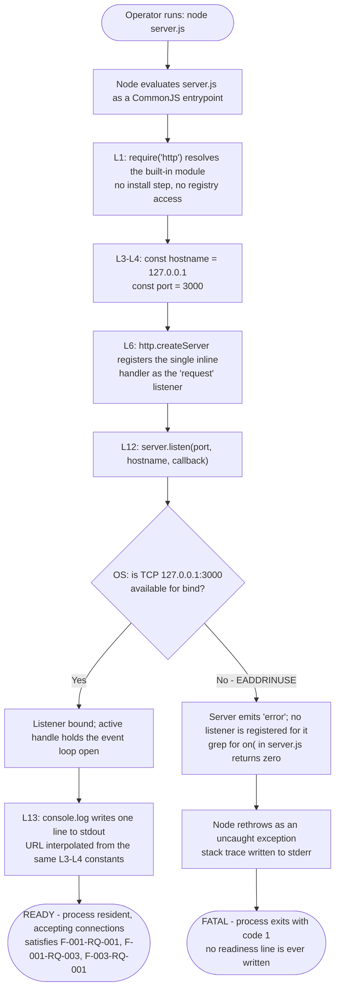

#### WF-2 — Request Fulfilment

**End-to-end journey.** A local HTTP client opens a TCP connection to `127.0.0.1:3000` and sends a request. Node's `http` parser reads the request line and headers, then emits the `request` event, which invokes the handler registered at line 6. The handler sets status 200 (L7), sets `Content-Type: text/plain` (L8), and calls `res.end('Hello, World!\n')` (L9). Because `res.end` both writes the body and completes the response in one call, there is no streaming loop and no intermediate `res.write`. The runtime then serialises the response — adding `Date`, `Content-Length: 14`, `Connection: keep-alive`, and `Keep-Alive: timeout=5`, none of which the application sets — and returns it on the wire.

**Verified uniformity.** Direct execution confirmed byte-identical `200` / `text/plain` / 14-byte responses for `GET /`, `GET /any/path?q=1&x=y`, `POST /submit` carrying a JSON body, and for `PUT`, `DELETE`, `PATCH`, and `OPTIONS`. `HEAD /` returns the same status and headers with a zero-byte body, because the runtime suppresses the body for `HEAD` — that is runtime framing, not application logic.

**Decision points.** All three belong to the runtime, and all three are evaluated *before* the handler runs:

| Decision | Owner | Outcome when the check fails |
|---|---|---|
| Does the request line parse, and is the method one of the 35 entries in `http.METHODS`? | Node HTTP parser | `400 Bad Request`, handler never invoked |
| Is the header block within Node's default 16 KB limit? | Node HTTP parser | `431`, handler never invoked |
| Has the keep-alive socket been idle beyond `keepAliveTimeout` (5000 ms)? | Node `http` server | Socket closed; no application involvement |

Inside the handler there is **no decision at all**. This is the single most important structural fact about WF-2: the flow from `request` event to completed response is unconditional.

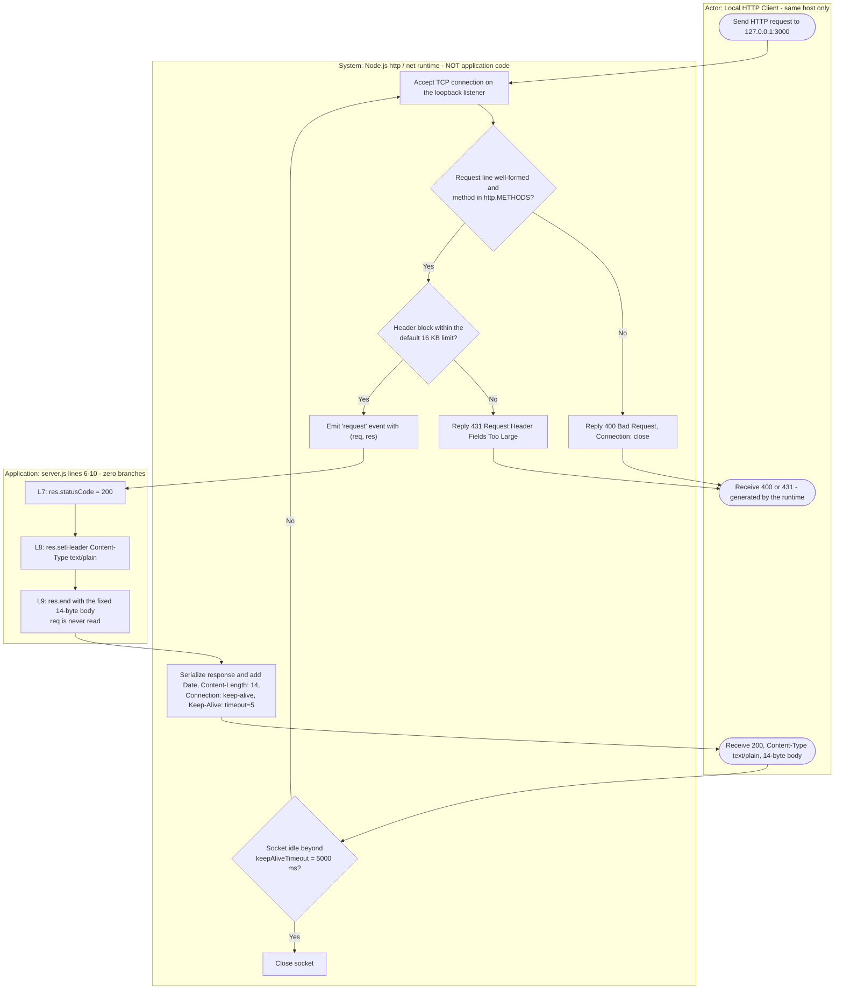

#### WF-3 — Service Termination and Port Release

This workflow is documented because it exists operationally, not because the repository implements it. `server.js` contains no `process.on` registration, no `server.close()` call, and no signal handler — all verified as zero-occurrence greps. Termination is therefore always externally initiated and always abrupt.

Verified behaviour: `kill -TERM` on the running process ends it immediately, with no connection draining, no in-flight-request completion guarantee, and no shutdown log line. The port is released on exit; subsequent connection attempts fail with `ECONNREFUSED`. Because the same absence of handlers governs `SIGINT` (Ctrl-C in the operator's terminal), the operator's stop procedure and an orchestrator's stop signal follow the identical path.

#### Error Handling Paths Across the Core Processes

Four error paths exist in total. Their internal mechanics, retry posture, and recovery procedures are documented in Section 4.3.2; the table below places them within the workflows.

| Error Path | Workflow | Where it is detected | Terminal state |
|---|---|---|---|
| Port already bound (`EADDRINUSE`) | WF-1 | OS bind, surfaced as an unhandled `'error'` event | Process exit code 1 |
| Malformed request or unsupported method | WF-2 | Node HTTP parser, before the handler | `400 Bad Request`, socket closed |
| Oversized header block | WF-2 | Node HTTP parser, before the handler | `431` |
| Client disconnects mid-exchange | WF-2 | Node `net` layer | Socket destroyed; nothing logged |

No error path is handled by application code, and no error path produces an operator notification beyond a stderr stack trace in the `EADDRINUSE` case.

### 4.1.2 Integration Workflows

The repository has **one** integration surface inbound and **one** outbound, and no others. This is not an inference from folder structure — it is established by exhaustive grep of the only source file. The following identifiers all return zero occurrences in `server.js`: `http.request`, `https`, `fetch`, `axios`, `setInterval`, `setTimeout`, `cron`, `schedule`, `queue`, `amqp`, `kafka`, `redis`, `fs.`, `readFile`, `writeFile`, `child_process`, `exec`, `spawn`, and `JSON`. The `console` identifier appears exactly once, at line 13.

#### Integration Surface Register

| Surface | Direction | Protocol / Medium | Evidence |
|---|---|---|---|
| Listener on `127.0.0.1:3000` | Inbound | TCP / HTTP 1.1, cleartext | `server.js` L12 |
| Process standard output | Outbound | Unstructured text, written once at startup | `server.js` L13 |

#### Data Flow Between Systems

The complete data flow is: request bytes arrive on a loopback socket, are parsed by the runtime, are **discarded** (the handler never reads `req`), and a constant 14-byte body is written back. No request datum crosses any boundary — it is not stored, logged, forwarded, transformed, or echoed. The process reads and writes no files during its lifetime, so there is no data at rest anywhere in the system.

The loopback bind at line 3 is an enforced system boundary, not a convention. Verification confirmed a request to the host's routable address (`10.76.1.55:3000`) fails to connect while `127.0.0.1:3000` succeeds. Any consumer on another host, container, or network requires an external proxy or a source edit; the repository provides neither.

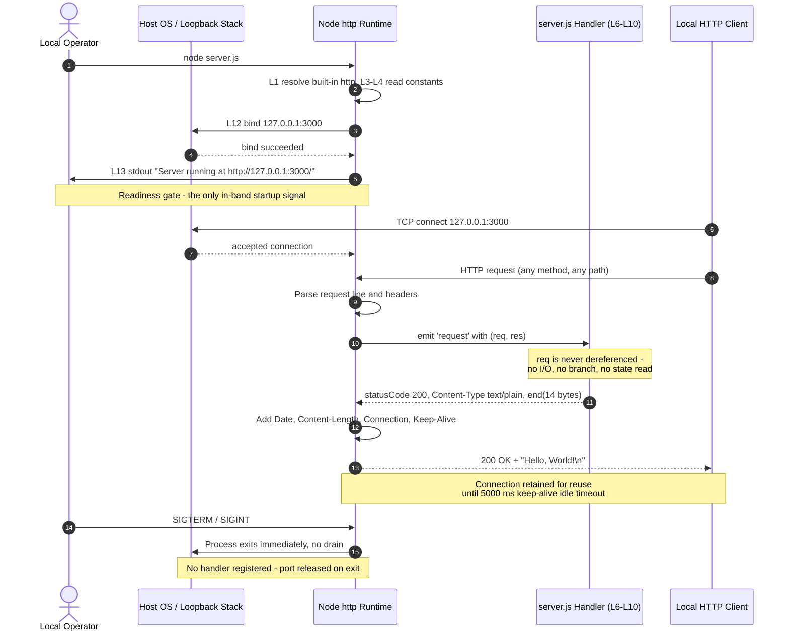

#### API Interactions

The system exposes one implicit endpoint and consumes none.

- **Exposed:** every request, regardless of method or path, resolves to the same response. There is no route table, no API versioning, no schema, and no OpenAPI or other interface descriptor anywhere in the repository. The effective API contract is the triple *(status 200, `Content-Type: text/plain`, body `Hello, World!\n`)*, established in Section 2.2 as requirements F-002-RQ-001 through F-002-RQ-003.
- **Consumed:** none. With `http.request`, `https`, `fetch`, and every HTTP-client library returning zero grep matches, the process never initiates an outbound network call. No authentication provider, telemetry endpoint, feature-flag service, or downstream API participates in any flow.

#### Event Processing Flows

There is no event-driven architecture in the product sense — no broker, no topic, no subscriber, no dead-letter path. What does exist is Node's internal `EventEmitter` wiring, and it is worth documenting precisely because *which events lack listeners* determines the failure behaviour in Section 4.3.2.

Notably, `server.js` contains **zero** explicit `.on(` registrations. Both listeners are registered implicitly by the API calls themselves:

| Runtime event | Listener | Consequence |
|---|---|---|
| `'request'` | The inline handler passed to `http.createServer` (L6) | Every parsed request is served |
| `'listening'` | The callback passed to `server.listen` (L12) | One-shot readiness line on stdout |
| `'error'` | **None** | Bind failure becomes an uncaught exception, exit code 1 |
| `'clientError'` | **None** | Protocol errors answered by the runtime default (`400`, socket closed) |
| `'close'`, `'connection'`, `'upgrade'` | **None** | No lifecycle, per-connection, or WebSocket-upgrade handling exists |

#### Batch Processing Sequences

**None exist.** No scheduled, deferred, or periodic work is performed anywhere in the repository: `setInterval`, `setTimeout`, `cron`, and `schedule` all return zero grep matches in `server.js`, and there is no crontab, systemd timer, `Procfile`, `Makefile`, or CI workflow in the checkout to schedule work externally. The process performs work only in direct response to an inbound request; between requests it is entirely idle, holding a listener handle and nothing else. There is consequently no batch window, no job queue, no chunking strategy, and no reconciliation or catch-up sequence to document.

## 4.2 Flowchart Requirements

This section decomposes each workflow from Section 4.1 into the elements a flowchart must express — boundaries, steps, decisions, touchpoints, terminal states — and then states the timing constraints and validation rules in force at each step. Two framing statements apply throughout and are not repeated per workflow.

**On SLAs.** The repository declares no service-level agreement, latency budget, throughput target, availability objective, or timeout of its own. `server.js` sets no `server.timeout`, `keepAliveTimeout`, `headersTimeout`, `requestTimeout`, `maxHeadersCount`, or `maxRequestsPerSocket`, and `README.md` (13 bytes) contains no operational statement of any kind. Every timing constraint documented below is therefore **inherited from the Node.js runtime**, not authored by this project.

**On validation.** Because the handler never dereferences `req`, no request field is validated — and none needs to be, since none is read. The validation that does occur is protocol-level and happens in the runtime before the handler executes. The distinction is maintained rigorously below, since conflating the two would credit the application with checks it does not perform.

### 4.2.1 Element Decomposition per Workflow

#### WF-1 — Service Startup and Readiness Announcement

| Element | Specification |
|---|---|
| Start point | Operator executes `node server.js` from a bare checkout; no install, build, or configuration step precedes it |
| Process steps | Resolve built-in `http` (L1) → materialise `hostname`/`port` constants (L3–L4) → construct server and register the inline handler (L6) → invoke `server.listen(port, hostname, callback)` (L12) |
| Decision diamonds | One, owned by the operating system: is TCP `127.0.0.1:3000` free for bind? |
| System boundaries crossed | Process → OS network stack (bind syscall); process → stdout (readiness line) |
| User touchpoints | Two: the launch command, and the single stdout line read back by the operator |
| Success end point | Listener bound, event loop held open by the active handle, one line on stdout — satisfies F-001-RQ-001, F-001-RQ-003, F-003-RQ-001 |
| Error end point | `EADDRINUSE` → unhandled `'error'` event → stack trace on stderr → **exit code 1**, with no readiness line written |
| Recovery path | External only. Free the port or edit L4, then relaunch. No in-process retry, port fallback, or partial-start mode exists |

#### WF-2 — Request Fulfilment

| Element | Specification |
|---|---|
| Start point | Inbound TCP connection accepted on the loopback listener, followed by an HTTP request |
| Process steps | Parse request line and headers (runtime) → emit `'request'` (runtime) → set status 200 (L7) → set `Content-Type: text/plain` (L8) → terminal write of the 14-byte body (L9) → serialise and frame the response (runtime) |
| Decision diamonds | Three, all runtime-owned and all evaluated before the handler: request-line/method validity; header-block size against the 16 KB limit; keep-alive idle expiry. **Zero decisions exist inside the application handler** |
| System boundaries crossed | Client → loopback socket (inbound); runtime → application handler (`'request'` event); application → runtime (response serialisation); runtime → client (wire response) |
| User touchpoints | One: the client's request and the response it receives. Nothing is written to stdout during request handling — verified, stdout remains at exactly one line across all traffic (F-003-RQ-003) |
| Success end point | `200` / `Content-Type: text/plain` / 14-byte body `Hello, World!\n`, framed by the runtime with `Date`, `Content-Length: 14`, `Connection: keep-alive`, `Keep-Alive: timeout=5` |
| Error end points | `400 Bad Request` (malformed request line or method outside `http.METHODS`); `431` (header block over 16 KB); silent socket destruction (client abort). None is produced by application code |
| Recovery path | Client-side only. The server neither retries, queues, nor records a failed exchange; a client that retries simply issues a new request |

#### WF-3 — Service Termination and Port Release

| Element | Specification |
|---|---|
| Start point | External signal (`SIGTERM`, `SIGINT`) or process kill; there is no internal trigger |
| Process steps | None in application code. `server.js` contains no `process.on` registration and no `server.close()` call — both verified as zero-occurrence greps |
| Decision diamonds | None |
| System boundaries crossed | OS signal → process; OS releases the bound port on exit |
| User touchpoints | One: the operator's stop command. No shutdown confirmation is emitted |
| End point | Immediate process termination; port released; subsequent connections fail with `ECONNREFUSED` |
| Error / degradation state | In-flight requests are abandoned without response and keep-alive connections are severed without a `Connection: close` courtesy. No draining, no grace period |

### 4.2.2 Timing and SLA Considerations

The values below are the complete set of timing constraints governing the running service, introspected from a Node.js `http.Server` on the verification runtime (Node v22.23.2). Because `server.js` configures none of them, these defaults are authoritative for the deployed behaviour.

| Constraint | Effective value | Governs |
|---|---|---|
| `server.timeout` | `0` (disabled) | No per-socket inactivity timeout is applied to active sockets |
| `server.keepAliveTimeout` | `5000` ms | Idle keep-alive socket closure; surfaced to clients as `Keep-Alive: timeout=5` |
| `server.headersTimeout` | `60000` ms | Maximum time to receive a complete header block |
| `server.requestTimeout` | `300000` ms | Maximum time to receive a complete request |
| `http.maxHeaderSize` | `16384` bytes | Header-block ceiling; exceeding it yields `431` |
| `server.maxRequestsPerSocket` | `0` (unlimited) | No cap on requests served per keep-alive connection |
| `server.maxConnections` | unset | No concurrent-connection cap is enforced by the application |
| `listen` backlog | `511` (Node default) | Depth of the pending-connection queue |

**Observed latency, stated as measurement rather than commitment.** Ten sequential loopback requests completed in 0.20–0.65 ms each end to end, and fifty concurrent requests all returned `200`. Section 2.2 records a corresponding load observation of roughly 14,000 requests per second at concurrency 50 (p50 ≈ 2 ms, p99 ≈ 31 ms) on a single host. These figures characterise specific machines under synthetic load; **the repository commits to nothing**, and no monitoring, alerting, or measurement apparatus exists in the checkout to detect a regression against them.

**Structural timing implications.** The handler performs no I/O — no filesystem access, no outbound network call, no database round trip — so response latency contains no external wait state and cannot be affected by a downstream dependency. Conversely, the single-threaded event loop with no `cluster` or `worker_threads` usage means one CPU core serves all traffic, and the fixed port admits exactly one instance per host, so there is no timing headroom to be gained without a source edit.

### 4.2.3 Validation Rules

#### Business Rules by Workflow Step

| Step | Business rule in force | Evidence |
|---|---|---|
| WF-1 bind | Exactly one instance may run per host. The port is a compile-time constant with no fallback, so a second instance is structurally prevented | L4; verified `EADDRINUSE` exit 1 |
| WF-1 announce | The readiness line is the sole in-band readiness indicator; its absence is the sole in-band startup-failure indicator | L12–L14 |
| WF-1 announce | The announced URL must remain interpolated from the bind constants so it cannot drift from the bound address (F-003-RQ-002) | L13 |
| WF-2 respond | The response triple — `200`, `text/plain`, `Hello, World!\n` — is the entire observable contract; changing any element is a breaking change for every consumer | L7–L9 |
| WF-2 respond | Uniformity is a rule rather than an accident: with no branching and `req` unread, differentiated responses are impossible without new code | L6–L10 |
| WF-2 respond | No request datum may be retained. Every binding in the file is `const` (`let` and `var` both return zero grep matches), so no cross-request accumulator can exist (F-002-RQ-005) | Whole file |
| WF-3 terminate | Availability beyond the process lifetime is the responsibility of external supervision; the repository defines no restart policy, service unit, or process-manager configuration | Absence of any such file |

#### Data Validation Requirements

No application-level data validation exists, and none is required by the current behaviour, because no request field is read. The following table records what *is* validated and by whom, so the absence is not mistaken for an unexamined gap.

| Check | Performed by | Failure result |
|---|---|---|
| Request line well-formed | Node HTTP parser | `400 Bad Request`, connection closed |
| Method within the 35 entries of `http.METHODS` | Node HTTP parser | `400 Bad Request` |
| Header block ≤ 16384 bytes | Node HTTP parser | `431` |
| Bind-parameter validity (`hostname`, `port`) | Nothing — they are source literals that cannot be supplied externally | Not applicable |
| Request body, query string, headers | **Nothing.** The body is never read; a POST body and an `Authorization` header were verified to change nothing about the response | Not applicable |

`server.js` registers no `'clientError'` handler and sets no parser options, so the runtime defaults above cannot be, and are not, overridden by this project.

#### Authorization Checkpoints

There are none. No workflow step performs identification, authentication, or authorization: there is no credential check, no token parsing, no session, no API key, no TLS, and no CORS or rate-limiting policy. An `Authorization: Bearer` header was verified to be accepted and ignored like any other header.

The only access control present is a *network-scope consequence* rather than a policy check: the bind to `127.0.0.1` (L3) confines reachability to the same host, verified by a refused connection to the host's routable address. Anything able to reach port 3000 is served unconditionally. As Section 2.4 notes, changing L3 to `0.0.0.0` would expose an unauthenticated, unencrypted endpoint to every reachable network — the highest-impact single-line edit available in this file.

#### Regulatory Compliance Checks

None exist and none are applicable to the implemented behaviour. The service accepts no personal, financial, health, or otherwise regulated data — it reads no request field at all — retains nothing, persists nothing to disk, and emits no per-request log, so there is no data subject, no retention period, and no audit trail to govern. The checkout contains no `LICENSE`, no policy document, no data-processing agreement, and no audit or compliance configuration. Any compliance obligation for a deployment of this service would attach to the surrounding environment, not to these 14 lines.


## 4.3 Technical Implementation

This section documents how the flows in Section 4.1 are realised in terms of state and failure behaviour. Both subsections are dominated by a single finding: the application code holds no state and handles no errors, so all state transitions and all error handling in the running system belong to the Node.js runtime. Each such attribution is evidenced rather than assumed.

### 4.3.1 State Management

#### State Transitions

The system has exactly one state machine, and it belongs to the `http.Server` object created at line 6 and driven by `server.listen` at line 12. The application declares no status field, no enum, and no workflow state of its own — there is nothing in `server.js` that could hold one.

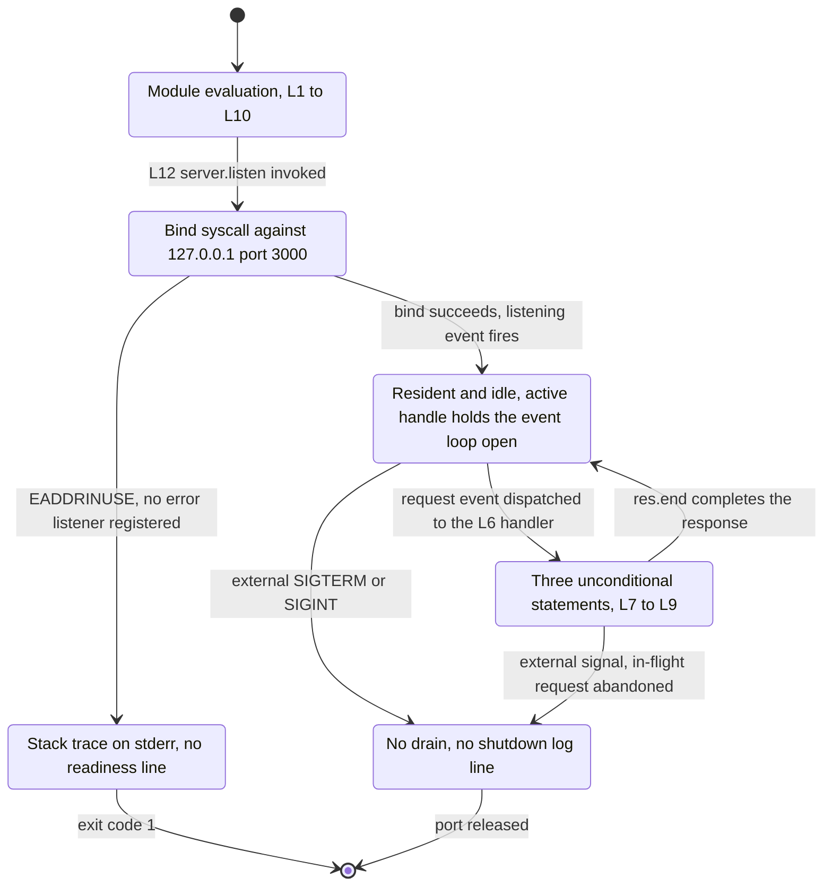

Three properties of this machine are worth stating explicitly:

- **`Loading` reaches `Binding` unconditionally.** There is no configuration validation, no dependency health check, and no precondition gate between module load and the bind attempt.
- **`Serving` returns to `Listening` on every path.** The handler cannot fail in a way it recognises, because it performs no I/O and reads no input.
- **No state is reachable that represents degradation.** There is no `Draining`, `Unhealthy`, `ReadOnly`, or `Maintenance` state, because no code exists to enter or expose one.

A second, lower-level machine governs each TCP connection. It matters because it is where every non-`200` outcome in the system is decided.

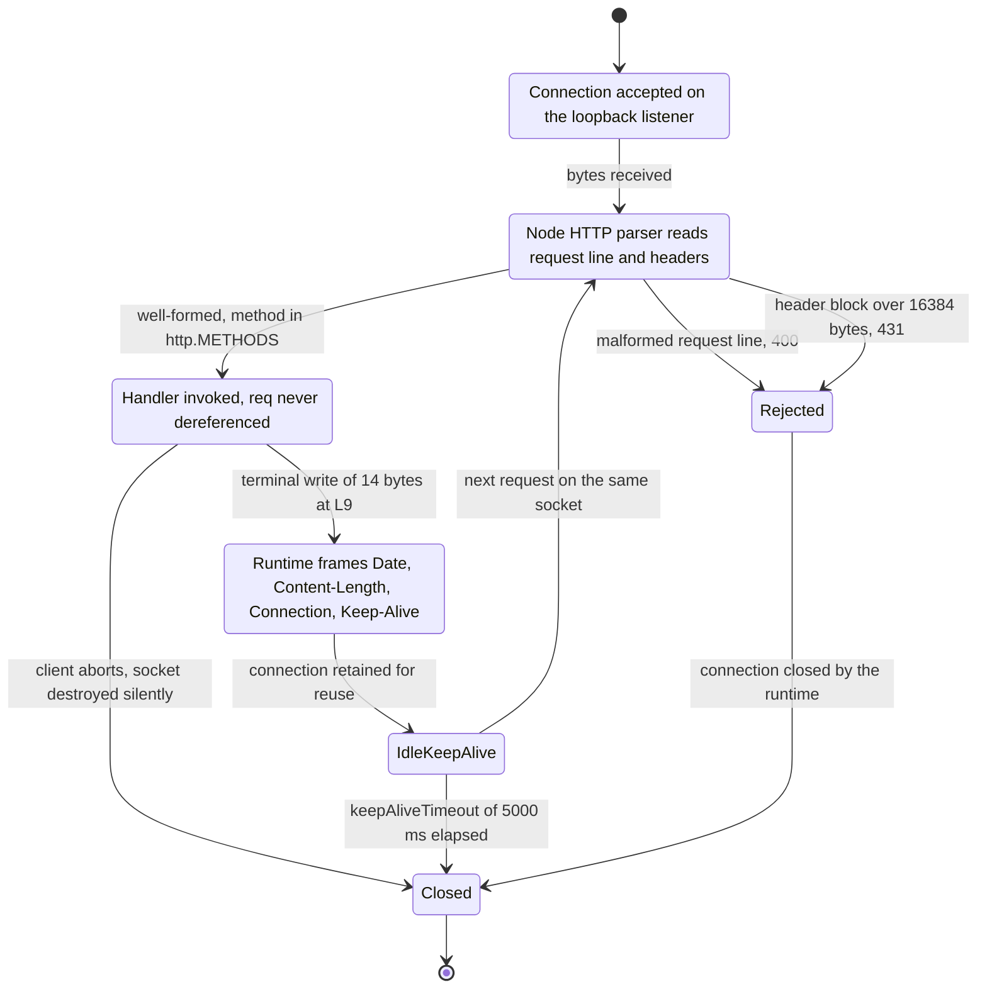

#### Data Persistence Points

**There are none.** The process reads and writes no files during its lifetime: `fs.`, `readFile`, `writeFile`, `child_process`, `exec`, and `spawn` all return zero occurrences in `server.js`, and the repository contains no database client, migration, schema, or datastore configuration. No request datum is stored, logged, or forwarded — the handler discards `req` entirely.

The consequence for the flowcharts is that **no diagram in this section contains a persistence step**, and nothing survives process exit. The only durable artifacts associated with the system are the two tracked files in the checkout, both static.

#### Caching Requirements

No caching exists at any layer, and none is required by the current behaviour.

| Cache layer | Status | Evidence |
|---|---|---|
| Application in-memory cache | Absent | `Map(`, `Set(`, and `JSON` all return zero grep matches; no cache library, and no dependency manifest to declare one |
| Response cache directives | Absent | The handler sets exactly one header, `Content-Type` (L8). No `Cache-Control`, `ETag`, `Last-Modified`, or `Expires` header is emitted, so client and intermediary caching is left entirely to default heuristics |
| Distributed cache | Absent | No `redis` or equivalent client reference; no outbound network call of any kind |
| Computed-value memoisation | Not applicable | The response is a source literal at L9; there is no computation to memoise |

#### Transaction Boundaries

There is no transactional resource in the system — no database, no queue, no file write, and therefore no commit, rollback, isolation level, or compensating action to document. Two boundaries are nonetheless meaningful when reasoning about atomicity:

1. **The response write (L9).** `res.end('Hello, World!\n')` writes the body and completes the response in a single call, which is why the runtime can compute an accurate `Content-Length: 14` rather than falling back to chunked framing. This single-call completion is the closest analogue to a transaction boundary in the system, and it is what requirement F-002-RQ-004 captures. There is no partial-response state to recover from: either the terminal write completes or the socket is gone.
2. **The bind (L12).** Binding is all-or-nothing. There is no partial-start mode in which the process is running but not serving — a failed bind terminates the process outright.

#### Mutable State Inventory

The application declares **no mutable state whatsoever**: `let` and `var` both return zero occurrences, so every binding in the file is `const`. The only mutable state in the running system is owned by the runtime:

| State | Owner | Lifetime |
|---|---|---|
| Listener handle in the event loop | Node runtime | From successful bind to process exit |
| Accepted socket / keep-alive connection | Node `net` layer | Until close or the 5000 ms idle timeout |
| `req` / `res` objects | Node `http` layer | Allocated per request, garbage-collected after the response completes |

This is the structural basis for requirement F-002-RQ-005: no cross-request accumulator, counter, session, or session-affinity requirement can exist, and 2,000 sequential requests were verified to produce byte-identical responses with no drift.

### 4.3.2 Error Handling

#### Error Path Catalogue

Four error paths exist. For each, the table records where detection occurs, what the application contributes, and what the caller or operator observes.

| Error path | Detected by | Application contribution | Observable outcome |
|---|---|---|---|
| `EADDRINUSE` on bind | OS, surfaced as the server's `'error'` event | **None** — no listener is registered | Stack trace on stderr, **exit code 1**, no readiness line |
| Malformed request line or unsupported method | Node HTTP parser, before the handler | **None** — no `'clientError'` handler | `400 Bad Request`, `Connection: close` |
| Header block over 16384 bytes | Node HTTP parser, before the handler | **None** | `431` |
| Client aborts or sends an incomplete request | Node `net` layer | **None** | Socket destroyed silently; process unaffected; **nothing logged** |

The absence of application involvement is not an inference. `server.js` contains zero occurrences of `try`, `catch`, `on(`, `process.`, and `close`, which rules out — respectively — exception handling, any explicit event listener including `'error'` and `'clientError'`, any `process.on('uncaughtException')` or signal handler, and any `server.close()` draining logic.

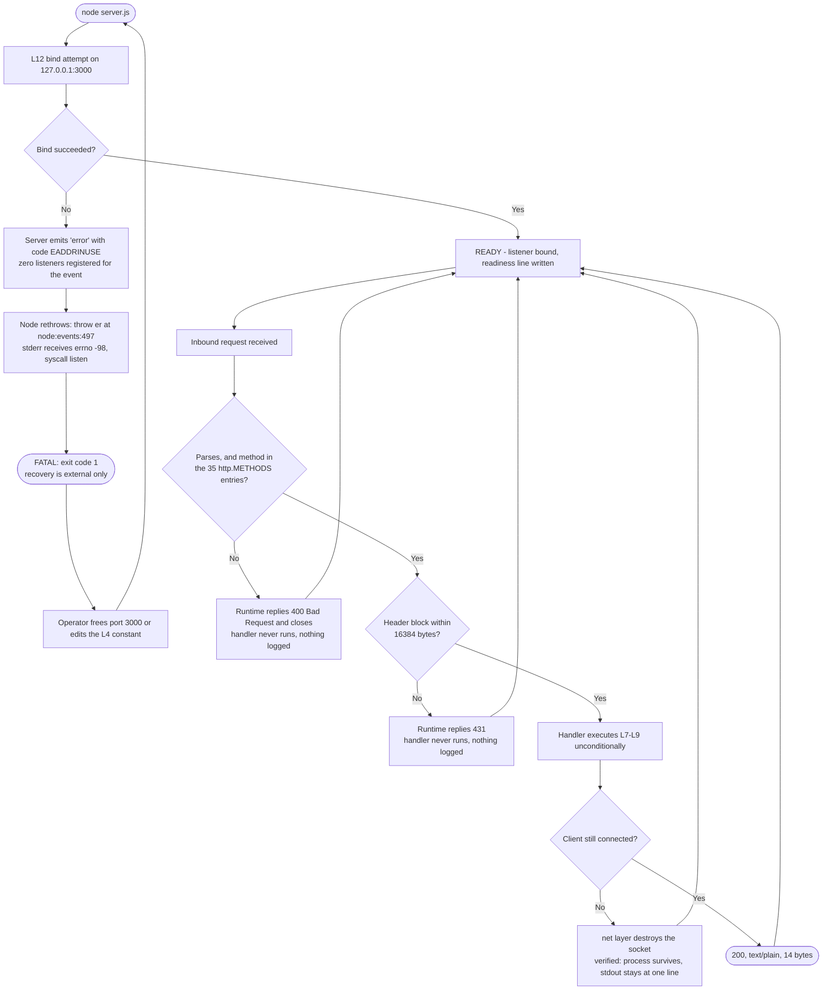

#### Retry Mechanisms

**None are implemented, at any layer.** There is no retry loop, no backoff schedule, no attempt counter, and no idempotency key, and none could exist as written: `setTimeout` and `setInterval` both return zero grep matches, so the code has no mechanism to defer or re-attempt any operation.

The two places a retry would conventionally appear are both explicitly absent:

- **Bind retry.** A port conflict terminates the process on the first attempt. There is no retry-with-delay and no fallback port — requirement F-001-RQ-004 documents fail-fast as the actual, verified behaviour, confirmed identically across three separate reproductions.
- **Request retry.** The server never initiates an outbound call, so there is no downstream operation to retry. Retry, if desired, is entirely the client's responsibility; since the response is a constant, a client retry is trivially safe.

#### Fallback Processes

**None exist.** There is no degraded mode, no default or cached response to serve when a dependency is unavailable, and no circuit breaker — largely because there is no dependency to fall back from. The handler's only external requirement is the runtime itself.

Two conventional fallbacks are worth naming as absent, since their absence has operational consequence:

| Conventional fallback | Status here |
|---|---|
| Fallback port when the primary is taken | Absent — the port is a `const` at L4; the process dies instead |
| Graceful degradation under load | Absent — no `maxConnections` cap, no rate limiter, no load-shedding path; the single-threaded event loop simply queues work behind the 511-deep backlog |

#### Error Notification Flows

The notification surface is minimal and, on three of four error paths, empty.

| Error path | Notification emitted | Destination |
|---|---|---|
| `EADDRINUSE` | Full stack trace with `code`, `errno`, `syscall`, `address`, `port` | stderr, once, at exit |
| `400` / `431` parser rejections | **None** | — |
| Client abort or incomplete request | **None** | — |
| Successful request | **None** (by design — F-003-RQ-003) | — |

This was verified directly: after a successful request, an aborted mid-exchange request, and an incomplete request held open, the process's stdout still contained exactly one line — the startup readiness line. **Request-time failures are therefore silent**: no log entry, no counter, no metric, and no alert. There is no logging library, no log file, no structured log envelope, no metrics endpoint, and no alerting integration anywhere in the repository, so any error visibility must be supplied by the process supervisor that captures stderr.

#### Recovery Procedures

Recovery is **entirely external to the codebase** — a direct consequence of there being no `'error'` listener, no signal handler, and no `server.close()` call.

| Scenario | Recovery procedure | Owner |
|---|---|---|
| Process crashed on `EADDRINUSE` | Identify and stop the process holding port 3000, or edit the port constant at L4, then relaunch. Verified: after the holder exits, the port frees immediately and a fresh instance binds and announces readiness normally | Operator / supervisor |
| Process terminated by signal | Relaunch `node server.js`. Startup is idempotent and requires no cleanup — no lock file, PID file, temp file, or persisted state is left behind, because the process writes no files | Operator / supervisor |
| Process unresponsive | No in-band remedy exists. There is no health endpoint distinguishable from the fixed response, so liveness must be probed by issuing a request and checking for `200` / 14 bytes | External monitor |
| In-flight requests lost at shutdown | No recovery. Requests are not journaled or replayed; the client must reissue | Client |

The single most consequential operational fact for this section is that **continuous availability requires an external supervisor**. The repository contains no restart policy, service unit, process-manager configuration, container definition, or orchestration manifest — a point Section 2.4 records as a cross-feature constraint. A crash is permanent until something outside these 14 lines restarts the process.


## 4.4 Required Diagrams

This section consolidates the diagram set for the system. Diagrams already placed alongside the narrative they explain are indexed rather than duplicated; the views below are additional and non-redundant.

### 4.4.1 Diagram Index

| Required diagram | Location | Form |
|---|---|---|
| High-level system workflow | 4.4.2 | Flowchart with trust/system boundaries |
| Detailed process flow — F-001 listener lifecycle | 4.1.1 (WF-1) and 4.4.3 | Flowchart |
| Detailed process flow — F-002 request fulfilment | 4.1.1 (WF-2) and 4.4.3 | Swim-laned flowchart |
| Detailed process flow — F-003 readiness announcement | 4.4.3 | Flowchart |
| Error handling flowchart | 4.3.2 | Flowchart with recovery loop |
| Integration sequence diagram | 4.1.2 and 4.4.4 | Sequence diagram, timing-annotated |
| State transition diagram — server lifecycle | 4.3.1 | `stateDiagram-v2` |
| State transition diagram — connection lifecycle | 4.3.1 | `stateDiagram-v2` |
| State transition diagram — supervised availability | 4.4.5 | `stateDiagram-v2` |

No diagram is provided for F-004 (`README.md`): it is a static file consumed by no code and participating in no flow.

### 4.4.2 High-Level System Workflow

This view places the three workflows of Section 4.1 inside the boundaries that constrain them. The loopback boundary is drawn as a hard edge because it was verified as one — a request to the host's routable address (`10.76.1.55:3000`) failed to connect while the same request to `127.0.0.1:3000` succeeded.

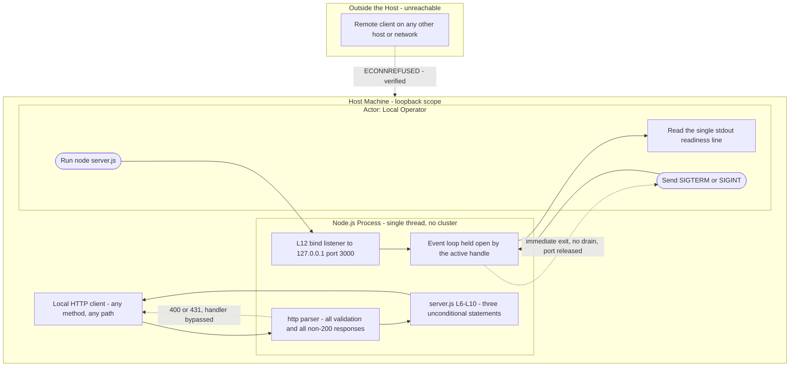

### 4.4.3 Detailed Process Flows per Core Feature

#### F-001 — HTTP Listener Lifecycle and Port Binding

The feature's whole flow is a linear setup sequence terminating in one of two mutually exclusive states. There is no configuration load, no readiness probe of a dependency, and no partial-start mode.

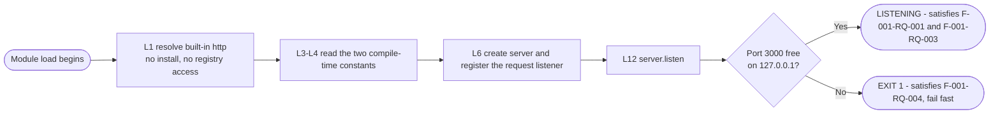

#### F-002 — Uniform Fixed Plain-Text Response

The diagram emphasises what is *discarded*. Every request attribute enters the handler and none is read, which is why the output edge is a single constant.

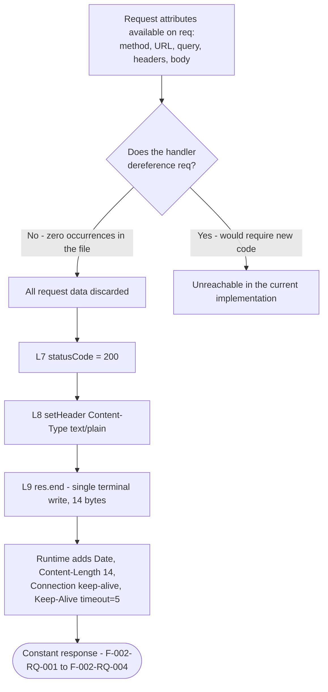

#### F-003 — Startup Readiness Announcement

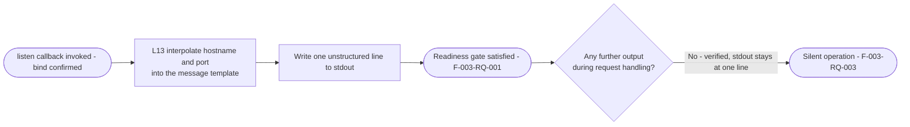

### 4.4.4 Integration Sequence Diagram with Timing Constraints

This sequence annotates the single inbound integration with the runtime-inherited timing limits from Section 4.2.2. Every limit shown is a Node default; `server.js` sets none of them.

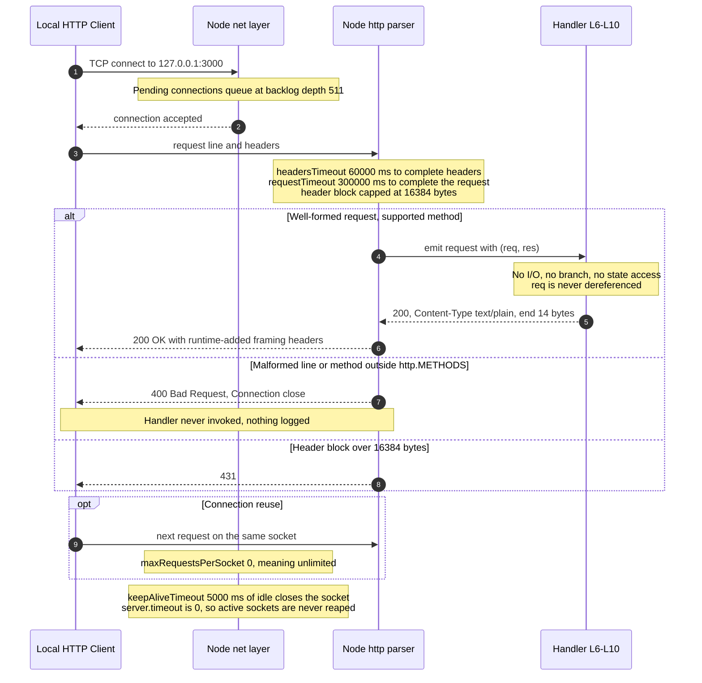

### 4.4.5 Supervised Availability State Transitions

The two state machines in Section 4.3.1 describe the process and its connections. This third view models the system as an operator experiences it over time, and exists to make one point precise: the transition out of `Crashed` is not implemented anywhere in the repository. It requires an external actor, because `server.js` registers no `'error'` listener, no signal handler, and no restart logic, and the checkout contains no service unit, container definition, or process-manager configuration.

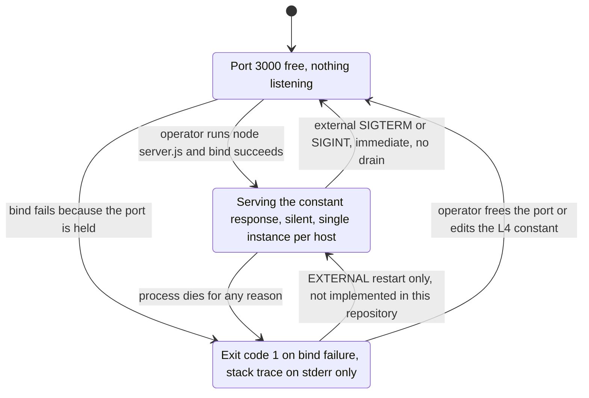


## 4.5 References

#### Repository Files Examined

- `server.js` — the sole implementing artifact for every workflow in this section. Line-level evidence: L1 (`require('http')`, the only dependency), L3–L4 (compile-time `hostname`/`port` constants), L6 (`http.createServer` with the single inline handler; `req` declared and never dereferenced), L7–L9 (the three unconditional response statements and the terminal 14-byte write), L12–L14 (`server.listen` and the single stdout readiness line).
- `README.md` — 13 bytes, one line (`# Hello_world`). Established that the repository documents no process, port, timing constraint, SLA, runbook, or recovery procedure, so all workflow facts in this section derive from source and execution rather than from project documentation.

#### Repository Structure

- Repository root (`/`) — confirmed to contain exactly two tracked files and no subdirectories other than `.git/`. This complete inventory is the evidence for the absence of routes, middleware, jobs, schemas, and configuration referenced throughout Sections 4.1.2, 4.2.3, and 4.3.
- Verified-absent paths, each checked individually: `package.json`, `package-lock.json`, `yarn.lock`, `pnpm-lock.yaml`, `.nvmrc`, `Dockerfile`, `docker-compose.yml`, `Makefile`, `Procfile`, `.env`, `.env.example`, `.github/`, `.circleci/`, `.gitlab-ci.yml`, `LICENSE`, `tsconfig.json`, and any test or config directory. Together these establish the absence of scheduled work, containerised or orchestrated deployment, restart policy, environment-variable configuration, and automated verification.

#### Negative-Space Evidence (grep counts on `server.js`)

- Zero occurrences of `if (`, `switch`, and any loop construct — the basis for placing every decision diamond outside the application code.
- Zero occurrences of `try`, `catch`, `on(`, `process.`, and `close` — the basis for the error-handling findings in 4.3.2 (no exception handling, no `'error'` or `'clientError'` listener, no signal handler, no draining).
- Zero occurrences of `let` and `var` — the basis for the statelessness findings in 4.3.1.
- Zero occurrences of `http.request`, `https`, `fetch`, `axios`, `fs.`, `readFile`, `writeFile`, `child_process`, `exec`, `spawn`, `JSON`, `Map(`, `Set(`, `redis`, `kafka`, `amqp`, and `queue` — the basis for the absence of outbound integrations, persistence points, and caching in 4.1.2 and 4.3.1.
- Zero occurrences of `setTimeout`, `setInterval`, `cron`, and `schedule` — the basis for the absence of batch processing (4.1.2) and retry mechanisms (4.3.2).
- Exactly one occurrence of `console` (L13) — the basis for the single-notification-surface finding in 4.3.2.

#### Runtime Verification Basis

All behavioural claims were confirmed by executing `server.js` unmodified on Node.js v22.23.2 and observing the results. The specific verifications relied upon:

- Startup produced exactly one stdout line, `Server running at http://127.0.0.1:3000/`, and the process remained resident.
- Uniform `200` / `Content-Type: text/plain` / 14-byte responses across `GET`, `POST` (with body), `PUT`, `DELETE`, `PATCH`, and `OPTIONS`, over `/` and arbitrary deep paths with query strings; `HEAD` returned the same status with a zero-byte body.
- The full response envelope, distinguishing the two application-set fields from the runtime-added `Date`, `Content-Length: 14`, `Connection: keep-alive`, and `Keep-Alive: timeout=5`.
- Loopback boundary enforcement — `127.0.0.1:3000` served while the host's routable address `10.76.1.55:3000` refused connection.
- `EADDRINUSE` reproduced three times identically: unhandled `'error'` event, `throw er` at `node:events:497`, `errno -98`, `syscall 'listen'`, terminating with exit code 1 and no readiness line.
- Malformed raw request (`THIS IS NOT HTTP`) answered by the runtime with `HTTP/1.1 400 Bad Request` before the handler ran.
- Client abort mid-exchange and an incomplete request held open: process survived, continued serving, and stdout remained at exactly one line — establishing that request-time failures are silent.
- `SIGTERM` terminated the process immediately with no drain and no shutdown line; the port freed on exit and a fresh instance bound successfully.
- Introspected `http.Server` defaults: `timeout` 0, `keepAliveTimeout` 5000 ms, `headersTimeout` 60000 ms, `requestTimeout` 300000 ms, `maxHeadersCount` null, `maxRequestsPerSocket` 0, `maxConnections` unset; plus `http.maxHeaderSize` 16384 and `http.METHODS.length` 35.
- Informational latency and concurrency measurements (0.20–0.65 ms per sequential loopback request; 50 of 50 concurrent requests returning `200`), recorded in 4.2.2 explicitly as observations rather than commitments.

#### Related Technical Specification Sections

- 2.1 Feature Catalog — supplied the feature identifiers F-001 through F-004 and their line-level evidence, used to label workflow steps throughout 4.1 and 4.4.
- 2.2 Functional Requirements — supplied the thirteen requirement identifiers (F-001-RQ-001 … F-004-RQ-001) traced to flowchart steps in 4.2.1 and 4.4.3, and corroborated the runtime-owned `400`/`431` parser behaviour documented in 4.1.1 and 4.2.3.
- 2.4 Implementation Considerations — supplied the cross-feature constraints cited in 4.2.3 and 4.3.2: recovery is entirely external, single instance per host, compile-time-only configuration, and no automated verification.
- 1.1 Executive Summary — supplied the "local operator" actor designation used in the swim lanes of 4.1.1 and 4.4.2.
- 1.3.2 Out-of-Scope — corroborated that handler lines 6–10 are the system's sole extension seam, referenced in 4.2.1.

#### External Sources

None. No web source was required or used; every claim in this section derives from the repository or from direct execution of its code.


# 5. System Architecture

## 5.1 High-Level Architecture

The architecture documented in this section is the architecture of two files totalling 355 bytes: `server.js` (14 lines) and `README.md` (13 bytes). The repository contains no subdirectories, no dependency manifest, and no configuration, build, container, or pipeline artifact. Every statement below is traced either to a line of `server.js` or to direct execution of the service on Node.js v22.23.2. Where a conventional architectural concern is absent, this section says so explicitly rather than describing what such a system would ordinarily contain.

### 5.1.1 System Overview

#### Architecture Style and Rationale

The system is a **single-process, single-module, event-driven HTTP responder**. It is a monolith in the strictest sense available: one source file, executed directly by the Node.js interpreter, which binds one TCP listener and answers every request that reaches it with one constant response. There is no tier separation, no module decomposition, no service boundary, and no inter-process communication, because there is only one process and one file within it.

Three properties fix the style precisely:

- **Monolithic and indivisible.** `server.js` declares no exports, no classes, and no named functions. The unit of deployment, the unit of execution, and the unit of source are the same file. Section 3.6.2 records the consequence: the source file *is* the deployable artifact.
- **Event-driven, non-blocking.** The application never blocks. `http.createServer` (line 6) registers a callback that the Node.js event loop invokes on each `request` event, and `server.listen` (line 12) registers a callback fired once on the `listening` event. Concurrency is therefore inherited from the runtime's event loop rather than implemented by the application; a measured 500 sequential keep-alive requests completed in 55 ms.
- **Framework-free.** The only `require` in the codebase targets `http`, a module bundled with the runtime. As Section 3.2 establishes, the Node.js standard library performs the role a web framework would ordinarily perform, and the application's entire coupling to it is six call sites.

No rationale is recorded anywhere in the repository — there is no design document, no architecture note, and no commit message beyond GitHub's defaults. The rationale that the artifact itself supports is *minimum viable proof of a working HTTP runtime*: the design eliminates every step between a checkout and a listening socket. No registry access, no dependency resolution, no `node_modules` tree, no compilation, and no configuration file stands in the way. That property is bought at the cost of every capability a production service normally requires, and the trade-offs are documented in Section 5.3.

#### Key Architectural Principles and Patterns

The principles below are inferred from consistent, verifiable properties of the code, not from stated policy.

| Principle | How the Code Expresses It | Architectural Consequence |
|---|---|---|
| Zero external dependency | One `require`, targeting a runtime built-in (line 1) | No supply chain, no transitive vulnerability surface, no install step |
| Statelessness | Zero `let` and zero `var`; every binding is `const`; nothing persists between requests | Any instance can serve any request; no session affinity is meaningful |
| Compile-time configuration | `hostname` and `port` are source literals (lines 3–4); no `process.env` read exists | One artifact cannot be promoted across environments unmodified |
| Uniform response contract | The handler branches on nothing and never dereferences `req` | Behaviour is total and input-independent; no request can produce a distinct outcome |
| Delegation to the runtime | Parsing, framing, keep-alive, and error rejection are never implemented in application code | The runtime, not this codebase, owns most observable HTTP behaviour |
| Fail-fast startup | No `'error'` listener is registered on the server object | A bind failure terminates the process rather than degrading it |

Two recognised patterns are present, and both belong to the runtime rather than to the application. The **Reactor pattern** governs execution: a single event-loop thread demultiplexes socket readiness and dispatches to the registered handler. The **Front Controller pattern** is present in degenerate form: one handler receives every request for every path and method, but performs no dispatch, because there is nothing to dispatch to.

Patterns conventionally expected at this layer and verified absent include layering (no controller, service, or repository separation exists to layer), middleware or interceptor chains, routing tables, dependency injection, the repository or data-mapper patterns, circuit breakers, and any form of caching. Section 5.3 records these as decisions with consequences rather than as omissions.

#### System Boundaries and Major Interfaces

The system has exactly **one inbound interface and one outbound interface**, and the inbound one is confined to a single host.

The trust and network boundary is the loopback bind at line 3. This was verified directly: a request to the host's routable address `10.76.1.29:3000` failed to connect, while the identical request to `127.0.0.1:3000` returned `200`. Every consumer must therefore execute on the same host as the server process. This boundary is the system's only access control — as Section 2.4.1 notes, it is incidental rather than enforced, since anything able to reach the port is served without identification.

| Boundary | Interface | Direction | Definition in Code |
|---|---|---|---|
| Host loopback network | HTTP/1.1 over TCP on `127.0.0.1:3000` | Inbound | `server.listen(port, hostname, cb)`, line 12 |
| Process standard output | Unstructured plain-text line | Outbound | `console.log(...)`, line 13 |
| Process exit status | Exit code `0` or `1` plus stderr stack trace | Outbound | Runtime default; no handler in code |

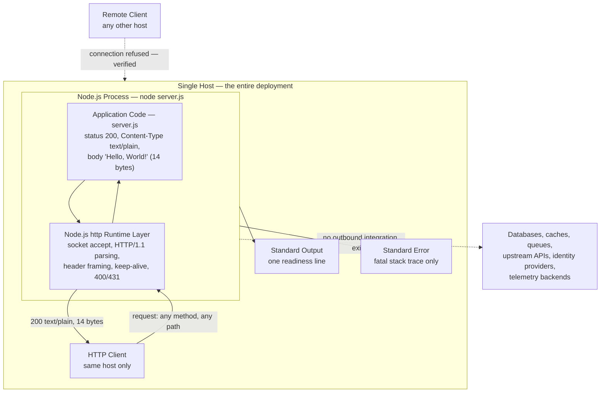

The diagram records the two facts that most constrain the architecture. First, the process makes **no outbound network call of any kind** — there is no HTTP client, no database driver, and no telemetry exporter in the repository, so the dashed edge to external systems represents an absence rather than a channel. Second, the application layer is thinner than the runtime layer beneath it: the runtime supplies the accept loop, the parser, and four of the five response headers observed on the wire.

### 5.1.2 Core Components

The system has no module decomposition, so the components below are the internal constructs of the single source file together with the runtime facilities they depend on. They correspond to the component inventory established in Section 1.2.2 and are the units referred to throughout the remainder of Section 5. Because the prompt limits tables to four columns, component attributes are presented across two tables keyed by component name.

**Responsibilities and dependencies:**

| Component | Primary Responsibility | Key Dependencies |
|---|---|---|
| Bootstrap Module (`server.js`) | Acquire the `http` module, declare bind constants, construct the server, and initiate the bind — all as load-time side effects | Node.js runtime; CommonJS module loader |
| Configuration Constants | Supply the bind target as immutable literals `127.0.0.1` and `3000` (lines 3–4) | None — values are compiled into the source |
| HTTP Server Instance | Own the listening socket, accept connections, parse HTTP/1.1, frame responses, and dispatch `request` events | Node.js `http` built-in; OS TCP stack; event loop |
| Request Handler | Write the response contract: status `200`, `Content-Type: text/plain`, body `Hello, World!\n` (lines 7–9) | `http.ServerResponse` API (`statusCode`, `setHeader`, `end`) |
| Readiness Callback | Emit one plain-text readiness line on the `listening` event (line 13) | `console` global; `process.stdout` |

**Integration points and critical considerations:**

| Component | Integration Points | Critical Considerations |
|---|---|---|
| Bootstrap Module (`server.js`) | Invoked only as `node server.js`; exports nothing | Binds on load, so it cannot be imported for reuse or unit-tested in isolation; mode `100644` with no shebang |
| Configuration Constants | Consumed by `server.listen` (line 12) and interpolated into the readiness line (line 13) | Any retarget requires a source edit and redeploy; changing `hostname` to `0.0.0.0` would expose an unauthenticated plaintext endpoint to every reachable network |
| HTTP Server Instance | Inbound TCP on `127.0.0.1:3000`; dispatches to the Request Handler | All timeouts, keep-alive, and header limits are inherited runtime defaults; no `'error'` listener, so `EADDRINUSE` is fatal with exit code `1` |
| Request Handler | Terminal edge of every request path; the system's only extension seam | Single unconditional path; `req` is never dereferenced, so no request attribute can alter behaviour; the 14-byte body, `200`, and `text/plain` are the entire public contract |
| Readiness Callback | Outbound to stdout; consumed only by whatever captures the stream | Fires exactly once; carries no timestamp, level, PID, or instance identifier; the message text is the de facto readiness contract for any script that greps it |

### 5.1.3 Data Flow Description

#### Primary Data Flows

There are two data flows in the system, and they do not interact.

**The startup flow** runs once per process lifetime. Loading `server.js` evaluates lines 1–10 — acquiring the `http` module, materialising the two configuration constants, and constructing the server object with its handler attached — then reaches line 12, where `server.listen` passes the constants to the runtime, which issues the bind syscall. On success the runtime emits `listening`, the callback interpolates the same two constants into a template literal, and one line is written to stdout. This flow is unconditional: nothing validates configuration, checks port availability, or gates the bind behind a precondition.

**The request flow** runs once per request and carries no data forward. The runtime accepts a connection, parses the request line and headers, and emits a `request` event carrying `req` and `res` objects. The handler receives both and reads neither — `req` is bound as a parameter and never dereferenced anywhere in the file. It performs three unconditional writes to `res` and terminates the response. The runtime then serialises the status line and headers onto the socket, adds the framing headers the application never set, and retains the connection for keep-alive reuse.

The defining characteristic of the request flow is that **no request data enters the system**. Method, path, query string, headers, and body are all parsed by the runtime and then discarded unread. This was verified by issuing `POST /admin/anything?q=1` with a request body and receiving a response byte-identical to `GET /`.

#### Integration Patterns and Protocols

| Aspect | Observed Value | Evidence |
|---|---|---|
| Interaction style | Synchronous request/response | Handler completes the response in-band; no queueing or callback to the caller |
| Wire protocol | HTTP/1.1 over TCP | Response line `HTTP/1.1 200 OK`; `http_version=1.1` reported by client instrumentation |
| Transport security | None — plaintext | The `http` module is required, not `https`; no TLS material exists in the repository |
| Connection management | Keep-alive, runtime defaults | `Connection: keep-alive` and `Keep-Alive: timeout=5` observed; no timeout is set in code |
| Payload format | `text/plain`, fixed 14-byte body | `res.setHeader` (line 8) and `res.end` (line 9); `Content-Length: 14` on the wire |
| Content negotiation | None | The handler ignores `Accept`; the content type is a literal |
| Asynchronous messaging | None | No broker client, no queue, no publish/subscribe code |

#### Data Transformation Points

There is **no data transformation** in the application code. No parsing, validation, mapping, serialisation, encoding, or enrichment step exists, because no input is read and the output is a source literal. The only two transformations in the running system belong to the runtime and to the standard library:

1. **Byte stream to request object** — the runtime's HTTP parser converts inbound bytes into a `req` object that the application then ignores. The same parser rejects input it cannot convert, producing `400` or `431` before the handler runs.
2. **Response object to byte stream** — the runtime serialises the application's status code and single header into a status line and header block, appending `Date`, `Content-Length`, `Connection`, and `Keep-Alive`. Four of the five headers a client observes are therefore generated below the application.

A third, trivial transformation occurs once at startup: template-literal interpolation of `hostname` and `port` into the readiness string at line 13.

#### Key Data Stores and Caches

**None exist at any layer.** This is a verified property, not an omission of detail: the repository contains no database client, no ORM, no cache library, no schema, no migration, and no datastore configuration, and the process performs no file I/O during its lifetime. Section 4.3.1 records zero occurrences of `fs.`, `readFile`, and `writeFile` in the source.

| Candidate Store | Status | Consequence |
|---|---|---|
| Relational or document database | Absent | No request or operational data is retained |
| Distributed cache | Absent | No shared state exists between hypothetical instances |
| In-process cache or memoisation table | Absent | The response is a literal; there is nothing to memoise |
| HTTP response cache directives | Absent | Only `Content-Type` is set; no `Cache-Control`, `ETag`, or `Expires` is emitted, leaving intermediary caching to default heuristics |
| Filesystem or temporary storage | Absent | Restart is idempotent; no lock file, PID file, or temp file is left behind |
| Log store | Absent | The single readiness line goes to stdout and nowhere else |

The architectural consequence is that **nothing survives process exit**, and the only durable artifacts associated with the system are the two static files in the checkout.

```mermaid
flowchart LR
    subgraph StartupFlow["Startup Flow — once per process"]
        direction TB
        Load["Module load, L1-L10<br/>require http, declare constants,<br/>construct server"]
        Bind["L12 server.listen<br/>bind syscall on 127.0.0.1:3000"]
        Ready["L13 console.log<br/>interpolate hostname and port"]
        Load --> Bind
        Bind --> Ready
    end

    subgraph RequestFlow["Request Flow — once per request, no state carried"]
        direction TB
        Accept["Runtime accepts connection"]
        Parse["Runtime parses request line and headers"]
        Dispatch["request event emitted with req and res"]
        Ignore["Handler ignores req entirely<br/>no field is ever read"]
        Write["L7-L9 status 200,<br/>Content-Type text/plain,<br/>res.end 14 bytes"]
        Frame["Runtime adds Date, Content-Length,<br/>Connection, Keep-Alive"]
        Accept --> Parse
        Parse --> Dispatch
        Dispatch --> Ignore
        Ignore --> Write
        Write --> Frame
    end

    Ready -.->|"listener is live"| Accept
    StdoutSink["stdout — one line, never appended to again"]
    Ready --> StdoutSink
    ClientOut["Client receives response"]
    Frame --> ClientOut
    Discarded["Request data discarded unread:<br/>method, path, query, headers, body"]
    Ignore --> Discarded
```

### 5.1.4 External Integration Points

The system integrates with **no external system**. It initiates no outbound network connection, reads no configuration from an external source, and exports no telemetry. The two interfaces below are the complete inventory, and both are local to the host.

| System | Integration Type | Data Exchange Pattern |
|---|---|---|
| Local HTTP client (any process on the same host) | Inbound, synchronous | Request/response; one fixed 14-byte reply per request, independent of input |
| Process stdout stream | Outbound, fire-and-forget | Single write at startup; no further emission for the process lifetime |

| System | Protocol / Format | SLA Requirements |
|---|---|---|
| Local HTTP client | HTTP/1.1 over TCP, `text/plain`, no TLS | **None defined.** The repository specifies no availability target, latency budget, throughput commitment, or error-rate threshold |
| Process stdout stream | Unstructured UTF-8 text, no schema | **None defined.** No delivery, retention, or aggregation guarantee exists; capture depends entirely on the invoking supervisor |

**No service-level agreement of any kind is defined in this repository.** There is no SLA or SLO document, no timeout or rate-limit constant, no health check, and no monitoring definition from which one could be derived. The performance figures cited in Sections 2.4.2 and 5.4 are measurements taken on one verification host under synthetic load; they characterise the code's observed behaviour and are not commitments.

The following integration categories were each checked individually and are absent from the repository, consistent with the inventory in Section 1.2.1:

- **Databases, caches, and message brokers** — no client library and no connection configuration.
- **Upstream or third-party APIs** — no HTTP client code; the process makes no outbound request.
- **Identity providers and authorization services** — semantic search for authentication and security assets returned no results.
- **Configuration and secrets services** — no environment variable is read, so no external configuration can reach the process.
- **Telemetry, metrics, and log aggregation** — stdout in plain text is the only egress.
- **Container orchestration and CI/CD** — no `Dockerfile`, no `.github/` directory, and no pipeline or deployment descriptor.


## 5.2 Component Details

Each component identified in Section 5.1.2 is detailed below. Because the system is a single file with no exports, these are internal constructs rather than independently deployable units; none can be built, tested, versioned, or scaled separately from the others. Two attributes recur identically across every component and are stated once here rather than repeated: **no component has any data persistence requirement**, since the process performs no file or database I/O of any kind, and **no component can be scaled independently**, since all five live inside one process bound to one fixed port.

### 5.2.1 Bootstrap Module — `server.js`

**Purpose and responsibilities.** `server.js` is the sole source file, the sole entrypoint, and the composition root. Executing it performs the entire assembly of the system in ten lines: acquire the runtime's HTTP facility, declare the bind target, construct the server with its handler attached, and initiate the bind. It has no other responsibility — there is no argument parsing, no configuration loading, no dependency wiring, and no lifecycle orchestration beyond the bind itself.

**Technologies and frameworks.** JavaScript executed by the Node.js interpreter under the **CommonJS** module system, using only ES2015-or-older syntax (`const`, arrow functions, template literals). No framework, transpiler, bundler, or loader is involved. Verification ran on Node.js v22.23.2; the repository declares no engine constraint, so the runtime version is entirely an environment concern.

**Key interfaces and APIs.** The module's inbound interface is the command line: `node server.js`, a command derived from the code rather than documented by the project. Its outbound interface is the single `require('http')` at line 1. It exposes **no programmatic interface at all** — there is no `module.exports`, so the file cannot be imported by another module.

**Scaling considerations.** The module's most consequential architectural property is that **it binds a socket as a side effect of loading**. This single design choice produces three constraints simultaneously: the file cannot be imported for reuse, it cannot be unit-tested without starting a real listener, and it cannot be composed into a larger application. Combined with the absence of a shebang and of an executable bit (mode `100644`), the module admits exactly one invocation pattern.

### 5.2.2 Configuration Constants

**Purpose and responsibilities.** Two `const` declarations supply the bind target: `hostname = '127.0.0.1'` (line 3) and `port = 3000` (line 4). They serve two consumers — the bind call at line 12 and the readiness message at line 13 — which is why the announced URL cannot drift from the actual bind address.

**Technologies and frameworks.** None. These are plain JavaScript source literals. No configuration library, schema, or validation layer is present, and no `process.env` reference exists anywhere in the file.

**Key interfaces and APIs.** There is no configuration interface. The values cannot be overridden by environment variable, command-line flag, configuration file, or remote configuration service, because no mechanism to read any of those exists.

**Scaling considerations.** This component is the primary structural obstacle to scaling the system, and the obstacle is architectural rather than incidental:

- The **fixed port** admits exactly one instance per host. A second launch terminates with `EADDRINUSE` and exit code `1`, verified directly.
- The **loopback address** confines all consumers to the same host and, as Section 3.6.4 records, would leave a containerised instance unreachable from outside its own container.
- Because both values are compile-time literals, **the same artifact cannot be promoted across environments**; every environment difference is a source change.

A single-token edit changing `hostname` to `0.0.0.0` would expose an unauthenticated, unencrypted endpoint on every reachable network interface. Section 2.4.1 identifies this as the highest-impact edit available in the file, and Section 5.3 records it as a security consideration rather than a configuration option.

### 5.2.3 HTTP Server Instance

**Purpose and responsibilities.** The `http.Server` object created at line 6 and activated at line 12 owns the listening socket and performs, on the application's behalf, every protocol-level responsibility in the system: accepting TCP connections, parsing HTTP/1.1 request lines and headers, emitting `request` events to the handler, serialising responses onto the wire, managing keep-alive connection reuse, and rejecting malformed input before application code executes. Measured against the application code it fronts, this component supplies more of the system's observable behaviour than the application does.

**Technologies and frameworks.** The Node.js `http` built-in module, versioned with the runtime and having no version of its own. Beneath it sit the runtime's `net` layer, the libuv event loop, and the operating system TCP stack. The process was observed running 7 OS threads (the JavaScript event-loop thread plus runtime helper threads) with a resident set size of approximately 48 MB, essentially all of which is runtime rather than application footprint.

**Key interfaces and APIs.** Inbound: TCP on `127.0.0.1:3000`, serving HTTP/1.1. Outbound: invocation of the registered request handler. The application touches this component through only two call sites — `http.createServer(handler)` at line 6 and `server.listen(port, hostname, cb)` at line 12.

Every connection-level policy is an **inherited runtime default**, because `server.js` sets none of them. The following were observed on the wire or in behaviour, and all are properties of the installed runtime rather than of this codebase:

| Policy | Observed Value | Set in Code? |
|---|---|---|
| Response framing headers | `Date`, `Content-Length: 14`, `Connection: keep-alive` | No |
| Idle keep-alive timeout | `Keep-Alive: timeout=5` (5,000 ms) | No |
| Maximum header block size | ~16 KB; a 22 KB header block was rejected with `431` | No |
| Malformed request handling | `400 Bad Request` for a bad method or `HTTP/9.9` version | No |
| Connection backlog and concurrency cap | Runtime default backlog; no `maxConnections` limit | No |

**Scaling considerations.** Three ceilings apply, in order of how soon they bind:

1. **One instance per host**, imposed by the fixed port from Section 5.2.2.
2. **One CPU core**, because the source contains no `cluster` and no `worker_threads` usage. All request handling executes on a single event-loop thread regardless of available cores.
3. **No load shedding.** With no rate limiter, no `maxConnections` cap, and no timeout override, excess demand queues behind the listen backlog rather than being rejected. There is no degraded mode and no admission control.

The component's registered listener set is also architecturally significant for what it lacks: **no `'error'` listener and no `'clientError'` listener is registered**, which is why a port conflict is a fatal crash and why parser-level rejections are invisible to the application. Section 5.4.3 details the resulting error paths.

### 5.2.4 Request Handler

**Purpose and responsibilities.** The inline arrow function at lines 6–10 is the entire application-layer request path. It carries out exactly three unconditional statements — set status `200`, set `Content-Type: text/plain`, and terminate the response with the 14-byte body `Hello, World!\n` — and then returns. It performs no I/O, no computation, no branching, and no logging.

**Technologies and frameworks.** Plain JavaScript against three members of the `http.ServerResponse` API: the `statusCode` setter, `setHeader`, and `end`. No framework, middleware, router, serialiser, or template engine participates.

**Key interfaces and APIs.** The handler's inbound interface is the `(req, res)` pair supplied by the server instance. Its defining property is that **`req` is declared but never dereferenced**: no method, path, query parameter, header, or body byte is ever read. Its outbound interface is the response contract, which constitutes the whole of the system's public API surface:

| Contract Element | Value | Source |
|---|---|---|
| Status code | `200` | Line 7 |
| Response header set by the application | `Content-Type: text/plain` | Line 8 |
| Response body | `Hello, World!\n`, exactly 14 bytes | Line 9 |
| Applicable methods and paths | All — behaviour is identical for every method, path, query string, and body | Verified: `GET /` and `POST /admin/anything?q=1` with a payload returned byte-identical responses |

**Scaling considerations.** The handler is the one component in the system that would scale without modification. It is stateless and share-nothing: no cross-request accumulator, counter, session, or cached value exists, so replicas would need no coordination, no cache invalidation, and no session affinity. Verification confirmed this empirically — 500 sequential requests over a single keep-alive connection produced exactly one distinct status-and-body pair, with no drift. The limiting factors are therefore entirely external to the handler, residing in the fixed-port bind and the single-threaded event loop.

The handler is also **the system's sole extension seam**. There is no route table or middleware chain to register into, so any new behaviour must be written into these five lines. As Section 2.4.2 notes, a maintainer introducing request differentiation must simultaneously introduce the routing, validation, error handling, and status-code vocabulary that do not currently exist.

### 5.2.5 Readiness Callback

**Purpose and responsibilities.** The arrow function passed to `server.listen` (lines 12–14) fires once, on the `listening` event, and writes one interpolated line to standard output: `Server running at http://127.0.0.1:3000/`. This is the system's only operational signal and its only positive confirmation that the bind succeeded.

**Technologies and frameworks.** The `console` global writing to `process.stdout`. No logging library, log level, formatter, or transport is present.

**Key interfaces and APIs.** The output is unstructured plain text with no timestamp, severity level, correlation identifier, PID, or instance label. There is no log file, no rotation, and no way to raise or lower verbosity. Consumers must scrape the stream, since the process exposes no readiness endpoint distinguishable from the fixed response every other path returns.

**Scaling considerations.** Because the message carries no instance identifier, multiple instances would emit indistinguishable readiness lines — although multi-instance operation on one host is already precluded by the fixed port. Aggregation would require an external collector attached to the process's stdout. The message text is the de facto readiness contract for any wrapper script that greps it, so changing its wording is a breaking change for such tooling.

### 5.2.6 Component Interaction

The diagram below traces every interaction in the system. Solid edges are load-time or startup interactions; the request path is shown separately because it involves only two of the five components.

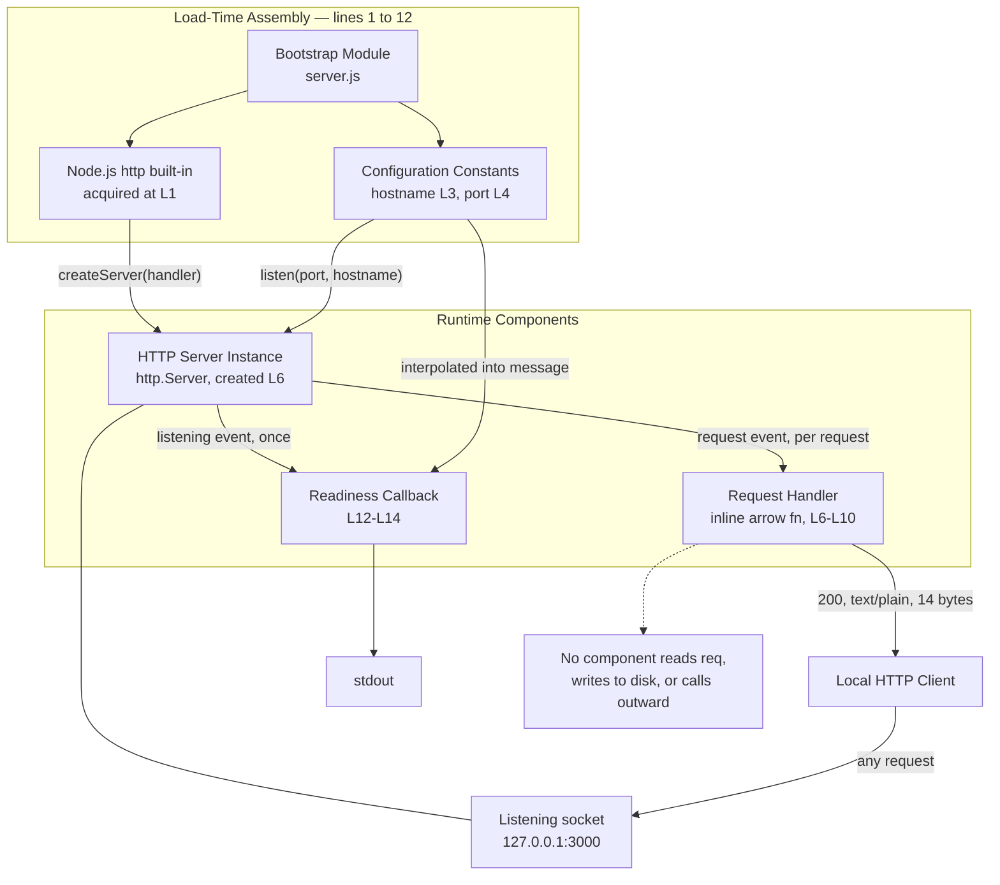

Two structural facts stand out. The **Configuration Constants fan out to two consumers**, which is what keeps the announced URL synchronised with the actual bind. And the **Request Handler has exactly one inbound edge and one outbound edge** — it is a leaf in the interaction graph, which is the structural reason the response is invariant.

### 5.2.7 Component Lifecycle State Transitions

The state machine below is scoped to the components of Section 5.2 and shows which component is active in each state. Section 4.3.1 documents the same lifecycle from the runtime's perspective, together with the per-connection machine that decides every non-`200` outcome.

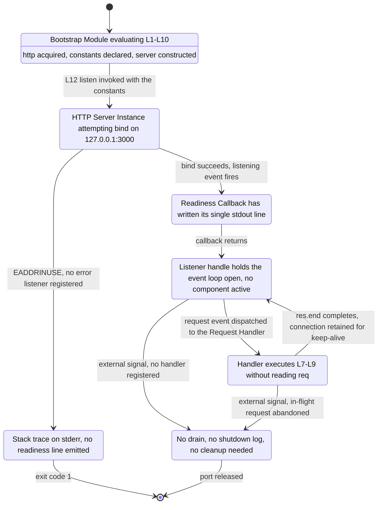

Three properties of this machine are architecturally consequential. There is **no validation state** between `Assembling` and `Binding` — no configuration check or precondition gate exists. There is **no state representing degradation** — no `Draining`, `Unhealthy`, or `Maintenance` state is reachable, because no code exists to enter or expose one. And `Responding` **always returns to `Idle`** on every path, because the handler performs no I/O and reads no input, leaving it nothing that can fail in a way it would recognise.

### 5.2.8 Sequence Diagrams for Key Flows

**Startup sequence.** This flow executes once and is unconditional from module load through the bind attempt.

```mermaid
sequenceDiagram
    actor Operator
    participant Node as Node.js Runtime
    participant Boot as Bootstrap Module (server.js)
    participant Srv as HTTP Server Instance
    participant OS as OS TCP Stack
    participant Out as stdout

    Operator->>Node: node server.js
    Node->>Boot: evaluate module (CommonJS)
    Boot->>Node: require('http') [L1]
    Node-->>Boot: http module (built-in, no install)
    Boot->>Boot: const hostname, port [L3-L4]
    Boot->>Srv: http.createServer(handler) [L6]
    Srv-->>Boot: server object (not yet listening)
    Boot->>Srv: server.listen(3000, '127.0.0.1', cb) [L12]
    Srv->>OS: bind + listen syscall
    alt bind succeeds
        OS-->>Srv: socket bound
        Srv->>Boot: 'listening' event -> callback
        Boot->>Out: "Server running at http://127.0.0.1:3000/" [L13]
        Note over Srv,Out: Process resident — listener handle keeps the event loop open
    else port already in use
        OS-->>Srv: EADDRINUSE (errno -98)
        Srv->>Node: emit 'error' — zero listeners registered
        Node->>Operator: stack trace on stderr, exit code 1
        Note over Node,Operator: No readiness line — recovery is external only
    end
```

**Request-handling sequence.** This flow executes per request and carries nothing forward. The runtime performs every step except the three application writes.

```mermaid
sequenceDiagram
    participant Client as Local HTTP Client
    participant Srv as HTTP Server Instance (http module)
    participant Handler as Request Handler (L6-L10)
    participant Out as stdout

    Client->>Srv: TCP connect to 127.0.0.1:3000
    Client->>Srv: request line + headers (any method, any path)
    Srv->>Srv: parse request line and header block
    alt malformed request or unsupported version
        Srv-->>Client: 400 Bad Request, Connection: close
        Note over Srv,Handler: Handler never invoked — nothing logged
    else header block exceeds ~16 KB
        Srv-->>Client: 431 Request Header Fields Too Large
        Note over Srv,Handler: Handler never invoked — nothing logged
    else well-formed
        Srv->>Handler: 'request' event with (req, res)
        Note over Handler: req is never dereferenced —<br/>method, path, query, body all discarded
        Handler->>Srv: res.statusCode = 200 [L7]
        Handler->>Srv: res.setHeader('Content-Type','text/plain') [L8]
        Handler->>Srv: res.end('Hello, World!\n') [L9]
        Srv->>Srv: add Date, Content-Length: 14, Connection, Keep-Alive
        Srv-->>Client: HTTP/1.1 200 OK + 14-byte body
        Note over Srv,Client: Connection retained for reuse — closes after 5,000 ms idle
    end
    Note over Handler,Out: No stdout write occurs on any request path —<br/>verified: stdout remained at one line throughout all traffic
```


## 5.3 Technical Decisions

**No decision rationale is recorded anywhere in the repository.** There is no architecture document, no design note, no `TODO` comment, and no commit message beyond GitHub's web-interface defaults (`Initial commit` and `Add files via upload`). The decisions below are therefore reconstructed from the code that embodies them. Each is stated as what the implementation demonstrably does, followed by the trade-off that choice imposes — the consequences are verified, the motivations are not, and this section distinguishes the two throughout.

### 5.3.1 Architecture Style Decision

The system is a single-process, single-file monolith with no framework. Three alternatives were available at the time of writing and none was taken; the evidence for each is an absence in the repository.

| Alternative | Evidence Not Chosen | What It Would Have Added | What It Would Have Cost |
|---|---|---|---|
| Framework-based service (Express, Fastify, Koa) | No manifest, no `node_modules`, no framework `require` | Routing, middleware chain, error-handling pipeline, extension seams | Dependency manifest, install step, transitive vulnerability surface |
| Multi-process / clustered monolith | Zero `cluster` and `worker_threads` occurrences | Use of more than one CPU core; resilience to a single worker crash | Process coordination, shared-port handling, higher footprint |
| Distributed or microservice decomposition | One file, no service boundary, no IPC or broker client | Independent scaling and deployment of capabilities | Network hops, service discovery, observability infrastructure |

The trade-off the chosen style delivers is stark and measurable. **Delivered:** a checkout runs immediately with no registry access, no lockfile resolution and no build step, giving complete auditability — the entire request path is three statements — and a footprint of roughly 48 MB resident, essentially all runtime. **Forfeited:** every extension seam. There is no route table or middleware chain to register into, so all cross-cutting concerns that a framework conventionally supplies — validation, structured logging, security headers, graceful shutdown, error handling — are absent and would have to be built from first principles inside lines 6–10.

For an artifact whose entire contract is a fixed 14-byte response, the benefits dominate and the costs remain latent. The balance inverts the moment request differentiation is required.

### 5.3.2 Communication Pattern Choices

One communication pattern is implemented: **synchronous request/response over HTTP/1.1 on loopback TCP**, with the response written and terminated in a single call at line 9.

| Decision | Choice Made | Rationale Supported by the Code |
|---|---|---|
| Interaction style | Synchronous request/response | The handler completes the response in-band; no deferral mechanism exists (`setTimeout` and `setInterval` are absent) |
| Protocol | HTTP/1.1 plaintext | `http` required, not `https`; `HTTP/1.1 200 OK` observed on the wire |
| Response completion | Single terminal write | `res.end(body)` in one call lets the runtime compute an accurate `Content-Length: 14` rather than falling back to chunked framing |
| Connection reuse | Keep-alive at runtime defaults | `Connection: keep-alive`, `Keep-Alive: timeout=5` observed; no timeout is configured in code |
| Scope of reachability | Loopback only | Bind to `127.0.0.1`; a connection to the host's routable interface was refused while loopback succeeded |

Patterns verified absent, each with an architectural consequence:

- **Asynchronous messaging** (queue, broker, publish/subscribe) — no client library exists, so no work can be deferred or buffered.
- **Streaming or chunked responses** — the single terminal write precludes them; there is no partial-response state to recover from.
- **Bidirectional protocols** (WebSocket, Server-Sent Events, gRPC) — no upgrade handling and no `'upgrade'` listener.
- **Outbound calls of any kind** — the process never initiates a connection, which is why no retry, timeout, or circuit-breaker policy exists or is needed.
- **Content negotiation** — the `Accept` header is never read; `text/plain` is a literal.

### 5.3.3 Data Storage Solution Rationale

**The decision was to have no persistence layer**, and it follows necessarily from the response contract. A constant 14-byte body computed from a source literal has no data to store, no data to retrieve, and no state to reconcile. The repository contains no database client, ORM, schema, migration, or datastore configuration, and the process performs no file I/O during its lifetime.

| Storage Concern | Decision | Consequence |
|---|---|---|
| Durable request or domain data | None stored | Nothing survives process exit; restart is idempotent with no cleanup, lock file, or PID file |
| Session or user state | None held | Every binding is `const`; no session affinity requirement can exist |
| Transactional resource | None present | No commit, rollback, isolation level, or compensating action to design; Section 4.3.1 identifies the terminal write at line 9 and the all-or-nothing bind at line 12 as the only atomicity-relevant boundaries |
| Configuration storage | Source literals | Rejects the alternatives — env vars, config file, config service — none of which the code can read |
| Log storage | stdout only | No log file, no retention, no aggregation; capture depends on the invoking supervisor |

The choice is coherent for the current contract and is the single largest structural gap for any richer one: introducing persistence would require a dependency manifest, a client library, connection configuration that the code has no mechanism to read, and error handling that does not exist.

### 5.3.4 Caching Strategy Justification

**No caching exists at any layer, and none is required by the current behaviour.** The justification is that the response is a source literal at line 9 — there is no computation to memoise, no query result to cache, and no upstream latency to hide. Adding a cache would consume memory to avoid work that is already free.

One consequence is worth separating from that justification, because it is a gap rather than a sound trade-off. The handler sets exactly one response header, `Content-Type`. It emits **no `Cache-Control`, `ETag`, `Last-Modified`, or `Expires` header**, so the cacheability of a perfectly static, constant response is left entirely to client and intermediary default heuristics rather than being declared. For a response that could safely be cached indefinitely, that is unnecessarily ambiguous — and it is the one caching-related change that would cost nothing and require no dependency.

| Cache Layer | Status | Basis |
|---|---|---|
| In-process cache or memoisation | Absent — not required | Response is a literal; no computation exists |
| Distributed cache | Absent — not possible | No client library; no outbound network call of any kind |
| HTTP response cache directives | Absent — a genuine gap | Only `Content-Type` is set; cacheability is left to default heuristics |
| Reverse-proxy or CDN cache | Absent | No proxy or edge configuration in the repository; the loopback bind would prevent one reaching it |

### 5.3.5 Security Mechanism Selection

The system implements **one security control: the loopback bind**. Everything else conventionally found at this layer is absent, and semantic search for authentication, authorization, and security-middleware assets returned no results.

| Mechanism | Status | Evidence and Consequence |
|---|---|---|
| Network scope restriction | **Present — the only control** | Bind to `127.0.0.1` (line 3). Verified: a connection to the host's routable interface was refused while loopback succeeded. Incidental rather than enforced — anything able to reach the port is served without identification |
| Transport encryption (TLS) | Absent | The `http` module is required, not `https`; no certificate or key material exists. All traffic is plaintext |
| Authentication | Absent | No credential check, token parsing, or identity provider integration anywhere in the repository |
| Authorization | Absent | No role, scope, or permission concept exists; every caller receives the identical response |
| Input validation | Absent — and currently inert | `req` is never dereferenced, so there is no injection, deserialisation, or path-traversal surface in application code. The protection is a by-product of reading nothing, not a validating control |
| Rate limiting / abuse protection | Absent | No limiter, no `maxConnections` cap, no timeout override; excess demand queues behind the listen backlog |
| Security response headers | Absent | Only `Content-Type` is set — no `Strict-Transport-Security`, `X-Content-Type-Options`, CSP, or CORS policy |
| Secret management | Not applicable | The process holds no credential, and the readiness line discloses only values already present in the source |
| Audit logging | Absent | Nothing is logged per request, so no request content can leak through logs — and equally, there is no record of who called the service |

The controlling security fact is that **the entire posture rests on one line of source**. The loopback bind is a single token; editing `hostname` to `0.0.0.0` would replace the system's only access control with none, exposing an unauthenticated, unencrypted endpoint on every reachable interface. No test, lint rule, review gate, or CI check exists to catch that change — a direct consequence of the absent pipeline documented in Section 3.6.5.

### 5.3.6 Decision Tree

The tree below traces the decision path the implementation actually took. Each branch marked *not taken* is an alternative for which the repository contains no artifact.

```mermaid
flowchart TD
    Start(["Requirement: serve a fixed HTTP response"]) --> Q1{"External dependencies<br/>acceptable?"}
    Q1 -->|"No — chosen"| Builtin["Use the node http built-in<br/>zero manifest, zero install"]
    Q1 -.->|"Yes — not taken"| Framework["Express / Fastify / Koa<br/>no manifest exists in repo"]

    Builtin --> Q2{"Request differentiation<br/>needed?"}
    Q2 -->|"No — chosen"| Uniform["Single unconditional handler<br/>req never dereferenced"]
    Q2 -.->|"Yes — not taken"| Router["Route table + middleware<br/>no such construct in repo"]

    Uniform --> Q3{"State to persist<br/>between requests?"}
    Q3 -->|"No — chosen"| Stateless["Fully stateless<br/>all bindings const, no I/O"]
    Q3 -.->|"Yes — not taken"| Store["Database or cache client<br/>none present"]

    Stateless --> Q4{"Reachable beyond<br/>the local host?"}
    Q4 -->|"No — chosen"| Loopback["Bind 127.0.0.1<br/>sole security control"]
    Q4 -.->|"Yes — not taken"| Exposed["Bind 0.0.0.0 + TLS + auth<br/>none of which exists"]

    Loopback --> Q5{"Configurable at<br/>deploy time?"}
    Q5 -->|"No — chosen"| Literals["const hostname and port<br/>no process.env read"]
    Q5 -.->|"Yes — not taken"| EnvCfg["Env vars or config file<br/>no reader in code"]

    Literals --> Q6{"Handle a bind failure<br/>in application code?"}
    Q6 -->|"No — chosen"| FailFast["No error listener<br/>crash with exit code 1"]
    Q6 -.->|"Yes — not taken"| Recover["error handler + retry or<br/>fallback port; absent"]

    FailFast --> Outcome(["Result: 14-line loopback responder<br/>200, text/plain, 14 bytes, one stdout line"])
```

### 5.3.7 Architecture Decision Records

The records below reconstruct the decisions embodied in the code. **Every "Context" and "Consequences" entry is derived from observed evidence; no "Decision" statement should be read as a documented intent, because the repository documents none.** All six are recorded as *Accepted — implemented*, since each is realised in the committed source, unchanged since commit `80c7709`.

#### ADR-001 — Use the Node.js `http` Built-In Instead of a Web Framework

- **Status:** Accepted — implemented at line 1.
- **Context:** The system must serve one fixed HTTP response. No dependency manifest exists in the repository, so no package could be installed without introducing one.
- **Decision:** Depend solely on the runtime's `http` module, coupling to six call sites: `require`, `createServer`, `statusCode`, `setHeader`, `end`, and `listen`.
- **Consequences:** No install step, no transitive dependency surface, and an unusually wide compatibility envelope. In exchange, there is no routing, no middleware chain, and no error-handling pipeline; all connection-level policy is inherited from the runtime, so wire behaviour can shift between runtime versions without any code change. Section 3.2.3 identifies pinning a runtime version as the highest-value compatibility control the repository lacks.

#### ADR-002 — Keep the Entire System in One Module with No Exports

- **Status:** Accepted — implemented; `server.js` contains no `module.exports`.
- **Context:** The system's whole behaviour is three response writes and one bind.
- **Decision:** Place all code in a single CommonJS file that binds its socket as a side effect of loading.
- **Consequences:** The source file is the deployable artifact, with no build or packaging step. Conversely, the module cannot be imported, reused, or unit-tested without starting a real listener, and it must be launched as `node server.js` — a command that exists only as knowledge derived from the source, since `README.md` documents nothing. Adding a manifest later carries the ESM hazard noted in Section 3.6.6: declaring `"type": "module"` would break line 1.

#### ADR-003 — Bind to Loopback Only

- **Status:** Accepted — implemented at line 3.
- **Context:** No authentication, authorization, or TLS exists in the codebase, so any network exposure would be unauthenticated and unencrypted.
- **Decision:** Bind `127.0.0.1`, confining all consumers to the host.
- **Consequences:** The system's only access control, verified by a refused connection to the routable interface. It simultaneously blocks containerisation — a container built from this source would start, announce readiness, and remain unreachable from outside — and blocks every remote consumer. The control is one token wide and protected by no test or review gate.

#### ADR-004 — Configure the Bind Target with Source Literals

- **Status:** Accepted — implemented at lines 3–4.
- **Context:** No configuration library, environment-variable read, or config file exists in the repository.
- **Decision:** Declare `hostname` and `port` as `const` literals, consumed by both the bind and the readiness message.
- **Consequences:** Zero configuration surface to misconfigure, and the announced URL cannot drift from the actual bind. In exchange, the same artifact cannot be promoted across environments unmodified, orchestrator- or image-level configuration would have no effect, and the fixed port limits the host to exactly one instance.

#### ADR-005 — Handle Every Request Identically Without Reading the Request

- **Status:** Accepted — implemented at lines 6–10.
- **Context:** The required output is one constant response.
- **Decision:** Register one unconditional handler that never dereferences `req`.
- **Consequences:** Behaviour is total and input-independent — verified across method, path, query-string, and body variation — which eliminates any injection or deserialisation surface in application code and makes the handler trivially replicable. In exchange, the handler is the system's only extension seam: any differentiation must begin by editing these five lines, and doing so requires introducing the routing, validation, and status-code vocabulary that do not exist. The 14-byte body, the `200` status, and the `text/plain` header are the entire public contract, protected by no test.

#### ADR-006 — Fail Fast on Bind Failure Rather Than Recover

- **Status:** Accepted — implemented by omission; no `'error'` listener is registered.
- **Context:** Port 3000 must be free at start time; the port is a compile-time constant with no fallback.
- **Decision:** Register no error handling, allowing the runtime to rethrow an unhandled `'error'` event.
- **Consequences:** A port conflict is unambiguous and immediate — verified as an `EADDRINUSE` stack trace on stderr with exit code `1` and no readiness line — which avoids a half-started process that appears healthy but serves nothing. In exchange, there is no retry, no backoff, and no fallback port, so recovery is entirely external to the codebase. Since the repository configures no process manager, restart policy, or service unit, a crash is permanent until something outside these 14 lines restarts the process.


## 5.4 Cross-Cutting Concerns

Cross-cutting concerns are conventionally the layer a framework supplies. Because this system has no framework — and no configuration, pipeline, or supervision artifact of any kind — nearly every concern in this section resolves either to a single line of code or to an absence with an operational consequence. Each is documented as observed, and the boundary between what the codebase provides and what an operator must supply is stated explicitly.

### 5.4.1 Monitoring and Observability

The system's complete observability surface is **one line of text, written once, at startup**: `Server running at http://127.0.0.1:3000/` (line 13). After that line, the process emits nothing for the remainder of its lifetime. This was verified directly — following successful requests, malformed requests, oversized-header requests, and 500 sequential keep-alive requests, the process's stdout still contained exactly one line.

| Observability Capability | Available Today | Basis |
|---|---|---|
| Readiness signal | Yes — scrape stdout for the startup line | Line 13; the line appears only on a successful bind |
| Liveness / health endpoint | No | Every path returns the identical fixed response, so a probe cannot distinguish health from normal operation |
| Request count or rate | No | No counter or log statement exists on the request path |
| Latency measurement | External probing only | No timing instrumentation in the code |
| Error rate | Not applicable in-band | Application code has one path and always returns `200`; parser rejections are never surfaced to it |
| Resource utilisation | External only | Observed via `ps` during verification at ~48 MB RSS; the process reports nothing itself |
| Metrics endpoint or exporter | No | No metrics library, no `/metrics` route, no exporter in the repository |
| Distributed tracing | No | No trace context is propagated; no span is created; the process makes no outbound call to propagate to |

The architecturally significant gap is the **absence of a health signal distinguishable from the response**. An orchestrator or load-balancer probe cannot assess this service's health, which is one of the three containerisation blockers recorded in Section 3.6.4. Liveness must instead be inferred externally by issuing a request and asserting `200` with a 14-byte body — that is, by exercising the service's only function.

### 5.4.2 Logging and Tracing Strategy

There is no logging strategy in any structural sense: no logging library, no logger abstraction, no log level, no output destination other than the inherited stdout and stderr streams, and no log file or rotation policy.

| Attribute | Observed Value |
|---|---|
| Mechanism | The `console` global writing to `process.stdout` (line 13) |
| Format | Unstructured plain text, single line, no delimiter or envelope |
| Metadata carried | None — no timestamp, severity level, PID, hostname, instance ID, or correlation ID |
| Emission volume | Exactly one line per process lifetime |
| Request logging | None. No access log, no per-request entry, and no error entry |
| stderr usage | Fatal stack traces only, emitted by the runtime rather than by application code |
| Verbosity control | None. No flag, environment variable, or level to adjust |
| Aggregation | None in-repo. Requires an external collector attached to the process's stdout |

Two consequences follow directly. First, **there is no audit trail**: because nothing is logged per request, no request content can leak through logs — but equally, there is no record of who called the service, when, or how often. Second, **request-time failures are entirely silent**. As Section 5.4.3 details, three of the four error paths in the system produce no output at all.

Tracing is absent and is also structurally unnecessary in its distributed sense: with no outbound call, there is no downstream hop to correlate. A correlation identifier would still be meaningful for tying a client request to a server-side event, but no such identifier is read from the request or generated, since `req` is never dereferenced.

### 5.4.3 Error Handling Patterns

**The application implements no error handling.** This is a verified absence, not an inference: `server.js` contains zero occurrences of `try`, `catch`, `on(`, `process.`, and `close`, which respectively rule out exception handling, any explicit event listener (including `'error'` and `'clientError'`), any `process.on('uncaughtException')` or signal handler, and any `server.close()` draining path. Every error path in the running system is therefore handled — or not handled — by the Node.js runtime.

Four error paths exist. All four were reproduced during verification.

| Error Path | Application Contribution | Observable Outcome |
|---|---|---|
| `EADDRINUSE` on bind | **None** — no `'error'` listener registered | Unhandled `'error'` event rethrown at `node:events:497`; stack trace on stderr with `errno -98`, `syscall: 'listen'`; **exit code 1**; no readiness line |
| Malformed request line or unsupported HTTP version | **None** — no `'clientError'` handler | `400 Bad Request`; handler never invoked; nothing logged |
| Header block beyond the runtime's ~16 KB limit | **None** | `431 Request Header Fields Too Large`; handler never invoked; nothing logged |
| Client aborts or sends an incomplete request | **None** | Socket destroyed silently; process unaffected; nothing logged |

The pattern is a **fail-fast startup paired with a silent, always-succeeding request path**. Because the handler performs no I/O and reads no input, it has no failure mode it could recognise: there is no error branch in application code because no application-level error is reachable.

| Resilience Pattern | Status |
|---|---|
| Retry with backoff | Absent — no `setTimeout` or `setInterval` exists, so no operation can be deferred or re-attempted |
| Fallback port on conflict | Absent — the port is a `const`; the process terminates instead |
| Graceful degradation / load shedding | Absent — no `maxConnections` cap and no rate limiter; excess demand queues behind the listen backlog |
| Circuit breaker | Not applicable — there is no dependency to break from |
| Graceful shutdown / connection drain | Absent — no signal handler and no `server.close()`; in-flight requests are abandoned on termination |
| Dead-letter or replay | Absent — requests are not journaled; a lost request must be reissued by the client |

```mermaid
flowchart TD
    Launch(["node server.js"]) --> Bind["L12 bind attempt on 127.0.0.1:3000"]
    Bind --> BindOK{"Bind succeeded?"}

    BindOK -->|"No"| ErrEvent["Server emits 'error' — zero listeners registered"]
    ErrEvent --> Rethrow["Runtime rethrows at node:events:497<br/>stderr: EADDRINUSE, errno -98, syscall listen"]
    Rethrow --> Fatal(["FATAL — exit code 1<br/>no readiness line emitted"])
    Fatal --> External["Operator frees port 3000<br/>or edits the L4 constant"]
    External --> Launch

    BindOK -->|"Yes"| Ready["READY — listener bound,<br/>one stdout line written"]
    Ready --> Inbound["Inbound request received"]

    Inbound --> ParseOK{"Request line and<br/>version well-formed?"}
    ParseOK -->|"No"| E400["Runtime replies 400 Bad Request<br/>handler never runs, nothing logged"]
    ParseOK -->|"Yes"| SizeOK{"Header block within<br/>the runtime limit?"}
    SizeOK -->|"No"| E431["Runtime replies 431<br/>handler never runs, nothing logged"]
    SizeOK -->|"Yes"| Handle["Handler executes L7-L9 unconditionally<br/>no try/catch, no branch, no logging"]

    Handle --> Connected{"Client still<br/>connected?"}
    Connected -->|"No"| Silent["net layer destroys the socket silently<br/>process survives, stdout unchanged"]
    Connected -->|"Yes"| OK(["200, text/plain, 14 bytes"])

    E400 --> Ready
    E431 --> Ready
    Silent --> Ready
    OK --> Ready
```

The diagram's asymmetry is the section's central finding: the **startup path has one fatal outcome and no recovery edge inside the process**, while the **request path has no fatal outcome at all** and no diagnostic output on any of its three failure branches.

### 5.4.4 Authentication and Authorization Framework

**No authentication or authorization framework exists.** Semantic search across the repository for authentication, authorization, and security-middleware assets returned no results, consistent with the absence of any dependency manifest in which such a library could be declared.

| Concern | Status in the Codebase |
|---|---|
| Caller identification | None. The handler never dereferences `req`, so no credential, token, cookie, or header can be inspected |
| Credential verification | None. No password, key, certificate, or signature check exists |
| Session or token management | None. No session store, no token issuance or validation, no expiry logic |
| Authorization model | None. No role, scope, permission, or policy concept exists; every caller receives the identical response |
| Identity provider integration | None. The process makes no outbound call, so no OIDC, SAML, or LDAP exchange is possible |
| Transport protection | None. The `http` module is used rather than `https`; all traffic is plaintext |

The de facto access control is **network reachability**: the loopback bind at line 3 restricts callers to processes on the same host, verified by the refused connection to the host's routable interface. This is containment, not authentication — it establishes *where* a caller must be, never *who* the caller is, and it grants every local process identical, unlimited access. As recorded in ADR-003, that control is a single token in the source and is protected by no test, lint rule, or review gate.

### 5.4.5 Performance Characteristics and Service Levels

**No performance requirement, SLA, or SLO is defined in this repository.** There is no such document, no timeout or rate-limit constant, no benchmark or load-test script, no monitoring definition, and no CI gate from which a target could be derived. The figures below are **measurements, not commitments** — they characterise the observed behaviour of the code on the verification host and would differ on other hardware.

| Characteristic | Observed Value | Measurement Basis |
|---|---|---|
| Response payload | Exactly 14 bytes, constant | `Content-Length: 14` on every response |
| Single-request round trip | ≈0.46 ms total over loopback | Client-side timing of `GET /` |
| Sequential keep-alive throughput | 500 requests in 55 ms on one connection | Direct measurement, single client |
| Concurrent throughput | ≈14,000 requests/second at concurrency 50; p50 ≈2 ms, p99 ≈31 ms | Recorded in Section 2.4.2 |
| Response consistency under load | 1 distinct status-and-body pair across 500 requests | No drift; confirms statelessness |
| Resident memory | ≈48 MB, runtime-dominated | `ps` against the running process |
| Concurrency model | Single JavaScript event-loop thread (7 OS threads total, the remainder runtime helpers) | No `cluster` or `worker_threads` in source |
| Idle keep-alive timeout | 5,000 ms | `Keep-Alive: timeout=5`, a runtime default |

Three architectural constraints bound performance regardless of host capacity, and all three are structural rather than tunable:

- **One CPU core.** With no clustering or worker threads, additional cores cannot be recruited.
- **One instance per host.** The fixed port makes horizontal scale-out on a single host impossible without a source edit.
- **No admission control.** With no rate limiter, connection cap, or timeout override, demand beyond the event loop's capacity queues rather than being shed, so latency degrades instead of the service rejecting load.

Latency is dominated by the runtime's HTTP framing rather than by application work, since the handler performs no I/O and allocates nothing beyond the response. Any organisation adopting this service would need to define its own targets; none can be inherited from the repository.

### 5.4.6 Disaster Recovery and Availability

**No disaster recovery procedure is codified anywhere in the repository.** There is no backup, no replication, no failover, no runbook, no health check, and no restart policy — and, as Section 3.6.5 records, no process manager, service unit, container definition, or orchestration manifest in which one could be declared.

Two properties of the architecture make recovery unusually simple while leaving it entirely manual. The system is **fully stateless**, so there is no data to back up, restore, or reconcile — nothing survives process exit and no data loss is possible beyond in-flight requests. And **startup is idempotent**: the process writes no files, leaves no lock file, PID file, or temporary state behind, and requires no cleanup before relaunch.

| Scenario | Recovery Procedure | Owner |
|---|---|---|
| Crash on `EADDRINUSE` | Stop the process holding port 3000, or edit the port constant at line 4, then relaunch. Verified: once the holder exits, the port frees immediately and a fresh instance binds and announces readiness normally | Operator / external supervisor |
| Termination by signal | Relaunch `node server.js`. No cleanup is required | Operator / external supervisor |
| Process unresponsive | No in-band remedy. Liveness must be probed by issuing a request and asserting `200` with a 14-byte body, since no distinguishable health path exists | External monitor |
| Host loss | Redeploy the two-file checkout on a replacement host and relaunch. There is no state to restore, but also no automation to perform this | Operator |
| In-flight requests at shutdown | No recovery. Requests are not journaled or replayed; the client must reissue | Client |

The decisive availability fact is that **continuous availability requires an external supervisor**. Nothing inside these 14 lines restarts the process after a crash, and no configuration in the repository instructs anything outside them to do so. A crash is permanent until a human or an externally supplied supervisor intervenes. Combined with the single-instance-per-host constraint, the system has **no redundancy of any kind**: one process on one host is the entire deployment topology, and its failure is a total outage of the service.


## 5.5 References

### 5.5.1 Repository Files and Folders Examined

- `server.js` — The single source file and the entire basis of this section. Established every component, interface, and behaviour documented here: the `require('http')` dependency (line 1), the `hostname`/`port` constants (lines 3–4), the server construction and inline request handler (lines 6–10), the response contract of status `200`, `Content-Type: text/plain`, and the 14-byte body `Hello, World!\n` (lines 7–9), and the bind with its readiness callback (lines 12–14). Also established by absence: no `module.exports`, no `try`/`catch`, no `'error'` or `'clientError'` listener, no `process.on` signal handler, no `server.close()`, no `let`/`var`, no `process.env` read, and no `cluster` or `worker_threads` usage.
- `README.md` — 13 bytes containing only the heading `# Hello_world`. Confirmed the absence of any documented run procedure, architecture note, configuration reference, or operational guidance.
- Repository root (folder path `""`) — Confirmed the complete file inventory is two files with **no subdirectories**, establishing that the system has no module decomposition. Also confirmed the absence of `package.json` and all lockfiles, `Dockerfile`, `docker-compose.yml`, `.env`, `.nvmrc`, `tsconfig.json`, `.eslintrc`, `.gitignore`, `Makefile`, `Procfile`, any `.github/` directory, and any test file — the basis for every "verified absent" statement in Sections 5.1.4, 5.3, and 5.4.
- Git metadata — Established that the source has been unchanged since commit `80c7709` ("Add files via upload"), preceded only by `d5373cb` ("Initial commit", adding `README.md`), and that both branch tips contain an identical two-file tree.

### 5.5.2 Runtime Verification Performed

All behavioural claims in this section were confirmed by executing the service on **Node.js v22.23.2** and observing the results:

- **Startup** — `node server.js` produced exactly one stdout line, `Server running at http://127.0.0.1:3000/`, and no stderr output.
- **Response contract** — `GET /` returned `HTTP/1.1 200 OK` with `Content-Type: text/plain`, plus the runtime-generated `Date`, `Content-Length: 14`, `Connection: keep-alive`, and `Keep-Alive: timeout=5` headers, and a 14-byte body; round-trip time ≈0.46 ms.
- **Input insensitivity** — `POST /admin/anything?q=1` with a request payload returned a byte-identical response, confirming that method, path, query string, and body are all discarded unread.
- **Statelessness under load** — 500 sequential requests over one keep-alive connection completed in 55 ms and produced exactly one distinct status-and-body pair.
- **Network boundary** — A connection to the host's routable (non-loopback) interface on port 3000 failed while the identical loopback request succeeded, confirming the `127.0.0.1` bind as the system's only access control.
- **Parser-level rejections** — Raw-socket tests produced `400 Bad Request` for a malformed method and for an `HTTP/9.9` version, and `431 Request Header Fields Too Large` for a ~22 KB header block; the process survived all three and stdout remained at one line.
- **Fatal startup failure** — A second concurrent instance exited with code `1`, emitting an unhandled `'error'` event rethrown at `node:events:497` with `EADDRINUSE`, `errno: -98`, `syscall: 'listen'`, `address: '127.0.0.1'`, `port: 3000`.
- **Process footprint** — Approximately 48 MB resident set size across 7 OS threads, with application JavaScript confined to a single event-loop thread.
- **Semantic search** — A repository-wide search for authentication, authorization, and security-middleware assets returned no results.

### 5.5.3 Technical Specification Sections Cross-Referenced

- **1.2 System Overview** — Supplied the established component vocabulary reused in Section 5.1.2, the "zero-dependency extreme" positioning, and the enterprise integration inventory corroborated in Section 5.1.4.
- **2.4 Implementation Considerations** — Supplied the feature identifiers F-001 to F-004, the concurrent throughput figures cited in Section 5.4.5, the single-instance and single-core scaling constraints, and the assessment of the `0.0.0.0` edit as the highest-impact change available in the file.
- **3.2 Frameworks & Libraries** — Established the six-call-site API surface and the runtime-versus-application responsibility split underpinning Sections 5.2.3 and 5.3.1, and identified runtime-version pinning as the missing compatibility control noted in ADR-001.
- **3.6 Development & Deployment** — Established that the source file is the deployable artifact, the absence of any build system, CI/CD pipeline, or containerisation, the three containerisation blockers cited in Sections 5.2.2 and 5.4.1, and the ESM hazard noted in ADR-002.
- **4.3 Technical Implementation** — Supplied the runtime-perspective state machines that Section 5.2.7 complements, the zero-occurrence grep evidence for absent error handling in Section 5.4.3, the per-connection state machine governing every non-`200` outcome, and the transaction-boundary analysis reused in Section 5.3.3.


# 6. SYSTEM COMPONENTS DESIGN

## 6.1 Core Services Architecture

### 6.1.1 Applicability Assessment

**Core Services Architecture is not applicable for this system.**

The repository contains no microservices, no distributed architecture, and no distinct service components. Its entire content is two files — `server.js` (14 lines, 342 bytes) and `README.md` (13 bytes) — with no subdirectories. A full git file census across every branch (`git log --all --pretty=format: --name-only | sort -u`) returns exactly those two paths, so no additional deployable unit has ever existed on any branch. There is therefore only **one process, one module, and one inbound interface** in the system, which is the same conclusion Section 5.1.1 reaches from the architectural-style perspective and Section 5.3.1 records as the "distributed or microservice decomposition" alternative not taken.

A "core service" in the sense this section addresses requires, at minimum, a unit that can be deployed, addressed, scaled, or failed over independently of another such unit. No second unit exists to stand in that relationship, so the concerns the section prompt enumerates — inter-service communication, discovery, load balancing, circuit breaking, retry and fallback — have no counterparty in this codebase.

#### 6.1.1.1 Decomposition Criteria Evaluated

Each criterion below was tested directly against the repository rather than inferred. `grep -c` counts are taken over `server.js`, the only source file.

| Criterion for a Service Architecture | Evidence That Would Establish It | Observed Result |
|---|---|---|
| More than one deployable unit | A second entrypoint, service directory, or package | Absent — 2 files total, 0 directories; only `server.js` is executable code |
| Inter-process or inter-service calls | Outbound client code (`http.request`, `fetch`, gRPC, broker) | Absent — `http.request`, `fetch(`, `axios`, `grpc`, `amqp`, `kafka`, `redis`, `mongo` each return 0 occurrences |
| A service registry or discovery client | `consul`, `etcd`, `eureka`, `zookeeper`, DNS-SD, or a registry SDK | Absent — all four registry tokens and `dns` return 0 occurrences |
| Multiple processes or workers per unit | `cluster`, `worker_threads`, `child_process`, `fork`, `spawn` | Absent — all return 0 occurrences; `pgrep -P <pid>` shows the running process has no children |
| A routing or dispatch layer | A route table, path matching, or method dispatch | Absent — `req` is never dereferenced; `if (`, `switch`, `url`, `method` all return 0 occurrences |
| A deployment topology descriptor | Container, orchestration, proxy, or process-manager config | Absent — see the artifact inventory in 6.1.1.2 |

Two independent semantic searches over the repository corroborate the code-level findings: a search for service-discovery, load-balancer, and circuit-breaker configuration returned zero results, and a folder search for independently deployable service or microservice packages likewise returned zero results — consistent with a repository that has no folders at all.

#### 6.1.1.2 Absence of a Deployment Topology

A service architecture is normally expressed as much in deployment descriptors as in code. Every such artifact was checked individually in the working tree and is absent, which means the repository declares no replica count, no scaling policy, no routing rule, and no restart behaviour anywhere.

| Artifact Class | Files Checked | Status |
|---|---|---|
| Container definition | `Dockerfile`, `docker-compose.yml`, `compose.yaml`, `.dockerignore` | All absent |
| Orchestration manifests | `deployment.yaml`, `service.yaml`, `ingress.yaml`, `hpa.yaml`, `k8s/`, `helm/`, `Chart.yaml` | All absent |
| Reverse proxy / load balancer | `nginx.conf`, `haproxy.cfg`, `envoy.yaml`, `Caddyfile` | All absent |
| Process supervision | `Procfile`, `ecosystem.config.js`, `pm2.json`, systemd unit, `app.json` | All absent |
| Infrastructure as code / pipelines | `main.tf`, `terraform/`, `.github/`, `.gitlab-ci.yml`, `Jenkinsfile`, `serverless.yml`, `skaffold.yaml` | All absent |
| Runtime manifest | `package.json` (and any lockfile) | Absent — no dependency, engine, or script declaration exists |

This is the same inventory that Section 3.6 records for the build and delivery perspective; here it establishes the specific point that **no artifact in the repository can express a service boundary, a scaling rule, or a failover policy**, so none of the mechanisms this section examines could be configured without first adding files that do not exist.

#### 6.1.1.3 Actual Topology and How This Section Proceeds

The deployment topology is a single OS process launched as `node server.js`, holding one listening socket on `127.0.0.1:3000`. Measured on the verification host (Node.js v22.23.2): the process shows **7 OS threads** — one JavaScript event-loop thread plus runtime helper threads — and **no child processes**, confirming that all application code executes on a single event loop. A second instance on the same host cannot start: it exits with code `1` and `Error: listen EADDRINUSE: address already in use 127.0.0.1:3000`, thrown as an unhandled `'error'` event at `node:events:497`. The listener is reachable only from the host itself — `curl http://127.0.0.1:3000/` returns `200` while the host's routable address `10.76.1.55:3000` fails to connect.

```mermaid
flowchart TB
    subgraph HostScope["Single Host — the complete deployment"]
        direction TB
        Client["Local HTTP client<br/>must be on this host"]

        subgraph ProcScope["One OS process — node server.js<br/>7 OS threads, 1 JS event loop, 0 children"]
            direction TB
            Listener["HTTP Server Instance<br/>one socket: 127.0.0.1:3000"]
            Handler["Request Handler, L7-L9<br/>unconditional 200 / text/plain / 14 bytes"]
            Listener --> Handler
            Handler --> Listener
        end

        Second["Second instance attempt<br/>EADDRINUSE, exit code 1"]
        Client -->|"HTTP/1.1 request"| Listener
        Listener -->|"fixed response"| Client
        Second -.->|"cannot bind — port is a const"| Listener
    end

    Remote["Any other host or container"]
    Remote -.->|"connection refused — verified"| HostScope

    Absent["No peer service, sidecar, broker,<br/>registry, proxy, or datastore<br/>exists in the repository"]
    ProcScope -.->|"no such component"| Absent
```

*Diagram 6.1.1-A — Actual deployment topology: one process, one socket, no peer of any kind.*

Because a bare non-applicability statement would leave the operational questions in the prompt unanswered, the remainder of this section documents each required concern against that topology: 6.1.2 examines the service-component questions and records what each mechanism would require if a second unit were introduced; 6.1.3 quantifies the scaling ceiling of the single process from direct measurement; and 6.1.4 documents the resilience posture of a one-instance, no-supervisor deployment. Every subsection distinguishes what the code does from what an operator must supply externally.


### 6.1.2 Service Components

The system has **one service component**, and its internal parts are not services — they are constructs inside a single module that share a call stack, not a network. The five constructs listed in Section 5.1.2 (Bootstrap Module, Configuration Constants, HTTP Server Instance, Request Handler, Readiness Callback) are documented there as components; this subsection examines whether any of them constitutes a *service boundary*, and concludes that none does.

#### 6.1.2.1 Service Boundaries and Responsibilities

The only boundary in the system that carries a protocol is the inbound HTTP listener. Everything on the far side of that boundary is in-process function invocation performed by the Node.js runtime.

| Construct | Responsibility | Boundary Type |
|---|---|---|
| HTTP Server Instance (L6, L12) | Own the listening socket; accept, parse, and frame HTTP/1.1 | Network boundary — the system's only one, at `127.0.0.1:3000` |
| Request Handler (L7–L9) | Write status `200`, `Content-Type: text/plain`, and the 14-byte body | In-process callback — invoked by the runtime, not addressed over a wire |
| Configuration Constants (L3–L4) | Supply the bind target to both the listener and the readiness message | Lexical scope — compiled into the source, not fetched from anywhere |
| Readiness Callback (L13) | Emit one line to stdout on the `listening` event | Process-stream boundary — outbound, fire-and-forget, once per lifetime |

The decisive property is that **the boundary count cannot be increased without changing the code**. There is no plugin point, no route table, and no exported symbol: `server.js` declares no `module.exports`, so nothing can even import it to compose a larger topology (Section 5.3.7, ADR-002). Responsibility partitioning of the kind a service architecture performs — separating request admission from business logic from data access — has no expression here because the total behaviour is three unconditional writes.

#### 6.1.2.2 Inter-Service Communication Patterns

**No inter-service communication exists, in either direction, at any layer.** The process never initiates a network connection: `server.js` contains zero occurrences of `http.request`, `https`, `fetch(`, `axios`, `grpc`, `amqp`, `kafka`, `redis`, `mongo`, `net.`, `dgram`, and `dns`. The single `require` on line 1 targets the runtime's `http` module, and the process holds exactly one socket, the inbound listener.

| Communication Concern | Status in This System | Basis |
|---|---|---|
| Synchronous inbound (client → system) | Present — the only channel | HTTP/1.1 over loopback TCP; keep-alive at runtime defaults (Section 5.3.2) |
| Synchronous outbound (system → peer) | Absent | No client library or socket-initiating call exists |
| Asynchronous messaging / events | Absent | No broker client, no queue, no publish/subscribe code; `search_files` for queue, worker, and job-processing implementations returned zero results |
| Streaming or bidirectional (WebSocket, SSE, gRPC) | Absent | No `'upgrade'` listener; the response is a single terminal write |
| Shared-database integration | Absent | No datastore of any kind exists (Section 5.3.3) |
| Shared-memory or IPC | Absent | No `child_process`, `fork`, `cluster`, or `worker_threads`; the process has no children |

The architectural consequence is that **the request is terminal**. A request enters, is answered from a source literal, and produces no downstream call, no event, and no write. This is why several patterns in the section prompt are not merely unimplemented but have no possible subject in this codebase, as recorded in Section 5.3.2.

#### 6.1.2.3 Service Discovery Mechanisms

**No service discovery mechanism exists, and none is required by the current topology.** The bind target is not discovered — it is two source literals, `hostname = '127.0.0.1'` and `port = 3000` (L3–L4), consumed directly by `server.listen` at L12. There is no registry client, no DNS-based lookup, no environment-variable indirection (`process.env` returns 0 occurrences), and no configuration file the process could read.

| Discovery Capability | Status | Consequence |
|---|---|---|
| Registration with a registry | Absent | Nothing announces this instance to anything; the sole readiness signal is one stdout line |
| Lookup of dependencies | Absent — nothing to look up | The process has no dependency to resolve |
| Addressability by clients | Static and compile-time | Clients must know `127.0.0.1:3000`; the value cannot be overridden at deploy time (Section 5.3.7, ADR-004) |
| Health-based membership | Impossible as written | No probe path is distinguishable from a normal request (Section 5.4.1) |

The loopback bind compounds this: even if a registry were introduced, the address it advertised would be unreachable from any other host, since a connection to the host's routable interface is refused. Making this instance discoverable would require changing L3 as a precondition — the change Section 5.3.5 identifies as the one that would remove the system's only access control.

#### 6.1.2.4 Load Balancing Strategy

**No load balancing strategy is defined or possible in the current configuration.** There is no proxy or balancer configuration in the repository (`nginx.conf`, `haproxy.cfg`, `envoy.yaml`, `Caddyfile` all absent), and — more fundamentally — there is no second backend to balance across.

Two structural blockers were verified by measurement:

- **The port is fixed.** Because `port` is a `const` with no environment override, a second instance on the same host cannot bind. The attempt exits with code `1` and `EADDRINUSE`, so a same-host backend pool of size greater than one is impossible without editing the source.
- **The address is loopback.** A balancer running on another host could not reach the instance at all; a balancer on the *same* host could reach it, but would be balancing a pool of one.

| Balancing Element | Status | What Would Be Required |
|---|---|---|
| Backend pool | Pool size fixed at 1 per host | Parameterise the port (env var or CLI argument) so multiple instances can coexist |
| Distribution algorithm | Not applicable | A proxy or orchestrator service object — none exists in the repository |
| Health-check probe | Not implementable | A path that returns a distinguishable status; every path currently returns `200` |
| Session affinity | Not meaningful | Already unnecessary: the service is fully stateless, so any instance can serve any request |

The one property that would make load balancing trivial if the blockers were removed is statelessness. As Section 5.1.1 records, every binding is `const` and nothing persists between requests, so no affinity or state-replication design would be needed.

#### 6.1.2.5 Circuit Breaker Patterns

**No circuit breaker exists, and the pattern has no applicable subject.** A circuit breaker protects a caller from a failing dependency; this process has no dependency and makes no outbound call, so there is no failure signal to trip on and no call to short-circuit. Section 5.3.2 states the same conclusion from the communication-pattern perspective, and Section 5.4.3 records the pattern as *not applicable* rather than merely missing. `server.js` contains zero occurrences of `circuit`, and no breaker library could be present because there is no dependency manifest.

The related *inbound* protection a breaker is sometimes paired with — shedding load when the service itself is degraded — is also absent and is discussed as service degradation in 6.1.4.5.

#### 6.1.2.6 Retry and Fallback Mechanisms

**No retry, backoff, or fallback mechanism exists anywhere in the codebase.** This is verified by absence of the primitives any such mechanism would need: `setTimeout` and `setInterval` return 0 occurrences, so no operation can be deferred or re-attempted; `try` and `catch` return 0 occurrences, so no failure can be caught and redirected; and `on('error'` returns 0 occurrences, so no error event is observed by application code.

| Failure Scenario | Retry or Fallback Implemented | Actual Behaviour |
|---|---|---|
| Bind fails because port 3000 is held | None — no error listener, no fallback port | Process crashes with exit code `1`; no retry (Section 5.3.7, ADR-006) |
| Client sends a malformed request | None | The runtime replies `400` before the handler runs; nothing is logged |
| Request headers exceed the runtime limit | None | The runtime replies `431`; nothing is logged |
| Client aborts mid-request | None | Socket destroyed silently; process unaffected |
| Handler-level failure | Not reachable | The handler performs no I/O and reads no input, so it has no failure mode to recover from |

Responsibility for every retry in the system therefore sits **outside** it: the client must reissue a lost request (nothing is journaled or replayed), and an operator or external supervisor must relaunch a crashed process. The four error paths themselves are documented in full in Section 5.4.3; this subsection records only that none of them is met with a retry or fallback in code.

```mermaid
flowchart LR
    Client["Local HTTP client<br/>same host only"]

    subgraph Service["The single service component — node server.js"]
        direction TB
        Runtime["Node http runtime<br/>accept, parse, frame, keep-alive"]
        Handler["Request Handler L7-L9<br/>one unconditional path"]
        Consts["Config Constants L3-L4<br/>compile-time literals"]
        Runtime --> Handler
        Consts -.->|"supplies bind target"| Runtime
    end

    Stdout["stdout — one readiness line"]

    Client -->|"1. HTTP/1.1 request<br/>any method, any path"| Runtime
    Runtime -->|"2. 200 text/plain, 14 bytes"| Client
    Service --> Stdout

    subgraph NotPresent["Verified absent — zero occurrences in source"]
        direction TB
        Peer["Peer service / sidecar"]
        Registry["Service registry<br/>consul, etcd, eureka"]
        Balancer["Load balancer / reverse proxy"]
        Breaker["Circuit breaker + retry policy"]
        Broker["Message broker / queue"]
    end

    Handler -.->|"no outbound call of any kind"| Peer
    Service -.->|"no registration, no lookup"| Registry
    Client -.->|"no proxy in the path"| Balancer
    Handler -.->|"no dependency to protect"| Breaker
    Handler -.->|"no event emitted"| Broker
```

*Diagram 6.1.2-A — Service interaction: the two solid paths are the entire interaction surface; every dashed edge terminates in a component proven absent from the repository.*


### 6.1.3 Scalability Design

**No scalability design is expressed in the repository.** There is no replica count, no autoscaling policy, no resource request or limit, and no clustering code. What follows is therefore a characterisation of the scaling *ceiling* of the single process, derived from direct measurement, together with the specific edits that would be required to lift each constraint. All figures in this subsection are **measurements taken on one verification host (Node.js v22.23.2, `nproc` = 44 cores), not commitments** — the repository defines no performance target, SLA, or SLO of any kind, as Section 5.1.4 establishes.

#### 6.1.3.1 Horizontal and Vertical Scaling Approach

Neither axis is available without a source change, and the blocking constraint differs on each.

| Scaling Axis | Blocking Constraint | Evidence |
|---|---|---|
| Horizontal, same host | `port` is a `const` with no override | Second instance exits code `1` with `EADDRINUSE` on `127.0.0.1:3000` |
| Horizontal, multiple hosts | `hostname` is `127.0.0.1`; no balancer, no discovery | Request to the host's routable address `10.76.1.55:3000` fails to connect |
| Vertical, more CPU cores | One JS event-loop thread; no `cluster`, no `worker_threads` | Process CPU accounting peaked at ~74% of **one** core under a 200,000-request run; 43 of 44 host cores were unreachable |
| Vertical, more memory | No heap flag, no manifest in which to declare one | No `package.json` scripts and no `--max-old-space-size`; RSS ≈47.8 MB idle, ≈62.3 MB after 8,000 requests |

The measured throughput and latency curve shows what the single event loop does as concurrency rises. Each row is 2,000 requests over keep-alive connections against one instance:

| Client Concurrency | Throughput (req/s) | p50 / p99 Latency |
|---|---|---|
| 1 | ≈10,720 | 0.1 ms / 0.3 ms |
| 10 | ≈16,282 | 0.4 ms / 2.1 ms |
| 50 | ≈13,239 | 2.5 ms / 36.1 ms |
| 200 | ≈11,004 | 13.1 ms / 71.6 ms |

The pattern is the signature of a single-threaded server with no admission control: **throughput plateaus while tail latency inflates by more than two orders of magnitude** (p99 rising from 0.3 ms to 71.6 ms as concurrency goes from 1 to 200). Warmed longer runs at concurrency 50 reached ≈33,900 req/s over 40,000 requests and ≈37,000 req/s over 200,000 requests with p99 ≈2.6–3.4 ms, confirming that steady-state capacity is materially higher than a short cold run suggests and that the co-resident load generator, itself single-threaded, competes for CPU. Section 2.4 records an independent measurement of ≈14,000 req/s at concurrency 50 on the same class of host; the spread between these figures is itself the reason none of them should be read as a capacity guarantee.

#### 6.1.3.2 Auto-Scaling Triggers and Rules

**No auto-scaling trigger or rule exists, and none could be evaluated against this service as written.** Two independent gaps block it:

- **No scaling substrate.** There is no orchestration manifest, no horizontal pod autoscaler definition, no process manager configuration, and no `package.json` — verified in the artifact inventory in 6.1.1.2 — so there is nothing to declare a minimum, maximum, or target replica count in.
- **No signal to trigger on.** The process emits exactly one line of output for its entire lifetime; stdout still contained one line after 8,000 requests. There is no metrics endpoint, no counter, and no latency instrumentation (Section 5.4.1), so a controller has no in-band utilisation or saturation signal to act on. Even a CPU-based trigger would be misleading, because the process cannot exceed one core regardless of demand.

| Trigger Class | Availability | Reason |
|---|---|---|
| Request-rate or queue-depth based | Unavailable | No counter, no metric export, no log per request |
| Latency based | Unavailable in-band | No timing instrumentation; only external probing measures latency |
| CPU or memory based | Available externally, but of low value | The single event loop caps utilisation near one core; adding replicas on one host is blocked by the fixed port |
| Health-check based membership | Unavailable | No probe path distinguishable from an ordinary request |

#### 6.1.3.3 Resource Allocation Strategy

**Resource allocation is entirely inherited from the runtime and the host; the repository allocates nothing.** No container resource request or limit exists, no cgroup or ulimit configuration is present, no V8 heap flag is set, and no thread-pool size (`UV_THREADPOOL_SIZE`) is configured — consistent with the absence of any environment-variable read in the source.

| Resource | Observed Allocation | Source of the Value |
|---|---|---|
| CPU | One JavaScript thread; 7 OS threads total | Node.js runtime default; no clustering in code |
| Memory | ≈47.8 MB RSS idle, ≈62.3 MB after 8,000 requests | Runtime-dominated; the application allocates only the response |
| Sockets / connections | Unbounded by the application | No `maxConnections` cap (0 occurrences) |
| Connection queue | Runtime default listen backlog | `server.listen(port, hostname, cb)` passes no backlog argument (Section 2.4 records the runtime default as 511) |
| Idle connection lifetime | 5,000 ms keep-alive timeout | Runtime default; `keepAliveTimeout` is never set in code |

The operational consequence is that **the host, not the application, is the only place resource policy can be applied**. Any limit — CPU shares, memory ceiling, file-descriptor cap — must be imposed by whatever launches the process, and nothing in the repository instructs it to do so.

#### 6.1.3.4 Performance Optimization Techniques

Two properties of the implementation are genuinely optimal for its contract, and both are consequences of doing nothing rather than of tuning:

- **Zero work per request.** The handler reads no input, performs no I/O, executes no branch, and allocates nothing beyond the response, so per-request latency is dominated by the runtime's HTTP framing. Section 5.4.5 reaches the same conclusion from measurement.
- **Single terminal write.** `res.end(body)` in one call lets the runtime compute an exact `Content-Length: 14` instead of falling back to chunked framing (Section 5.3.2), which is the cheapest correct framing available.

Optimisation techniques conventionally applied at this layer are absent, and each has a specific reason:

| Technique | Status | Note |
|---|---|---|
| Multi-core utilisation (`cluster`, worker threads) | Absent | The single highest-leverage available change; 43 of 44 cores idle under load |
| Response caching / cache directives | Absent | No `Cache-Control` or `ETag` is emitted, leaving intermediary caching to defaults (Section 5.3.4) |
| Compression | Absent — and unhelpful here | A 14-byte body would grow under gzip framing |
| Connection reuse | Present, at runtime defaults | `Connection: keep-alive`, `Keep-Alive: timeout=5` observed |
| Payload precomputation | Effectively present | The body is a source literal; there is nothing to precompute |

#### 6.1.3.5 Capacity Planning Guidelines

The repository provides no capacity model, so the guidance below is derived strictly from the measured behaviour above and must be re-measured on any target host before use.

| Planning Question | What the Measurements Support |
|---|---|
| Capacity of one instance | Tens of thousands of req/s for this fixed 14-byte response, bounded by one CPU core; ≈37,000 req/s observed in the largest warmed run |
| Instances per host | Exactly **one**, until the port becomes configurable |
| Memory to provision | ≈50–65 MB per instance observed; almost entirely runtime overhead, so it does not scale with request volume |
| Behaviour beyond capacity | Latency degrades; requests queue behind the listen backlog rather than being rejected — there is no rate limiter, connection cap, or timeout override to shed load |
| Headroom signal available | None in-band; capacity must be inferred from external probing |

The ordered prerequisites for any capacity increase are therefore: (1) make the port configurable so more than one instance can run per host; (2) adopt multi-process execution to use additional cores; (3) change the loopback bind — accepting the security consequence recorded in Section 5.3.5 — so that a balancer or orchestrator can reach the instances; (4) add a distinguishable health path so pool membership can be assessed; and (5) add request-level telemetry so any scaling rule has a signal to evaluate. Each step is blocked by the absence of the step before it.

```mermaid
flowchart TB
    Demand["Inbound demand<br/>concurrency 1 to 200 measured"]

    subgraph Current["Current capacity envelope — one instance"]
        direction TB
        Backlog["Runtime listen backlog<br/>no backlog arg passed, no admission control"]
        Loop["Single JS event loop<br/>caps at ~74% of ONE core measured"]
        Work["Zero-work handler<br/>no I/O, no branch, no allocation"]
        Backlog --> Loop
        Loop --> Work
    end

    Demand --> Backlog
    Work -->|"plateau ~11k-37k req/s;<br/>p99 0.3ms at conc 1 -> 71.6ms at conc 200"| Served["Responses served"]

    subgraph Blockers["Structural scaling blockers — each requires a source edit"]
        direction TB
        FixedPort["port is a const L4<br/>2nd instance dies EADDRINUSE"]
        Loopback["hostname is 127.0.0.1 L3<br/>unreachable from other hosts"]
        NoCluster["no cluster / worker_threads<br/>43 of 44 host cores idle"]
        NoSignal["no metrics, no health path<br/>nothing for a scaler to read"]
    end

    Current -.->|"cannot replicate on host"| FixedPort
    Current -.->|"cannot be fronted by a balancer"| Loopback
    Current -.->|"cannot use more cores"| NoCluster
    Current -.->|"cannot be auto-scaled"| NoSignal
```

*Diagram 6.1.3-A — Scalability architecture: the measured capacity envelope of the single instance and the four structural blockers that bound it.*


### 6.1.4 Resilience Patterns

The service-level resilience posture follows directly from the topology: **one process, one host, no supervisor, no state**. Two of those facts make recovery trivially cheap and two make it entirely manual. This subsection documents the posture from the service-architecture angle — redundancy, failover, and degradation of the deployable unit. The in-process error paths themselves (`EADDRINUSE`, `400`, `431`, client abort) are enumerated in Section 5.4.3 and are not repeated here.

#### 6.1.4.1 Fault Tolerance Mechanisms

**The application implements no fault-tolerance mechanism.** Every primitive one would be built from is absent from `server.js`: `try`/`catch`, `on('error'`, `process.on` (so no `uncaughtException` or signal handler), `setTimeout`/`setInterval`, and `close(` all return zero occurrences. Fault tolerance is therefore whatever the Node.js runtime and the host provide.

| Fault Class | Tolerance in the Service | Observed Outcome |
|---|---|---|
| Startup contention on port 3000 | None — fail-fast by omission | Unhandled `'error'` event, stderr stack trace, exit code `1`, no readiness line (ADR-006) |
| Protocol-level bad input | Runtime-owned, application untouched | Runtime answers `400` or `431`; handler never runs; process survives; nothing logged |
| Client disconnect mid-request | Runtime-owned | Socket destroyed silently; process survives |
| Application-level exception | Not reachable | The handler reads no input and performs no I/O, so it has no failure branch |
| Process crash or termination | None inside the process | Nothing restarts it; no `close()` drain, so in-flight requests are abandoned |

The one genuinely tolerant property is that **the request path cannot fail in application code**. Verified across method, path, query, header, and body variation, the response is byte-identical every time, and 8,000+ requests produced exactly one distinct status-and-body pair. The failure surface is confined to process lifecycle, not request handling.

#### 6.1.4.2 Disaster Recovery Procedures

**No disaster recovery procedure is codified in the repository** — no runbook, no restart policy, no backup job, and no service unit in which any of these could be declared (Section 5.4.6 records the same finding, and Section 3.6.5 the absent process manager). Recovery is simple to *perform* and impossible to *trigger automatically*.

| Failure Event | Recovery Action | Automation Available |
|---|---|---|
| Process crashed on bind conflict | Free port 3000 or edit the L4 constant, then relaunch `node server.js` | None in-repo — operator or external supervisor |
| Process terminated by signal | Relaunch; no cleanup required — startup is idempotent, and no lock file, PID file, or temp file is written | None in-repo |
| Host lost | Re-clone the two-file checkout on a replacement host and relaunch | None in-repo — no image, manifest, or pipeline exists |
| Instance unresponsive | Probe by issuing a request and asserting `200` with a 14-byte body; then restart | None in-repo — no health path to probe |

Two mitigating properties are worth stating precisely: recovery has **no data-restoration step** because nothing is persisted, and recovery has **no configuration step** because configuration is compiled into the source. The recovery time objective is consequently bounded only by how quickly something notices the outage and issues one command — and nothing in the repository notices.

#### 6.1.4.3 Data Redundancy Approach

**Data redundancy is not applicable: the system holds no data.** The repository contains no database client, ORM, schema, migration, or datastore configuration, the process performs no file I/O, and every binding in the source is `const` (Section 5.3.3). There is nothing to replicate, back up, snapshot, or reconcile.

| Redundancy Concern | Status | Consequence |
|---|---|---|
| Durable data replication | Not applicable — no datastore | No replication lag, quorum, or split-brain risk exists |
| In-memory state replication | Not applicable — no cross-request state | Any instance could serve any request without state transfer |
| Configuration redundancy | Inherent — literals live in version control | The two files in git are the only durable artifacts of the system |
| Request durability | Absent | Requests are not journaled; an in-flight request lost at termination must be reissued by the client |

The only data-loss window in the system is therefore **in-flight requests at the moment of process termination**, and it exists because there is no graceful-shutdown drain rather than because storage is unreliable.

#### 6.1.4.4 Failover Configurations

**No failover configuration exists, and the current topology cannot support one.** Failover requires a standby target and a mechanism to redirect traffic to it; the repository provides neither. The same two constraints that block load balancing (6.1.2.4) block failover: the fixed port prevents a warm standby on the same host, and the loopback bind prevents a standby on any other host from receiving traffic.

| Failover Element | Status | Blocking Constraint |
|---|---|---|
| Standby instance | None | `EADDRINUSE` on the same host; unreachable across hosts |
| Traffic redirection | None | No proxy, DNS, or virtual-IP configuration in the repository |
| Failure detection | None | No health path, no heartbeat, no supervisor |
| Automatic restart in place | None | No systemd unit, PM2 config, container restart policy, or orchestrator |

The consequence stated plainly: **the deployment has no redundancy of any kind, so the failure of the single process is a total outage of the service** until an external actor intervenes — the same conclusion Section 5.4.6 reaches from the availability perspective.

#### 6.1.4.5 Service Degradation Policies

**No degradation policy exists in either direction — the service neither sheds load nor reduces its function under pressure.** There is no rate limiter, no `maxConnections` cap, no request timeout override, no circuit breaker, and no queue-depth threshold anywhere in the source. Because the response is a constant, there is also no "reduced" mode to fall back to: the service either serves its single full response or is not running.

| Degradation Mechanism | Status | Behaviour Under Excess Demand |
|---|---|---|
| Admission control / rate limiting | Absent | All connections are accepted; nothing is rejected on load grounds |
| Load shedding | Absent | Demand beyond event-loop capacity queues behind the runtime listen backlog |
| Timeout-based abandonment | Absent in code | Only the runtime's default keep-alive idle timeout of 5,000 ms applies |
| Reduced-functionality mode | Not meaningful | The response is a literal; there is no optional work to drop |
| Backpressure signalling | Absent | No `503`, `429`, or `Retry-After` is ever emitted; every served request receives `200` |

The measured effect of having no degradation policy is in 6.1.3.1: as concurrency rose from 1 to 200, throughput stayed flat while p99 latency rose from 0.3 ms to 71.6 ms. **The service converts overload into latency rather than into errors** — which keeps the error rate at zero and makes saturation invisible to any client that does not measure response time.

```mermaid
flowchart TB
    subgraph Implemented["Implemented — by omission or inheritance"]
        direction TB
        FailFast["Fail-fast startup<br/>no error listener, exit code 1"]
        Stateless["Statelessness<br/>all const, no I/O, nothing to restore"]
        Idempotent["Idempotent restart<br/>no lock, PID, or temp file"]
        Uniform["Total request path<br/>no reachable app-level failure"]
    end

    subgraph AbsentControls["Verified absent — zero occurrences in source or config"]
        direction TB
        NoRestart["Restart policy / supervisor"]
        NoStandby["Standby instance + failover target"]
        NoDrain["Graceful shutdown drain, server.close"]
        NoShed["Rate limit, maxConnections, 429/503"]
        NoProbe["Health or readiness probe path"]
    end

    Incident["Incident: crash, signal, host loss, or overload"]
    Incident --> FailFast
    Incident -.->|"nothing detects it"| NoProbe
    Incident -.->|"nothing restarts it"| NoRestart
    Incident -.->|"no traffic to redirect"| NoStandby

    FailFast --> Manual["Manual recovery:<br/>operator relaunches node server.js"]
    Stateless --> Manual
    Idempotent --> Manual
    Manual --> Restored["Service restored —<br/>no data restoration step required"]

    Overload["Sustained overload"]
    Overload -.->|"no shedding, so it queues"| NoShed
    NoShed --> Latency["Outcome: latency inflates,<br/>error rate stays at zero,<br/>saturation is invisible in-band"]
```

*Diagram 6.1.4-A — Resilience pattern implementation: the four properties the system actually provides, the five controls verified absent, and the two outcomes they produce.*


### 6.1.5 References

#### 6.1.5.1 Repository Files and Folders Examined

- `server.js` — the only source file and the only deployable unit; established the single-process topology, the loopback bind and fixed port (L3–L4), the unconditional request handler (L6–L10), the bind and readiness callback (L12–L14), and the absence of every service, scaling, and resilience primitive (zero occurrences of `cluster`, `worker_threads`, `child_process`, `fork(`, `spawn(`, `http.request`, `fetch(`, `axios`, `grpc`, `amqp`, `kafka`, `redis`, `mongo`, `net.`, `dgram`, `dns`, `consul`, `etcd`, `eureka`, `zookeeper`, `on('error'`, `try`, `catch`, `setTimeout`, `setInterval`, `close(`, `process.on`, `process.env`, `maxConnections`, `keepAliveTimeout`, `headersTimeout`, `requestTimeout`, `backlog`, `health`, `metrics`, `circuit`, `retry`, `fallback`, `queue`, `pool`, `proxy`, `balanc`, `replica`, `scale`, `url`, `method`, `if (`, `switch`, `async`, `await`, `Promise`; single `require(` on line 1)
- `README.md` — 13 bytes containing only the heading `# Hello_world`; confirmed it documents no run, scaling, deployment, or recovery procedure
- Repository root (`/`) — verified to contain exactly the two files above and no subdirectories, establishing that no service package, orchestration directory, or configuration folder exists

#### 6.1.5.2 Verified Absent Artifacts

Each of the following was checked individually in the working tree and found absent, establishing that no service boundary, scaling rule, routing policy, or failover behaviour is declared anywhere in the repository:

- Container and orchestration — `Dockerfile`, `docker-compose.yml`, `compose.yaml`, `.dockerignore`, `deployment.yaml`, `service.yaml`, `ingress.yaml`, `hpa.yaml`, `k8s/`, `kubernetes/`, `helm/`, `Chart.yaml`, `skaffold.yaml`, `serverless.yml`
- Proxy, balancer, and supervision — `nginx.conf`, `haproxy.cfg`, `envoy.yaml`, `Caddyfile`, `Procfile`, `app.json`, `ecosystem.config.js`, `pm2.json`, systemd unit files
- Pipelines and infrastructure as code — `.github/`, `.gitlab-ci.yml`, `Jenkinsfile`, `main.tf`, `terraform/`
- Runtime manifest — `package.json` and any lockfile (no dependency, engine, script, or resource declaration exists)
- `.blitzyignore` — none exists in the working tree or in any commit on any branch, so no path exclusions applied to this investigation

#### 6.1.5.3 Repository Metadata and Semantic Searches

- Git history — `git log --all --pretty=format: --name-only | sort -u` returns only `README.md` and `server.js` across branches `2608_01`, `main`, `origin/2608_01`, and `origin/main`, proving no second deployable unit has ever existed
- Semantic search, files — "service discovery, load balancer, or circuit breaker configuration for distributed microservices" returned zero results
- Semantic search, files — "message queue producer consumer, background worker, or asynchronous job processing implementation" returned zero results
- Semantic search, folders — "folders containing independently deployable service components or microservice packages" returned zero results
- File summary, `server.js` — independently corroborated the single inline handler, the unused request argument, and the bind-on-load side effect

#### 6.1.5.4 Runtime Verification Performed for This Section

All measurements were taken on one verification host running Node.js v22.23.2 with `nproc` = 44, and are observations rather than commitments:

- Process model — `/proc/<pid>/task` showed 7 OS threads; `pgrep -P <pid>` showed no child processes
- Single-instance constraint — a second `node server.js` exited with code `1` and `Error: listen EADDRINUSE: address already in use 127.0.0.1:3000` at `node:events:497`
- Reachability — `curl http://127.0.0.1:3000/` returned `200`; `curl http://10.76.1.55:3000/` (the host's routable address) failed to connect
- Load characterisation — 2,000 requests at concurrency 1, 10, 50, and 200 (≈10,720 / ≈16,282 / ≈13,239 / ≈11,004 req/s; p99 0.3 / 2.1 / 36.1 / 71.6 ms); warmed runs of 40,000 and 200,000 requests at concurrency 50 (≈33,900 and ≈37,000 req/s)
- CPU accounting — `/proc/<pid>/stat` deltas during the 200,000-request run showed 1.48 CPU-seconds over 2.00 s wall, ≈74% of one core, never exceeding a single core
- Memory — RSS ≈47,832 KB idle and ≈62,256 KB after 8,000 requests
- Telemetry — stdout remained exactly one line after all request traffic, confirming no in-band signal exists for a scaling or health decision

#### 6.1.5.5 Technical Specification Sections Cross-Referenced

- Section 2.4 Implementation Considerations — independent throughput measurement (≈14,000 req/s at concurrency 50) and the runtime listen-backlog depth
- Section 3.6 Development & Deployment — absence of a build system, process manager, container definition, and pipeline; the source file as the deployable artifact
- Section 5.1 High-Level Architecture — the single-process, single-module architectural style; component inventory reused in 6.1.2.1; verified network boundary
- Section 5.3 Technical Decisions — the microservice-decomposition alternative not taken; communication-pattern choices; ADR-002 (single module, no exports), ADR-004 (source-literal bind target), ADR-006 (fail-fast on bind failure); security consequence of changing the loopback bind
- Section 5.4 Cross-Cutting Concerns — the four error paths, absent observability signals, performance-as-measurement framing, and the external-supervisor availability finding

No external or web sources were used for this section; every claim traces to the repository, its git metadata, direct runtime verification, or a cited specification section.


## 6.2 Database Design

### 6.2.1 Applicability Assessment

**Database Design is not applicable to this system.**

The repository contains no database, no embedded or file-based datastore, no cache tier, no object store, and no filesystem persistence. It holds exactly two files — `server.js` (14 lines, 342 bytes) and `README.md` (13 bytes) — and no directories at all, so there is no `migrations/`, `models/`, `db/`, `schema/`, or `prisma/` folder, and no `.sql` file, in which a schema could be expressed. `server.js` declares a single import, `require('http')` on line 1, which is a Node.js built-in; because the repository has no dependency manifest of any kind, no database driver, ORM, query builder, or cache client can be declared or installed. The same conclusion is reached independently in Section 3.5, which records the persistence-layer inventory as empty across every tier, and in Section 1.3.2, which lists "databases, ORMs, migrations, caching layers, file storage, session state" as verified absences.

The deeper reason the section is not applicable is not that persistence was omitted from a data-bearing design, but that **there is no data to persist**. The complete inventory of data the system handles is three items, all of which are source literals or transient derivations of them, and none of which outlives the process. Consequently the concerns this section's prompt enumerates — entity relationships, indexing, partitioning, replication, migration, archival, retention, read/write splitting — have no subject in this codebase rather than merely lacking an implementation.

#### 6.2.1.1 Evidence of Absent Persistence Primitives

Each class of primitive below was tested directly against the repository rather than inferred. The keyword sweep was executed case-insensitively across every tracked file, excluding `.git`.

| Persistence Primitive | Evidence That Would Establish It | Observed Result |
|---|---|---|
| Relational or document database | A client library, connection string, or query in source | Absent — `sql`, `postgres`, `mysql`, `sqlite`, `mongo`, `dynamo`, `cassandra`, `elastic` all return zero matches repository-wide |
| ORM, ODM, or query builder | `sequelize`, `mongoose`, `typeorm`, `prisma`, `knex`, or an entity/repository class | Absent — all tokens return zero matches; no manifest exists in which one could be declared |
| Cache or session store | `redis`, `memcach`, a cache client, or session/cookie handling | Absent — `cache`, `session`, `cookie`, `pool`, `createClient`, `connect` return zero matches |
| Filesystem persistence | `require('fs')`, `writeFile`, `appendFile`, a data or log file path | Absent — the only `require(` in the repository is `http` at `server.js:1` |
| Schema, DDL, migration, or seed artifacts | A `.sql` file, migration directory, or seed script | Absent — `schema`, `migrat`, `table`, `entity`, `collection`, `index` return zero matches; the repository has no directories |
| Externalised datastore configuration | `process.env`, a `.env` file, or a config file with DSN values | Absent — `process.env` returns zero matches; `hostname` and `port` are source literals at lines 3–4 |
| Datastore provisioning in deployment | `docker-compose.yml` service, Kubernetes StatefulSet, Terraform database resource | Absent — no container, orchestration, or IaC artifact exists (inventory in Section 6.1.1.2) |

Git history confirms the absence is not a recent state: `git log --all --pretty=format: --name-only | sort -u` across branches `2608_01`, `main`, `origin/2608_01`, and `origin/main` returns only `README.md` and `server.js`, so **no persistence code, schema, or migration has ever existed on any branch**. The two commits in the repository are `d5373cb` ("Initial commit", adding the one-line `README.md`) and `80c7709` ("Add files via upload", adding the 14-line `server.js`).

#### 6.2.1.2 Runtime Verification of Zero Persistence

Static absence was corroborated by running the service and observing its I/O directly. All observations below were taken on the verification host with Node.js v22.23.2, against a copy of the checkout, and are measurements rather than commitments.

| Verification | Method | Result |
|---|---|---|
| Open file handles | Enumerated `/proc/<pid>/fd` | 22 descriptors: two `/dev/null`, the inherited stdout/stderr streams, one socket, and 17 runtime-internal handles (`eventpoll`, `io_uring`, `eventfd`, pipe pairs) — **no regular data file is ever opened** |
| Datastore connections | Matched the process's socket descriptors against `/proc/<pid>/net/tcp` | Exactly one socket, inode `1597940`, corresponding to `0100007F:0BB8` (`127.0.0.1:3000`) in state `0A` (LISTEN) — the inbound listener is the process's only socket, so no outbound datastore connection exists |
| Durable writes under data-shaped traffic | 200 requests mixing `GET /item/N?id=N` with `POST /insert` bodies, then `find` for new or modified files | No file created or modified; the working directory still contained only `README.md` and `server.js` |
| Block-device I/O accounting | `/proc/<pid>/io` after the 200 requests | `read_bytes: 0` and `cancelled_write_bytes: 0`; character I/O (`rchar` 57,907 / `wchar` 33,357) is fully accounted for by socket reads of requests, socket writes of responses, and the single startup log line |
| Residue after termination | Killed the process and re-listed the working directory | Nothing left behind — no lock file, PID file, journal, temp file, or data file; the lifecycle is write-free and restart-idempotent |
| Data-dependent response variation | Bodies from `/`, `/users`, and `/orders?id=7` piped through `sort -u` | Exactly **one** distinct body, `Hello, World!` (14 bytes with the newline) — no key lookup, no query semantics, no data-dependent branch |
| Descriptor stability | Re-counted `/proc/<pid>/fd` after the 200 requests | Still 22 — no handle growth, so nothing is opened per request |

#### 6.2.1.3 The Complete Data Inventory

Everything the system holds is listed below. Two of the three items are compiled into the source file; the third is written once to a stream and never retained. This inventory is consistent with Section 1.3.1 and Section 3.5.2.

| Data Element | Nature and Location | Lifetime |
|---|---|---|
| `Hello, World!\n` response body | Source literal at `server.js:9`, 14 bytes | Exists in the source file; re-emitted per response, never stored |
| `hostname` / `port` values | Source literals at `server.js:3-4` (`'127.0.0.1'`, `3000`) | Exist in the source file; read at bind time and at log time |
| Readiness log line | Interpolated from the two constants at `server.js:13` | Transient — written once to stdout at startup and never retained or re-read |

No inbound data can enter the process even transiently: the handler's `req` argument is accepted at line 6 and never dereferenced, so no header, path, query parameter, or body byte is ever read into application state. Section 6.1.4.3 records the corresponding architectural consequence — data redundancy is not applicable because there is no data — and Section 5.4.6 records that recovery therefore has no data-restoration step.

#### 6.2.1.4 Data Flow Without a Persistence Layer

The diagram below is the system's complete data flow. Every path a datastore would normally occupy terminates in a component proven absent from the repository.

```mermaid
flowchart TB
    Client["Local HTTP client<br/>same host only — 127.0.0.1"]

    subgraph Process["Single OS process — node server.js"]
        direction TB
        Source["Source literals, L3-L4 and L9<br/>hostname, port, 14-byte body<br/>immutable, compiled in"]
        Listener["HTTP listener, L12<br/>one socket on 127.0.0.1:3000<br/>the process's only socket fd"]
        Handler["Request handler, L7-L9<br/>req never dereferenced<br/>no read, no write, no branch"]
        Heap["V8 heap — transient only<br/>response buffer per request<br/>RSS runtime-dominated"]

        Source -->|"bind target"| Listener
        Listener -->|"invoke callback"| Handler
        Source -->|"body literal"| Handler
        Handler -->|"allocate response"| Heap
        Heap -->|"single terminal write, res.end"| Listener
    end

    Stdout["stdout — one readiness line<br/>never re-read, no rotation"]

    Client -->|"request: any method, path, query, body"| Listener
    Listener -->|"200 / text-plain / Content-Length 14"| Client
    Source -->|"once at startup, L13"| Stdout

    subgraph Absent["Verified absent — zero occurrences in source, zero fds at runtime"]
        direction TB
        DB["Primary database<br/>+ read replica"]
        Cache["Cache tier<br/>Redis / in-process"]
        Files["Filesystem store<br/>fs module never required"]
        Blob["Object storage<br/>no SDK, no bucket"]
        Queue["Durable queue / journal<br/>no broker client"]
    end

    Handler -.->|"no query issued"| DB
    Handler -.->|"nothing memoised"| Cache
    Handler -.->|"read_bytes 0, no file opened"| Files
    Handler -.->|"no upload path"| Blob
    Handler -.->|"request is terminal, no event"| Queue
```

*Diagram 6.2.1-A — Complete data flow: the only data movement is from source literals to a socket write; every persistence edge is dashed and terminates in a verified-absent component.*

Because a bare non-applicability statement would leave the prompt's questions unanswered, the remainder of this section documents each required area against the observed implementation: 6.2.2 covers schema design and the degenerate value model that stands in for it, 6.2.3 covers data management, 6.2.4 covers compliance, 6.2.5 covers performance optimisation, and 6.2.6 records what introducing persistence would require. Each subsection separates what the code does from what an operator would have to supply externally.


### 6.2.2 Schema Design

**No schema exists in any form.** There is no DDL, no ORM model class, no document shape, no JSON Schema, and no type declaration anywhere in the repository — `server.js` contains no class, no object literal, and no exported symbol, and `README.md` is a single 13-character heading. What follows documents the degenerate value model that occupies the place a schema would take, and records the disposition of each schema-design concern named in the prompt.

#### 6.2.2.1 Entity Relationships

There are **no entities and therefore no relationships** — no cardinality, no foreign key, no join, and no referential integrity rule. The three data elements from 6.2.1.3 are unrelated scalar values that never coexist in a stored structure: two are read by the runtime at bind and log time, the third is written to a socket. No element references another by identifier, because no identifier exists.

The diagram below is presented as an ERD for completeness of format, but it must be read with an explicit caveat: **these are source-level constants, not persisted tables**. No `CREATE TABLE`, collection, index, or key is created anywhere; the "entities" have no primary key, no row count, and no storage location other than the source file.

```mermaid
erDiagram
    RESPONSE_BODY_LITERAL {
        string value "Hello World plus newline"
        int byte_length "14 - matches Content-Length"
        int source_line "server.js line 9"
        string mutability "const literal in source"
    }
    BIND_HOSTNAME_CONSTANT {
        string value "127.0.0.1 loopback only"
        int source_line "server.js line 3"
        string mutability "const - no env override"
        string consumers "listen call and log line"
    }
    BIND_PORT_CONSTANT {
        int value "3000"
        int source_line "server.js line 4"
        string mutability "const - no env override"
        string consumers "listen call and log line"
    }
    READINESS_LOG_LINE {
        string value "interpolated from hostname and port"
        int source_line "server.js line 13"
        string lifetime "transient - stdout only"
        int emission_count "one per process lifetime"
    }
```

*Diagram 6.2.2-A — The complete value model. Four standalone value definitions, no relationship between any pair, no persisted table behind any of them.*

#### 6.2.2.2 Data Models and Structures

The only data structures in the running system are the transient objects the Node.js runtime creates per connection (the `IncomingMessage` and `ServerResponse` passed to the handler at line 6) and the response buffer the runtime allocates for the 14-byte body. The application defines no structure of its own.

| Structure | Owner | Persistence |
|---|---|---|
| `IncomingMessage` (`req`) | Node.js `http` runtime | Transient per request; **never dereferenced by application code**, so no field is copied anywhere |
| `ServerResponse` (`res`) | Node.js `http` runtime | Transient per request; receives three unconditional writes (status, header, body) |
| Response body buffer | Node.js runtime, from the source literal | Transient per response; freed by garbage collection |
| Module-scope bindings (`http`, `hostname`, `port`, `server`) | `server.js` lines 1–6 | Process-lifetime, immutable — all four are `const`; no mutable module state exists |

Because every module-scope binding is `const` and the handler is a closure over nothing mutable, there is no accumulating in-memory structure that a persistence layer would eventually need to durably store — the property Section 3.5.2 records as verified across 2,000 uniform responses and 6.2.1.2 re-confirms across 200 data-shaped requests.

#### 6.2.2.3 Indexing Strategy and Constraints

**No index of any kind exists**, and none is meaningful: an index accelerates selective retrieval from a collection, and there is no collection and no selection. Retrieval in this system is the evaluation of a string literal in `res.end` at line 9, which is a constant-time operation with no lookup key.

The prompt requires that all indexes and constraints be documented. The complete list is below — every item is a source-level or protocol-level constraint enforced by the language runtime, not a datastore constraint:

| Constraint | Kind | Enforcement Point |
|---|---|---|
| `hostname`, `port`, `http`, `server` are immutable | Language-level immutability (`const`) | V8 at parse/assign time; reassignment would be a `TypeError` |
| Exactly one process may hold `127.0.0.1:3000` | OS-level uniqueness on the bind target | Kernel; violation surfaces as fatal `EADDRINUSE`, exit code `1` (Section 5.4.3) |
| Response length is exactly 14 bytes | Protocol-level, derived from the single terminal write | Node.js runtime computes `Content-Length: 14`; verified on every response |
| Response content type is `text/plain` | Application-set header at line 8 | Set unconditionally; no negotiation, no `Vary` |
| No uniqueness, foreign-key, check, or not-null constraint | Absent | No datastore exists to host one |

#### 6.2.2.4 Partitioning Approach

**No partitioning approach exists and none is applicable.** Partitioning distributes rows or documents across shards, ranges, or hash buckets; with no table, no key, and no volume that grows over time, there is nothing to divide. It is worth recording that the system also has no *implicit* partitioning axis: no tenant identifier, no region, no date field, and no customer scope is ever read from the request, so no natural sharding key exists even conceptually. Section 1.3.1 records the corresponding boundary — geographic coverage is a single host, and no region-specific configuration exists.

#### 6.2.2.5 Replication Configuration

**No replication is configured, and the current topology cannot host any.** There is no primary/replica pair, no streaming or logical replication slot, no quorum or consensus configuration, and no conflict-resolution policy — because there is no datastore. Two further facts bound the possibility even at the process level: the port is a source-level `const`, so a second instance on the same host terminates with `EADDRINUSE`, and the bind address is loopback, so an instance on another host is unreachable (both verified in Section 6.1). The system therefore has no redundancy of any kind, and no replication lag, split-brain, or read-your-writes concern can arise.

```mermaid
flowchart TB
    Client["Local HTTP client"]

    subgraph Actual["Actual topology — the entire deployment"]
        direction TB
        Primary["One node process<br/>node server.js<br/>127.0.0.1:3000, 0 children"]
        State["State held: none<br/>all bindings const<br/>read_bytes 0, no file opened"]
        Primary --- State
    end

    Client -->|"request"| Primary
    Primary -->|"200, 14 bytes, identical every time"| Client

    subgraph NoReplication["Verified absent — no replication substrate"]
        direction TB
        Replica["Read replica or standby<br/>blocked: fixed const port, EADDRINUSE"]
        Log["Write-ahead log / binlog / oplog<br/>no datastore to emit one"]
        Sync["Sync or async replication channel<br/>no outbound socket exists"]
        Quorum["Quorum, consensus, failover controller<br/>no orchestrator or supervisor"]
    end

    Primary -.->|"no standby to promote"| Replica
    State -.->|"no change stream to ship"| Log
    Primary -.->|"process holds only the listener socket"| Sync
    Primary -.->|"nothing detects or redirects failure"| Quorum

    Durable["Only durable artifact: the git repository<br/>2 files, 2 commits, replicated by git remotes"]
    Actual -.->|"source, not runtime data"| Durable
```

*Diagram 6.2.2-B — Replication architecture: a single unreplicated process with no state; the only thing actually replicated anywhere is the source code, via git remotes.*

#### 6.2.2.6 Backup Architecture

**No backup architecture exists, and no runtime state requires one.** There is no dump job, snapshot schedule, point-in-time-recovery window, retention tier, or restore procedure in the repository — and, as Section 6.1.1.2 records, no cron, pipeline, container, or orchestration artifact in which one could be declared.

| Backup Concern | Status | Basis |
|---|---|---|
| Runtime data backup | Not applicable | Nothing is written to any durable medium; `/proc/<pid>/io` shows no application file write |
| Configuration backup | Inherent, via version control | `hostname`, `port`, and the response body are source literals, so the git repository *is* the configuration backup |
| Source/artifact backup | Git remotes only | Branches `main` and `2608_01` exist locally and on `origin`; there is no build artifact or image to store |
| Restore procedure | Re-clone and relaunch | Two files and `node server.js`; startup is idempotent with no cleanup step (Section 5.4.6) |
| Recovery point objective | Not applicable to data | No data-loss window exists other than in-flight requests at termination, which are not journaled (Section 6.1.4.3) |


### 6.2.3 Data Management

Data management practices in this repository reduce to source-code management, because the only artifacts with a lifecycle are the two tracked files. Each concern from the prompt is documented below against what is actually observable.

#### 6.2.3.1 Migration Procedures

**No migration procedure exists**, and there is no schema to migrate. Every migration mechanism was checked and is absent: no migration directory, no `.sql` file, no framework migration command (there is no `package.json` in which a script could be defined), no `alembic`/`flyway`/`liquibase` configuration, and no seed or fixture data. The keyword `migrat` returns zero matches repository-wide.

The only change-propagation mechanism the repository possesses is git, and the only "deployment migration" is replacing the source file and restarting:

| Change Type | Procedure Actually Available | Automation |
|---|---|---|
| Change the response body | Edit `server.js:9`, commit, redeploy the file, restart the process | None — no pipeline exists |
| Change the bind address or port | Edit `server.js:3-4`; the values are compiled in, so no environment override is possible | None |
| Add persistence | Requires a dependency manifest, a driver, and connection handling, none of which exist (see 6.2.6) | None |
| Roll back any change | `git checkout` the prior commit and restart; no state reconciliation is needed | None |

Because the process holds no state, every such change is **forward-and-backward safe by construction**: there is no data written under an old shape that a new version must interpret, and no rollback can strand a partially migrated record.

#### 6.2.3.2 Versioning Strategy

There is **no data or schema versioning**, and no application version declaration either — the repository has no `package.json`, so no `version` field exists, and no tag, changelog, or `CHANGELOG.md` is present. Versioning is therefore entirely commit-based:

| Versioning Artifact | Observed Value |
|---|---|
| Schema version marker | None — no schema, no version table, no migration ledger |
| Application version declaration | None — no manifest, no tag, no changelog |
| API/response version | None — the response carries no version header and no envelope; `Content-Type` is `text/plain` |
| Source history | Two commits: `d5373cb` "Initial commit" (`README.md`, 1 line) and `80c7709` "Add files via upload" (`server.js`, 14 lines) |
| Branches | `2608_01` and `main`, plus `origin/2608_01` and `origin/main`; the file census is identical on all of them |

The absence of a response-level version is worth noting for consumers: because the body is a bare 14-byte string with no envelope, a client cannot detect a change in the contract other than by comparing bytes.

#### 6.2.3.3 Archival Policies

**No archival policy exists because nothing accumulates.** Data lifetime is bounded by the process lifetime, and in the request path it is bounded by the response itself:

| Item | Retention Horizon | Archival Action |
|---|---|---|
| Response body | Reconstructed per response, freed by garbage collection | None possible — nothing is retained |
| Request data | Never read; no field is copied out of `req` | None — no inbound data ever enters the process |
| Readiness log line | One line on stdout for the entire process lifetime | None — no log file, no rotation, no shipping configured (Section 5.4.2) |
| Source files | Retained indefinitely in git | Git history is the only archive; two commits, both retained |

#### 6.2.3.4 Data Storage and Retrieval Mechanisms

Storage and retrieval collapse into a single language-level operation. The table below documents the actual mechanism for every value the system serves or reads:

| Value | Storage Mechanism | Retrieval Mechanism |
|---|---|---|
| Response body | UTF-8 literal inside the source file at line 9; loaded into the V8 heap when the module is parsed | Passed directly to `res.end(...)` on every request — constant-time, no key, no lookup |
| Bind hostname and port | Source literals at lines 3–4 | Read once by `server.listen(port, hostname, cb)` at line 12 and once by the log template at line 13 |
| Readiness message | Not stored — produced by template interpolation at line 13 | Written once to `process.stdout`; never read back by the process |

Two properties of this mechanism were verified at runtime and are the practical substance of "storage" here: the process opens **no regular file** for the whole of its lifetime (22 file descriptors, none a data file), and `/proc/<pid>/io` reports `read_bytes: 0` after 200 requests, so not a single byte is read from a block device on the request path.

```mermaid
flowchart LR
    Repo["Git repository<br/>2 files, 2 commits<br/>the only durable store"]
    File["server.js on disk<br/>read once at module load"]
    HeapConst["V8 heap - constants<br/>hostname, port, body literal<br/>immutable for process lifetime"]

    Repo -->|"clone / checkout"| File
    File -->|"parse at startup"| HeapConst

    subgraph PerRequest["Per-request path — no storage touched"]
        direction TB
        Req["Inbound request<br/>discarded unread"]
        Resp["Response buffer<br/>allocated then GC'd"]
        Req --> Resp
    end

    HeapConst -->|"literal copied into response"| Resp
    Resp -->|"socket write, 14 bytes"| Out["Client"]
    HeapConst -->|"once at startup"| Log["stdout, 1 line, never re-read"]

    NoStore["No datastore read or write occurs:<br/>read_bytes 0, no file descriptor opened,<br/>no outbound socket"]
    PerRequest -.->|"verified at runtime"| NoStore
```

*Diagram 6.2.3-A — Storage and retrieval: the only durable medium is the git repository; the request path touches nothing but the heap and the socket.*

#### 6.2.3.5 Caching Policies

**No caching policy is implemented at any level**, and this is one of the few absences with an observable protocol consequence. The response headers were captured directly and contain no cache directives whatsoever:

| Header Emitted | Origin | Cache Significance |
|---|---|---|
| `Content-Type: text/plain` | Application, line 8 | None |
| `Content-Length: 14` | Runtime, from the single terminal write | None |
| `Connection: keep-alive` / `Keep-Alive: timeout=5` | Runtime defaults | Connection reuse, not content caching |
| `Date` | Runtime, per response | Not a validator |

No `Cache-Control`, `ETag`, `Last-Modified`, `Expires`, or `Vary` header is present. The consequences are precise: no client or intermediary is instructed how to treat the response, no conditional request can ever produce a `304`, and the fixed 14-byte body is regenerated and re-sent on every request. Equally, there is no application-level cache — nothing is memoised, because the value being served is already a literal and there is no computation or lookup to avoid. Section 3.5.3 records the same finding across the application, distributed, HTTP, and edge cache levels.


### 6.2.4 Compliance Considerations

The zero-storage posture eliminates whole categories of data-protection obligation, and the reasoning is unusually clean: no personal, sensitive, or business data can enter the system because the handler never reads the request, and none can leave it because nothing is written anywhere but the response socket and one startup log line. Two absences nevertheless have real consequences and are stated explicitly below rather than dismissed — the lack of transport encryption and the lack of any audit record.

#### 6.2.4.1 Data Retention Rules

**No retention rule is defined, and none is required for stored data because nothing is stored.** Retention is therefore an emergent property of process lifetime:

| Data Class | Retention in Practice | Deletion Mechanism |
|---|---|---|
| Personal or user-submitted data | Zero seconds — never read from `req`, never copied | Not applicable; nothing is captured to delete |
| Response content | Regenerated per response from a source literal | Garbage collection of the response buffer |
| Operational log output | One startup line held only in whatever stream the launcher attached | Terminating the process or discarding the stream |
| Source-embedded values | Indefinite, in git history | A commit that removes them |

No right-to-erasure, subject-access, or retention-schedule mechanism exists — and, because no subject data is ever captured, no such request could have a target within the system.

#### 6.2.4.2 Backup and Fault Tolerance Policies

**No backup policy and no data fault-tolerance mechanism exist**; both are documented as inapplicable for the same reason, with one genuine gap.

| Policy Area | Status | Consequence |
|---|---|---|
| Data backup schedule | Not applicable | No datastore, no file, no snapshot target |
| Point-in-time recovery | Not applicable | No write-ahead log or change stream is produced |
| Data redundancy | Not applicable | Nothing to replicate (Section 6.1.4.3) |
| Recovery procedure | Manual, and free of data restoration | Re-clone two files and run `node server.js`; startup writes no lock, PID, or temp file |
| In-flight request durability | **Genuine gap** | Requests are not journaled and no graceful drain exists, so a request in flight at termination is lost and must be reissued by the client |
| Automated restart | Absent | Nothing in the repository restarts the process; continuous availability requires an external supervisor (Section 5.4.6) |

The single data-loss window in the entire system is therefore the in-flight request at process termination, and it exists because there is no `server.close()` drain — not because a storage medium is unreliable.

#### 6.2.4.3 Privacy Controls

**No privacy control is implemented, and none is currently needed at the data layer** because no personal data is collected. The distinction between "no data collected" and "data collected and protected" matters for any future change, so both sides are recorded:

| Privacy Concern | Status | Basis |
|---|---|---|
| Personal data collection | None | `req` is never dereferenced — no header, cookie, IP-bearing field, query parameter, or body byte is read |
| Encryption at rest | Not applicable | Nothing is written to any durable medium (`read_bytes 0`, no file descriptor opened) |
| Encryption in transit | **Absent, and material** | The `http` module is used, not `https`; nothing in the repository terminates TLS |
| Data minimisation | Maximal by construction | The system processes the minimum possible: nothing inbound |
| Pseudonymisation / masking | Not applicable | No identifier or field exists to mask |
| Cross-border data transfer | Not applicable | The loopback bind confines traffic to one host (Section 1.3.1) |
| Consent or purpose-limitation logic | Absent | No such code exists; there is no processing purpose to limit |

Section 1.3.2 draws the operational conclusion this supports: with no storage, no input validation, and no transport encryption, the system is unsuitable for handling personal, sensitive, or regulated data — and introducing any datastore would require adding both a dependency and the protection logic that exists nowhere in the codebase.

#### 6.2.4.4 Audit Mechanisms

**No audit mechanism exists.** The process emits exactly one line for its entire lifetime — verified again for this section: stdout still contained a single line after 200 requests, and stderr was empty.

| Audit Capability | Status | Basis |
|---|---|---|
| Data-access audit trail | None | There is no data store to record access to |
| Request/access log | None | No per-request log statement; no counter; nothing distinguishes 1 request from 200 in the output |
| Change/mutation audit | Not applicable | No mutation is possible — all bindings are `const` and no write occurs |
| Administrative-action audit | None | No administrative interface, configuration endpoint, or signal handler exists |
| Tamper-evident storage of audit records | Not applicable | No audit record is produced |
| Source-change audit | Git commit history only | Two commits with author and timestamp metadata; this is the only audit trail in the system |

This absence cuts both ways, as Section 5.4.2 records: because nothing is logged per request, no request content can leak through logs — but equally there is no record of who called the service, when, or how often. For a system whose only response is a public constant this is low-consequence; for any data-bearing successor it would be the first gap to close.

#### 6.2.4.5 Access Controls

**There is no data-layer access control because there is no data layer**, and there is no application-layer access control either. The only control in force is network reachability, which is a containment boundary rather than an authorisation decision.

| Control Layer | Status | Effect |
|---|---|---|
| Datastore authentication (user, role, grant) | Not applicable | No datastore exists to authenticate to |
| Row-, column-, or field-level security | Not applicable | No rows, columns, or fields exist |
| Application authentication / authorisation | Absent | No credential is read and no policy is evaluated; every caller receives the identical response (Section 5.4.4) |
| Network-level containment | Present — the only control | `hostname = '127.0.0.1'` at line 3 limits callers to processes on the same host; verified refused from the host's routable address |
| Least privilege for the runtime process | Not expressed | No user, capability, or filesystem restriction is declared anywhere in the repository |
| Secrets management | Not applicable — and no secret exists | No `process.env` read, no credential, no key; there is nothing to protect |

The loopback bind grants every local process identical, unlimited access, and it is a single token in the source protected by no test, lint rule, or review gate. Any change that widens the bind address removes the system's only access control at the same moment — the dependency Section 5.3 records as a security consequence of making the service reachable.


### 6.2.5 Performance Optimization

Database-layer performance optimisation has no subject here: with no query, no connection, and no I/O, the data path is already the theoretical minimum — a constant-time read of a string literal followed by one socket write. This subsection documents that baseline and the disposition of each optimisation technique the prompt names. All figures are measurements taken on the verification host (Node.js v22.23.2) and are **not commitments**; the repository defines no performance target, SLA, or SLO of any kind (Section 5.4.5).

#### 6.2.5.1 Query Optimization Patterns

**No query is ever issued**, so there is no execution plan, no `EXPLAIN` output, no N+1 problem, no projection or predicate to tune, and no slow-query log. The retrieval operation is `res.end('Hello, World!\n')` at line 9 — a literal evaluation with no key, no scan, and no join.

The measured consequence is that data access contributes nothing to latency; what remains is the runtime's HTTP framing:

| Data-Path Property | Observed Value | Basis |
|---|---|---|
| Data-access operations per request | Zero | No file opened, `read_bytes: 0`, no socket other than the listener |
| Response payload | Exactly 14 bytes, constant | `Content-Length: 14` on every response |
| Single-request round trip | ≈0.46 ms over loopback | Recorded in Section 5.4.5 |
| Result-set variability | One distinct body across all requests | Verified across varied paths, methods, queries, and bodies |

The one framing-level efficiency worth recording is that the handler performs a **single terminal write**, which lets the runtime compute an exact `Content-Length` rather than falling back to chunked encoding — the cheapest correct framing available for this response.

#### 6.2.5.2 Caching Strategy

**No cache exists at any level, and no cache would help.** The value served is already a literal in the heap, so there is no computation, no lookup, and no round trip to memoise. The absence with an actual effect is at the protocol level: because no `Cache-Control`, `ETag`, `Last-Modified`, or `Expires` header is emitted (verified in 6.2.3.5), no client or intermediary is instructed to reuse the response, and the body is re-sent on every request.

| Cache Layer | Present | Reason |
|---|---|---|
| Query/result cache | No | No query exists to cache the result of |
| Application/in-process cache | No | The response is a literal; nothing to memoise |
| Distributed cache (Redis or equivalent) | No | No client library, no manifest to declare one, nothing to store |
| HTTP response cache / CDN | No | No cache directives emitted; the loopback bind precludes any edge topology |

#### 6.2.5.3 Connection Pooling

**No database connection pool exists**, because there is no database connection: the process holds exactly one socket for its entire lifetime, and it is the inbound listener (fd inode `1597940` on `127.0.0.1:3000`). The descriptor count remained at 22 after 200 requests, confirming that nothing is opened per request and no pool grows or leaks.

The only connection-management behaviour present is **inbound** connection reuse, inherited entirely from runtime defaults rather than configured:

| Connection Aspect | Observed Value | Configured In Code |
|---|---|---|
| Outbound pool size / acquire timeout | None — no outbound connection of any kind | Not applicable |
| Inbound keep-alive | `Connection: keep-alive`, `Keep-Alive: timeout=5` | No — runtime default; `keepAliveTimeout` is never set |
| Maximum inbound connections | Unbounded by the application | No — no `maxConnections` cap exists |
| Pending-connection queue | Runtime default listen backlog | No — `server.listen(port, hostname, cb)` passes no backlog argument |

#### 6.2.5.4 Read/Write Splitting

**Read/write splitting is not applicable.** Splitting routes reads to replicas and writes to a primary; this system performs **no writes at all** to any store, and its only "read" is a literal evaluation. There is no replica to route to (6.2.2.5), no driver in which a read preference could be expressed, and no consistency trade-off to manage — a client can never observe stale data because there is no data that changes. The corollary is that every request is trivially serviceable by any instance, which is why Section 3.5.2 records that the handler would replicate without cache invalidation or session affinity if the port and bind-address constraints were lifted.

#### 6.2.5.5 Batch Processing Approach

**No batch processing exists in any form.** There is no scheduled job, no bulk-insert or bulk-export path, no ETL step, no queue or worker, and no deferral primitive: `setTimeout` and `setInterval` do not appear in `server.js`, and no `cron`, pipeline, or scheduler artifact exists in the repository. Processing is strictly one request in, one response out, with no accumulation between requests.

| Batch Concern | Status | Basis |
|---|---|---|
| Scheduled/periodic jobs | Absent | No scheduler artifact; no timer primitive in source |
| Bulk load, export, or ETL | Absent | No datastore and no file I/O to move data between |
| Write batching / buffering | Absent — and unnecessary | The response is one terminal write; nothing is queued or coalesced |
| Asynchronous work offload | Absent | No queue client, no worker thread, no child process |
| Request-level batching | Absent | Each request is handled independently; the handler holds no accumulator |

#### 6.2.5.6 Aggregate Effect on Observed Performance

Because the data layer contributes zero work, throughput is bounded entirely by the single JavaScript event loop and the runtime's HTTP framing. The measurements collected in Section 6.1.3.1 — a plateau in the range of roughly 11,000 to 37,000 requests per second depending on warm-up and concurrency, with p99 latency inflating from 0.3 ms at concurrency 1 to 71.6 ms at concurrency 200 — therefore characterise the *server*, not a data tier. Resident memory of roughly 48 MB idle and 62 MB after 8,000 requests is runtime-dominated and does not grow with request volume, which is the expected signature of a process that stores nothing. Any future persistence layer would introduce the first non-trivial term into this latency budget, and would be the point at which the optimisation techniques catalogued above became meaningful.


### 6.2.6 Prerequisites If Persistence Is Introduced

This subsection is **forward-looking and does not describe current behaviour**. The repository contains no roadmap, backlog, `TODO` comment, feature flag, or stub indicating that persistence is planned, and Section 1.3.2 records that no future phase is documented anywhere. What follows is derived strictly from observed structural facts: it enumerates the gaps a data layer would have to cross, so that this section is useful to a reader evaluating the change rather than merely recording an absence.

| Prerequisite | Why It Is Blocking Today | Observed Anchor Point |
|---|---|---|
| A dependency manifest | No `package.json` or lockfile exists, so no driver, ORM, or cache client can be declared or installed | Repository root — two files, no manifest |
| Externalised configuration | A DSN cannot be supplied at deploy time: `process.env` is never read and connection values would have to be committed to source alongside `hostname` and `port` | `server.js:3-4` — the single point where configurability must begin |
| An asynchronous request path | The handler is synchronous and performs no I/O; any query introduces awaited work, partial failure, and response-time variance into a path that currently has none | `server.js:6-10` — the single insertion point for request differentiation |
| Error handling | No `try`/`catch` and no `'error'` listener exist, so a driver failure would surface as an unhandled rejection rather than a controlled response | Section 5.4.3 — four runtime-owned error paths, zero application handling |
| Connection lifecycle management | No pool configuration and no shutdown path exist; there is no `server.close()` and no signal handler, so connections would be abandoned on termination | Section 6.2.5.3 — one socket, runtime defaults only |
| Observability for the data layer | No metric, timing, or log statement exists on the request path, so query latency and error rate would be invisible | Section 5.4.1 — one stdout line per process lifetime |
| Audit and privacy controls | Once inbound data is read, the absent audit trail, input validation, and transport encryption become material rather than moot | Sections 6.2.4.3 and 6.2.4.4 |
| Backup, retention, and recovery procedures | Nothing in the repository can express a schedule or a restore step — no pipeline, container, or supervision artifact exists | Section 6.1.1.2 artifact inventory |

The ordering matters: the manifest and the configuration mechanism are preconditions for everything below them, and the error-handling and observability gaps would otherwise turn the first datastore outage into a silent failure. Each item above is a statement about what the repository currently lacks, not a recommendation the repository itself makes.


### 6.2.7 References

#### 6.2.7.1 Repository Files and Folders Examined

- `server.js` — the only source file; established the single import `require('http')` (L1), the source-literal bind values (L3–L4), the handler that never dereferences `req` and writes a constant 14-byte body (L6–L10), the bind call and single log line (L12–L14), the immutability of every module-scope binding, and the absence of every persistence primitive
- `README.md` — 13 bytes containing only the heading `# Hello_world`; confirmed that no schema, datastore, connection, migration, or backup procedure is documented
- Repository root (`/`) — verified to contain exactly the two files above and **no directories**, establishing that no `migrations/`, `models/`, `db/`, `schema/`, or `prisma/` folder and no `.sql` file exists

#### 6.2.7.2 Verified Absent Artifacts and Keyword Sweeps

- Datastore and cache technology sweep (case-insensitive, whole tree, `.git` excluded) — `sql`, `postgres`, `mysql`, `sqlite`, `mongo`, `dynamo`, `cassandra`, `elastic`, `redis`, `memcach`, `database`, `schema`, `migrat`, `orm`, `sequelize`, `mongoose`, `typeorm`, `prisma`, `knex`, `alembic`, `entity`, `table`, `collection`, `index`, `persist`, `storage`, `store`, `bucket`, `s3`, `repository`, `dao` — **zero matches**
- Persistence and configuration API sweep — `fs.`, `writeFile`, `readFile`, `appendFile`, `localStorage`, `sessionStorage`, `session`, `cookie`, `cache`, `pool`, `connect`, `createClient`, `process.env` — **zero matches**; the only `require(` in the repository is `http` at `server.js:1`
- Absent manifest and provisioning artifacts — `package.json` and any lockfile, `.env`, `Dockerfile`, `docker-compose.yml`, Kubernetes manifests, Terraform files, CI workflow files — each confirmed absent, so no datastore can be declared, credentialed, or provisioned
- `.blitzyignore` — no such file exists in the working tree, so no path exclusions applied to this investigation

#### 6.2.7.3 Repository Metadata

- Git history — `git log --all --pretty=format: --name-only | sort -u` returns only `README.md` and `server.js` across branches `2608_01`, `main`, `origin/2608_01`, and `origin/main`, proving no schema, migration, or persistence code has ever existed
- Commit inventory — `d5373cb` "Initial commit" (adds `README.md`, 1 line) and `80c7709` "Add files via upload" (adds `server.js`, 14 lines); this history is the system's only version and audit record
- Folder summary of the repository root — independently corroborated the dependency-free, `http`-only implementation and the bind-on-load side effect

#### 6.2.7.4 Runtime Verification Performed for This Section

Executed against a copy of the checkout on the verification host (Node.js v22.23.2); all results are observations, not commitments:

- File-descriptor census — `/proc/<pid>/fd` showed 22 descriptors: two `/dev/null`, the inherited stdout/stderr streams, one socket, and 17 runtime-internal handles (`eventpoll`, `io_uring`, `eventfd`, pipe pairs); **no regular data file**, and the count was unchanged after 200 requests
- Socket census — the process held exactly one socket, inode `1597940`, matched in `/proc/<pid>/net/tcp` to `0100007F:0BB8` (`127.0.0.1:3000`) in state `0A` (LISTEN); no outbound datastore connection exists
- Durable-write test — 200 data-shaped requests (`GET /item/N?id=N` and `POST /insert` with bodies) created or modified no file; after termination no lock, PID, journal, or temp file remained
- Block-device I/O accounting — `/proc/<pid>/io` reported `read_bytes: 0`, `cancelled_write_bytes: 0`, `rchar` 57,907 / `wchar` 33,357 with `syscr` 509 / `syscw` 272, all attributable to socket traffic and the single log line
- Response header capture — `HTTP/1.1 200 OK`, `Content-Type: text/plain`, `Content-Length: 14`, `Connection: keep-alive`, `Keep-Alive: timeout=5`, `Date`; **no** `Cache-Control`, `ETag`, `Last-Modified`, `Expires`, or `Vary`
- Result-uniformity test — bodies returned for `/`, `/users`, and `/orders?id=7` reduced to exactly one distinct 14-byte line, confirming no data-dependent retrieval
- Output volume — stdout remained exactly one line and stderr empty after all traffic, confirming no per-request audit record is produced

#### 6.2.7.5 Technical Specification Sections Cross-Referenced

- Section 1.3 Scope — the complete in-scope data inventory (three source-literal or transient items) and the explicit exclusion of databases, ORMs, migrations, caching layers, file storage, and session state
- Section 2.4 Implementation Considerations — independent throughput measurement and the runtime listen-backlog behaviour cited in 6.2.5
- Section 3.5 Databases & Storage — the empty persistence-layer inventory, the "no data to persist" strategy, the four-level cache absence, and the data-security implications
- Section 5.3 Technical Decisions — the security consequence of widening the loopback bind, cited in 6.2.4.5
- Section 5.4 Cross-Cutting Concerns — the single-line observability surface, the four runtime error paths, the absence of authentication and authorisation, the no-SLA performance framing, and the stateless, externally supervised recovery model
- Section 6.1 Core Services Architecture — the single-process topology, the `EADDRINUSE` and loopback constraints reused in 6.2.2.5, the "data redundancy not applicable" finding, and the measured throughput, latency, and memory figures reused in 6.2.5.6

No external or web sources were used for this section; every claim traces to the repository, its git metadata, direct runtime verification, or a cited specification section.


## 6.3 Integration Architecture

### 6.3.1 Applicability Assessment

**Integration Architecture is not applicable for this system.**

The system integrates with no external system or service in any direction. It exposes exactly one interface — an inbound HTTP listener on `127.0.0.1:3000` — and initiates nothing. There is no API client, no message broker, no queue, no stream, no scheduled job, no webhook dispatch, no gateway, and no third-party service contract anywhere in the repository, which consists of exactly two files: `server.js` (14 lines, 342 bytes) and `README.md` (13 bytes), with no subdirectories.

The determination rests on a structural fact rather than on absent configuration. `server.js` contains a single `require` — `require('http')` at line 1, a Node.js built-in — and the repository has no dependency manifest of any kind, so no client library, SDK, driver, or broker binding can be declared or installed. Absence is therefore not a deployment-time gap that configuration could close; it is a property of the source. The same conclusion is reached independently in Section 3.4, which records the third-party service inventory as empty across thirteen categories, and in Section 1.2.1, which lists the complete integration surface as one inbound listener plus one outbound stdout line.

A second fact narrows the applicability further: the inbound interface is bound to loopback. The host's routable address was verified unreachable — `curl http://10.76.1.55:3000/` fails to connect while `curl http://127.0.0.1:3000/` returns `200` — so even the one interface that exists cannot participate in an integration that crosses a host boundary. The system is a closed unit whose only counterparty is a process on the same machine.

#### 6.3.1.1 Integration Surface Census

The complete inventory of channels crossing the process boundary is two items. Every other row is empty, and each was verified rather than inferred.

| Channel | Direction | Status |
|---|---|---|
| HTTP/1.1 listener on `127.0.0.1:3000` | Inbound | **Present** — the system's only network interface |
| Readiness line on stdout | Outbound | **Present** — one `console.log` at line 13, once per process lifetime |
| Upstream, partner, or third-party HTTP APIs | Outbound | Absent — no client is ever constructed |
| Message brokers and event streams | Both | Absent — no broker client library exists |
| Databases, caches, object stores | Outbound | Absent — no driver, no connection (Section 6.2) |
| Identity provider or auth service | Inbound | Absent — no credential is read |
| Configuration or secrets service | Inbound | Absent — `process.env` is never referenced |
| Telemetry, metrics, or log aggregation | Outbound | Absent — plain stdout only, no exporter |
| Webhook or callback dispatch | Outbound | Absent — no request is ever initiated |
| API gateway, proxy, or service mesh | Inbound | Absent — no gateway artifact in the repository |

The census was confirmed at runtime as well as in source. Throughout all traffic generated for this section — including a 500-request burst — the process held exactly **one** socket file descriptor, matched in `/proc/<pid>/net/tcp` to `0100007F:0BB8` (`127.0.0.1:3000`) in state `0A` (LISTEN), with a total file-descriptor count of 22 that never changed. A system with any outbound integration would show at least one additional socket; this one never does.

#### 6.3.1.2 Evidence of Absent Integration Primitives

Each primitive below was tested directly against the repository. The keyword counts are taken over `server.js`, the only source file, and the artifact checks were performed individually in the working tree.

| Integration Primitive | Evidence That Would Establish It | Observed Result |
|---|---|---|
| Outbound HTTP or RPC client | `http.request`, `https`, `fetch(`, `axios`, `grpc` | Absent — zero occurrences; the sole `require` is `http` at line 1 |
| Message broker or queue client | `amqp`, `kafka`, `redis`, `sqs`, `sns`, `nats` | Absent — zero occurrences; no manifest in which to declare one |
| Streaming or bidirectional channel | An `'upgrade'` listener, WebSocket, or SSE response | Absent — a WebSocket handshake receives the ordinary greeting, never `101` |
| Scheduled or batch trigger | `setTimeout`, `setInterval`, `cron`, a scheduler artifact | Absent — zero occurrences of either timer primitive |
| Authentication or authorization logic | A credential read, token verification, or policy check | Absent — `req` is never dereferenced, so no header can be inspected |
| Interface contract or discovery document | OpenAPI, AsyncAPI, Swagger, WSDL, `.proto`, JSON Schema | Absent — no such file exists; `GET /openapi.json` returns the greeting |
| API gateway or proxy configuration | `nginx.conf`, `envoy.yaml`, Kong or Apigee descriptor | Absent — no proxy, gateway, or mesh artifact in the repository |
| Externalised endpoint configuration | `process.env`, a `.env` file, or a config file with URLs | Absent — `hostname` and `port` are source literals at lines 3–4 |

Two semantic searches over the repository corroborate the source-level findings independently: a search for message-queue producer/consumer and asynchronous job-processing implementations returned zero results, and a search for service-discovery, load-balancer, and circuit-breaker configuration likewise returned zero results — consistent with a repository containing no folders at all. Git history closes the question of recency: a file census across every branch returns only `README.md` and `server.js`, so no integration code has ever existed on any branch.

#### 6.3.1.3 System Boundary and Integration Flow

The diagram below is the system's complete integration topology. The two solid edges are the entire set of channels that cross the process boundary; every dashed edge terminates in a component proven absent from the repository.

```mermaid
flowchart TB
    subgraph HostBoundary["Single host — the entire integration scope"]
        direction TB
        LocalClient["Local HTTP client<br/>must run on this host"]

        subgraph ProcessBoundary["One OS process — node server.js"]
            direction TB
            Listener["HTTP/1.1 listener, L12<br/>127.0.0.1:3000<br/>the only socket, state LISTEN"]
            Handler["Request handler, L7-L9<br/>req never dereferenced<br/>no routing, no branch"]
            Consts["Bind constants, L3-L4<br/>source literals, no env override"]
            Listener -->|"invoke callback"| Handler
            Handler -->|"200 / text-plain / 14 bytes"| Listener
            Consts -.->|"supplies bind target"| Listener
        end

        Stdout["stdout — one readiness line<br/>L13, once per lifetime"]
        LocalClient -->|"inbound: any method, any path"| Listener
        Listener -->|"fixed response, byte-identical"| LocalClient
        ProcessBoundary -->|"outbound: fire-and-forget"| Stdout
    end

    RemoteClient["Any client on another host"]
    RemoteClient -.->|"connection refused — verified at 10.76.1.55:3000"| HostBoundary

    subgraph AbsentIntegrations["Verified absent — zero occurrences in source, zero sockets at runtime"]
        direction TB
        ThirdParty["Third-party / partner APIs"]
        Broker["Message broker, queue, event stream"]
        Gateway["API gateway, proxy, service mesh"]
        Identity["Identity provider, secrets service"]
        Telemetry["Telemetry, metrics, log aggregation"]
        Datastore["Database, cache, object store"]
    end

    Handler -.->|"no outbound request is ever initiated"| ThirdParty
    Handler -.->|"no event is emitted; the request is terminal"| Broker
    LocalClient -.->|"nothing sits in the request path"| Gateway
    Handler -.->|"no credential read, no config fetched"| Identity
    Handler -.->|"no exporter, no per-request signal"| Telemetry
    Handler -.->|"no query issued, no write performed"| Datastore
```

*Diagram 6.3.1-A — Complete integration topology: one inbound HTTP channel and one outbound stdout line, both confined to a single host; every external integration edge is dashed and terminates in a verified-absent component.*

Because a bare non-applicability statement would leave the questions in this section's prompt unanswered, the remainder documents each required area against the observed implementation. Section 6.3.2 covers API design, treating the one inbound interface as the API it is and recording what its protocol contract actually guarantees. Section 6.3.3 covers message processing, distinguishing the in-process runtime event mechanics that do exist from the broker-based messaging that does not. Section 6.3.4 covers external systems and the complete external dependency inventory. Section 6.3.5 records the ordered prerequisites any future integration would have to satisfy. Throughout, what the code does is kept separate from what an operator would have to supply from outside it.


### 6.3.2 API Design

The system exposes one API, and it is the inbound HTTP listener. It has no design artifacts — no route table, no schema, no contract document, and no middleware — because the whole of it is three unconditional statements inside a single handler at `server.js` lines 7–9:

```javascript
res.statusCode = 200;
res.setHeader('Content-Type', 'text/plain');
res.end('Hello, World!\n');
```

Everything documented below follows from the fact that this handler branches on nothing and reads nothing. The `req` argument is accepted at line 6 and never dereferenced, which means no header, path, query parameter, cookie, or body byte can influence the response. That single property is what makes authentication, authorization, versioning, negotiation, and routing not merely unimplemented but structurally unreachable: there is no point in the code at which request data enters application state.

#### 6.3.2.1 Protocol Specifications

The protocol contract was established by direct observation against a running instance (Node.js v22.23.2). Only one of the response headers is set by the application; the rest are generated by the runtime.

| Contract Element | Observed Value | Origin |
|---|---|---|
| Transport | TCP on `127.0.0.1:3000`, plaintext | `server.listen`, line 12 |
| Application protocol | HTTP/1.1 | Node.js `http` module, line 1 |
| Status line | `HTTP/1.1 200 OK` — invariant | `res.statusCode = 200`, line 7 |
| `Content-Type` | `text/plain` — invariant, no charset parameter | `res.setHeader`, line 8 |
| `Content-Length` | `14` — invariant for HTTP/1.1 requests | Runtime, from the single terminal write |
| `Connection` / `Keep-Alive` | `keep-alive` / `timeout=5` | Runtime defaults; never configured in code |
| `Date` | RFC-formatted, per response | Runtime |
| Response body | `Hello, World!\n` — 14 bytes, invariant | `res.end`, line 9 |
| Transport security | None — `http`, not `https`; no TLS terminator | Line 1 |

Two framing details are worth recording because they are the only observable variation in the entire protocol surface. First, the handler performs a **single terminal write**, which lets the runtime compute an exact `Content-Length` rather than falling back to chunked encoding. Second, an HTTP/1.0 request receives `HTTP/1.1 200 OK` with `Connection: close` and **no `Content-Length` header at all** — the runtime downgrades to connection-close framing for that client. A `HEAD` request likewise receives `200` with the body suppressed and no `Content-Length`.

**Method and path semantics.** There is no dispatch layer, so the resource model is a single implicit endpoint that matches every method and every path. This was verified across ten methods:

| Request Class | Methods Tested | Result |
|---|---|---|
| Standard methods | `GET`, `POST`, `PUT`, `DELETE`, `PATCH` | `200`, `text/plain`, 14-byte body — identical |
| Metadata methods | `OPTIONS`, `HEAD`, `TRACE` | `OPTIONS` and `TRACE` return the greeting; `HEAD` returns `200` with no body |
| Extension method | `PROPFIND` (WebDAV) | `200`, greeting — accepted like any other |
| Unregistered token | `FROBNICATE` | `400 Bad Request` from the runtime; the handler never runs |

Three consequences follow. `OPTIONS` returns the greeting rather than `204` with an `Allow` header, so the API cannot advertise its own capabilities. `TRACE` is answered `200` rather than rejected, which is normally disabled on production endpoints. And method validation is entirely the runtime's: an unknown method token is rejected before application code is reached.

**Version and upgrade negotiation.** The protocol surface is HTTP/1.1 only. An HTTP/2 prior-knowledge preface (`PRI * HTTP/2.0`) is rejected with `400 Bad Request`, as is a malformed version such as `HTTP/9.9`. A full WebSocket handshake — `Connection: Upgrade`, `Upgrade: websocket`, `Sec-WebSocket-Key`, `Sec-WebSocket-Version: 13` — receives the ordinary `200` greeting and never `101 Switching Protocols`, confirming that no `'upgrade'` listener is registered and that no streaming or bidirectional channel exists. HTTP/1.1 pipelining does work: two requests written to one connection produce two complete responses, a capability inherited entirely from the runtime.

**Request-body handling.** Bodies are accepted and discarded unread. A JSON `POST` with `Content-Type: application/json` returns the greeting, as does a `Transfer-Encoding: chunked` request. An `Expect: 100-continue` request receives an automatic `HTTP/1.1 100 Continue` from the runtime before the greeting — Node's default when no `checkContinue` listener is registered — so the server unconditionally invites payloads it will never consume.

#### 6.3.2.2 Authentication Methods

**No authentication method is implemented, and no credential is ever evaluated.** This was verified by presenting four distinct credential types and comparing the results byte for byte. All four, and the unauthenticated baseline, returned `200` with the identical 14-byte body (SHA-256 prefix `c98c24b677ef`) and an identical header set:

| Credential Presented | Expected Under Any Auth Scheme | Observed |
|---|---|---|
| No credential (baseline) | `401` with `WWW-Authenticate` | `200`, greeting |
| `Authorization: Bearer <jwt>` | Signature verification, then allow or reject | `200`, greeting — header ignored |
| `Authorization: Basic` with bogus credentials | `401` | `200`, greeting — header ignored |
| `X-API-Key: totally-invalid` | `401` or `403` | `200`, greeting — header ignored |
| `Cookie: session=forged` | Session lookup failure, then `401` | `200`, greeting — header ignored |

No `WWW-Authenticate` header appears in any response, so the API never issues an authentication challenge. There is no API key, token, certificate, or shared secret anywhere in the repository, and `process.env` is never read, so no credential could be supplied even out of band. Section 3.4.2 records the same finding from the third-party-service perspective.

The only control in force is network reachability. Because `hostname` is the source literal `'127.0.0.1'` at line 3, callers must already be processes on the same host — verified by the refusal of connections to the host's routable address. This is a containment boundary, not an identity decision: it grants every local process identical, unlimited access without distinguishing between them. Section 2.4.1 characterises the barrier as incidental rather than enforced, and Section 3.4.5 identifies widening that literal as the single highest-impact edit available in the codebase, since it would remove the API's only protection in one token.

#### 6.3.2.3 Authorization Framework

**No authorization framework exists, and there is no decision point at which one could act.** Authorization requires a principal, a resource, and a policy; the API establishes none of the three. No principal is ever derived, because no credential is read. No resource is ever identified, because the path is never parsed. And no policy is ever evaluated, because the handler contains no conditional logic at all.

The absence was tested at the two places a policy boundary would normally appear:

| Authorization Concern | Test Performed | Result |
|---|---|---|
| Path-scoped permissions | `GET /admin/delete-all` | `200`, ordinary greeting — no path is privileged |
| Method-scoped permissions | `DELETE` and `PUT` against `/` | `200`, greeting — mutating methods are not distinguished |
| Role, scope, or claim checks | Bearer token carrying claims | Token ignored entirely; no claim is parsed |
| Resource ownership checks | Not applicable | No resource identity and no stored data exist |

Because the response is a public constant and nothing can be mutated, read or write authorization has no asset to protect in the current implementation. The architectural point is narrower and more durable: the API has **no enforcement point**. Introducing one would require request inspection and a conditional branch, neither of which exists anywhere in `server.js`.

#### 6.3.2.4 Rate Limiting Strategy

**No rate limiting, throttling, quota, or admission control exists at any layer.** A burst of 500 concurrent requests produced 500 responses, every one of them `200`; no request was rejected, delayed by policy, or queued behind a limiter. No response carries `RateLimit-*`, `X-RateLimit-*`, or `Retry-After`, so a client has no in-band signal about permitted rates.

| Control Mechanism | Status | Basis |
|---|---|---|
| Per-client or per-IP rate limit | Absent | No limiter code; `req` is never inspected, so no client identity exists to key on |
| Global request quota | Absent | No counter of any kind; nothing distinguishes 1 request from 500 |
| Concurrent-connection cap | Absent | `maxConnections` is never set; the application accepts all connections |
| Backpressure signalling | Absent | No `429` or `503` is ever emitted; no `Retry-After` |
| Request or header timeout override | Absent in code | Only the runtime keep-alive idle timeout of 5,000 ms applies |
| Connection admission queue | Runtime default | `server.listen` passes no backlog argument |

The behavioural consequence is documented from measurement in Section 6.1.4.5: because nothing sheds load, demand beyond the single event loop's capacity queues rather than being rejected, so the service **converts overload into latency rather than into errors**. Tail latency was measured rising from 0.3 ms at concurrency 1 to 71.6 ms at concurrency 200 while the error rate stayed at zero. For an integrating client this is the important property — saturation is invisible in the status code and detectable only by measuring response time.

#### 6.3.2.5 Versioning Approach

**No versioning approach exists in any of the forms an HTTP API can express.** Every common versioning channel was tested and none is honoured:

| Versioning Channel | Test Performed | Result |
|---|---|---|
| URI path versioning | `GET /v1/users` and `GET /v2/users` | Both return the identical greeting; paths are not parsed |
| Header versioning | `Accept-Version: 2.0` | Ignored; identical response |
| Media-type versioning | `Accept: application/json` | Ignored; response remains `text/plain` |
| Response version marker | Header inspection across all variants | No version header, no envelope, no metadata field |
| Declared artifact version | Repository inspection | No `package.json`, no tag, no changelog |

The consequence for consumers is precise and is also recorded in Section 6.2.3.2: because the body is a bare 14-byte string with no envelope and no version header, **a client cannot detect a contract change other than by comparing bytes**. There is no deprecation mechanism, no sunset header, and no way to run two versions concurrently — the port is a source-level `const`, so a second instance cannot even bind on the same host. Any change to the status code, the `Content-Type`, or the 14-byte body is therefore an unannounced breaking change to every consumer simultaneously.

#### 6.3.2.6 Documentation Standards

**No API documentation exists, and no documentation standard is applied.** There is no OpenAPI, Swagger, AsyncAPI, WSDL, `.proto`, or JSON Schema file in the repository, no annotation or docblock in `server.js`, and no generated reference. `README.md` is a single 13-byte heading, `# Hello_world`, containing no endpoint list, no request or response example, and no run instructions.

The API is also not self-describing at runtime, which was verified rather than assumed:

| Discovery Mechanism | Test Performed | Result |
|---|---|---|
| Conventional spec path | `GET /openapi.json` | Returns the greeting, not a specification |
| Well-known URI | `GET /.well-known/openapi` | Returns the greeting |
| Capability advertisement | `OPTIONS /` | `200` with the greeting; no `Allow` header |
| Server identification | Header inspection | No `Server` or `X-Powered-By` header is emitted |

The practical position is that the API's contract exists only as observed behaviour and as the three lines of source that produce it. This specification section, together with Section 2.1, is the only written description of it. A consumer integrating against the service must derive the contract empirically, and — per 6.3.2.5 — has no mechanism to be notified when it changes.

#### 6.3.2.7 API Architecture and Request Flow

The diagram below shows the layers a request actually traverses. The runtime owns everything except the three statements in the handler, and every layer a conventional API would insert between the socket and the handler is absent.

```mermaid
flowchart TB
    Caller["Local HTTP client<br/>same host only, no credential required"]

    subgraph RuntimeLayer["Node.js http runtime — owns all protocol behaviour"]
        direction TB
        Accept["TCP accept on 127.0.0.1:3000<br/>no connection cap, default backlog"]
        Parse["HTTP/1.1 parse and validate<br/>rejects bad method, version, oversized headers"]
        Frame["Response framing<br/>Date, Connection, Keep-Alive, Content-Length"]
        Accept --> Parse
        Parse --> Frame
    end

    subgraph AppLayer["Application — server.js lines 7-9, the entire API"]
        direction TB
        Fixed["Three unconditional statements<br/>status 200, text/plain, 14-byte body<br/>req never dereferenced"]
    end

    Caller -->|"request: any method, any path, any header"| Accept
    Parse -->|"invoke handler"| Fixed
    Fixed -->|"single terminal write"| Frame
    Frame -->|"200 text/plain, byte-identical every time"| Caller

    subgraph AbsentLayers["Verified absent — no layer exists between socket and handler"]
        direction TB
        TLS["TLS termination"]
        AuthN["Authentication + WWW-Authenticate challenge"]
        AuthZ["Authorization policy evaluation"]
        Limit["Rate limiter, quota, 429 / Retry-After"]
        Route["Router, path and method dispatch"]
        Version["Version negotiation, URI or header"]
        Validate["Request validation, body parsing"]
        Docs["OpenAPI contract, discovery endpoint"]
    end

    Parse -.->|"plaintext only, http not https"| TLS
    Parse -.->|"Bearer, Basic, API key, Cookie all ignored"| AuthN
    Fixed -.->|"no principal, resource, or policy"| AuthZ
    Accept -.->|"500 of 500 burst requests served 200"| Limit
    Fixed -.->|"/v1, /v2, /admin all identical"| Route
    Fixed -.->|"Accept-Version ignored, no version header"| Version
    Fixed -.->|"JSON and chunked bodies discarded unread"| Validate
    Fixed -.->|"GET /openapi.json returns the greeting"| Docs
```

*Diagram 6.3.2-A — API architecture: the runtime performs all protocol work, the application contributes three unconditional statements, and every conventional API middleware layer is verified absent.*

The sequence below traces the key flow end to end, including the runtime-owned steps that application code never observes.

```mermaid
sequenceDiagram
    participant C as Local client
    participant R as Node.js http runtime
    participant H as Handler (L7-L9)
    participant O as stdout

    Note over R,O: Startup — once per process lifetime
    R->>R: bind 127.0.0.1:3000 (L12)
    R->>O: "Server running at http://127.0.0.1:3000/" (L13)

    Note over C,H: Normal request — any method, any path, any credential
    C->>R: HTTP/1.1 request (headers ignored, body never read)
    R->>H: invoke callback with (req, res)
    H->>H: statusCode = 200
    H->>H: setHeader Content-Type text/plain
    H->>R: res.end("Hello, World!\n") — single terminal write
    R->>R: add Date, Connection, Keep-Alive, Content-Length 14
    R-->>C: 200 text/plain, 14 bytes
    Note over C,R: Connection kept alive, idle timeout 5000 ms

    Note over C,H: Expect: 100-continue — runtime answers on its own
    C->>R: POST with Expect: 100-continue
    R-->>C: 100 Continue (no checkContinue listener registered)
    C->>R: request body
    R->>H: invoke callback
    H->>R: res.end — body still never read
    R-->>C: 200 text/plain, 14 bytes

    Note over C,H: Protocol-level rejection — handler is never reached
    C->>R: malformed request line, or headers over the limit
    R-->>C: 400 Bad Request, or 431 Request Header Fields Too Large
    Note over H,O: Application observes nothing — stdout stays at one line
```

*Diagram 6.3.2-B — Key request flows: the normal path, the runtime's automatic `100 Continue`, and the two protocol-level rejections the application never sees.*

### 6.3.3 Message Processing

**Message processing is not applicable for this system in the sense this section normally addresses.** There is no message, no envelope, no topic, no queue, no broker, and no consumer. The single unit of work the system knows is an HTTP request, and that request is *terminal*: it produces no downstream call, no emitted event, and no write of any kind, so nothing is ever handed off to be processed asynchronously.

The distinction worth drawing is between the event mechanics the Node.js runtime provides and the message-driven architecture the repository does not have. The former genuinely exists and is documented below because it is what actually moves work through the process; the latter is absent at the level of source, dependencies, and runtime sockets alike.

#### 6.3.3.1 Event Processing Patterns

The system is event-driven in exactly one respect: it is built on the Node.js `http` module, so the runtime's event loop is what dispatches work. The application registers two callbacks and no others.

| Event | Registration | Handler Behaviour |
|---|---|---|
| Inbound request | Implicit — the callback passed to `http.createServer` at line 6 | Writes status, header, and body unconditionally (lines 7–9) |
| `listening` | The callback passed to `server.listen` at line 12 | Emits one line to stdout (line 13); never fires again |

No other event is observed anywhere in the process. `server.js` registers no `'error'` listener, no `'upgrade'` listener, no `'clientError'` listener, no `'connection'` or `'close'` listener, and no `process.on` handler of any kind — so no signal, no rejection, and no uncaught exception is intercepted by application code.

Two properties distinguish this from an event-driven *architecture*:

- **No event is produced.** Handling a request emits nothing. There is no domain event, no change notification, no audit record, and no publication — verified at runtime by the fact that stdout remained at exactly one line and stderr at zero bytes after 500 requests plus every malformed, oversized, and large-body probe run for this section.
- **No event is consumed from outside the request path.** The only trigger that can cause the process to do work is an inbound TCP connection. There is no subscription, no poller, and no timer: `setTimeout` and `setInterval` do not appear in the source, so the process cannot even schedule work for itself.

The dispatch model is therefore a single-threaded reactor with one registered reaction. All application code runs on one JavaScript thread; the process shows seven OS threads and no child processes, and no `cluster`, `worker_threads`, or `child_process` primitive appears in the source, so there is no worker pool to which a message could be dispatched.

#### 6.3.3.2 Message Queue Architecture

**No message queue architecture exists.** There is no broker, no client library, no producer, no consumer, no topic or exchange, no dead-letter destination, and no manifest in which a broker binding could be declared. `server.js` contains zero occurrences of `amqp`, `kafka`, `redis`, `sqs`, `sns`, and `nats`, and a semantic search of the repository for message-queue producer/consumer and asynchronous job-processing implementations returned zero results.

The absence is confirmed at the socket level rather than only in source. Throughout all traffic generated for this section the process held exactly one file descriptor of type socket — the inbound listener, `0100007F:0BB8` in state `0A` (LISTEN) — with the total descriptor count fixed at 22. A broker connection would appear as an additional established socket; none ever does.

| Queueing Concern | Status | Basis |
|---|---|---|
| Broker or queue service | Absent | No client library; no external socket at runtime |
| Producer / publish path | Absent | The request path emits nothing; the request is terminal |
| Consumer / subscription path | Absent | The only work trigger is an inbound TCP connection |
| Durable buffering of work | Absent | Nothing is written to any medium (Section 6.2) |
| Dead-letter or retry queue | Absent | No failure is captured, so nothing could be parked |
| Ordering, partitioning, offsets | Not applicable | No message stream exists to order or partition |

The one queue that genuinely exists is the operating system's accept queue behind the listening socket, and the application does not configure it: `server.listen(port, hostname, cb)` passes no backlog argument, so the runtime default applies. This is the mechanism through which excess concurrency is absorbed, and it is why the service degrades into latency rather than into rejections — as measured in Section 6.1.4.5, nothing is ever shed, and no `429` or `503` is emitted.

#### 6.3.3.3 Stream Processing Design

**No stream processing design exists, in either the data-streaming or the HTTP-streaming sense.**

There is no stream processor, no windowing, no aggregation, and no continuous query — consistent with the absence of any data at all (Section 6.2). At the HTTP level, the system supports no persistent or incremental channel, which was verified directly:

| Streaming Capability | Test Performed | Result |
|---|---|---|
| WebSocket | Full handshake with `Upgrade: websocket` and `Sec-WebSocket-Version: 13` | `200` with the ordinary greeting; never `101 Switching Protocols` |
| Server-sent events | Response inspection | `Content-Type` is always `text/plain`; the response ends immediately |
| Chunked response streaming | Response framing inspection | Exact `Content-Length: 14`; a single terminal write, never chunked |
| Chunked request streaming | `Transfer-Encoding: chunked` POST | Accepted, discarded unread, answered with the greeting |
| gRPC or bidirectional RPC | Source inspection | No `grpc` occurrence; HTTP/2 preface rejected with `400` |

The architectural point is that the response path is deliberately non-incremental. `res.end('Hello, World!\n')` is one call, which is what allows the runtime to compute an exact `Content-Length` instead of chunking. There is no `res.write` loop, no pipe, and no readable stream consumed anywhere — the `req` object, which *is* a readable stream, is never read.

#### 6.3.3.4 Batch Processing Flows

**No batch processing flow exists.** There is no scheduled job, no bulk ingest or export path, no ETL step, no worker process, and no deferral primitive of any kind. Both timer primitives are absent from the source, so the process has no mechanism to run work at an interval or after a delay, and no cron, pipeline, or scheduler artifact exists in the repository in which an external schedule could be declared.

| Batch Concern | Status | Basis |
|---|---|---|
| Scheduled or periodic execution | Absent | No `setTimeout` or `setInterval`; no scheduler artifact in the repository |
| Bulk ingest path | Absent as a *processed* path | Large bodies are accepted but discarded unread (see 6.3.3.5) |
| Bulk export or report generation | Absent | No data exists to export; no file is ever written |
| Worker or job queue | Absent | No queue client, no worker thread, no child process |
| Accumulation between requests | Absent | Every module-scope binding is `const`; nothing accumulates |

Processing is strictly one request in, one response out. Because the handler holds no accumulator and the module holds no mutable state, there is no window during which work could be gathered for later batch execution — a property that also makes every request trivially independent.

#### 6.3.3.5 Error Handling Strategy

**The application implements no error handling.** `server.js` contains no `try`/`catch`, no `'error'` or `'clientError'` listener, and no `process.on` registration, so every failure path in the system is owned by the Node.js runtime. What follows is the observed behaviour of each, verified directly.

| Failure Condition | Observed Response | Application Involvement |
|---|---|---|
| Malformed request line | `400 Bad Request`, `Connection: close` | None — handler never runs; nothing logged |
| Request headers over the limit (~27 KB tested) | `431 Request Header Fields Too Large` | None — handler never runs |
| Very long request URI (70 KB tested) | `431` — the URI counts against the header budget, not `414` | None |
| Unregistered method token | `400 Bad Request`, no `Content-Type` | None — rejected before dispatch |
| HTTP/2 preface or invalid version | `400 Bad Request`, `Connection: close` | None |
| Client aborts mid-request | Socket destroyed silently | None — process unaffected |
| Port 3000 already bound at startup | Unhandled `'error'` event; stderr stack trace; exit code `1` | None — fail-fast by omission |

Two characteristics of this strategy matter for any integrating client:

**Failures are invisible to the operator.** After every probe above, the server's stdout still contained exactly one line and stderr exactly zero bytes. The runtime answers `400` and `431` without the application observing them, so there is no record that a client sent malformed traffic. There is no error counter, no correlation identifier, and no `X-Request-Id` or `traceparent` header in any response, so a failed integration attempt cannot be traced from either side.

**Large-payload senders can observe a broken pipe despite a successful request.** This is the one failure mode the implementation actively creates rather than merely failing to handle, and it is a direct consequence of the handler never consuming the request stream. It was reproduced deterministically:

| Send Pattern | Body Size | Observed Client Outcome |
|---|---|---|
| `curl` POST, `Content-Type: application/json` | 1 KB to 5 MB | `200` in every case |
| Raw socket with `Connection: close`, single write | 8 MB | `BrokenPipeError` (EPIPE) on 3 of 3 trials |
| Raw socket with keep-alive, single write | 8 MB | Write completes; client reads `200` |

The mechanism is that the handler responds and — when the client requested `Connection: close` — the runtime closes the socket before the client has finished transmitting the body, because nothing is draining it. The server is entirely unaffected and unaware: stderr stayed empty and stdout stayed at one line across all trials. The integration consequence is that **delivery confirmation is unreliable for large-payload senders**: a producer may see a write error on a request the server considered complete and answered successfully. Any future ingest path would have to consume or explicitly destroy the request stream to close this gap.

There is no retry, backoff, fallback, circuit breaker, or dead-letter mechanism anywhere in the codebase, and none is possible without the primitives listed as absent above. Responsibility for every retry therefore sits outside the system: a client must reissue a lost request, since nothing is journaled or replayed, and an external actor must relaunch a crashed process. Section 6.1.2.6 records the same finding from the service-architecture perspective.

#### 6.3.3.6 Message Flow

The diagram below traces every path a unit of work can take through the process. The single solid path is the whole of message processing; each dashed edge marks a mechanism verified absent, and the three runtime-owned rejection paths bypass application code entirely.

```mermaid
flowchart TB
    Producer["Local HTTP client<br/>the only source of work"]

    subgraph OSQueue["OS accept queue — the only real queue"]
        direction TB
        Backlog["Listen backlog, runtime default<br/>no backlog argument passed<br/>absorbs excess concurrency as latency"]
    end

    subgraph RuntimeDispatch["Node.js runtime — parse, validate, dispatch"]
        direction TB
        Validate["HTTP/1.1 parse and validate"]
        Loop["Single-threaded event loop<br/>7 OS threads, 0 children, 1 JS thread"]
        Validate --> Loop
    end

    Handler["Handler L7-L9 — the only registered reaction<br/>reads nothing, emits nothing, writes nothing"]
    Response["200 / text-plain / 14 bytes<br/>single terminal write"]

    Producer --> Backlog
    Backlog --> Validate
    Loop -->|"invoke callback"| Handler
    Handler --> Response
    Response -->|"delivered"| Producer

    subgraph RuntimeRejects["Runtime-owned rejections — handler never reached, nothing logged"]
        direction TB
        BadReq["400 Bad Request<br/>malformed line, bad method, bad version"]
        TooLarge["431 Header Fields Too Large<br/>oversized headers or URI"]
        Aborted["Client abort<br/>socket destroyed silently"]
    end

    Validate -.->|"protocol invalid"| BadReq
    Validate -.->|"over header budget"| TooLarge
    Validate -.->|"connection lost"| Aborted

    Undrained["Undrained request body<br/>8 MB with Connection close -> client EPIPE<br/>server unaware, stderr empty"]
    Handler -.->|"request stream never consumed"| Undrained

    subgraph AbsentMessaging["Verified absent — zero occurrences in source, zero external sockets"]
        direction TB
        Broker["Broker, topic, exchange"]
        DLQ["Dead-letter queue, retry policy"]
        Worker["Worker pool, background job"]
        Scheduler["Scheduler, cron, timer primitive"]
        Stream["Stream processor, WebSocket, SSE"]
        Publish["Event publication, audit record"]
    end

    Handler -.->|"no producer path exists"| Broker
    Handler -.->|"no failure is captured"| DLQ
    Loop -.->|"no cluster or worker_threads"| Worker
    Loop -.->|"no setTimeout or setInterval"| Scheduler
    Response -.->|"no 101 upgrade, never chunked"| Stream
    Handler -.->|"the request is terminal"| Publish
```

*Diagram 6.3.3-A — Message flow: one solid path from client to fixed response, three runtime-owned rejection paths the application never observes, the undrained-body hazard, and six messaging mechanisms verified absent.*


### 6.3.4 External Systems

**No external system participates in serving a request.** The process initiates no network connection, holds no credential, reads no environment variable, and contacts no endpoint. This subsection records the complete external dependency inventory, documents each external-system concern from the prompt against that inventory, and states the two boundary contracts that do exist.

#### 6.3.4.1 Third-Party Integration Patterns

**No third-party integration pattern is implemented.** None of the patterns this concern normally covers — request/reply against a partner API, credential exchange with an identity provider, SDK-mediated cloud service calls, webhook subscription or dispatch, polling, or file-based exchange — appears in the repository. Section 3.4.1 records the same result across thirteen service categories, from cloud platforms and payment providers to feature-flag and secrets-management services.

The reason is structural rather than configurational, and it holds at three independent levels:

| Level | Constraint Observed | Consequence |
|---|---|---|
| Source | The only `require` is `http` at line 1, confirmed a Node.js built-in | No client, SDK, or driver is ever constructed |
| Dependency management | No `package.json` and no lockfile exist | No third-party library can be declared or installed |
| Configuration | `process.env` is never referenced; no `.env` or config file exists | No endpoint, key, or secret could be supplied even out of band |

The runtime evidence closes the question. Across every probe run for this section the process held exactly one socket — the inbound listener on `127.0.0.1:3000` in state `LISTEN` — with no established outbound connection at any point and a total file-descriptor count fixed at 22. Section 3.4.5 draws the security corollary: because the process initiates nothing, it has no server-side request-forgery surface, no exfiltration path, and no third-party availability coupling.

#### 6.3.4.2 Complete External Dependency Inventory

The prompt requires all external dependencies to be documented. The complete list has two runtime entries and one development-time entry.

| Dependency | Type | Version Constraint Declared |
|---|---|---|
| Node.js runtime | Execution environment, supplied by the host | **None** — no `package.json`, no `engines` field, no `.nvmrc` |
| `http` built-in module | Runtime-bundled standard library, required at line 1 | None — versioned with the runtime |
| GitHub repository `origin` | Source-control host, development time only | Not applicable — no runtime dependency |

Three points about this inventory:

- **The runtime version is entirely an environment concern.** Because the repository declares no engine constraint, nothing prevents the service from running on an incompatible Node.js version. The code relies only on the long-stable `createServer`/`listen`/`ServerResponse` surface. All observations in this section were taken on Node.js v22.23.2.
- **There are zero installed dependencies.** With no manifest and no lockfile, `node server.js` runs from a bare checkout with no installation step. This also means the system has no third-party supply-chain surface: there is no transitive dependency tree to audit or patch.
- **The only external system the project touches is its source-control host.** A single `origin` remote points at a GitHub repository, with branches `main` and `2608_01` present locally and remotely. This is a development-time relationship — the runtime never contacts it — and Section 1.2.1 records that both commits carry GitHub's default web-interface messages, so the repository host is also the sole delivery mechanism.

#### 6.3.4.3 Legacy System Interfaces

**No legacy system interface exists, and there is no predecessor system.** The repository contains no adapter, no anti-corruption layer, no protocol bridge, no data-format translator, and no compatibility shim. No legacy protocol client is present — there is no SOAP or WSDL artifact, no FTP or SFTP transfer, no fixed-width or EDI parser, no mainframe or message-oriented-middleware connector, and no `.proto` or IDL file of any kind.

Git history establishes that this is an original artifact rather than a replacement: the entire history is two commits authored 57 seconds apart, and a file census across every branch returns only `README.md` and `server.js`. There is no migration script, no deprecation notice, and no reference to any prior implementation anywhere in the two files — the same finding Section 1.2.1 records when documenting current system limitations.

One property is worth stating for the reverse direction, since it constrains how this service could itself be wrapped by an adapter: `server.js` declares no `module.exports` and binds its socket as a side effect of module load. It therefore cannot be imported and composed into a larger process — any integration must go through the network interface, not through code reuse.

#### 6.3.4.4 API Gateway Configuration

**No API gateway is configured, and none is present in the request path.** Every gateway, proxy, and mesh artifact was checked individually in the working tree and is absent: there is no `nginx.conf`, `haproxy.cfg`, `envoy.yaml`, or `Caddyfile`; no Kong, Apigee, or AWS API Gateway descriptor; no `serverless.yml`; no Kubernetes `Ingress`; and no service-mesh sidecar definition. Section 6.1.1.2 records the same artifact inventory from the deployment-topology perspective.

The runtime evidence confirms nothing intercepts traffic: responses carry no `Server`, `X-Powered-By`, `Via`, or `X-Forwarded-*` header, and the header set is exactly the six values the Node.js runtime and the application produce.

More importantly, the current bind makes a gateway structurally unplaceable rather than merely unconfigured:

| Gateway Function | Blocking Constraint | Evidence |
|---|---|---|
| Fronting the service from a network | `hostname` is the literal `'127.0.0.1'` at line 3 | Connections to the host's routable address `10.76.1.55:3000` are refused |
| Load balancing across a backend pool | `port` is a `const` at line 4, so a second instance cannot bind | A second launch exits code `1` with `EADDRINUSE` |
| Health-based pool membership | Every path returns the same `200` | `GET /admin/delete-all` and `GET /openapi.json` are indistinguishable from a probe |
| Terminating TLS on the service's behalf | Possible in principle — nothing in the repository does it | The code uses `http`, not `https` |
| Enforcing auth or rate limits at the edge | Possible in principle — nothing exists to enforce them | No policy artifact of any kind in the repository |

A gateway on the *same host* could reach the listener, but it would be fronting a pool of one, unable to distinguish a health probe from ordinary traffic, and unable to route by path because the origin ignores paths entirely.

#### 6.3.4.5 External Service Contracts

There is no contract with any external provider — no service-level agreement, no terms of use, no rate or quota allocation, and no support arrangement, because there is no provider. What does exist is two contracts the system offers at its own boundary. Both are stated below as they were observed, and neither is written down anywhere in the repository.

| Contract | Obligation the System Meets | Consumer Requirement |
|---|---|---|
| Inbound HTTP interface | Return `200`, `Content-Type: text/plain`, and the exact 14 bytes `Hello, World!\n` to any well-formed HTTP/1.1 request | Must run on the same host and address `127.0.0.1:3000` |
| Outbound readiness signal | Emit `Server running at http://127.0.0.1:3000/` on stdout once, after a successful bind | Must capture the process's stdout stream to observe it |

The inbound contract has three important limits. It offers **no availability guarantee** — nothing in the repository restarts the process, so a crash is a total outage until an external actor intervenes (Section 6.1.4.4). It offers **no performance guarantee** — the repository defines no SLA, SLO, or target of any kind, and the throughput and latency figures in Section 6.1.3.1 are measurements on one host, not commitments. And it offers **no change notification** — with no version marker in the response, a consumer can detect a contract change only by comparing bytes.

The outbound readiness contract is equally narrow: it fires once per process lifetime and never again, so it confirms startup but conveys nothing about continued health. After 500 requests and every error probe, stdout still contained exactly that one line and stderr zero bytes.

#### 6.3.4.6 External Integration Flow

The sequence below contrasts what happens at the system's boundary with what a conventional integration would require. Every interaction with an external participant is either refused or does not occur.

```mermaid
sequenceDiagram
    participant Ext as External host or service
    participant Local as Local client (same host)
    participant Sys as node server.js
    participant Out as stdout

    Note over Sys,Out: Startup — the only outbound signal in the system
    Sys->>Sys: bind 127.0.0.1:3000 (L12)
    Sys->>Out: readiness line, once per lifetime (L13)

    Note over Ext,Sys: Attempt from outside the host
    Ext->>Sys: TCP connect to 10.76.1.55:3000
    Sys--xExt: connection refused — loopback bind, verified
    Note over Ext,Sys: No gateway, proxy, or mesh exists to bridge this

    Note over Local,Sys: The only integration that succeeds
    Local->>Sys: HTTP/1.1 request, no credential needed
    Sys-->>Local: 200 text/plain, 14 bytes
    Note over Sys,Out: Nothing logged — stdout stays at one line

    Note over Sys,Ext: Outbound integrations that never occur
    Sys--xExt: no third-party API call — no client is constructed
    Sys--xExt: no identity provider or secrets lookup — process.env never read
    Sys--xExt: no broker publish — the request is terminal
    Sys--xExt: no telemetry export — one socket held, always LISTEN
```

*Diagram 6.3.4-A — External integration flow: off-host callers are refused with no gateway available to bridge them, the only successful exchange is same-host HTTP, and every outbound integration is verified never to occur.*


### 6.3.5 Integration Prerequisites

This subsection consolidates the section's findings and records what an integration would structurally require. **The second half is forward-looking and does not describe current behaviour.** The repository contains no roadmap, backlog, `TODO` comment, stub, feature flag, or configuration placeholder suggesting that integration is planned, and Section 1.3.2 records that no future phase is documented anywhere. Everything below is derived from observed structural facts, so that this section is useful to a reader evaluating such a change rather than merely recording an absence.

#### 6.3.5.1 Consolidated Applicability Matrix

Every area named in this section's prompt, with its disposition and the evidence that established it.

| Integration Area | Disposition | Basis |
|---|---|---|
| Protocol specifications | **Documented** — HTTP/1.1 plaintext, one implicit endpoint | Verified status line, header set, and framing (6.3.2.1) |
| Authentication methods | Not applicable — none implemented | Bearer, Basic, API key, and Cookie all produce identical responses |
| Authorization framework | Not applicable — no enforcement point exists | `req` never dereferenced; no principal, resource, or policy |
| Rate limiting strategy | Not applicable — no admission control | 500 of 500 burst requests answered `200`; no `429`, no `Retry-After` |
| Versioning approach | Not applicable — no versioning channel honoured | `/v1`, `/v2`, `Accept-Version`, and media type all ignored |
| Documentation standards | Not applicable — no contract artifact | No OpenAPI/AsyncAPI/WSDL; `README.md` is a bare heading |
| Event processing patterns | **Documented** — two runtime callbacks, no domain events | Handler and `listening` callback are the only registrations |
| Message queue architecture | Not applicable — no broker at any level | Zero broker tokens in source; one LISTEN socket at runtime |
| Stream processing design | Not applicable — no incremental channel | WebSocket handshake ignored; exact `Content-Length`, never chunked |
| Batch processing flows | Not applicable — no scheduling primitive | No `setTimeout`/`setInterval`; no scheduler artifact |
| Error handling strategy | **Documented** — entirely runtime-owned | Seven failure paths observed; zero application handling |
| Third-party integration patterns | Not applicable — no external participant | Only `require` is `http`; no manifest; no outbound socket |
| Legacy system interfaces | Not applicable — no predecessor system | Two-commit history; no adapter, shim, or legacy protocol client |
| API gateway configuration | Not applicable — none present or placeable | No gateway artifact; loopback bind and fixed port block placement |
| External service contracts | **Documented** — two self-offered boundary contracts | Inbound HTTP response contract; outbound stdout readiness line |

Three areas are documented as implemented rather than absent, and they are the whole of the system's integration architecture: one inbound HTTP protocol surface, a two-callback event model, and a runtime-owned error posture.

#### 6.3.5.2 Ordered Prerequisites for Any Integration

The prerequisites below are ordered by dependency: each is blocked by the one above it. Each row names the observed anchor point in the code where the change would have to begin.

| Prerequisite | Why It Blocks Integration Today | Anchor Point |
|---|---|---|
| A dependency manifest | Without `package.json` or a lockfile, no client, SDK, broker binding, or middleware can be declared or installed | Repository root — two files, no manifest |
| Externalised configuration | An endpoint, key, or DSN cannot be supplied at deploy time; `process.env` is never read, so values would have to be committed to source | `server.js:3-4` — where configurability must begin |
| A reachable bind address | A loopback bind refuses every off-host caller, so no gateway, balancer, partner, or broker can reach the service | `server.js:3` — the `'127.0.0.1'` literal |
| Request differentiation | `req` is never dereferenced, so no path, method, header, or body can be read — the precondition for routing, auth, versioning, and validation alike | `server.js:6` — the unused handler argument |
| An asynchronous request path | The handler is synchronous and performs no I/O; any outbound call introduces awaited work, partial failure, and latency variance into a path that has none | `server.js:7-9` — three unconditional statements |
| Error handling | With no `try`/`catch` and no `'error'` listener, a failing dependency would surface as an unhandled rejection rather than a controlled response | 6.3.3.5 — seven runtime-owned paths, zero application handling |
| Request-stream consumption | The undrained request body already causes client-visible `EPIPE` on large payloads; any ingest path must consume or destroy the stream | 6.3.3.5 — reproduced on 3 of 3 trials at 8 MB |
| Observability of integration events | No per-request log, counter, correlation ID, or trace header exists, so integration failures would be invisible from both sides | 6.3.3.1 — stdout stays at one line under all traffic |
| Transport security and access control | Once a reachable address is exposed, the absent TLS, authentication, and rate limiting become material rather than moot | 6.3.2.2 and 6.3.2.4 |

The ordering carries a warning worth stating plainly. The third prerequisite — changing the bind address — is a single-token edit, while the controls that would make a reachable service safe are the last three rows. Section 3.4.5 identifies exactly this asymmetry as the highest-impact edit available in the codebase: widening `hostname` to `0.0.0.0` would expose an unauthenticated, unencrypted, unrate-limited, unlogged endpoint to every reachable network, with no compensating control anywhere in the repository. Any integration effort should therefore treat the last three rows as preconditions for the third, not as follow-on work.

#### 6.3.5.3 Properties That Would Simplify Integration

Three observed properties would work in favour of a future integration, and each is a consequence of the implementation doing nothing rather than of deliberate design:

- **Complete statelessness.** Every module-scope binding is `const`, nothing is written to any medium, and nothing accumulates between requests. Any instance could serve any request, so no session affinity, cache invalidation, or state-transfer design would be needed once the fixed-port constraint were lifted.
- **No supply-chain surface.** With zero installed dependencies, a new integration starts from a clean base: there is no transitive dependency tree to reconcile, and no existing library version to work around.
- **No outbound coupling to unwind.** Because the process contacts nothing, there is no existing integration to migrate, deprecate, or maintain in parallel — and no third-party outage can affect the service today.

These are genuine assets, but they are narrow ones: each simplifies work that has not been started, and none reduces the nine prerequisites enumerated above.


### 6.3.6 References

#### 6.3.6.1 Repository Files and Folders Examined

- `server.js` — the only source file and the sole definition of the system's integration surface; established the single `require('http')` (L1), the loopback bind literals (L3–L4), the handler whose `req` argument is never dereferenced and whose three unconditional statements are the entire API (L6–L10), the `listen` call and the one-shot readiness callback (L12–L14), the absence of `module.exports`, and the absence of every integration primitive (zero occurrences of `http.request`, `https`, `fetch(`, `axios`, `grpc`, `amqp`, `kafka`, `redis`, `sqs`, `sns`, `nats`, `webhook`, `oauth`, `jwt`, `api_key`, `token`, `cors`, `rate`, `limit`, `version`, `swagger`, `openapi`, `process.env`, `try`, `catch`, `on('error'`, `setTimeout`, `setInterval`, `cron`, `cluster`, `worker_threads`, `child_process`)
- `README.md` — 13 bytes containing only the heading `# Hello_world`; confirmed that no endpoint, request/response example, contract, integration, or run instruction is documented anywhere
- Repository root — verified to contain exactly the two files above and **no directories**, establishing that no `api/`, `routes/`, `clients/`, `integrations/`, `proto/`, or `gateway/` folder exists in which an interface definition could reside

#### 6.3.6.2 Verified Absent Artifacts and Keyword Sweeps

- Interface and contract artifacts — `openapi.yaml`, `openapi.json`, `swagger.json`, `asyncapi.yaml`, any `.proto` or WSDL/IDL file, and any JSON Schema: each confirmed absent, so the API has no machine-readable contract
- Gateway, proxy, and mesh artifacts — `nginx.conf`, `haproxy.cfg`, `envoy.yaml`, `Caddyfile`, `serverless.yml`, Kubernetes `Ingress`, and any Kong/Apigee/API-Gateway descriptor: all absent
- Dependency and configuration artifacts — `package.json`, `package-lock.json`, `yarn.lock`, `pnpm-lock.yaml`, `.nvmrc`, `.env`, `.env.example`, `tsconfig.json`: all absent, so no client library can be declared and no endpoint or credential can be supplied at deploy time
- Container, CI, and orchestration artifacts — `Dockerfile`, `docker-compose.yml`, `.github/`, `Procfile`, `Makefile`: all absent, so no integration could be provisioned or credentialed at deploy time
- Combined keyword sweep across both tracked files for HTTP clients, brokers, auth schemes, rate limiting, versioning, spec formats, environment reads, timers, and error handling — **zero matches**
- Semantic search — "message queue producer consumer, background worker, or asynchronous job processing implementation" returned zero results; "service discovery, load balancer, or circuit breaker configuration" returned zero results
- `.blitzyignore` — no such file exists anywhere on the filesystem, so no path exclusions applied to this investigation

#### 6.3.6.3 Repository Metadata

- Git file census — `git ls-files` returns exactly two paths (`README.md`, `server.js`); the census is identical on branches `2608_01` and `main` and on their `origin` counterparts, proving no integration code has ever existed on any branch
- Commit inventory — `d5373cb` "Initial commit" and `80c7709` "Add files via upload"; the two-commit history establishes that the system has no predecessor and therefore no legacy interface
- Remote configuration — a single `origin` remote pointing at the GitHub repository `lakshya-blitzy/Hello_world`, recorded in 6.3.4.2 as the only external system the project touches and as a development-time relationship the runtime never contacts
- File summary of `server.js` — independently corroborated that the request argument is unused and that the module's primary interface is the inbound network listener and its fixed plain-text response

#### 6.3.6.4 Runtime Verification Performed for This Section

Executed against a copy of the checkout on the verification host with Node.js v22.23.2 (`require('module').builtinModules` confirmed `http` is a built-in). All results are observations, not commitments:

- Baseline response capture — `HTTP/1.1 200 OK` with `Content-Type: text/plain`, `Date`, `Connection: keep-alive`, `Keep-Alive: timeout=5`, `Content-Length: 14`, and the 14-byte body; only `Content-Type` is application-set
- Method matrix — `GET`, `POST`, `PUT`, `DELETE`, `PATCH`, `OPTIONS`, `TRACE`, and `PROPFIND` each returned `200`/`text/plain`/14 bytes; `HEAD` returned `200` with no body and no `Content-Length`; the unregistered token `FROBNICATE` was rejected `400` by the runtime
- HTTP version handling — `GET / HTTP/1.0` answered with `Connection: close` and **no** `Content-Length`; the HTTP/2 prior-knowledge preface `PRI * HTTP/2.0` and the invalid version `HTTP/9.9` both rejected `400`; two pipelined HTTP/1.1 requests served on one connection
- Protocol upgrade — a full WebSocket handshake (`Upgrade: websocket`, `Sec-WebSocket-Key`, `Sec-WebSocket-Version: 13`) received the ordinary `200` greeting, never `101 Switching Protocols`
- Credential no-op — `Authorization: Bearer <jwt>`, `Authorization: Basic` with bogus credentials, `X-API-Key: totally-invalid`, and `Cookie: session=forged` all returned bodies with SHA-256 prefix `c98c24b677ef`, identical to the unauthenticated baseline
- Versioning, authorization, and negotiation — `/v1/users`, `/v2/users`, `/admin/delete-all`, `Accept-Version: 2.0`, `Accept: application/json`, `Accept-Encoding: gzip, br`, `Accept-Language: fr-FR`, and `If-None-Match` all produced byte-identical responses; header sets identical across five distinct paths
- CORS — preflight `OPTIONS` with `Origin` and `Access-Control-Request-Method` returned the greeting with no `Access-Control-*` header and no `Vary`
- Absent response headers — no `RateLimit-*`, `X-RateLimit-*`, `Retry-After`, `X-Request-Id`, `X-Correlation-Id`, `traceparent`, `Access-Control-*`, `Allow`, `WWW-Authenticate`, `Strict-Transport-Security`, `Vary`, `ETag`, `Cache-Control`, `Server`, or `X-Powered-By`
- Rate limiting — a burst of 500 concurrent requests yielded 500 responses, all `200`; no `429` or `503`
- Body ingress — `Expect: 100-continue` auto-answered `100 Continue` by the runtime; `Transfer-Encoding: chunked` and JSON `POST` bodies accepted and discarded unread; `curl` POSTs of 1 KB through 5 MB all returned `200`
- Undrained-request hazard — an 8 MB body with `Connection: close` sent in a single write produced `BrokenPipeError` (EPIPE) on 3 of 3 trials, while the same body over keep-alive completed and read `200`; server stderr stayed empty and stdout stayed at one line in every trial
- Malformed and oversized ingress — `THIS IS NOT HTTP` rejected `400`; ~27 KB of headers and a 70 KB URI both rejected `431` (not `414`); the handler never ran and nothing was logged
- Egress proof — during and after all traffic the process held exactly one socket file descriptor, matched in `/proc/<pid>/net/tcp` to `0100007F:0BB8` (`127.0.0.1:3000`) in state `0A` (LISTEN), with the total descriptor count fixed at 22
- Reachability — `curl http://10.76.1.55:3000/` (the host's routable address) failed to connect with exit code 7, while `curl http://127.0.0.1:3000/` returned `200`
- Integration observability — after all of the above, stdout contained exactly one line and stderr zero bytes

#### 6.3.6.5 Technical Specification Sections Cross-Referenced

- Section 1.2 System Overview — the canonical integration-surface table (one inbound listener, one outbound stdout line), the four-variant uniform-response verification, `ECONNREFUSED` from off-host, the absence of an engine constraint, and the GitHub default commit messages cited in 6.3.4.2
- Section 1.3 Scope — the explicit exclusion of integration points and the confirmation that no future phase is documented, cited in 6.3.5
- Section 2.1 Feature Catalog — the observable feature contract, cited in 6.3.2.6 as the only other written description of the API
- Section 2.4 Implementation Considerations — the characterisation of the loopback barrier as incidental rather than enforced, cited in 6.3.2.2
- Section 3.4 Third-Party Services — the empty external-service inventory across thirteen categories, the verified `Authorization: Bearer` no-op, and the highest-impact-single-edit finding reused in 6.3.5.2
- Section 6.1 Core Services Architecture — the single-process topology, the absent-artifact inventory reused in 6.3.4.4, the `EADDRINUSE` and loopback constraints, the runtime error paths, the no-retry/no-circuit-breaker findings, and the overload-becomes-latency measurements cited in 6.3.2.4
- Section 6.2 Database Design — the one-socket runtime evidence, the response-header capture, and the "a client cannot detect a contract change other than by comparing bytes" finding reused in 6.3.2.5

No external or web sources were used for this section; every claim traces to the repository, its git metadata, direct runtime verification, or a cited specification section.


## 6.4 Security Architecture

### 6.4.1 Applicability Assessment and Standard Security Practices

**Detailed Security Architecture is not applicable for this system.**

The repository consists of exactly two files — `server.js` (14 lines) and `README.md` (13 bytes) — and contains no security mechanism of any kind. A case-insensitive sweep of both tracked files for fifty-two security identifiers (`auth`, `jwt`, `oauth`, `oidc`, `saml`, `ldap`, `session`, `cookie`, `password`, `credential`, `login`, `bcrypt`, `argon`, `pbkdf2`, `hash`, `hmac`, `crypto`, `tls`, `ssl`, `https`, `cert`, `secret`, `token`, `api_key`, `role`, `permission`, `acl`, `rbac`, `policy`, `cors`, `helmet`, `csrf`, `sanitize`, `escape`, `validate`, `encrypt`, `decrypt`, `cipher`, `salt`, `mask`, `redact`, `pii`, `gdpr`, `hipaa`, `audit`, `vault`, `kms`, `iam`, `process.env`, `setuid`, `setgid`, `umask`) returned exactly **one** non-zero result: the word `require` in `server.js` line 1, `const http = require('http');`. Every other term has zero occurrences.

There is consequently nothing to authenticate, nothing to authorize, nothing to encrypt, and no secret to manage. This assessment is consistent with Section 5.4.4 ("No authentication or authorization framework exists") and Section 3.4.2 ("the loopback bind is the system's only access control").

#### 6.4.1.1 Why the Conventional Security Domains Collapse

Each conventional security domain is inapplicable for a structural reason, not merely because configuration is missing.

| Security Domain | Structural Reason It Does Not Apply |
|---|---|
| Identity and authentication | The handler at `server.js` lines 6–10 never dereferences `req`, so no credential, header, cookie, or body byte can reach application logic |
| Authorization | Only one resource exists — a compile-time 14-byte constant returned for every request — so there is no subject, object, or action to mediate |
| Data protection | No data is accepted, derived, stored, or transmitted beyond a fixed literal; there is no database, file write, cache, or session store (Section 6.2) |
| Secret management | No environment variable is read and no credential, key, or certificate exists in the working tree or in any commit on any branch |
| Supply-chain security | No dependency manifest or lockfile exists, so there are zero third-party packages and zero transitive dependencies to audit |
| Egress control | The process holds exactly one socket for its entire lifetime — the listener itself — so no outbound connection is possible |

#### 6.4.1.2 Standard Practices the Implementation Actually Satisfies

The following properties are security-positive and were each verified directly. They are consequences of the system's minimalism rather than deliberate controls, and they are recorded here as the substance of the "standard practices" this system does observe.

| Practice | How the Implementation Satisfies It | Verification |
|---|---|---|
| Minimal attack surface / least functionality | One inbound endpoint, one method-agnostic handler, one constant response; no routing, parsing, templating, or file access | 17 credential and injection probes returned byte-identical responses |
| Zero third-party trust | Only the Node.js built-in `http` module is imported; no registry package participates in the build or runtime | No `package.json`, `package-lock.json`, `yarn.lock`, or `node_modules/` in any commit |
| No secrets in source control | Full-patch scan of every commit on every branch for passwords, tokens, API keys, bearer values, and PEM private-key headers | Zero matches across the two-commit history |
| Default-deny network exposure | The listener binds `127.0.0.1` (line 3), so the routable host address refuses connections | `/proc/<pid>/net/tcp` shows `0100007F:0BB8` in state `0A` (LISTEN); `http://10.76.1.55:3000/` unreachable |
| No unnecessary privilege requirement | Port 3000 is above 1024, so binding requires no elevated privilege, and no `setuid`/`setgid`/capability call exists | Static sweep; port constant at line 4 |
| No information disclosure in responses | No `Server` or `X-Powered-By` banner is emitted, and the response body is a constant that echoes nothing from the request | Full header capture: only `Content-Type`, `Date`, `Connection`, `Keep-Alive`, `Content-Length` |
| No data retention | Nothing is persisted; the process writes no file, lock, or PID artifact | Section 6.2; `read_bytes: 0` on the process I/O counters |
| No log-based leakage | Exactly one stdout line for the whole process lifetime, containing only the bind address already visible in source | stdout remained 1 line after all probe traffic |

#### 6.4.1.3 Standard Practices That Are Absent and Must Be Supplied Externally

The repository provides none of the following. Each is listed with the artifact that would have declared it, so that the gap is auditable rather than assumed.

| Absent Practice | Artifact That Would Declare It | Status |
|---|---|---|
| Transport encryption (TLS) | `https` module usage, certificate/key files, or a terminating proxy configuration | No `https` import; no `cert.pem`, `key.pem`, `server.crt`, `server.key`, or `certs/` directory |
| Security response headers | `res.setHeader` calls for HSTS, CSP, frame and content-type options | Only `Content-Type` is set (line 8) |
| Input validation and output encoding | Request parsing plus a validation or escaping routine | `req` is never read; nothing from the request reaches the response |
| Dependency vulnerability scanning | A manifest plus a scanner invocation in CI | No manifest and no CI workflow exists |
| Static analysis / linting with security rules | ESLint configuration or equivalent | No `.eslintrc`, `eslint.config.js`, or any lint configuration |
| Secret scanning and commit hygiene | `.gitignore`, pre-commit hooks, signed commits | No `.gitignore`; commits are unsigned |
| Published vulnerability-disclosure policy | `SECURITY.md` | Absent |
| Runtime hardening (user, capabilities, seccomp, read-only filesystem) | Dockerfile `USER`, systemd unit, or orchestration security context | No container, unit, or orchestration artifact exists |
| Rate limiting and admission control | Middleware or `server.maxConnections` assignment | `maxConnections` is `undefined`; a 500-request burst produced 500 × `200` and zero `429`/`503` |
| Audit logging | Per-request log emission | No request-path logging exists (Section 5.4.2) |

Because none of these are present, every security guarantee for a deployment of this code originates **outside** the repository. The single most consequential change available is the one Section 3.4.5 identifies: editing `hostname` on line 3 from `127.0.0.1` to `0.0.0.0` would expose an unauthenticated, unencrypted, unlogged, unthrottled endpoint to every reachable network with no compensating control anywhere in the codebase.


### 6.4.2 Authentication Framework

**No authentication framework exists.** The system has no concept of a caller identity: it does not extract, verify, reject, or record credentials, and no response in its output space signals an authentication requirement. Seventeen probe requests carrying assorted identity material returned responses byte-identical to the anonymous baseline.

#### 6.4.2.1 Identity Management

There is no identity store, no user record, no principal abstraction, and no identity-provider integration. The structural cause is a single fact in the code: the request handler signature at `server.js` line 6 accepts `req`, but the parameter is never dereferenced anywhere in the file, so no request-borne identity signal can influence execution.

| Identity Capability | Status | Basis |
|---|---|---|
| Local user directory | None | No datastore of any kind (Section 6.2); no user schema, table, or file |
| External identity provider (OIDC, SAML, LDAP) | None | The process opens no outbound socket, so no identity exchange is possible |
| Service-to-service identity (mTLS, SPIFFE, signed tokens) | None | No TLS listener; no signature verification code |
| Anonymous access | Universal | Every request is served without identification |
| Caller attribution | None | No client address, header, or fingerprint is read or logged |

The only property that constrains *who* can invoke the service is network position. Section 5.4.4 characterises this precisely: the loopback bind establishes where a caller must be, never who the caller is, and it grants every local process identical, unlimited access.

#### 6.4.2.2 Multi-Factor Authentication

Multi-factor authentication is not applicable. There is no first factor to augment: no credential is collected, no enrolment or challenge step exists, and the response is generated unconditionally in three statements (`server.js` lines 7–9) with no branch that could interrupt the flow for a second factor. Introducing MFA would require, in order, a request-parsing layer, a credential verification layer, a factor-challenge state machine, and a session or token mechanism to carry the elevated state — none of which exist.

#### 6.4.2.3 Session Management

The service is fully stateless and issues no session. This was verified from both directions: no `Set-Cookie` header is ever emitted, and a request carrying `Cookie: session=forged-admin-session` received the same 14-byte response as an anonymous request.

| Session Concern | Observed Behaviour |
|---|---|
| Session establishment | None. No `Set-Cookie`, no session identifier, no server-side session record |
| Session storage | None. No session store, cache, or in-memory map exists (Section 6.2) |
| Session fixation / hijacking | Not applicable — there is no session artifact to fixate or steal |
| Idle and absolute timeouts | Not applicable to sessions. The only lifetime in the system is the TCP keep-alive idle timeout of 5,000 ms (`Keep-Alive: timeout=5`), a runtime default |
| Logout / revocation | Not applicable — nothing is granted that could be revoked |
| Cross-request state | None. Consecutive requests over a reused keep-alive connection are indistinguishable from requests on new connections |

The connection-level lifetimes that do exist are all Node.js defaults, set by the runtime rather than by application code: `keepAliveTimeout` 5,000 ms, `headersTimeout` 60,000 ms, `requestTimeout` 300,000 ms, and `timeout` 0 (no socket inactivity timeout).

#### 6.4.2.4 Token Handling

No token is issued, parsed, validated, cached, refreshed, or revoked. There is no signing key, no verification key, no `crypto` usage, and no clock-skew or expiry logic. Credential-bearing requests are not rejected — they are simply ignored, which is the more important observation because it means a client cannot distinguish a valid credential from an invalid one.

| Probe (all against `http://127.0.0.1:3000/`) | Response | Body Digest (prefix) |
|---|---|---|
| Anonymous `GET /` (baseline) | `200` / `text/plain` / 14 bytes | `c98c24b677ef` |
| `Authorization: Bearer <jwt-shaped value>` | `200` / `text/plain` / 14 bytes | `c98c24b677ef` |
| `Authorization: Basic admin:wrongpassword` | `200` / `text/plain` / 14 bytes | `c98c24b677ef` |
| `X-API-Key: totally-invalid-key` | `200` / `text/plain` / 14 bytes | `c98c24b677ef` |
| `Cookie: session=forged-admin-session` | `200` / `text/plain` / 14 bytes | `c98c24b677ef` |
| `Host: evil.example.com` | `200` / `text/plain` / 14 bytes | `c98c24b677ef` |
| `X-Forwarded-For: 1.2.3.4` | `200` / `text/plain` / 14 bytes | `c98c24b677ef` |

Two response headers that a token-based design would rely on are verified absent from every response: `WWW-Authenticate` (no challenge is ever issued, so `401` is unreachable) and `Set-Cookie` (no bearer state is established).

#### 6.4.2.5 Password Policies

No password policy exists, and none is applicable: the system stores no credential, so there is no complexity rule, rotation interval, history depth, lockout threshold, or hashing algorithm to specify. The absence is verified by the static sweep — `password`, `bcrypt`, `argon`, `pbkdf2`, `hmac`, `salt`, and `crypto` all have zero occurrences in the repository — and by the absence of any datastore in which credential material could reside.

If credential handling were ever introduced, every element of a password policy would have to be created from nothing: a storage mechanism, a key-derivation function, a verification path, a lockout counter with its own state store, and an audit record. None of these has a precedent in the current codebase.

#### 6.4.2.6 Authentication Flow as Implemented

The diagram below traces the actual path of a request and shows, alongside it, the authentication stages that a conventional design would interpose. Every stage in the right-hand group is unreachable in this implementation.

**Diagram 6.4.2-A — Authentication Flow (Actual vs. Absent Stages)**

```mermaid
flowchart TD
    Caller["Any process on the host<br/>no identity asserted"] --> Connect["TCP connect to 127.0.0.1:3000"]

    subgraph RuntimeStage["Node.js http runtime — no application code involved"]
        Parse["Parse request line and header block"]
        Wellformed{"Well-formed and<br/>within 16 KB headers?"}
        Rejected["Runtime replies 400 / 431 / 408<br/>handler never runs, nothing logged"]
        Parse --> Wellformed
        Wellformed -->|"No"| Rejected
    end

    Connect --> Parse

    subgraph AbsentStages["Authentication stages that do not exist in this codebase"]
        Extract["Credential extraction<br/>req is never dereferenced"]
        Verify["Credential verification<br/>no store, no key, no crypto"]
        Factor["Second-factor challenge<br/>no challenge state machine"]
        Issue["Session or token issuance<br/>no Set-Cookie, no signing key"]
        Extract --> Verify --> Factor --> Issue
    end

    Wellformed -->|"Yes"| Handler["Handler lines 7-9 executes unconditionally<br/>statusCode 200, Content-Type, end()"]
    Handler -.->|"never invoked"| Extract
    Handler --> Response["200 / text/plain / 14 bytes<br/>identical for every caller"]
    Response --> Silent["No authentication event recorded<br/>stdout remains at one line"]
```

The diagram's essential asymmetry is that the request path contains **no decision point at all** between the runtime's protocol check and the constant response. There is no policy enforcement point at which an authentication decision could be inserted without first adding request parsing.


### 6.4.3 Authorization System

**No authorization system exists.** There is no role, group, scope, permission, policy, or access-control list anywhere in the repository, and there is no decision point at which one could be evaluated. Because the response is a compile-time constant, the system has exactly one resource and grants it to every caller unconditionally.

#### 6.4.3.1 Role-Based Access Control

RBAC is absent and structurally inapplicable. The static sweep found zero occurrences of `role`, `permission`, `acl`, `rbac`, and `policy` in the tracked files. A role model requires at minimum a subject (an authenticated identity), a set of protected objects, and a mediation point — this system has none of the three: identity is never established (Section 6.4.2), the object set has a single member, and no conditional statement exists in the request path.

| RBAC Element | Status | Basis |
|---|---|---|
| Role definitions | None | No role identifier appears in source; no configuration file exists |
| Role assignment | None | No identity exists to assign a role to |
| Role hierarchy / inheritance | None | No policy artefact of any kind |
| Privileged vs. unprivileged callers | Indistinguishable | `GET /admin`, `GET /admin/users/delete`, and `DELETE /admin` each returned the same `200` / 14-byte body as `GET /` |
| Administrative interface | None | No path is treated differently; there is no routing table |

#### 6.4.3.2 Permission Management

There is no permission model, no grant or revoke operation, and no administrative surface through which access could be changed at runtime. The only "permission" in the system is the implicit, universal grant embodied in the three unconditional statements at `server.js` lines 7–9. Changing who may invoke the service is therefore not a permission operation but a source edit — the `hostname` constant at line 3 — followed by a process restart.

| Permission Concern | Observed Reality |
|---|---|
| Permission catalogue | None. One capability exists (retrieve the greeting) and it is ungated |
| Grant / revoke mechanism | None at runtime. The effective grant is fixed at process start by the bind address |
| Delegation or impersonation | Not applicable — no identity or token can be delegated |
| Least privilege for callers | Not expressible. All callers hold the same, complete access |
| Least privilege for the process | Not enforced by the code. No `setuid`/`setgid` call, no capability drop, and no container security context exists; the process inherits the launching account's privileges in full |

The process-privilege observation is worth stating precisely because it is the one place where the system's own permissions matter. Port 3000 is above 1024, so no elevated privilege is required to bind. During verification the process happened to run with `Uid 0`, `Umask 0022`, a full capability set (`CapEff 000001ffffffffff`), `NoNewPrivs 0`, and `Seccomp 0` — but that is a property of how the operator launched it, not a requirement of the code. Nothing in the repository requests, drops, or constrains privilege.

#### 6.4.3.3 Resource Authorization

The system exposes one logical resource: the 14-byte literal `Hello, World!\n` compiled into `server.js` line 9. Resource authorization is therefore vacuous — there is no per-resource, per-path, per-method, or per-field access decision, and no resource whose exposure depends on the caller.

| Access Dimension | Discrimination Applied | Verification |
|---|---|---|
| Request path | None | `/`, `/admin`, `/admin/users/delete`, `/v1/users`, and traversal-shaped paths all returned the identical response |
| HTTP method | None | `GET`, `POST`, `PUT`, `DELETE`, `PATCH`, `OPTIONS`, and `TRACE` all returned the identical response |
| Request headers | None | `req` is never read; identity, `Host`, and forwarding headers have no effect |
| Request body | None | A JSON body of `{"role":"admin"}` was accepted, unread, and ignored |
| Response content | Constant | One distinct body digest across every probe |

#### 6.4.3.4 Policy Enforcement Points

The application contains **zero policy enforcement points**. Two enforcement points exist in the running system, and both belong to layers outside the application code.

| Enforcement Point | Layer | What It Enforces |
|---|---|---|
| Loopback bind (`server.js` line 3) | Operating-system network stack | Only processes on the same host can establish a connection; the routable host address `10.76.1.55:3000` was unreachable |
| HTTP protocol validation | Node.js `http` runtime | Malformed request lines and unsupported versions receive `400`; header blocks beyond 16,384 bytes receive `431`; incomplete header blocks are closed with `408` after the 60-second `headersTimeout` |
| Application-level policy check | — | **Does not exist.** No conditional statement lies between request acceptance and response emission |

The loopback bind must not be mistaken for an authorization control. Section 3.4.2 records that it is "a network property rather than an identity decision", and Section 2.4.1 characterises the barrier as incidental rather than enforced; Section 5.4.4 further notes, via ADR-003, that this control is a single token in the source protected by no test, lint rule, or review gate.

#### 6.4.3.5 Audit Logging

**No audit logging exists.** After the complete verification campaign — TLS handshake attempts, seventeen credential and identity probes, six injection and traversal probes, a CRLF response-splitting attempt, 400 half-open connections, one runtime-issued `408`, and a 500-request concurrent burst — the process's stdout still contained exactly one line (the startup readiness message) and stderr contained zero bytes.

| Auditable Event | Recorded? | Consequence |
|---|---|---|
| Successful request | No | No access log; call volume, caller, and timing are unknown to the system |
| Authentication attempt | No | None occurs, and a credential-bearing request leaves no trace |
| Authorization decision | No | None occurs |
| Rejected / malformed request (`400`, `431`, `408`) | No | Emitted by the runtime; the application never observes them |
| Connection flood or slow-request attempt | No | 400 half-open connections produced no output |
| Process start | Yes — one line | `Server running at http://127.0.0.1:3000/`, containing only values already visible in source |
| Process stop or crash | Crash only | An unhandled `EADDRINUSE` writes a stack trace to stderr and exits 1; an ordinary termination writes nothing |

This absence has a symmetric reading, already noted in Section 5.4.2: because nothing is logged per request, no request content can leak through logs — but equally, there is no record of who called the service, when, or how often, and therefore no forensic capability, no anomaly detection input, and no non-repudiation.

#### 6.4.3.6 Authorization Flow as Implemented

**Diagram 6.4.3-A — Authorization Flow (Two Non-Application Enforcement Points, No Application Decision)**

```mermaid
flowchart TD
    Remote["Client on another host<br/>or network"] --> Blocked["Connection refused<br/>verified: 10.76.1.55:3000 unreachable"]

    subgraph HostBoundary["Host boundary — the de facto access control"]
        LocalCaller["Any process on the same host<br/>any user, no credential"]
        Route{"Destination is the<br/>loopback interface?"}
        LocalCaller --> Route
    end

    Route -->|"No"| Blocked
    Route -->|"Yes"| Accept["Listener accepts the connection<br/>maxConnections is undefined"]

    subgraph ProtocolGate["Node.js runtime protocol gate"]
        Check{"Request syntactically valid<br/>and within limits?"}
        Deny["400 Bad Request / 431 Too Large /<br/>408 Request Timeout"]
        Check -->|"No"| Deny
    end

    Accept --> Check

    subgraph AbsentDecision["Authorization stages that do not exist in this codebase"]
        Subject["Resolve subject / principal"]
        Lookup["Look up role, scope, or permission"]
        Decide["Evaluate policy against resource and action"]
        Record["Write audit record of the decision"]
        Subject --> Lookup --> Decide --> Record
    end

    Check -->|"Yes"| Grant["Implicit universal grant<br/>lines 7-9 run with no condition"]
    Grant -.->|"never invoked"| Subject
    Grant --> Served["200 / text/plain / 14 bytes<br/>same resource for every caller"]
    Served --> NoTrail["No authorization event recorded<br/>stdout remains at one line"]
```

The flow makes the architectural conclusion explicit: **the only access decision in the system is made by the kernel's routing of the loopback address**, and it answers a question about network location rather than about entitlement.


### 6.4.4 Data Protection

**No data protection mechanism exists, and the system holds no data that would require one.** The complete data inventory is three items, two of which are compile-time constants in `server.js`. The `crypto` module is never imported; `crypto`, `encrypt`, `decrypt`, `cipher`, `hmac`, `salt`, `mask`, and `redact` all have zero occurrences in the repository.

#### 6.4.4.1 Complete Data Inventory

| Data Element | Location and Lifetime | Sensitivity |
|---|---|---|
| Response literal `Hello, World!\n` (14 bytes) | Compiled into `server.js` line 9; emitted verbatim on every response | None — public constant, identical for all callers |
| Bind constants `127.0.0.1` and `3000` | `server.js` lines 3–4; also printed in the readiness line | None — already visible in the source |
| Readiness log line | Written once to stdout at startup; not persisted by the process | None — discloses only the two constants above |
| Inbound request bytes | Held transiently in runtime buffers, never read by application code, discarded when the socket closes | Caller-determined; never parsed, stored, logged, or echoed |

The final row is the only path by which caller data enters the process at all. It is architecturally significant that this data is *received but never consumed*: bodies up to several megabytes are accepted and discarded unread, and the process's I/O counters showed `read_bytes: 0` from block devices with no data file among its 22 open descriptors (Section 6.2). No request byte has ever influenced a response byte.

#### 6.4.4.2 Encryption Standards

No encryption is applied anywhere, in any state.

| Data State | Encryption Applied | Basis |
|---|---|---|
| In transit | **None.** Cleartext HTTP/1.1 only | `server.js` line 1 imports `http`, not `https`; a TLS handshake against the port fails with OpenSSL `error:0A00010B ... wrong version number` |
| At rest | Not applicable | Nothing is written to disk; no datastore, cache, or file output exists (Section 6.2) |
| In use / in memory | None | No `crypto` usage; the only in-memory data are the public constants above |
| Backups | Not applicable | No backup exists because there is no state (Section 5.4.6) |

The absence of transport encryption is mitigated in the current configuration solely by the loopback bind: traffic never traverses a physical network interface, so there is no on-the-wire exposure beyond the host itself. That mitigation is one source token deep — it disappears entirely if the bind address is widened.

#### 6.4.4.3 Key Management

There is no key material of any kind, and therefore no key-management architecture: no symmetric key, no asymmetric key pair, no X.509 certificate, no signing or verification key, and no key-derivation function. This was verified in two independent ways — the working tree contains no `cert.pem`, `key.pem`, `server.crt`, `server.key`, `certs/`, `.npmrc`, `.netrc`, `id_rsa`, `credentials.json`, or `secrets.yaml`; and a full-patch scan of every commit on every branch for PEM private-key headers, bearer values, API-key patterns, and AWS access-key identifiers returned zero matches.

| Key-Management Concern | Status |
|---|---|
| Key generation, storage, and distribution | Not applicable — no key exists |
| Key rotation schedule | Not applicable — nothing to rotate |
| KMS / HSM / Vault integration | None — no secrets-management client and no environment-variable read (Section 3.4.1) |
| Certificate lifecycle and expiry monitoring | Not applicable — no certificate is presented because there is no TLS listener |
| Secret injection at deploy time | Not possible — configuration is `const` literals with no environment override |

#### 6.4.4.4 Data Masking Rules

No masking, redaction, tokenisation, or field-level filtering is implemented, and none is required by the current behaviour. The reason is structural rather than procedural: the response is a constant, so **no request-derived value can appear in output**. This was confirmed adversarially — an XSS-shaped path, a SQL-shaped query string, a command-injection-shaped query string, a null byte, and a CRLF sequence intended to inject a `Set-Cookie` header all produced the identical unmodified 14-byte greeting with the standard six-header response and no injected header.

Logging cannot leak data either, because the only log line is emitted before any request is received and contains no request-derived value. The corollary, recorded in Section 5.4.2, is that this leak-immunity is inseparable from the total absence of an audit trail.

#### 6.4.4.5 Secure Communication

| Communication Property | Observed Value |
|---|---|
| Protocol | HTTP/1.1 cleartext (with HTTP/1.0 downgrade framing); no HTTP/2, no HTTP/3, no TLS |
| TLS availability | None — `curl -k https://127.0.0.1:3000/` fails with exit 35; `openssl s_client` reports `ssl3_get_record:wrong version number` |
| Transport security headers | None — `Strict-Transport-Security`, `Content-Security-Policy`, `X-Frame-Options`, `X-Content-Type-Options`, `Referrer-Policy`, `Permissions-Policy`, and `Cross-Origin-Opener-Policy` are all absent from every response |
| Cross-origin policy | None declared — no `Access-Control-Allow-Origin` and no `Vary`; a preflight `OPTIONS` with a hostile `Origin` receives the ordinary greeting |
| Cookie transport flags | Not applicable — no `Set-Cookie` is ever emitted |
| Server fingerprinting | Minimal — no `Server` or `X-Powered-By` header is emitted, so the runtime volunteers no version banner |
| Egress protection | Not applicable — the process holds exactly one socket, the listener, for its entire lifetime; there is no outbound connection to protect |
| Network reachability | Loopback only — the listener appears as `0100007F:0BB8` in state `0A` (LISTEN), and the host's routable address refuses connections |

The complete set of headers the application itself controls is one: `Content-Type: text/plain` (`server.js` line 8). `Date`, `Connection`, `Keep-Alive`, and `Content-Length` are generated by the Node.js runtime.

#### 6.4.4.6 Compliance Controls

No compliance framework is referenced, claimed, or implemented anywhere in the repository — `gdpr`, `hipaa`, `pii`, `audit`, and `soc2` have zero occurrences, and there is no `SECURITY.md`, licence file, or policy document of any kind. The system's relationship to data-protection regulation is determined by a single fact: **no personal, financial, health, or otherwise regulated data ever enters application logic**, because request content is never read.

| Control Family | Applicability to This System |
|---|---|
| Data subject rights (access, erasure, portability) | Not applicable — no personal data is collected, derived, or stored |
| Data retention and deletion schedules | Not applicable — nothing is retained; the process writes no file and leaves no artifact after exit |
| Cross-border transfer controls | Not applicable — no data leaves the process; there is no egress path |
| Encryption-at-rest obligations | Not applicable — there is no data at rest |
| Encryption-in-transit obligations | **Unmet if regulated data were ever introduced** — traffic is plaintext and no TLS option exists |
| Audit-trail and non-repudiation obligations | **Unmet** — no request, access, or administrative event is recorded |
| Access-control obligations | **Unmet** — there is no identity, role, or authorization decision (Sections 6.4.2, 6.4.3) |
| Vulnerability management obligations | Partially satisfied by construction — zero third-party dependencies means no package advisory applies; however no scanning, patching, or disclosure process exists in the repository |

The practical reading is that this system is compliance-neutral **only while it remains functionally empty**. The three unmet control families above become blocking prerequisites the moment any request content is read, any data is stored, or the bind address is widened beyond loopback.


### 6.4.5 Security Zones and Trust Boundaries

The system defines no security zones of its own. Its entire trust topology is produced by one token in the source — the bind address `127.0.0.1` at `server.js` line 3 — which draws a single boundary at the host perimeter and applies uniform trust to everything inside it.

#### 6.4.5.1 Zone Model

| Zone | Membership | Trust Treatment |
|---|---|---|
| Zone U — Off-host networks | Any client on another host or network | No reachable path. Connections to the host's routable address `10.76.1.55:3000` fail (`curl` exit 7) |
| Zone H — Host interior | Every process on the host, under any account | Fully trusted and undifferentiated. No account, group, or peer-credential check is performed |
| Zone P — Server process | The single Node.js process, one listener socket, one event-loop thread | Single trust level internally; no privilege separation, sandbox, or internal segmentation |

There is exactly one boundary crossing in the whole architecture: a TCP connection from Zone H to the listener in Zone P. There is no second crossing outward — the process held precisely one socket descriptor for its entire lifetime, so no egress boundary exists to control.

**Diagram 6.4.5-A — Security Zones and the Single Trust Boundary**

```mermaid
flowchart TB
    subgraph ZoneU["Zone U — Off-host networks (no reachable path)"]
        RemoteClient["Remote client on any other host"]
        Refused["Connection refused<br/>verified: 10.76.1.55:3000 unreachable"]
        RemoteClient --> Refused
    end

    subgraph ZoneH["Zone H — Host interior (uniform, undifferentiated trust)"]
        AnyLocal["Any local process, any user account<br/>no credential required"]
        Loopback["Loopback interface 127.0.0.1"]
        AnyLocal --> Loopback
    end

    subgraph ZoneP["Zone P — Node.js process (single trust level, no segmentation)"]
        Listener["Listener socket :3000<br/>the only ingress point"]
        Gate["http runtime protocol gate<br/>400 / 431 / 408 only"]
        Handler["Handler lines 7-9<br/>no condition, no input read"]
        Constant["Response constant, 14 bytes<br/>compiled into line 9"]
        Listener --> Gate --> Handler --> Constant
    end

    Loopback ==>|"TCP connect — the ONLY boundary crossing"| Listener
    Constant --> Reply["200 / text/plain / 14 bytes<br/>returned into Zone H"]
    Listener -.->|"once, at bind time"| Stdout["stdout readiness line<br/>the only outbound emission"]
    Handler -.->|"no outbound socket ever opened"| NoEgress["No egress: 1 socket fd for<br/>the entire process lifetime"]
```

#### 6.4.5.2 Attack Surface Enumeration

| Surface | Exposure | Verified Outcome |
|---|---|---|
| Inbound HTTP listener (`127.0.0.1:3000`) | Reachable by every local process without credentials | Serves the constant response to all callers |
| Request line, headers, body | Received by the runtime, never read by application code | No injection, traversal, or deserialisation path reaches application logic |
| Response construction | Constant; no request-derived byte is included | No reflection, no response splitting, no content-type confusion beyond the fixed `text/plain` |
| Outbound calls | None — one socket for the whole lifetime | No SSRF surface, no exfiltration pivot, no dependency to compromise |
| Filesystem | No read or write of any file at runtime | `read_bytes: 0`; no data file among the process's descriptors |
| Third-party code | None — only the Node.js built-in `http` module | No package advisory can apply; no lockfile to poison |
| Configuration and secrets | None — no environment variable read, no secret in tree or history | Nothing to leak, misconfigure, or inject |
| Process privilege | Inherited from the launching account; not constrained by code | No `setuid`/`setgid`, no capability drop, no seccomp profile in the repository |

#### 6.4.5.3 Verified Threat-Class Outcomes

Each probe below was executed against a running instance. The outcomes are measurements, not assurances — they hold for the current 14-line implementation and would change with the first line of request-handling code.

| Threat Class | Probe Executed | Observed Result |
|---|---|---|
| Credential stuffing / brute force | Bearer, Basic, API-key, and forged-cookie requests | All served `200`; no authentication exists to attack, and no lockout or throttle exists either |
| Privilege escalation via path or method | `GET /admin`, `GET /admin/users/delete`, `DELETE /admin` | Identical `200` and 14-byte body — no privileged surface exists to reach |
| Path traversal | `/../../../../etc/passwd` (raw) and `/%2e%2e%2f%2e%2e%2fetc/passwd` (encoded) | Identical greeting; no filesystem access occurs |
| Null-byte injection | `/file%00.txt` | Identical greeting |
| Reflected XSS | `/<script>alert(1)</script>` (encoded) | Identical greeting; response contains no request-derived byte |
| SQL injection | `/?q=1' OR '1'='1` | Identical greeting; there is no datastore or query |
| Command injection | `/?x=; cat /etc/passwd` | Identical greeting; no shell or child process is spawned |
| HTTP response splitting | Raw-socket request line containing `%0d%0aSet-Cookie:%20admin=1` | No `Set-Cookie` in the reply; standard six-header `200` returned |
| Host-header and forwarding-header abuse | `Host: evil.example.com`, `X-Forwarded-For: 1.2.3.4` | Identical greeting; neither header is read, so neither can poison a redirect or a log |
| Man-in-the-middle | TLS handshake attempts against the port | No TLS exists; all traffic is plaintext, mitigated only by loopback confinement |
| Off-host reconnaissance / access | Connection to the routable host address | Refused — the service is not reachable from Zone U |
| Server fingerprinting | Full response header capture | No `Server` or `X-Powered-By` banner disclosed |

The pattern is consistent and follows from one design property: **the injection-oriented threat classes are unreachable because no request byte is ever interpreted**, while the transport-, identity-, and availability-oriented classes are unmitigated because no control exists for them.

#### 6.4.5.4 Availability and Resource-Exhaustion Posture

Availability is the one security property with a genuine, measurable exposure. Every limit in effect is a Node.js default; `server.js` sets none of them.

| Limit or Behaviour | Effective Value | Security Consequence |
|---|---|---|
| `maxConnections` | `undefined` (unbounded) | Connection admission is unlimited; 400 half-open sockets were accepted with zero failures |
| `headersTimeout` | 60,000 ms | The only slow-request defence. A half-open connection was closed with `408 Request Timeout` after 66.4 s |
| `requestTimeout` | 300,000 ms | A client may hold a request open for five minutes |
| `keepAliveTimeout` | 5,000 ms | Idle keep-alive connections are reclaimed after five seconds |
| `timeout` | `0` | No socket inactivity timeout is enforced |
| `maxHeadersCount` / `maxRequestsPerSocket` | `null` / `0` (both unlimited) | No per-connection header-count or request-count cap |
| `http.maxHeaderSize` | 16,384 bytes | Oversized header blocks receive `431`; a 70 KB URI is rejected on the same budget |
| Rate limiting | None | A 500-request concurrent burst produced 500 × `200`, zero `429`, zero `503`, and no `Retry-After` |
| Load shedding | None | Excess demand queues behind the listen backlog and degrades latency rather than being rejected (Section 5.4.3) |
| Bind conflict | Fatal | An unhandled `EADDRINUSE` `'error'` event terminates the process with exit code 1; no supervisor exists in the repository to restart it |
| Graceful shutdown | None | No signal handler and no `server.close()`; in-flight requests are dropped on termination |

Because a single process on a single host is the entire deployment topology and nothing in the repository restarts it (Section 5.4.6), **denial of availability is the highest-severity realistic threat** to a deployment of this code — and it is the one threat class the codebase does nothing to address.


### 6.4.6 Security Control Matrix and Compliance Posture

This subsection consolidates the section's findings into control matrices, states the security policies that exist versus those that do not, and records the prerequisites that any hardening effort would have to satisfy. Every "Implemented" verdict below is backed by a verification recorded earlier in this section.

#### 6.4.6.1 Security Control Matrix

| Control Family | Implemented | Where Enforced (if at all) |
|---|---|---|
| Identification and authentication | No | Nowhere. `req` is never dereferenced (`server.js` line 6) |
| Authorization / access enforcement | No | Nowhere in the application. The kernel's loopback routing is the only gate |
| Session and token management | No | Nowhere. No `Set-Cookie`, no token issuance or validation |
| Cryptography (transit) | No | Nowhere. `http` module; TLS handshake fails |
| Cryptography (rest) | Not applicable | No data at rest exists |
| Key and secret management | Not applicable | No key or secret exists in tree, history, or environment |
| Input validation / output encoding | No | Not needed today — no request byte is read or reflected |
| Security response headers | No | Only `Content-Type` is set (line 8) |
| Audit logging and monitoring | No | One startup line; no request-path emission |
| Rate limiting / admission control | No | `maxConnections` undefined; 500-request burst all `200` |
| Error handling and fail-safe defaults | Partial, runtime-owned | Runtime replies `400`/`431`/`408`; bind failure is fatal and unhandled |
| Network segmentation | Partial, single boundary | Loopback bind confines callers to the host (line 3) |
| Least functionality / attack-surface reduction | Yes | One endpoint, one constant response, no parsing, no I/O |
| Supply-chain integrity | Yes, by construction | Zero dependencies; no manifest or lockfile exists |
| Information-disclosure control | Yes, incidentally | No `Server`/`X-Powered-By` banner; response echoes nothing |
| Data minimisation | Yes, absolutely | No data is collected, derived, or retained |
| Process hardening (user, capabilities, sandbox) | No | No `USER`, unit file, security context, or privilege-drop code |
| Vulnerability management and disclosure | No | No scanner, no CI, no `SECURITY.md` |
| Availability protection and recovery | No | No supervisor, no restart policy, no graceful drain |

#### 6.4.6.2 Security Policies — Declared vs. Absent

| Policy Area | Policy in Force | Source of Truth |
|---|---|---|
| Who may call the service | Any process on the host, unauthenticated | `hostname` constant, `server.js` line 3 |
| What a caller may do | Retrieve the fixed greeting; nothing else exists | Handler, `server.js` lines 7–9 |
| Transport protection requirement | None declared | No `https` usage, no certificate, no proxy config |
| Password / credential policy | None — no credential is stored or accepted | Static sweep: zero occurrences of credential terms |
| Session lifetime policy | None. The only lifetimes are TCP-level runtime defaults | `Keep-Alive: timeout=5`; `headersTimeout` 60 s; `requestTimeout` 300 s |
| Data retention / deletion policy | None required — nothing is retained | No datastore, no file write (Section 6.2) |
| Logging and retention policy | None — one line to inherited stdout | `console.log`, `server.js` line 13 |
| Dependency and patch policy | None declared; nothing to patch but the runtime | No manifest, lockfile, or engine constraint |
| Vulnerability disclosure policy | None | No `SECURITY.md` |
| Change-control over security-relevant constants | None | No test, lint rule, CI gate, or `.gitignore`; commits are unsigned (2-commit history) |

#### 6.4.6.3 Compliance Requirements

No compliance framework is named or implemented in the repository. The table records the requirement families that a governance review would raise, and the status each holds against the observed implementation.

| Requirement Family | Status for This System | Determining Fact |
|---|---|---|
| Personal-data processing lawfulness and subject rights | Out of scope | No personal data can enter application logic; request content is never read |
| Records of processing / data inventory | Satisfiable trivially | The complete inventory is three public constants plus discarded request bytes (Section 6.4.4.1) |
| Encryption of regulated data in transit | Not met | Cleartext HTTP/1.1 only; TLS handshake fails |
| Access control and identity assurance | Not met | No identity, role, or authorization decision exists |
| Audit trail, non-repudiation, and log retention | Not met | No request, access, or decision event is recorded |
| Change management and traceability | Not met | Two unsigned commits, no review trail, no CI gate |
| Vulnerability management | Partially satisfied by construction | Zero third-party dependencies; but no scanning or patch process exists |
| Business continuity and recovery objectives | Not met | No supervisor, redundancy, or recovery automation (Section 5.4.6) |
| Secure configuration baseline | Not met | Bind parameters are `const` literals; no hardening artifact exists |

The governing conclusion is that the system is **compliance-neutral by virtue of doing nothing with data**, not compliance-capable. The three "Not met" families in the middle of the table — transit encryption, access control, and audit trail — are prerequisites, not enhancements, for any deployment that handles real input or is reachable beyond loopback.

#### 6.4.6.4 Hardening Prerequisites

Each item below is expressed as the change that would be required, with the dependency it introduces. The ordering reflects the dependency chain observed in the code: request inspection must exist before any caller-level control can be enforced.

| Prerequisite | Change Required | Introduces |
|---|---|---|
| Request inspection | Read `req` in the handler (currently never dereferenced) | The precondition for every authentication, authorization, validation, and logging control |
| Transport encryption | Replace `http` with `https` plus certificate material, or front the process with a terminating proxy | Key and certificate lifecycle management, which today has no precedent |
| Environment-based configuration | Replace the `const` literals at lines 3–4 with validated configuration input | A configuration surface that must itself be protected from injection |
| Identity and authorization | Add credential verification and a policy decision point | At least one third-party dependency (Section 3.3) and, for tokens, key management |
| Audit logging | Emit a structured per-request record | A log destination, retention policy, and masking rules for any request-derived field |
| Rate limiting and admission control | Set `server.maxConnections` and add throttling middleware | Rejection semantics (`429`/`503`) that the service does not currently possess |
| Security response headers | Add `res.setHeader` calls for HSTS, CSP, and content-type/frame options | A response policy where only `Content-Type` exists today |
| Process hardening | Declare a non-root user, drop capabilities, and constrain the filesystem | A deployment artifact — none exists in the repository |
| Availability protection | Add an `'error'` listener, a signal handler with `server.close()`, and an external supervisor | Restart and drain semantics that the 14 lines do not provide |
| Assurance | Add dependency scanning, security linting, secret scanning, and a `SECURITY.md` | A CI pipeline, which the repository does not have |

#### 6.4.6.5 Residual Risk Assessment

The assessment below is derived solely from the behaviours verified in this section. It applies to the code as written; it is not a rating of any particular deployment, since every compensating control would come from outside the repository.

| Risk | Basis in Observed Behaviour | Assessment |
|---|---|---|
| Loss of availability | Unbounded connection admission, no rate limiting, no supervisor, and a fatal unhandled `EADDRINUSE`; one process on one host is the whole topology | Highest realistic exposure — the only threat class with a measurable, unmitigated path |
| Exposure by a one-token configuration change | Editing `hostname` to `0.0.0.0` publishes an unauthenticated, unencrypted, unlogged, unthrottled endpoint; no test, lint rule, or review gate guards the constant | High consequence, trivially reachable (also recorded in Sections 3.4.5 and 5.4.4) |
| Plaintext interception | No TLS; mitigated today only by loopback confinement | Contained while the bind is loopback; unmitigated the moment it is not |
| Absence of forensic capability | No request-path logging of any kind; an intrusion or abuse episode would leave no record in the system | Material for any operational deployment |
| Confidentiality or integrity loss of data | No data is accepted, derived, stored, or transmitted; injection classes are structurally unreachable | Negligible for the code as written |
| Supply-chain compromise | Zero third-party packages; only the Node.js runtime is trusted | Negligible, limited to runtime provenance |


### 6.4.7 References

#### 6.4.7.1 Repository Files Examined

- `server.js` — the entire implementation (14 lines). Established: the sole import is the Node.js built-in `http` module (line 1, not `https`); the bind constants `127.0.0.1` and `3000` (lines 3–4) with no environment override; the handler (lines 6–10) that never dereferences `req` and sets only `res.statusCode`, `Content-Type`, and the 14-byte constant body; the `server.listen` callback (lines 12–14) whose `console.log` is the only emission for the process lifetime. Also established by exhaustive keyword sweep: zero occurrences of every authentication, authorization, cryptography, secret-handling, validation, masking, privilege, and error-handling identifier.
- `README.md` — a single 13-byte line, `# Hello_world`. Established that no security, operational, deployment, or disclosure guidance accompanies the code.
- `/` (repository root) — confirmed to contain exactly the two files above and no directories, so no `auth/`, `middleware/`, `config/`, `certs/`, or `src/` tree exists.

#### 6.4.7.2 Security-Relevant Artifacts Verified Absent

Each of the following was checked individually in the repository working tree and confirmed absent, establishing that no security control could be declared outside the source file: `package.json`, `package-lock.json`, `yarn.lock` (no dependency or supply-chain surface); `.env`, `.env.example` (no configuration or secret surface); `cert.pem`, `key.pem`, `server.crt`, `server.key`, `certs/`, `tls/` (no TLS material); `.npmrc`, `.netrc`, `id_rsa`, `credentials.json`, `secrets.yaml` (no credential material); `Dockerfile`, `docker-compose.yml`, `nginx.conf` (no container hardening, no terminating proxy); `.github/`, `.gitlab-ci.yml`, `Jenkinsfile` (no scanning or gating pipeline); `helmet.js`, `middleware/`, `auth/`, `config/`, `src/` (no security middleware); `SECURITY.md` (no disclosure policy); `.gitignore` (no commit hygiene guard); `LICENSE`.

#### 6.4.7.3 Git History Evidence

- Full-branch file census (`git log --all --pretty=format: --name-only`) across `main`, `2608_01`, and both `origin/*` refs — established that only `README.md` and `server.js` have ever existed in the repository, so no security artifact was added and later removed.
- Full-patch secret scan of every commit for passwords, secrets, tokens, API keys, bearer values, PEM private-key headers, and AWS access-key identifiers — zero matches.
- Commit history: two unsigned commits (`d5373cb` "Initial commit" adding `README.md`; `80c7709` "Add files via upload" adding `server.js`) — established the absence of a review trail or change-control gate over security-relevant constants.
- File modes: both files `100644`, no executable, setuid, or setgid bit.

#### 6.4.7.4 Runtime Security Verification

All probes were executed against a disposable copy of the checkout running under Node.js v22.23.2, listening on `127.0.0.1:3000`.

- TLS probes — `curl -k https://127.0.0.1:3000/` (exit 35, OpenSSL `error:0A00010B ... wrong version number`) and `openssl s_client -connect 127.0.0.1:3000` (`ssl3_get_record:wrong version number`): established that no TLS listener exists.
- Full response header capture — established the exact six-header response (`200 OK`, `Content-Type: text/plain`, `Date`, `Connection: keep-alive`, `Keep-Alive: timeout=5`, `Content-Length: 14`) and the verified absence of fifteen security and disclosure headers.
- Seventeen identity, credential, path, method, and header-abuse probes — established byte-identical responses (body digest prefix `c98c24b677ef`) across Bearer, Basic, API-key, forged-cookie, `/admin` paths, `DELETE`, `Host` override, `X-Forwarded-For` spoof, and a role-bearing JSON body.
- Six injection and traversal probes plus a raw-socket CRLF response-splitting attempt — established that no request byte reaches the response and that no header can be injected.
- Server-limit introspection on an identically constructed server — established `headersTimeout` 60000, `requestTimeout` 300000, `keepAliveTimeout` 5000, `timeout` 0, `maxHeadersCount` null, `maxRequestsPerSocket` 0, `maxConnections` undefined, `http.maxHeaderSize` 16384.
- Resource-exhaustion probes — 400 half-open connections accepted with service preserved; a half-open connection closed with `408 Request Timeout` after 66.4 s; a 500-request concurrent burst returning `{200: 500}` with zero `429`/`503`.
- Process and network inspection via `/proc/<pid>` — established `Uid`/`Gid` 0, `Umask 0022`, full capability set, `NoNewPrivs 0`, `Seccomp 0`, 7 threads, exactly 1 socket descriptor, the listener at `0100007F:0BB8` in state `0A`, and unreachability of the routable host address `10.76.1.55:3000`.
- Log-state checks after every probe batch — established that stdout remained at one line and stderr at zero bytes, confirming the total absence of security-event logging.

#### 6.4.7.5 Technical Specification Sections Cross-Referenced

- `3.4 Third-Party Services` — confirmed the empty identity-provider and secrets-management inventory, the framing of the loopback bind as the system's only access control, the four verified security assets of the zero-service posture, and the `0.0.0.0` highest-impact-edit finding.
- `5.4 Cross-Cutting Concerns` — confirmed 5.4.4's "No authentication or authorization framework exists", the "containment, not authentication" reading of the loopback bind and its ADR-003 attribution, 5.4.2's no-audit-trail finding, 5.4.3's four error paths and absent load-shedding and graceful-shutdown patterns, and 5.4.6's external-supervisor and no-redundancy conclusions.
- `6.2 Database Design` — confirmed the absence of any datastore, file write, cache, or session store, the single-socket lifetime, and the `read_bytes: 0` I/O evidence.
- `2.4 Implementation Considerations` — confirmed the characterisation of the loopback barrier as incidental rather than enforced.
- `6.1 Core Services Architecture` and `6.3 Integration Architecture` — supplied the non-applicability documentation convention, the unhandled `EADDRINUSE` failure mode, and the protocol-level rejection behaviours reused here.

No external or web sources were used; every claim in this section derives from the repository, its git history, or direct runtime verification.


## 6.5 Monitoring and Observability

### 6.5.1 Applicability Assessment and Baseline Monitoring Practices

**Detailed Monitoring Architecture is not applicable for this system.**

The repository contains no monitoring infrastructure of any kind: no metrics library, no metrics endpoint, no logging framework, no tracer, no APM agent, no alerting rule, no dashboard definition, and no health-check route. Its entire content is two files — `server.js` (14 lines, 342 bytes) and `README.md` (13 bytes) — with no subdirectories, and an all-branch git census (`git log --all --pretty=format: --name-only | sort -u`) returns exactly those two paths, so no monitoring artifact has ever existed on any branch.

The system's complete self-reported telemetry is **one 41-byte line written once, at startup**, by the `console.log` call at `server.js` line 13. Section 5.4.1 documents that surface at the architectural level; this section documents the operational consequence — that every monitoring capability this service can have must be supplied from **outside** the process, by whatever launches it and by whatever probes it. The remainder of 6.5 therefore records what an operator can actually observe, quantifies each observable signal from direct measurement, and states precisely what would have to be added before conventional monitoring, alerting, or service-level management could function.

#### 6.5.1.1 Telemetry Census

Sixty-plus observability-relevant identifiers were counted across both tracked files. Exactly one construct is present, and every other term returns zero occurrences.

| Telemetry Capability Probed | Identifiers Searched | Occurrences |
|---|---|---|
| Console / stream output | `console`, `console.log` | **1 each** — `server.js` L13, the only emission |
| Error-stream output | `console.error`, `console.warn`, `process.stderr` | 0 — the application never writes to stderr |
| Logging frameworks | `winston`, `pino`, `bunyan`, `morgan`, `log4js`, `debug(` | 0 |
| Metrics clients | `prom-client`, `prometheus`, `statsd`, `dogstatsd`, `counter`, `gauge`, `histogram` | 0 |
| Tracing / APM | `opentelemetry`, `@opentelemetry`, `otel`, `span`, `traceparent`, `datadog`, `newrelic`, `elastic-apm`, `sentry` | 0 |
| Probe or scrape routes | `/metrics`, `/health`, `/healthz`, `/ready`, `/live`, `/status` | 0 |
| Runtime self-measurement | `perf_hooks`, `performance.now`, `eventLoopUtilization`, `memoryUsage`, `cpuUsage`, `resourceUsage`, `getConnections`, `process.report`, `writeHeapSnapshot` | 0 |
| Time sources | `Date`, `Date.now`, `hrtime` | 0 — no timestamp or duration is ever computed |
| Periodic emission | `setInterval`, `setTimeout` | 0 — no heartbeat, no sampling clock |
| Diagnostic hooks | `diagnostics_channel`, `trace_events`, `async_hooks`, `inspector`, `process.on` | 0 |
| Verbosity configuration | `process.env`, `LOG_LEVEL`, `DEBUG`, `VERBOSE` | 0 — verbosity cannot be changed without editing source |

Four consequences follow directly from that table. There is **no timestamp** in the one log line, because no time source is consulted. There is **no periodic emission**, because no timer exists. There is **no verbosity control**, because no environment variable is read. And there is **no stderr output from application code**, so any stderr content observed at runtime originates in the Node.js runtime itself.

Two independent semantic searches corroborate the code-level findings: a file search for metrics-collection, structured-logging, and health-check implementations returned zero results, and a folder search for monitoring dashboards, alerting rules, and observability configuration returned zero results — consistent with a repository that has no folders at all.

Every monitoring artifact class was also checked individually in the working tree and is absent: `prometheus.yml`, `alertmanager.yml`, `grafana/`, `dashboards/`, `otel-collector.yaml`, `fluent-bit.conf`, `fluentd.conf`, `logstash.conf`, `filebeat.yml`, `newrelic.js`, `datadog.yaml`, `sentry.properties`, `instrumentation.js`, `tracing.js`, `logger.js`, `healthcheck.js`, `healthcheck.sh`, `SLA.md`, `SLO.md`, `runbook.md`, `docs/`, `monitoring/`, `observability/`, `Dockerfile`, `docker-compose.yml`, `k8s/`, `.github/`, `.gitlab-ci.yml`, `Jenkinsfile`, `.env`. Because there is also no `package.json`, no monitoring dependency could be declared even if one were wanted.

#### 6.5.1.2 Basic Monitoring Practices That Are Available

The practices below are the complete set of monitoring capabilities that work against this service **without any code change**. Each was verified by direct measurement on the verification host (Node.js v22.23.2); the values are observations, not commitments.

| Practice | How It Works Against This Service | Verified Behaviour |
|---|---|---|
| Startup / readiness detection | Capture the process's stdout and match the readiness line | 41 bytes, exactly 1 line: `Server running at http://127.0.0.1:3000/`; written only after a successful bind, so its **absence** is the reliable bind-failure signal |
| Process liveness | Supervisor observes the process handle and exit status | Normal run: process resident indefinitely. Bind conflict: exit code `1`. `SIGTERM`: wait status `143` (128 + 15), signal-terminated rather than clean |
| Failure detection at startup | Capture stderr | Bind conflict wrote 20 stderr lines including `Error: listen EADDRINUSE: address already in use 127.0.0.1:3000` and `code: 'EADDRINUSE'`; this is the only error text the system ever produces |
| Synthetic liveness probe, TCP | Open a TCP connection to `127.0.0.1:3000` | Bare TCP connect succeeds with no HTTP exchange; sufficient to prove the listener is bound |
| Synthetic liveness probe, HTTP | Issue any request and assert `200` with the exact 14-byte body | Every path returns `200 / text/plain / 14 bytes`; only a body-content assertion distinguishes this service from any other process that happens to hold the port |
| Probe start delay calibration | Measure exec-to-first-accept | 38 ms, 32 ms, 32 ms across three trials — the readiness line and the accepting socket are effectively simultaneous |
| Resource and utilisation metrics | Read the OS process tables from outside the process | `/proc/<pid>/stat`, `/status`, `/io` supply CPU ticks, RSS, thread count, fd count and byte counters — see 6.5.3.2 |
| Incident-time deep diagnostics | Send `SIGUSR1` to the running process | Node activated the V8 inspector on `ws://127.0.0.1:9229/<uuid>` and wrote 145 bytes to stderr; `curl http://127.0.0.1:9229/json/version` returned `{"Browser":"node.js/v22.23.2","Protocol-Version":"1.1"}`, enabling CPU profiling and heap snapshots with no code change |

The `SIGUSR1` lever deserves a caution rather than a recommendation as standing practice: it opens an **unauthenticated** debug port on loopback for the remainder of the process's life, so it belongs in an incident runbook (6.5.4.3), not in a normal operating configuration.

#### 6.5.1.3 Practices That Are Not Available

| Practice | Why It Cannot Be Applied | Consequence |
|---|---|---|
| Request-rate, error-rate, or latency metrics from the service | No counter, no timer, no metrics endpoint; stdout stayed at 1 line after 200 mixed requests and after sustained load | Every rate and latency figure must be produced by the measuring client, never by the server |
| Log-based analysis of traffic | No access log and no per-request entry of any kind | There is no record of who called, when, or how often (Section 3.4.5) |
| Distinguishing a healthy service from a broken one | The response is a compile-time constant; `/metrics`, `/healthz`, `/health`, `/ready`, `/live`, `/status`, `/debug/vars` and `/actuator/health` all return the identical 14-byte greeting | A probe confirms only that the process is alive and its event loop is turning |
| Log correlation across a request's lifetime | No correlation identifier is read or generated, because `req` is never dereferenced | Client-side and server-side views of a request cannot be joined |
| Distributed tracing | No tracer and, structurally, no downstream hop to trace | Nothing to correlate beyond the single in-process hop |
| Alerting on service-emitted signals | The service emits one line per lifetime and never emits an error | All alerting must be built on external probe results and OS-level process facts |
| Service-level objective measurement | No SLA, SLO, latency budget, or error budget exists anywhere in the repository (Section 5.4.5) | Any objective must be defined and measured externally before it can be reported against |


### 6.5.2 Monitoring Infrastructure

No monitoring infrastructure is implemented, configured, or referenced in the repository. This subsection documents each infrastructure concern from the section prompt against the observed reality: what collection is possible from outside the process, what it costs, and what would have to be added inside the process before the conventional pattern could apply.

#### 6.5.2.1 Metrics Collection

**The service exports no metrics.** There is no `/metrics` route, no exporter, no push client, and no counter or timer of any kind — and, because the request handler ignores `req` and contains no branch, there is no place a counter could be incremented without editing lines 6–10.

A scrape attempt does not fail cleanly, which is a monitoring hazard worth recording explicitly. `GET /metrics` was measured as returning:

```text
HTTP/1.1 200 OK
Content-Type: text/plain
Content-Length: 14
```

with the body `Hello, World!`. A metrics scraper therefore receives **HTTP success with an unparseable 14-byte payload**, not a `404`. Any scrape configuration pointed at this service will report a parse failure rather than an obvious "endpoint missing" condition, and a naïvely configured target-health check will report the target as *up*.

All quantitative telemetry must consequently be collected by pull, from outside the process:

| Collection Path | Mechanism | Cost and Fidelity |
|---|---|---|
| OS process counters | Read `/proc/<pid>/stat`, `/proc/<pid>/status`, `/proc/<pid>/io` at a fixed interval | Zero overhead on the service; process-scoped only, cannot attribute anything to a request |
| Socket state | Read the process's socket table entry (`127.0.0.1:3000`, state `LISTEN`) | Zero overhead; proves the listener exists, says nothing about latency |
| Synthetic request measurement | Issue a request and record status, body bytes, and elapsed time | The only source of latency and error-rate data; consumes the same event loop it measures |
| Process lifecycle | Supervisor records start time, exit code, and restart count | Zero overhead; the only failure-event source (exit `1` on bind conflict, status `143` on `SIGTERM`) |

Two properties of this collection model shape everything downstream. First, **every rate is a client-side rate**: request count, error rate, and latency percentiles exist only in the measuring client, so they describe synthetic traffic and not real traffic. Second, **metric cardinality is trivially low** — one process, one port, one response shape — so there is no label-explosion or retention concern; the constraint is fidelity, not volume.

#### 6.5.2.2 Log Aggregation

The entire log output of a process lifetime is **41 bytes**. `cat -A` on the captured stream shows a single LF-terminated ASCII line:

```text
Server running at http://127.0.0.1:3000/$
```

| Log Attribute | Observed Value | Aggregation Consequence |
|---|---|---|
| Destination | Inherited stdout; stderr unused by application code | Capture requires only shell redirection or an agent attached to the stream — verified working by redirecting to a file |
| Volume | 1 line / 41 bytes per process lifetime | No rotation, sampling, throttling, or retention sizing is needed |
| Format | Unstructured English sentence | No parser can extract fields; ingestion must treat it as a literal string match |
| Timestamp | **None** | The collector must stamp arrival time; event time is unknowable from the record |
| Severity, PID, host, service name | **None** | All identifying metadata must be injected by the collector or the launcher |
| Correlation identifier | **None** | Server-side and client-side views of a request cannot be joined (Section 5.4.2) |
| Request records | **None** | Verified: after 200 GETs with distinct paths, a POST with a body, a malformed request (`400`), a 25 KB header block (`431`) and a client abort, stdout remained 1 line and stderr remained 0 bytes |

The aggregation design that follows is therefore inverted relative to a normal service: the pipeline is not sized for throughput but for **detecting a single expected string and any unexpected one**. Two log-derived conditions carry all the information available: the readiness line **present** means a bind succeeded; the readiness line **absent** while the process has exited means the bind failed, and the accompanying stderr block names the cause (`EADDRINUSE`, 20 lines). Because the application never writes to stderr, *any* stderr content is by definition a runtime-level fault and is safe to treat as an alertable event.

#### 6.5.2.3 Distributed Tracing

**No distributed tracing exists, and no trace can be produced by this service.** There is no tracer, no instrumentation hook, no sampler, and no context propagation: `opentelemetry`, `traceparent`, `span`, `async_hooks` and `diagnostics_channel` all return zero occurrences.

Tracing is also structurally degenerate here, and it is worth separating the two reasons:

- **No downstream hop exists.** The process holds exactly one socket for its whole lifetime — the inbound listener — and initiates no outbound connection, so there is no span to correlate with a callee (Sections 6.1.2.2 and 6.3).
- **No inbound context can be observed.** Even a single-hop trace requires reading a header. Because `req` is never dereferenced, an inbound `traceparent` is discarded, and no response carries `X-Request-Id`, `X-Correlation-Id`, or `traceparent` — verified absent from the six-header response.

The practical effect is that a distributed trace passing through this service **breaks at the service boundary**: the caller's span ends, nothing continues it, and no child span is ever created.

#### 6.5.2.4 Alert Management

**No alert rule, alert destination, alerting library, or notification integration exists in the repository.** There is no Alertmanager configuration, no monitor definition, no notification webhook, and no error-tracking SDK; correspondingly there is no `Retry-After`, `RateLimit-*`, or any other signalling header the service could use to communicate distress.

Alerting must therefore be constructed from the four externally observable signal sources, and only two of them can ever fire on a genuine fault:

| Signal Source | Alertable Condition | Fault Class Detected |
|---|---|---|
| Process exit status | Exit code `1`, or any unexpected termination | Bind conflict at startup; crash |
| stderr content | Any byte written to stderr | Runtime-level fault — the application never writes here |
| Synthetic probe result | Connection refused, non-`200`, or body ≠ 14 bytes | Listener gone, port stolen by another process, or wrong build deployed |
| Synthetic probe latency | Elapsed time beyond an operator-chosen bound | Event-loop saturation — the only overload symptom, since overload never produces errors |

The last row is the structurally important one. As Section 6.1.4.5 records, this service **converts overload into latency rather than into errors**: a 500-request burst returned `200` five hundred times with no `429` and no `503`. An alerting strategy built on error rate will therefore never fire, no matter how saturated the service becomes; only a latency-based or externally measured throughput signal can detect it. Concrete threshold candidates and their measured basis are tabulated in 6.5.5.2.

#### 6.5.2.5 Dashboard Design

No dashboard definition exists in the repository — no Grafana JSON, no dashboard-as-code, no folder in which either could live. A dashboard for this service is unusual in two ways that follow from the evidence above: it can contain **no service-emitted panel at all**, and its "logs" panel is expected to be empty apart from one line per process start. The reference layout, its panels, and the signal backing each panel are specified in 6.5.5.1.

#### 6.5.2.6 Reference Monitoring Architecture

The diagram below is the complete monitoring architecture that is achievable against this codebase without modifying it. Solid edges are signal flows verified to exist; dashed edges terminate in components proven absent from the repository.

```mermaid
flowchart LR
    subgraph HostBoundary["Single host — the entire deployment"]
        direction TB
        Proc["node server.js<br/>1 process, 7 OS threads, 1 event loop"]
        Sock["Listening socket<br/>127.0.0.1:3000, state LISTEN"]
        Out["stdout — 41 bytes for the whole lifetime<br/>1 readiness line, no timestamp"]
        Err["stderr — 0 bytes until a runtime fault"]
        ProcFS["OS process tables<br/>CPU ticks, RSS, threads, fds, io counters"]
        Proc --> Sock
        Proc --> Out
        Proc --> Err
        Proc --> ProcFS
    end

    subgraph Collection["Operator-supplied collection — absent from the repository"]
        direction TB
        LogCap["stdout / stderr capture<br/>redirection, journald, or a log agent"]
        Prober["Synthetic prober<br/>TCP connect, or HTTP assert 200 + 14 bytes"]
        HostAgent["Host metrics agent<br/>samples the OS process tables"]
        Supervisor["Supervisor<br/>exit code 1 vs signal status 143"]
    end

    Out --> LogCap
    Err --> LogCap
    Sock --> Prober
    ProcFS --> HostAgent
    Proc --> Supervisor

    Store["Log store + time-series store<br/>operator-supplied"]
    LogCap --> Store
    Prober --> Store
    HostAgent --> Store
    Supervisor --> Store
    Store --> Dash["Dashboard — layout in 6.5.5.1"]
    Store --> Rules["Alert rules — thresholds in 6.5.5.2"]

    subgraph AbsentInProcess["Verified absent in-process — zero occurrences in source"]
        direction TB
        NoExporter["Metrics exporter / scrape route"]
        NoLogger["Structured logger, access log"]
        NoTracer["Tracer, span emitter, context propagation"]
        NoHealth["Health or readiness route"]
    end

    Proc -.->|"exports no metric"| NoExporter
    Proc -.->|"logs nothing per request"| NoLogger
    Proc -.->|"emits no span, propagates no context"| NoTracer
    Proc -.->|"every path returns the same 200"| NoHealth
```

*Diagram 6.5.2-A — Monitoring architecture: the four signal sources that exist, the four collection roles an operator must supply, and the four in-process capabilities verified absent.*


### 6.5.3 Observability Patterns

This subsection defines the signals that can actually be observed, with the measured value of each. Every figure was taken from a verbatim copy of the repository running on one verification host under Node.js v22.23.2 and is an **observation, not a commitment** — the repository declares no target of any kind (Section 5.4.5).

#### 6.5.3.1 Health Checks

**No health-check endpoint exists.** The handler at lines 6–10 never inspects `req`, so no path, method, or header can select a different response. Eight conventional probe paths were measured and all returned the identical payload:

| Probe Path Attempted | Measured Response | Usable as a Health Check? |
|---|---|---|
| `/healthz`, `/health`, `/ready`, `/live` | `200`, `text/plain`, 14 bytes, body `Hello, World!` | Only as a liveness signal — it cannot express readiness or degradation |
| `/metrics`, `/debug/vars`, `/actuator/health`, `/status` | `200`, `text/plain`, 14 bytes, body `Hello, World!` | No — success here is misleading to any tool expecting a structured payload |
| Bare TCP connect to `127.0.0.1:3000` | Connection accepted, no HTTP exchange required | Yes — the cheapest proof that the listener is bound |

The three health-check patterns and how each resolves against this service:

| Pattern | Best Available Implementation | Limitation |
|---|---|---|
| Liveness | TCP connect, or HTTP request asserting `200` **and** a 14-byte body equal to `Hello, World!\n` | Confirms only that the process is alive and its event loop is turning; a hung handler cannot occur, because the handler performs no I/O |
| Readiness | Identical to liveness — there is no separate signal | The listener begins accepting at bind time, so readiness and liveness are the same instant |
| Startup | Delay the first probe past the measured bind time | Exec-to-first-accept measured at 38 ms, 32 ms and 32 ms over three trials; the readiness log line and the accepting socket are effectively simultaneous |

Two design notes follow from the measurements. First, **the body assertion is not optional**: because any process could hold port 3000 and return `200`, only comparing the exact 14 bytes distinguishes this service from an impostor or a wrong build. Second, **the loopback bind constrains probe placement** — the probe must execute on the same host, since the host's routable address refuses connections (Sections 5.4.1 and 3.4.3 record this as one of the three containerisation blockers).

#### 6.5.3.2 Performance Metrics

The service emits no performance data. The metrics below are the complete set obtainable from outside the process, with the baseline values measured for each.

| Metric | Definition and Source | Measured Baseline |
|---|---|---|
| Process uptime | `starttime` from the OS process table, compared to boot time | Available continuously; the process stays resident until externally signalled |
| CPU time consumed | `utime` + `stime` ticks from the process table (100 ticks per second on the verification host) | 3 / 0 ticks idle at ~1 s uptime; 8 / 1 ticks after ~205 requests; 85 / 25 ticks after a sustained 200-concurrency run |
| Resident memory | `VmRSS` from the process status table | 50,004 kB idle → 58,248 kB after 205 requests → 66,336 kB under sustained load |
| Thread count | `Threads` from the process status table | 7 constant — 1 JavaScript event-loop thread plus runtime helpers |
| Open file descriptors | Count of the process's fd entries | 22 constant, unchanged after 205 requests — no descriptor leak |
| Socket state | The process's single socket table entry | Exactly one socket for the whole lifetime: `127.0.0.1:3000`, state `LISTEN` |
| Block-device I/O | `read_bytes` / `write_bytes` from the process io table | `read_bytes` 0 always; `write_bytes` 4,096 attributable solely to the captured stdout line |
| Character I/O and syscalls | `rchar` / `wchar` / `syscr` / `syscw` | 32,694 / 1,354 / 54 / 11 idle → 75,356 / 34,442 / 467 / 221 after 205 requests — a usable proxy for request volume |
| Request latency | Client-side elapsed time per request; no server-side timing exists | Measured percentiles in the saturation table of 6.5.3.5 |
| Throughput | Requests completed per second, measured by the load generator | ≈10,800 to ≈23,800 req/s depending on concurrency (6.5.3.5) |
| Error rate | Non-`200` responses observed by the client | Zero in every run; the application has no reachable error path |

The syscall and character-I/O counters deserve emphasis: they are the **only server-side quantity that moves with request volume**. They cannot separate requests from responses or attribute traffic to a caller, but they rise monotonically with load and require no instrumentation, which makes them the closest available substitute for a request counter.

#### 6.5.3.3 Business Metrics

**No business metric exists, and none can be derived.** The service performs no business transaction: it accepts no input, makes no decision, stores nothing, and returns a compile-time constant. There is no user, account, order, session, or feature-usage concept anywhere in the two files, and no event is emitted that could be counted as an outcome.

| Business Metric Class | Availability | Basis |
|---|---|---|
| Transaction or conversion volume | Not applicable | No transaction concept; the response is a source literal |
| Per-user or per-tenant activity | Not applicable | No caller identity is ever read (Section 6.4.2) |
| Feature usage / adoption | Not applicable | One behaviour exists and it is unconditional |
| Request volume as a usage proxy | Client-side or syscall-counter approximation only | No server-side counter exists |

The nearest thing to a business-relevant indicator is therefore **whether the greeting is being served correctly at all** — that is, probe success with a byte-exact body. Section 1.2.3 records the same constraint from the objectives perspective and explicitly forbids deriving indicators the code cannot produce.

#### 6.5.3.4 SLA Monitoring

**The repository defines no SLA, SLO, error budget, latency budget, or availability target.** There is no such document, no timeout or rate-limit constant, no benchmark script, and no CI gate from which a target could be inferred; Section 5.4.5 records the same finding, and Section 5.1.4 records that no external integration carries an SLA either.

What can be stated is the **measurable definition** each service-level indicator would have against this service, together with the fact that no objective is attached to any of them. The "Repository-Declared Objective" column is uniformly *None* by verification, and any figure adopted in its place is an operator's choice, not a property of this system.

| Candidate SLI | Measurable Definition Available Today | Repository-Declared Objective |
|---|---|---|
| Availability | Fraction of synthetic probes returning `200` with the exact 14-byte body | None — no target exists |
| Correctness | Fraction of responses byte-identical to `Hello, World!\n` with `Content-Type: text/plain` | None — though the observed value was 100% across every run, including 500-request bursts |
| Latency | Client-measured percentile of probe round-trip time | None — no latency budget exists |
| Error rate | Fraction of non-`200` responses observed by the client | None — and structurally pinned at zero for well-formed requests |
| Durability | Not applicable — the service holds no data (Section 6.2) | Not applicable |

Two properties make SLA reporting for this service unusual. **Correctness is trivially verifiable** because the correct answer is 14 known bytes, so a probe can assert full correctness rather than sampling it. And **availability is binary at the process level**: with one instance, no redundancy, and no supervisor in the repository, the service is either fully serving or completely down — there is no partial-capacity state to express as a percentage of degraded requests.

#### 6.5.3.5 Capacity Tracking

Capacity must be tracked entirely by external measurement, because the process emits nothing that varies with load — stdout remained one line after every load run. The saturation curve measured for this section (2,000 requests per level, keep-alive connections, in-process load generator co-resident with the service):

| Client Concurrency | Throughput Observed | Latency p50 / p95 / p99 |
|---|---|---|
| 1 | ≈10,800 req/s | 0.07 ms / 0.16 ms / 0.26 ms |
| 10 | ≈19,812 req/s | 0.44 ms / 0.89 ms / 1.54 ms |
| 50 | ≈23,798 req/s | 1.65 ms / 2.66 ms / 18.43 ms |
| 200 | ≈19,169 req/s | 5.12 ms / 56.05 ms / 56.55 ms |

The shape matches the independent measurements recorded in Section 6.1.3.1: **throughput plateaus while tail latency inflates by more than two orders of magnitude**. This is the signature of a single-threaded server with no admission control, and it means the only usable saturation indicator is externally measured latency percentiles.

A measured caution about probe design belongs here, because it contradicts the intuitive approach. A **single** probe is a poor saturation detector at this scale: worst-of-five `curl` timings were **4.07 ms while idle** (dominated by connection setup) versus **0.41 ms during a sustained 200-concurrency load**. Only aggregate percentiles over many requests exposed the degradation that the concurrency table shows. Capacity monitoring must therefore be built on many-sample percentile aggregation, not on individual probe timings.

| Capacity Dimension | Tracked Value and Ceiling | Signal Source |
|---|---|---|
| CPU headroom | Bounded by **one** core; the process cannot recruit more (no `cluster`, no `worker_threads`) | Process-table CPU ticks; Section 6.1.3.1 measured ~74% of one core under sustained load |
| Memory growth | 50 MB idle → 66 MB under load; runtime-dominated and non-cumulative | `VmRSS` sampling |
| Instances per host | Exactly **one** — a second process exits with `EADDRINUSE` | Supervisor exit code |
| Connection admission | Unbounded by the application; excess demand queues behind the runtime listen backlog | Socket table; no `maxConnections` in source |
| Descriptor / socket usage | 22 fds and 1 socket, flat under load | fd count sampling |
| Autoscaling trigger feasibility | None in-band — see Section 6.1.3.2 | No metric, no health path, no per-request output |

The operational conclusion is that capacity tracking here answers only one question — *how close is the single event loop to saturation* — and it must be answered by a load-generating observer, not by the service.


### 6.5.4 Incident Response

**No incident-response process is codified in the repository.** There is no on-call definition, no `CODEOWNERS`, no `SECURITY.md`, no issue or pull-request template, no `CONTRIBUTING.md`, no `docs/` directory, and no runbook or post-mortem template — each verified absent. Git history consists of two commits 57 seconds apart by a single author, with no tags and no review trail, so no change-management or incident-review practice is evidenced either.

What follows is therefore an incident-response design derived strictly from the signals proven to exist in 6.5.1.2 and 6.5.3, together with an explicit record of which parts of the process have no artifact behind them.

#### 6.5.4.1 Alert Routing

Routing has exactly one meaningful destination — **whoever launched the process** — because that actor is the only party able to act: nothing in the repository restarts, redirects, or degrades the service, so every incident terminates in a manual relaunch.

| Alert | Triggering Signal (measured basis) | Routing Target and Rationale |
|---|---|---|
| A-1 Service down | Process exited (code `1` on bind conflict, status `143` after `SIGTERM`), or probe connection refused | Operator or external supervisor — the only actor that can relaunch; with one instance and no redundancy this is a total outage (Section 6.1.4.4) |
| A-2 Wrong response | Probe returns non-`200`, or a body that is not the exact 14 bytes `Hello, World!\n` | Operator — indicates the port is held by a different process or a modified build is running |
| A-3 Saturation | Aggregate probe latency percentile beyond an operator-chosen bound | Operator — the only overload symptom, since error rate stays at zero under load |
| A-4 Runtime fault | Any byte written to stderr | Operator — the application never writes to stderr, so all stderr content is a runtime-level fault |

Three routing constraints are properties of the system rather than choices. The **probe must be co-located**, because the loopback bind refuses connections from other hosts. The **alert must be generated externally**, because the service emits no signal after startup. And **no alert can be suppressed or annotated by the service**, because it exposes no maintenance mode, no admin route, and no configuration surface.

#### 6.5.4.2 Escalation Procedures

Escalation in the conventional sense — first responder, then service owner, then vendor — collapses to a single tier, and the reason is documented rather than assumed: there is no second instance to fail over to, no dependency whose owner could be engaged (the process makes no outbound call), and no vendor in the stack (Section 3.4.1 lists every service category as *None*).

| Escalation Tier | Applicability Here | Evidence |
|---|---|---|
| Tier 1 — automated remediation | **Absent** | No restart policy, supervisor unit, container policy, or orchestrator exists (Section 6.1.4.4) |
| Tier 2 — on-call operator | The only tier that exists | Manual relaunch of `node server.js`; recovery has no data-restoration and no configuration step |
| Tier 3 — service owner / developer | Required only for source-level causes | Any change to bind address, port, response, or instrumentation is a code edit — all four values are literals in `server.js` |
| Tier 4 — dependency or vendor | **Not applicable** | Zero third-party dependencies and zero outbound integrations |

The escalation trigger that matters is therefore **cause class, not elapsed time**: if the readiness line reappears after a relaunch, the incident is closed at Tier 2; if it does not — for example because another process permanently owns port 3000 — the only remedy is editing the port constant at line 4, which is a Tier 3 code change and, absent any pipeline, a manual redeployment of the file.

#### 6.5.4.3 Runbooks

Each runbook below is keyed to a failure signature that was **reproduced during verification**, so the detection evidence and the expected diagnostic output are known exactly.

**RB-1 — Process exited with code 1 (bind conflict).**
Detection: supervisor observes exit code `1`; stdout of the failed instance contains **0 bytes** (the readiness line is never written), and stderr contains a 20-line block including `Error: listen EADDRINUSE: address already in use 127.0.0.1:3000` and `code: 'EADDRINUSE'`. Diagnosis: another process holds TCP port 3000 on this host — commonly a previous instance that was never stopped, since only one instance can run per host. Resolution: identify and stop the holder, then relaunch; alternatively edit the port constant (a Tier 3 change). Verification: the readiness line `Server running at http://127.0.0.1:3000/` appears and a probe returns `200` with 14 bytes. Verified during testing: once the holder exits, the port frees immediately and a fresh instance binds and announces readiness normally.

**RB-2 — Probe fails, process not running.**
Detection: probe receives connection refused; no process present. This is the state observed immediately after `SIGTERM`, where the port stopped accepting and a probe returned no HTTP status at all. Diagnosis: the process was terminated or crashed; note that **no shutdown log line exists**, so the logs cannot say why — stdout stays at 41 bytes and stderr at 0 bytes through a signal-driven termination. Resolution: relaunch. No cleanup is required: startup is idempotent, writes no files, and leaves no lock, PID, or temporary file. Expected time to serve: 32–38 ms from exec to first accepted connection.

**RB-3 — Probe succeeds but the response is wrong.**
Detection: probe returns `200` with a body that is not the exact 14 bytes, or a `Content-Type` other than `text/plain`. Diagnosis: port 3000 is held by a different program, or a modified copy of `server.js` is deployed — both are indistinguishable from correct operation to any check that asserts only the status code. Resolution: confirm which process owns the socket and which file it was launched from, then restore the expected source and relaunch. This runbook exists because of a structural fact: **status-code-only probes cannot detect an impostor** on this service.

**RB-4 — Latency degraded, error rate still zero.**
Detection: aggregated probe latency percentiles rise while every response remains `200`. Diagnosis: the single event loop is saturated. Confirmation from outside the process: process-table CPU ticks approaching one core's worth of time, and rising `syscr`/`syscw` counters. Resolution options are all external, because the service has no shedding or scaling mechanism — reduce offered load, or accept the latency; scaling requires the ordered source changes in Section 6.1.3.5. Deep diagnosis, if required: send `SIGUSR1` to the process, which was verified to activate the V8 inspector on `ws://127.0.0.1:9229/<uuid>` and to write 145 bytes to stderr, permitting a CPU profile or heap snapshot without a restart. Close the incident by restarting the process, because the inspector port stays open and unauthenticated for the remainder of that process's life.

| Runbook | Detection Signal | Recovery Owner |
|---|---|---|
| RB-1 bind conflict | Exit code `1` + `EADDRINUSE` on stderr, no readiness line | Operator; Tier 3 if the port must change |
| RB-2 process gone | Probe refused; process absent; no shutdown log | Operator |
| RB-3 wrong response | Probe body ≠ 14 exact bytes | Operator; Tier 3 if the source was modified |
| RB-4 saturation | Rising latency percentiles with zero errors | Operator; Tier 3 for any capacity change |

#### 6.5.4.4 Post-Mortem Process

No post-mortem template, incident log, or review process exists in the repository. More consequentially, the **forensic evidence available after an incident is extremely thin**, and its limits are known precisely:

| Post-Mortem Question | Evidence Available | Gap |
|---|---|---|
| Did the service start successfully? | Yes — presence or absence of the readiness line | The line carries **no timestamp**, so start time must come from the collector or the OS |
| Why did it stop? | Bind conflicts: the 20-line stderr block names the cause. Signals: exit status `143` | Any other termination leaves no application-level record at all |
| What traffic was served? | Nothing from the service | No access log. Verified: 200 requests, a `400`, a `431` and a client abort left stdout at 1 line and stderr at 0 bytes |
| Which client was affected? | Nothing | No caller identity is read; no correlation identifier is generated (Section 5.4.2) |
| Were requests rejected? | Nothing from the service | The `400` and `431` rejections are produced by the runtime before the handler runs and are never recorded |
| Was the service saturated? | Only externally collected latency and CPU samples | No in-band saturation signal exists |

The practical rule this imposes: **a post-mortem for this service can only be reconstructed from data the monitoring system captured while the incident was in progress.** Nothing can be recovered afterwards from the process itself, so retention of external probe results and host metrics is the only mitigation available.

#### 6.5.4.5 Improvement Tracking

No improvement-tracking mechanism is evidenced in the repository: no backlog, no `TODO` markers, no roadmap document, no issue templates, no tags or releases, and no CI pipeline that could enforce a regression check once one were agreed. The two-commit history contains no review or approval trail.

The improvement backlog implied by this section is therefore ordered by dependency, because each item unblocks the next — the same ordering logic Section 6.1.3.5 applies to capacity:

| Improvement | Unblocks | Current Blocker |
|---|---|---|
| Add a distinguishable health route | Orchestrator probes, pool membership, readiness ≠ liveness | Handler ignores `req`; every path returns the same response |
| Add per-request logging with a timestamp and correlation identifier | Traffic analysis, audit trail, post-mortem reconstruction | No log statement on the request path; no time source is consulted |
| Add a metrics counter or exporter | Rate and error-rate alerting, autoscaling triggers | No metrics library and no dependency manifest in which to declare one |
| Register a signal handler and `server.close()` drain | Clean shutdown accounting; distinguishing planned from unplanned exits | `process.on` and `close(` both have zero occurrences |
| Add a supervisor or restart policy | Automated Tier 1 remediation | No process manager, service unit, or container policy exists |
| Define and record service-level objectives | SLA monitoring and error budgeting | No SLA, SLO, or target exists anywhere (Section 5.4.5) |

#### 6.5.4.6 Alert and Escalation Flow

Solid edges are flows that the measured signals support; dashed edges terminate in capabilities verified absent from the repository.

```mermaid
flowchart TD
    subgraph Signals["Observable signals — the only detection inputs"]
        direction TB
        Exit["Process exit status<br/>1 = bind conflict, 143 = SIGTERM"]
        ErrStream["Any byte on stderr<br/>application never writes here"]
        ProbeRes["Synthetic probe result<br/>status plus exact body bytes"]
        ProbeLat["Probe latency percentiles<br/>many-sample aggregate"]
        HostRes["Host process metrics<br/>CPU ticks, RSS, fds, syscalls"]
    end

    Exit --> Alive{"Process still<br/>running?"}
    ErrStream --> Alive
    ProbeRes --> Alive

    Alive -->|"No"| A1["A-1 Service down<br/>total outage, no redundancy"]
    Alive -->|"Yes, probe body wrong"| A2["A-2 Wrong response<br/>port stolen or modified build"]
    Alive -->|"Yes, probe correct"| Sat{"Latency percentile<br/>beyond chosen bound?"}

    ProbeLat --> Sat
    HostRes --> Sat
    Sat -->|"Yes"| A3["A-3 Saturation<br/>error rate remains zero"]
    Sat -->|"No"| Steady["Steady state — no alert"]

    A1 --> Route["Routing: the operator that launched the process"]
    A2 --> Route
    A3 --> Route

    Route --> Book["Runbook selection<br/>RB-1 to RB-4"]
    Book --> Act["Manual action:<br/>free the port, relaunch, or reduce load"]
    Act --> Confirm["Confirm recovery:<br/>readiness line present and probe returns 200 with 14 bytes"]
    Confirm --> Review["Post-mortem from externally retained data only"]

    subgraph AbsentAutomation["Verified absent — no repository artifact provides these"]
        direction TB
        NoPager["Paging or notification integration"]
        NoOnCall["On-call rota, CODEOWNERS, ownership record"]
        NoAutoHeal["Restart policy, supervisor, orchestrator"]
        NoTicket["Incident record, post-mortem template"]
        NoGate["CI regression gate for fixes"]
    end

    Route -.->|"no destination configured"| NoPager
    Route -.->|"no ownership declared"| NoOnCall
    Act -.->|"nothing restarts it automatically"| NoAutoHeal
    Review -.->|"no record is created"| NoTicket
    Review -.->|"no gate prevents recurrence"| NoGate
```

*Diagram 6.5.4-A — Alert flow: five measured signal sources, three alert classes, a single routing target, and the five automation capabilities verified absent.*


### 6.5.5 Dashboard Layout, Alert Thresholds and Service-Level Baseline

This subsection consolidates the presentation and threshold artifacts the section prompt requires. Nothing here is declared by the repository: no dashboard definition, alert rule, or service-level target exists in it. Every threshold column below states the **measured baseline** that a threshold would have to be derived from, and every stated value is an observation on one verification host, not a commitment.

#### 6.5.5.1 Reference Dashboard Layout

Because the service emits no telemetry, a dashboard for it contains **no service-sourced panel**. Every panel is fed either by a synthetic prober, by the OS process tables, by the supervisor, or by the stdout capture — the four collection roles in Diagram 6.5.2-A.

```mermaid
flowchart TB
    subgraph RowA["Row A — Service state, binary by nature"]
        direction LR
        A1["Up / Down<br/>probe result and process presence"]
        A2["Readiness line seen<br/>stdout capture, 41 bytes expected"]
        A3["Restarts and last exit code<br/>1 = bind conflict, 143 = signal"]
    end

    subgraph RowB["Row B — Correctness and latency, external probe only"]
        direction LR
        B1["Response correctness<br/>share of probes with the exact 14-byte body"]
        B2["Probe latency percentiles<br/>p50, p95, p99 over many samples"]
        B3["Probe error rate<br/>expected to remain flat at zero"]
    end

    subgraph RowC["Row C — Host resource envelope of the single process"]
        direction LR
        C1["CPU time vs one-core ceiling<br/>process-table utime and stime ticks"]
        C2["Resident memory<br/>50 MB idle, 66 MB observed under load"]
        C3["Threads, fds, socket state<br/>7 / 22 / one LISTEN socket"]
    end

    subgraph RowD["Row D — Logs and events, expected to be nearly empty"]
        direction LR
        D1["stdout stream<br/>exactly one line per process start"]
        D2["stderr stream<br/>any content is a runtime fault"]
        D3["Active alerts<br/>A-1 to A-4 from 6.5.4.1"]
    end

    RowA --> RowB
    RowB --> RowC
    RowC --> RowD
```

*Diagram 6.5.5-A — Reference dashboard layout: four rows of three panels, none of which is fed by the service itself.*

| Panel | Signal Source | Expected Steady-State Value |
|---|---|---|
| Up / Down | Synthetic probe plus process presence | Up; a single instance with no redundancy, so this panel is the availability record |
| Readiness line seen | stdout capture | Exactly one 41-byte line per process start; timestamp supplied by the collector |
| Restarts and last exit code | Supervisor | 0 restarts; `1` indicates a bind conflict, `143` a `SIGTERM` |
| Response correctness | Probe asserting the exact body | 100% — observed across every run, including 500-request bursts |
| Probe latency percentiles | Many-sample probe aggregation | Sub-millisecond p50 at low concurrency; see the saturation table in 6.5.3.5 |
| Probe error rate | Probe status codes | 0 — structurally pinned at zero for well-formed requests |
| CPU vs one-core ceiling | Process-table CPU ticks | Well below one core when idle; ~74% of one core under sustained load (Section 6.1.3.1) |
| Resident memory | `VmRSS` sampling | 50,004 kB idle, 58,248 kB after ~205 requests, 66,336 kB under sustained load |
| Threads, fds, socket state | Process status and fd tables | 7 threads, 22 fds, one socket in `LISTEN` — all flat under load |
| stdout stream | Log store | One line per process start and nothing else |
| stderr stream | Log store | Empty; any content is alertable by definition |
| Active alerts | Alert rules of 6.5.5.2 | None |

#### 6.5.5.2 Alert Threshold Matrix

| Alert | Condition | Measured Baseline Behind It | Severity |
|---|---|---|---|
| A-1 Service down | Probe connection refused, or process absent | Post-`SIGTERM` probe returned no HTTP status; port stops accepting immediately | Critical — total outage, no redundancy exists |
| A-1b Bind failure on start | Exit code `1` **and** no readiness line in stdout | Reproduced repeatedly: 0 bytes stdout, 20 stderr lines, `EADDRINUSE` | Critical — the service never came up |
| A-2 Wrong response body | Probe body ≠ the exact 14 bytes `Hello, World!\n`, or `Content-Type` ≠ `text/plain` | 100% byte-identical responses observed across all runs, so any deviation is anomalous | Critical — impostor process or modified build |
| A-3 Latency saturation | Aggregated p99 beyond an operator-chosen bound | p99 measured at 0.26 ms (concurrency 1), 1.54 ms (10), 18.43 ms (50), 56.55 ms (200) | Warning — capacity, not correctness |
| A-4 Runtime fault | Any byte written to stderr | Application never writes to stderr; stderr stayed at 0 bytes through 200 requests, a `400`, a `431` and a client abort | Critical — the only in-band fault signal |
| A-5 CPU ceiling approached | Process CPU time approaching one core's worth per wall-clock second | Peaked at ~74% of one core; the process cannot exceed one core | Warning — no headroom is recoverable without code change |
| A-6 Memory drift | `VmRSS` materially above the observed load envelope | 50 MB idle → 66 MB under sustained load; footprint is runtime-dominated and not cumulative | Informational — no leak observed in testing |
| A-7 Descriptor drift | fd count moving away from 22, or more than one socket present | 22 fds and exactly one `LISTEN` socket, unchanged after 205 requests | Informational — a change implies a code change |

Two rules govern the matrix rather than any individual number. **No threshold can be inherited from the repository** — the absolute values above are single-host measurements and must be re-measured on any target host before a bound is chosen. And **an error-rate threshold will never fire**: with no admission control, no rate limiter, and no reachable application error path, overload appears exclusively as latency (Section 6.1.4.5), which is why A-3 rather than an error-budget rule is the saturation detector.

#### 6.5.5.3 Service-Level Requirements

**The repository declares no service-level agreement, objective, or indicator.** The table below documents each element an SLA would need, the repository's actual status for it, and the measurable substitute available today.

| SLA Element | Repository Status | Measurable Substitute Available |
|---|---|---|
| Availability target | None declared | Share of synthetic probes succeeding with a byte-exact body |
| Latency objective | None declared | Client-measured percentiles; no server-side timing exists |
| Error-budget policy | None declared | Not meaningful — the served error rate is structurally zero |
| Throughput commitment | None declared | ≈10,800–23,800 req/s observed, bounded by one CPU core |
| Recovery time objective | None declared | Bounded by detection plus one manual relaunch; 32–38 ms of that is process start |
| Recovery point objective | Not applicable | The service is stateless; nothing to restore (Section 6.2) |
| Maintenance-window definition | None declared | No graceful-drain path exists, so any restart drops in-flight requests |
| Reporting mechanism | None declared | External probe history and host metrics only |
| Dependency-inherited SLAs | None — zero third-party services (Section 3.4.1) | Not applicable |

Three structural facts constrain any objective an adopting organisation might set, and all three are consequences of the architecture rather than of configuration:

- **Availability is binary and manual.** One instance, no supervisor in the repository, and no failover target mean the service is either fully serving or wholly down, and the recovery time is dominated by how long detection takes — nothing in the repository detects anything (Section 6.1.4.4).
- **Correctness can be asserted absolutely.** The correct response is 14 known bytes, so a probe can verify the full contract on every check instead of sampling it — an unusually strong correctness SLI, and the only one this service can support.
- **Latency objectives must include the measurement method.** Because a single probe measured 4.07 ms while idle and 0.41 ms under sustained load, any latency target stated without a specified sample count and percentile would be unfalsifiable for this service.


### 6.5.6 References

#### 6.5.6.1 Repository Files and Folders Examined

- `server.js` — the only source file; established the entire telemetry surface (`console.log` at line 13, the single 41-byte readiness message), the bind constants at lines 3–4 that the message interpolates, the unconditional handler at lines 6–10 that makes every probe path indistinguishable, and the absence of every monitoring primitive (zero occurrences of `console.error`, `process.stderr`, `process.on`, `process.env`, `perf_hooks`, `performance.now`, `eventLoopUtilization`, `memoryUsage`, `cpuUsage`, `resourceUsage`, `getConnections`, `writeHeapSnapshot`, `diagnostics_channel`, `trace_events`, `async_hooks`, `inspector`, `setInterval`, `setTimeout`, `Date`, `Date.now`, `hrtime`, `prom-client`, `prometheus`, `statsd`, `dogstatsd`, `counter`, `gauge`, `histogram`, `opentelemetry`, `otel`, `span`, `traceparent`, `datadog`, `newrelic`, `elastic-apm`, `sentry`, `winston`, `pino`, `bunyan`, `morgan`, `log4js`, `debug(`, `/metrics`, `/health`, `/healthz`, `/ready`, `/live`, `/status`, `LOG_LEVEL`, `DEBUG`, `VERBOSE`)
- `README.md` — 13 bytes containing only the heading `# Hello_world`; confirmed that no monitoring, alerting, on-call, runbook, or service-level guidance is documented anywhere in the project
- Repository root — verified to contain exactly the two files above and no subdirectories, so no dashboard, alert-rule, or observability configuration directory exists

#### 6.5.6.2 Verified Absent Artifacts

Each of the following was checked individually in the working tree and found absent, establishing that no monitoring, alerting, or incident-response behaviour is declared anywhere in the repository:

- Metrics and tracing — `prometheus.yml`, `prometheus.yaml`, `otel-collector.yaml`, `otel-collector-config.yaml`, `instrumentation.js`, `tracing.js`, `newrelic.js`, `newrelic.yml`, `datadog.yaml`, `.datadog`, `sentry.properties`
- Log aggregation — `fluent-bit.conf`, `fluentd.conf`, `logstash.conf`, `filebeat.yml`, `logger.js`, `log4js.json`, `pino.config.js`, `winston.js`
- Alerting and dashboards — `alertmanager.yml`, `grafana/`, `dashboards/`, `monitoring/`, `observability/`
- Health checking and probes — `healthcheck.js`, `healthcheck.sh`, `probe.sh`, `Dockerfile` (no `HEALTHCHECK` instruction can exist), `docker-compose.yml`, `k8s/` (no liveness, readiness, or startup probe definition)
- Supervision and pipelines — `Procfile`, `ecosystem.config.js`, systemd unit files, `.github/`, `.gitlab-ci.yml`, `Jenkinsfile`
- Process and service-level documentation — `SLA.md`, `SLO.md`, `runbook.md`, `RUNBOOK.md`, `docs/`, `CONTRIBUTING.md`, `SECURITY.md`, `CODEOWNERS`, issue and pull-request templates
- Configuration surface — `.env`, `.env.example`, `package.json` and any lockfile (so no monitoring dependency could be declared even if one were wanted)
- `.blitzyignore` — none exists anywhere on the filesystem, so no path exclusions applied to this investigation

#### 6.5.6.3 Repository Metadata and Semantic Searches

- Git census — `git log --all --pretty=format: --name-only | sort -u` returns only `README.md` and `server.js` across branches `2608_01`, `main`, `origin/2608_01`, and `origin/main`, proving no monitoring artifact has ever existed on any branch
- Git history — two commits 57 seconds apart by a single author, with no tags and no review trail, establishing that no incident-review or improvement-tracking practice is evidenced
- Semantic search, files — "files implementing metrics collection, structured logging, or health check endpoints for monitoring" returned zero results
- Semantic search, folders — "folders containing monitoring dashboards, alerting rules, or observability configuration" returned zero results
- Folder inspection of the repository root — independently corroborated the two-file inventory and that the listen callback's log line is the module's only outbound effect besides the HTTP response

#### 6.5.6.4 Runtime Verification Performed for This Section

All measurements were taken from a verbatim copy of the repository on one verification host running Node.js v22.23.2, and are observations rather than commitments:

- Log surface — stdout captured to a file measured **41 bytes / 1 line**; `cat -A` confirmed a single LF-terminated ASCII sentence with no timestamp, severity, PID, host, or structured field; stderr measured 0 bytes
- Request-path silence — after 200 GETs with distinct paths and queries, a POST with a body, a malformed request line (answered `400`), a ~25 KB header block (answered `431`), and a client abort, stdout remained 1 line / 41 bytes and stderr remained 0 bytes
- Probe-path matrix — `/metrics`, `/healthz`, `/health`, `/ready`, `/live`, `/status`, `/debug/vars`, and `/actuator/health` each returned `200`, `text/plain`, 14 bytes, body `Hello, World!`; the `/metrics` response headers were captured in full
- Socket and descriptor topology — exactly one socket for the process lifetime (`127.0.0.1:3000`, state `LISTEN`) and 22 file descriptors, unchanged after 205 requests; a bare TCP connect succeeded with no HTTP exchange
- Process-table metrics — CPU ticks 3/0 idle → 8/1 after ~205 requests → 85/25 under sustained load (100 ticks per second); `VmRSS` 50,004 kB → 58,248 kB → 66,336 kB; `Threads` 7 constant; `read_bytes` 0 and `write_bytes` 4,096 throughout; `rchar`/`wchar`/`syscr`/`syscw` 32,694/1,354/54/11 → 75,356/34,442/467/221
- Failure signatures — second instance exited with code `1`, 0 bytes on stdout and a 20-line stderr block containing `Error: listen EADDRINUSE: address already in use 127.0.0.1:3000`; `SIGTERM` produced wait status `143` with no shutdown log line, after which a probe received no HTTP status
- Startup timing — exec to first accepted TCP connection measured at 38 ms, 32 ms, and 32 ms across three trials
- Diagnostic lever — `SIGUSR1` activated the V8 inspector on `ws://127.0.0.1:9229/<uuid>` (145 bytes written to stderr); `curl http://127.0.0.1:9229/json/version` returned `{"Browser":"node.js/v22.23.2","Protocol-Version":"1.1"}`
- Saturation curve — 2,000 requests per level over keep-alive connections: concurrency 1 ≈10,800 req/s (p50 0.07 / p95 0.16 / p99 0.26 ms); 10 ≈19,812 req/s (0.44 / 0.89 / 1.54 ms); 50 ≈23,798 req/s (1.65 / 2.66 / 18.43 ms); 200 ≈19,169 req/s (5.12 / 56.05 / 56.55 ms)
- Probe-fidelity caution — worst-of-five single-probe timings measured 4.07 ms while idle versus 0.41 ms during a sustained 200-concurrency load, demonstrating that individual probe timings are not a reliable saturation signal

#### 6.5.6.5 Technical Specification Sections Cross-Referenced

- Section 1.2 System Overview — objectives and indicator discipline: which indicators are measurable today and which would require new instrumentation
- Section 3.4 Third-Party Services — monitoring/APM, log aggregation, and error-tracking providers all recorded as *None*; the finding that monitoring must be supplied entirely from outside the process; cloud-deployment barriers including the missing health endpoint
- Section 3.6 Development & Deployment — absence of a process manager, service unit, container definition, and pipeline; the containerisation blockers that include the absent distinguishable health path
- Section 5.4 Cross-Cutting Concerns — the architectural statement of the observability surface (5.4.1), logging and tracing attributes (5.4.2), the four error paths (5.4.3), the explicit absence of any SLA or SLO (5.4.5), and the external-supervisor availability finding (5.4.6)
- Section 6.1 Core Services Architecture — auto-scaling triggers and the absence of any in-band signal (6.1.3.2), capacity planning prerequisites (6.1.3.5), failover and redundancy findings (6.1.4.4), and the conclusion that overload is converted into latency rather than errors (6.1.4.5)
- Section 6.2 Database Design — statelessness and the absence of any persistence, establishing that no recovery-point objective applies
- Section 6.3 Integration Architecture — absence of request-correlation and trace headers in the response, and the single-socket egress proof
- Section 6.4 Security Architecture — the absence of any audit trail or security-event record, verified to persist under adversarial probing

No external or web sources were used for this section; every claim traces to the repository, its git metadata, direct runtime verification, or a cited specification section.


## 6.6 Testing Strategy

### 6.6.1 Testing Approach

**Detailed Testing Strategy is not applicable for this system.**

The repository contains no test of any kind. Its complete content is two files — `server.js` (14 lines, 342 bytes) and `README.md` (13 bytes) — and an all-branch git census (`git log --all --pretty=format: --name-only | sort -u`) returns exactly those two paths, so no test file, runner configuration, or fixture has ever existed on any branch. Section 3.6.1 records the same finding at the toolchain level ("Test framework / test files: No"), and Section 3.6.5 records that no pipeline exists in which a test could be executed.

Four structural properties, not merely missing configuration, are why a comprehensive testing strategy does not apply here:

| Property | Evidence | Consequence for Testing |
|---|---|---|
| One behaviour exists, and it is unconditional | `server.js` lines 7–9 emit a compile-time constant; `req` is never dereferenced | The entire functional contract is three assertions — status, `Content-Type`, and 14 bytes of body |
| The source contains no branch | Branch coverage measured at 100.00% in every experiment, including a test with no assertions | Branch, path, and equivalence-partition techniques have nothing to discriminate |
| There are no module boundaries and no dependencies | Single file, no exports, only the built-in `http` module; zero third-party packages (Section 3.3) | There is no seam to isolate, no collaborator to double, and no supply chain to test |
| There is no test surface beyond the process boundary | The module exports nothing and binds a socket on load (Section 1.3.2, "Reuse as a library or framework" is unsupported) | Verification must happen either through a mocked runtime seam or across the network boundary |

What follows is therefore not a comprehensive strategy but the **basic testing approach that is achievable against this codebase**, documented with the same rigour: every framework, flag, pattern, coverage figure, and failure signature below was measured on a disposable copy of the checkout under Node.js v22.23.2. The repository itself was never modified. All figures are observations on one host, not commitments — the repository declares no target of any kind (Sections 5.4.5 and 6.5.3.4).

#### 6.6.1.1 Unit Testing

##### 6.6.1.1.1 Testing Frameworks and Tools

No test framework is installed, declared, or configured, and — importantly — **none needs to be**. The Node.js runtime that already executes `server.js` ships the complete toolchain, so a test suite can be added with zero dependencies, preserving the zero-dependency posture recorded in Section 3.3.

| Tool | Availability | Verified Detail |
|---|---|---|
| `node:test` test runner | Built into the runtime | Exports `test`, `describe`, `it`, `before`, `after`, `beforeEach`, `afterEach`, `skip`, `todo`, `only`, `run`, `suite`, `mock`, `snapshot`, `assert` |
| `node:assert/strict` | Built into the runtime | Strict-equality assertion API; no matcher library required |
| `mock` (part of `node:test`) | Built into the runtime | Function/method replacement — the only injection mechanism available for this code |
| Coverage collector | Built in via `--experimental-test-coverage` | Produces a per-file line/branch/function table and an lcov artifact |
| Third-party runners (Jest, Mocha, Vitest, AVA, tap) | **Absent, and would require a manifest** | No `package.json`, lockfile, or `node_modules/` exists in any commit |

Two invocation facts were established by measurement and matter operationally. First, **auto-discovery is the working invocation**: `node --test` discovers and runs the suite, whereas `node --test test/` fails with `Cannot find module '.../test'` because positional arguments are treated as file paths. Second, **no manifest is required** — a suite was run successfully in a directory containing no `package.json` at all. If a manifest is later added for other reasons, Section 3.6.6's ESM hazard applies: declaring `"type": "module"` would break `require('http')` at `server.js` line 1 and take the suite with it.

##### 6.6.1.1.2 Test Organization Structure

The repository has no directories at all, so any structure is greenfield. The runner's default discovery rules — verified by creating ten differently named files and observing which were executed — determine the only structure that works without extra flags.

| Location / Name Form | Discovered by `node --test` | Verified Example |
|---|---|---|
| Any file under a `test/` directory | Yes, regardless of suffix | `test/h.js`, `test/i.spec.js` |
| `*.test.js`, `*-test.js`, `*_test.js` at any depth | Yes | `a.test.js`, `b-test.js`, `c_test.js`, `nested/g.test.js` |
| `test-*.js`, `test.js` | Yes | `test-d.js`, `test.js` |
| `*.spec.js` outside a `test/` directory | **No** | `e.spec.js` was silently not executed |
| Any other name (e.g. `f.js`) | No | `f.js` was silently not executed |

The recommended layout is consequently a single `test/` directory beside `server.js`, holding one file per verification level. The `*.spec.js` result is the trap worth recording: a file named in the convention most other ecosystems use is **skipped without warning** if it sits at the repository root.

##### 6.6.1.1.3 The Central Testability Constraint

Unit testing this module is constrained by one fact established in Section 1.3.2 and confirmed here by direct measurement: `require('./server.js')` returns an **empty exports object** (0 keys) and, as a side effect of loading, binds `127.0.0.1:3000` and prints the readiness line. A process that merely requires the module **never exits** — a 5-second timeout killed it with exit status 124, and two handles remained active.

| Consequence | Measured Behaviour | Remedy Available Today |
|---|---|---|
| The runner cannot exit on its own | In-process contract test passed (`ok 1`, 31.7 ms) but `node --test` was still running when killed at 30 s | Run with `--test-force-exit` (verified: exit 0, `# pass 1`, 94 ms) |
| No server handle is reachable | Nothing is exported, so a test cannot call `server.close()` | None in-process; only forced exit or the mock seam below |
| The port is a shared global | Every loading test file competes for `127.0.0.1:3000` | Serialise execution (6.6.2.3) |

##### 6.6.1.1.4 Mocking Strategy

There is nothing in the application to mock — no collaborator, no dependency, no clock, no I/O. The only useful double is of the **runtime module the code calls**, and it exists to avoid the socket bind rather than to isolate behaviour. Replacing `http.createServer` before the module loads captures the request handler and lets it be invoked against a stub response object:

```js
mock.method(http, 'createServer', (h) => { handler = h; return { listen: () => {} }; });
require('../server.js');                 // no socket is bound
handler({}, { setHeader: (k, v) => …, end: (b) => … });
```

Measured outcome of that pattern: the test passed in 1.6 ms, the runner **exited cleanly with no `--test-force-exit`**, and port 3000 was verified still free afterwards. It is the only in-process pattern that leaves no side effect, and it is the only way to assert the handler contract without a network hop.

| Mocking Concern | Status | Basis |
|---|---|---|
| Application collaborators | None to mock | Single file, no injected dependency, no exported unit |
| Runtime seam (`http.createServer`) | The one usable seam | Verified capture of the handler with no bind |
| Response object | Stub of two methods (`setHeader`, `end`) plus a settable `statusCode` | Those are the only members `server.js` touches |
| Request object | Any value, including `{}` | `req` is never dereferenced (Sections 2.2.2, 6.4.2.1) |
| External services, datastores, clocks, filesystem | Not applicable | No egress, no datastore, no time source, no file I/O (Sections 6.2, 6.3, 6.5.1.1) |

##### 6.6.1.1.5 Code Coverage Requirements

The repository sets no coverage requirement and contains no coverage configuration. Coverage was measured for each viable pattern, and the results show why coverage is a **weak signal for this codebase** rather than a useful gate.

| Test Pattern Measured | `server.js` Line % | Funcs % | Uncovered Lines |
|---|---|---|---|
| Load module + one HTTP request with assertions | 100.00 | 100.00 | none |
| Load module only, zero assertions | 78.57 | 50.00 | 7–9 (handler body) |
| Mocked `createServer`, handler invoked directly | 92.86 | 50.00 | 13 (listen callback) |
| Black-box subprocess suite | **not reported at all** | — | `server.js` absent from the report |

Three findings follow. **Branch coverage was 100.00% in every case**, including the run with no assertions, because the file contains no branch — so a branch threshold is vacuous. **A zero-assertion test already reaches 78.57% line coverage**, so line percentage says almost nothing about whether the contract is verified. And **coverage instrumentation does not follow spawned children**: the black-box suite's lcov artifact contained only `SF:test/blackbox.test.js`, so coverage collection and out-of-process verification are mutually exclusive here. A meaningful target is therefore expressed as *both* patterns being present — the mock-seam test for line and function coverage, and the black-box suite for contract truth — rather than as a single percentage.

##### 6.6.1.1.6 Test Naming Conventions

No convention exists in the repository, so the constraint is entirely the discovery table in 6.6.1.1.2. The convention this section documents is: place files under `test/`, name them `<level>.test.js` (`unit.test.js`, `integration.test.js`, `lifecycle.test.js`), and name each test case after the requirement it verifies — the requirement identifiers in Section 2.2 provide ready-made, traceable names. The black-box suite measured for this section used exactly that form:

```js
test('F-002: contract holds for every method and path', async () => { … });
test('F-003-RQ-003: no further stdout during request handling', () => { … });
```

Requirement-prefixed names also make `--test-name-pattern='^F-002'` a working selector for verifying a single feature, and they keep the JUnit XML `name` attribute (6.6.2.4) traceable to Section 2.2 without a separate mapping table.

##### 6.6.1.1.7 Test Data Management

Test data management is close to trivial and should be kept that way. The system's entire data inventory is three public constants (Section 6.4.4.1), so there is no fixture to load, no factory to build, no seed to apply, and no personal or sensitive value that could enter a test.

| Data Item | Source of Truth | Handling in Tests |
|---|---|---|
| Expected body `Hello, World!\n` | `server.js` line 9, 14 bytes | Assert the literal byte-for-byte; assert `Content-Length: 14` alongside it |
| Expected header `Content-Type: text/plain` | `server.js` line 8 | The only header the application controls (Section 6.4.4.5) |
| Expected readiness line | `server.js` line 13, 41 bytes | Assert the exact string `Server running at http://127.0.0.1:3000/\n` |
| Bind target `127.0.0.1:3000` | `server.js` lines 3–4 | A fixed global, not a parameter — see the serialisation constraint in 6.6.2.3 |
| Request inputs | Arbitrary | Any method, path, header, or body may be sent; none can change the outcome, so no input data set needs curating |

The one discipline worth enforcing is that the three expected values are written as literals in the test, **not** imported or derived from the source, so that a change to the response contract fails the suite instead of silently redefining it.

#### 6.6.1.2 Integration Testing

There is no second component to integrate with. The process holds exactly one socket for its entire lifetime — the inbound listener — and initiates no outbound connection (Sections 6.3, 6.4.5.2), so "integration testing" here means exercising the only two boundaries the system has: the **OS network stack** and the **Node.js `http` runtime** that sits in front of the handler.

##### 6.6.1.2.1 Service Integration Test Approach

| Boundary | Integration Under Test | Method |
|---|---|---|
| Process ↔ OS network stack | The bind at `server.js` line 12 actually accepts connections on `127.0.0.1:3000` | Bare TCP connect, plus an HTTP request from the same host |
| Process ↔ network scope | The loopback bind excludes off-host callers (F-001-RQ-002) | Connect to the host's routable address and assert refusal (verified refused in Sections 1.3.1 and 6.4.5.1) |
| `http` runtime ↔ handler | Well-formed requests reach lines 7–9; malformed ones never do | Send a malformed request line and assert the runtime's `400`, then assert stdout is still one line |
| Handler ↔ response framing | One terminal write yields `Content-Length: 14` and a reusable keep-alive connection (F-002-RQ-004) | Issue three sequential requests over one agent and assert connection reuse |

The distinction that matters when writing these tests is documented in Section 2.2.5: `400`, `431`, and `408` responses are produced by the **runtime** before the handler runs. Tests must assert them as runtime behaviour, not as application behaviour, or the suite will encode a contract `server.js` does not own.

##### 6.6.1.2.2 API Testing Strategy

The API is one endpoint with a constant response, so API testing is exhaustive rather than sampled — the complete input space that can produce a distinct outcome is empty. The suite measured for this section covers the contract with six methods against one arbitrary path:

| Assertion Group | Requirement Verified | Measured Result |
|---|---|---|
| Status code `200` for `GET`, `POST`, `PUT`, `DELETE`, `PATCH`, `OPTIONS` | F-002-RQ-001 | Pass — 6/6 methods |
| `Content-Type: text/plain` on every response | F-002-RQ-002 | Pass |
| Body exactly `Hello, World!\n` and `Content-Length: 14` | F-002-RQ-003 | Pass |
| Statelessness — repeated identical requests are identical | F-002-RQ-005 | Pass (see also the 2,000-request run in 6.6.1.3.4) |

`HEAD` deserves its own case rather than inclusion in the loop above: Section 2.2.2 records that its body is correctly zero bytes while headers still declare the contract, so a body-equality assertion written for the other methods will fail on `HEAD` unless it is special-cased.

##### 6.6.1.2.3 Database Integration Testing

**Not applicable.** The system has no datastore, no ORM, no migration, no cache, and no file I/O; Section 6.2 establishes the absence of persistence, and the process's I/O counters showed `read_bytes: 0` with no data file among its descriptors. There is no schema to migrate, no fixture to seed, no transaction to roll back, and no state to reset between tests — which is also why every test in this section is order-independent by construction.

##### 6.6.1.2.4 External Service Mocking

**Not applicable.** There is no external service to stub: zero third-party dependencies (Section 3.3), zero third-party service integrations (Section 3.4.1), and no outbound socket for the entire process lifetime (Section 6.4.5.2). No WireMock-style HTTP double, no service-virtualisation layer, and no contract-test consumer/provider pair has anything to bind to. The only "double" in the whole approach is the `http.createServer` seam of 6.6.1.1.4, which stands in for the runtime, not for a service.

##### 6.6.1.2.5 Test Environment Management

The test environment is the same single host that runs the service (Section 6.6.4 specifies it fully). Three properties govern its management, and all three derive from the hard-coded bind:

- **The port is a global resource.** Nothing is configurable — the port is a `const` at line 4 — so at most one server instance may exist across the whole suite at any instant.
- **The probe must be co-located.** The loopback bind refuses off-host connections, so the test process must run on the same host as the service under test.
- **There is nothing to provision or tear down.** No install step, no container, no database, no migration, no seed. Startup writes no file, lock, or PID artifact (Section 6.5.4.3, RB-2), so a failed run leaves nothing to clean up except a possibly orphaned process holding port 3000.

#### 6.6.1.3 End-to-End Testing

End-to-end testing is the **highest-value level for this system**, and it is also the only level that verifies the artifact as it is actually deployed: a process launched with `node server.js`, observed through stdout and the network. The pattern measured for this section spawns the real file, waits for the readiness line, probes it, and terminates it:

```js
before(() => new Promise((r) => { child = spawn(process.execPath, ['../server.js']);
  child.stdout.on('data', (d) => { out += d; if (out.includes('Server running')) r(); }); }));
after(() => { child.kill('SIGTERM'); });
```

Measured result: three tests passed, exit 0, runner duration 169 ms, wall-clock 202 ms, and port 3000 was verified released after the suite.

##### 6.6.1.3.1 E2E Test Scenarios

| Scenario | Requirement | Expected Observation |
|---|---|---|
| Cold start from a bare checkout, no install step | F-001-RQ-001 | Socket accepts on `127.0.0.1:3000`; exec-to-first-accept measured at 32–38 ms (Section 6.5.1.2) |
| Readiness announcement is exact and singular | F-003-RQ-001, F-003-RQ-002 | stdout is exactly `Server running at http://127.0.0.1:3000/\n` — 41 bytes, one line |
| Response contract across methods, paths, headers | F-002-RQ-001 … F-002-RQ-004 | `200` / `text/plain` / `Content-Length: 14` / 14-byte body |
| Silence on the request path | F-003-RQ-003 | stdout still one line after the full probe set; stderr zero bytes |
| Off-host unreachability | F-001-RQ-002 | Connection to the routable address refused |
| Bind conflict is fatal | F-001-RQ-004 | Second instance exits `1` with `EADDRINUSE` on stderr and **no** readiness line |
| Termination behaviour | F-001-RQ-003 | `SIGTERM` yields wait status 143, no shutdown log line, and the port is released |
| Project label present | F-004-RQ-001 | `README.md` is the 13-byte heading `# Hello_world` — a static file assertion, no process needed |

The bind-conflict and termination scenarios are the two that cannot be expressed at any lower level, because they concern the **process**, not the handler. They are also the two that produce the failure signatures the runbooks in Section 6.5.4.3 key on, which makes them the highest-return tests in the suite.

##### 6.6.1.3.2 UI Automation Approach

**Not applicable.** There is no user interface to automate: the response is `text/plain`, there is no HTML document, no static asset, no script, no stylesheet, and no route that returns markup (Sections 1.3.2 and 6.4.4.5). No browser driver, page-object layer, or visual-regression baseline has a target. A browser pointed at `http://127.0.0.1:3000/` renders the 14-byte greeting as plain text, which a `fetch`-level assertion already covers completely and far more cheaply.

##### 6.6.1.3.3 Test Data Setup and Teardown

| Phase | Action Required | Verified Detail |
|---|---|---|
| Setup | Spawn `node server.js`; resolve only when the readiness line is seen | Waiting on the line — rather than sleeping — is what makes the suite deterministic; the line and the accepting socket are effectively simultaneous |
| Data seeding | None | No datastore, no fixture, no seed (6.6.1.2.3) |
| Per-test isolation | None needed | The handler retains no state (F-002-RQ-005), so tests cannot contaminate each other |
| Teardown | `child.kill('SIGTERM')` in `after`, then confirm the port is free | Verified released; wait status 143, no shutdown log line to assert |
| Failure teardown | Kill the child even when a test fails | Otherwise an orphaned process holds port 3000 and every subsequent run fails at setup |

The last row is the one operational risk in the whole approach: because the port is fixed and no supervisor exists, a leaked child process converts every later run into a startup failure whose symptom (6.6.2.6) does not name the port at all.

##### 6.6.1.3.4 Performance Testing Requirements

The repository states no performance requirement, latency budget, or throughput target — Sections 5.4.5 and 6.5.3.4 record the absence explicitly — so performance testing here **establishes a baseline and detects regression against it**; it cannot verify a commitment that does not exist. It also needs no tooling: a load driver built from `http.Agent` and `Promise.all` was measured driving 2,000 requests at concurrency 50 over keep-alive connections in 162.7 ms — 12,289 requests/second, p50 2.69 ms, p95 5.65 ms, p99 41.77 ms — with the driver co-resident with the service.

| Performance Test Requirement | Basis |
|---|---|
| Report percentiles from many samples, never a single timing | A single probe measured 4.07 ms idle versus 0.41 ms under sustained load (Section 6.5.3.5) — individual timings invert the truth |
| Treat absolute numbers as host- and harness-specific | Concurrency 50 measured ≈23,800 req/s with p99 18.43 ms in Section 6.5.3.5 versus 12,289 req/s and p99 41.77 ms with the co-resident driver here |
| Assert the saturation *shape*, not a threshold | Throughput plateaus while tail latency inflates by orders of magnitude; error rate stays at zero (Section 6.1.4.5) |
| Do not assert on error rate under load | A 500-request burst returned 500 × `200`, zero `429`, zero `503` (Section 6.4.5.4) — an error-rate assertion can never fail |
| Bound the test to one CPU core | The process cannot recruit more than one core; no `cluster` or `worker_threads` exists (Section 6.5.3.5) |

##### 6.6.1.3.5 Cross-Browser Testing Strategy

**Not applicable, for the same reason as UI automation.** No browser-specific behaviour can exist: the response carries no HTML, CSS, or JavaScript, sets no cookie, declares no cross-origin policy, and does not vary on any request header — `Accept`, `Accept-Language`, and `User-Agent` are all ignored because `req` is never read (Sections 2.2.2, 6.4.4.5). The only client-side variation worth covering is at the protocol level, and it is cheaper to test directly: HTTP/1.1 keep-alive reuse, HTTP/1.0 downgrade framing, and `HEAD` semantics. There is no HTTP/2 or HTTP/3 listener to test against.

#### 6.6.1.4 Test Strategy Matrix

| Level | What It Can Verify | Cost / Constraint |
|---|---|---|
| Handler unit test via the `http.createServer` mock seam | Status, `Content-Type`, body literal — without binding a port | 1.6 ms; exits cleanly; 92.86% line coverage, line 13 uncovered |
| In-process test that loads the module | The same contract plus a real bind | Requires `--test-force-exit`; holds port 3000; 100% line coverage |
| Integration test across the runtime boundary | Keep-alive framing, `400`/`431` runtime rejections, loopback scope | Must distinguish runtime behaviour from application behaviour (Section 2.2.5) |
| Black-box E2E on the spawned process | Readiness line, full contract, bind conflict, `SIGTERM` behaviour | 169 ms for three tests; **no coverage attribution for `server.js`** |
| Performance baseline | Throughput and latency percentiles, saturation shape | Numbers are host- and harness-specific; no target exists to assert |
| Static-file assertion | `README.md` content (F-004-RQ-001) | Trivial; no process required |

The matrix's practical reading is that **two levels are sufficient and necessary**: the mock-seam unit test, which is fast, side-effect-free, and coverage-visible; and the black-box E2E suite, which is the only level that can observe the readiness line, the process exit codes, and the loopback scope. Everything else is optional refinement of a 14-line file.

### 6.6.2 Test Automation

**No test automation exists in the repository, and there is no pipeline in which a test could be automated.** Section 3.6.5 records the absence of every CI/CD artifact — no `.github/` directory of any kind, no `.gitlab-ci.yml`, `Jenkinsfile`, `.circleci/`, `.travis.yml`, `azure-pipelines.yml`, or `bitbucket-pipelines.yml` — and the working tree contains no `Makefile`, no `package.json` (hence no `scripts` block), and no Git hook other than the stock `*.sample` files. Section 3.6.5's delivery diagram already names the gap: "Automated tests — no test files" is one of eight verified-absent pipeline stages, and nothing stands between a commit and a running process.

This subsection therefore documents the automation that is **achievable with the runtime alone**, with each mechanism's measured behaviour and each constraint the fixed port imposes.

#### 6.6.2.1 CI/CD Integration

The suite is unusually cheap to automate because two of the three normal pipeline stages do not exist for this artifact: there is nothing to install (zero dependencies, no lockfile) and nothing to build (the source is the deployable artifact, Section 3.6.2). A pipeline job reduces to checkout plus one command.

| Pipeline Stage | Requirement for This Repository | Status |
|---|---|---|
| Checkout | Two files, no submodule, no LFS | Trivially satisfied |
| Runtime provisioning | Node.js with `node:test` and the `--test-*` flags | **Version is unpinned** — no `engines`, `.nvmrc`, or `.node-version` exists (Section 3.6.1), so the job must choose and record a version |
| Dependency installation | None | Not applicable — zero packages (Section 3.3.1) |
| Build / compile | None | Not applicable — interpreted source (Section 3.6.2) |
| Test execution | `node --test --test-force-exit` (serialised, see 6.6.2.3) | Available today; verified working with no manifest present |
| Coverage collection | Add `--experimental-test-coverage` and, optionally, threshold flags | Verified working; thresholds exit 1 when unmet |
| Result publication | Add `--test-reporter=junit --test-reporter-destination=<file>` | Verified: 538-byte JUnit XML for a three-test suite |
| Artifact publication | None | Not applicable — there is no build output to publish |

Because the runtime version is unpinned, the pipeline job — not the repository — becomes the de facto declaration of the supported runtime. That is a documentation obligation rather than a technical one: any behaviour the suite asserts about `node:test` flags, coverage output, or the `400`/`431` runtime rejections of Section 2.2.5 is a property of the chosen Node.js version.

#### 6.6.2.2 Automated Test Triggers

No trigger of any kind exists. The relevant absences were each verified individually: no workflow file to carry a `push`, `pull_request`, or `schedule` event; no `.husky/` or `.pre-commit-config.yaml`; only stock samples in `.git/hooks`; no `package.json` in which a `pretest`/`test` script could be wired; and no tag or release event to hook, since the history has no tags (Section 3.6.5).

| Candidate Trigger | Prerequisite | Currently Blocked By |
|---|---|---|
| On push / on pull request | A workflow file in a CI system | No `.github/` or equivalent exists |
| Pre-commit / pre-push | A hook script or hook manager | `.git/hooks` holds only `*.sample` files |
| Named local command (`npm test`) | A manifest with a `scripts` entry | No `package.json`; the ESM hazard of Section 3.6.6 applies when one is added |
| Scheduled regression run | A scheduler plus a result destination | No pipeline and no result store |
| On-demand manual run | Nothing — works today | Not blocked: `node --test --test-force-exit` runs from a bare checkout |

The last row is the operative one: **the only trigger available today is a human typing the command**, which is the same conclusion Section 3.6.6 reaches for the run command itself.

#### 6.6.2.3 Parallel Test Execution

Parallel execution is the one automation dimension where this codebase imposes a hard, measured limit, and it derives entirely from the hard-coded port at `server.js` line 4.

The runner's default concurrency was measured as `os.availableParallelism()` — 8 on the verification host — with one child process per test file. Two test files that each load `server.js` were run under that default: the first passed, and the second died with `Error: listen EADDRINUSE: address already in use 127.0.0.1:3000` (`code: 'EADDRINUSE'`), reported as `not ok 2 - test/b.test.js`, with the run exiting 1.

| Execution Mode | Measured Outcome | Verdict |
|---|---|---|
| Default concurrency (8 files in parallel) | Second loading file fails with `EADDRINUSE`; exit 1 | Unusable whenever more than one file binds the port |
| `--test-concurrency=1` | Both files pass; exit 0 | The safe default for this repository |
| `--experimental-test-isolation=none` + `--test-force-exit` | Both files pass (`# pass 2`, exit 0) — one process, so the CommonJS module cache prevents a second bind | Works, but couples all files into one process and one server instance |
| Two suites launched simultaneously (3 trials) | One suite exit 0, the other exit 1 with all tests `cancelledByParent`, in 3 of 3 trials | Never run two suites against one host |
| `--test-shard` across machines | Not measured; sound only if each shard has its own host | Sharding on one host reintroduces the port conflict |

Mock-seam unit tests (6.6.1.1.4) are the exception: they bind nothing, so they parallelise freely. The rule that follows is a two-tier one — **parallelise the mock-seam tests, serialise everything that binds** — and, because the runner's concurrency setting is global, the practical implementation is either `--test-concurrency=1` for the whole suite or two separate invocations.

#### 6.6.2.4 Test Reporting Requirements

The repository defines no reporting requirement and retains no result. The runtime's reporters were each exercised against the three-test black-box suite, and their measured output establishes what is available at zero cost.

| Reporter | Measured Output | Suitable For |
|---|---|---|
| `spec` (default when TTY) | 318 bytes of human-readable pass/fail lines | Local development |
| `tap` | 628 bytes of TAP 13, including `failureType` and `location` per failure | Machine parsing; richest failure detail |
| `dot` | 4 bytes | Terse pipeline logs |
| `junit` | 538 bytes of XML: `<testsuites>` with `<testcase name= time= classname=>` | Pipeline result publication and history |
| `lcov` (with coverage enabled) | 664 bytes; **0 bytes without** `--experimental-test-coverage` | Coverage upload; see the child-process caveat below |

Two reporting facts must be recorded with the artifact, or the report will mislead. The lcov artifact for the black-box suite contained **only** `SF:test/blackbox.test.js` (`FNF:7`, `BRF:9`, `LH:27`, `LF:27`) — `server.js` was absent, because coverage does not follow spawned children (6.6.1.1.5). And the JUnit `name` attribute carries whatever the test title says, which is why the requirement-prefixed naming of 6.6.1.1.6 is what makes a published report traceable to Section 2.2 at all.

#### 6.6.2.5 Failed Test Handling

Failure handling has exactly one mechanism today: the runner's exit code. It was verified to be 1 for an assertion failure, for a file that dies on `EADDRINUSE`, and for an unmet coverage threshold; 0 otherwise. Nothing consumes that code — there is no pipeline to fail and no hook to block a commit — so the operator is the entire failure-handling apparatus.

| Failure Class | Signature Observed | Correct Response |
|---|---|---|
| Contract assertion failure | `not ok`, `failureType: 'testCodeFailure'`, with file and line in `location` | Treat as a real regression: the response contract is the whole interface (Section 2.2.2) |
| Port already held | `Error: listen EADDRINUSE … 127.0.0.1:3000` in the file's output; `not ok <file>` | Find and stop the holder — commonly a leaked child from an earlier run (6.6.1.3.3) |
| Setup hook lost the port race | Every test `cancelledByParent` with `error: 'Promise resolution is still pending but the event loop has already resolved'` | Serialise, then re-run; see 6.6.2.6 |
| Runner does not terminate | Suite reports `ok` but the process stays alive (measured: still running at 30 s) | Add `--test-force-exit`; this is expected, not a failure |
| Coverage threshold unmet | Exit 1 with no `not ok` line | Distinguish from a test failure before investigating |

The third row is the diagnostic hazard of this suite. The same error string — *"Promise resolution is still pending but the event loop has already resolved"* — was reproduced from two unrelated causes: a test whose promise genuinely never settles, and a black-box `before` hook whose spawned server lost the port race and therefore never printed the readiness line. Neither presentation mentions the port. The mitigation is to assert the child's `stderr` in the failure path, because `EADDRINUSE` is written there (Section 6.5.4.3, RB-1) and is otherwise discarded by the pipe.

#### 6.6.2.6 Flaky Test Management

No flake detection, quarantine, retry facility, or result history exists — and none can be inferred, because no result is ever retained. The measurements taken for this section identify exactly three flakiness sources, all of them properties of the code under test rather than of the tests:

| Flakiness Source | Measured Evidence | Mitigation |
|---|---|---|
| The fixed port is a shared global | Two simultaneous suites: 1 pass / 1 fail in 3 of 3 trials; the same two suites staggered by 0.2 s: both passed | Serialise (6.6.2.3) and hold a single server instance per host |
| Startup timing if setup sleeps instead of waiting | Exec-to-first-accept measured at 32–38 ms (Section 6.5.1.2) — fast enough that a fixed sleep passes locally and fails under load | Resolve the `before` hook on the readiness line, as the measured pattern does |
| Latency assertions from single probes | A single probe measured 4.07 ms idle versus 0.41 ms under sustained load (Section 6.5.3.5) | Never assert on one timing; use many-sample percentiles (6.6.1.3.4) |

Retry-on-failure is deliberately **not** recommended for this suite. Every failure mode enumerated in 6.6.2.5 is either a genuine contract regression or a port-ownership problem that a retry would mask while leaving the orphaned process in place — and with no result history, a masked flake leaves no evidence behind at all.

#### 6.6.2.7 Test Execution Flow

The diagram traces the execution path that the measurements in this section establish. Solid edges are flows verified to work; dashed edges terminate in automation capabilities verified absent from the repository.

```mermaid
flowchart TD
    Dev["Operator runs<br/>node --test --test-force-exit"] --> Discover["Runner discovers files<br/>test/ plus *.test.js patterns"]
    Discover --> Spawn["One child process per test file<br/>default concurrency = availableParallelism, 8 measured"]
    Spawn --> Gate{"More than one file<br/>binds port 3000?"}
    Gate -->|"Yes — measured EADDRINUSE"| Conflict["Second file fails:<br/>listen EADDRINUSE 127.0.0.1:3000"]
    Gate -->|"No, or --test-concurrency=1"| Lanes["Execute test files"]

    subgraph UnitLane["Lane 1 — mock-seam unit test, no socket"]
        direction TB
        MockSeam["mock.method on http.createServer"]
        LoadMock["require server.js — no bind"]
        AssertH["Assert 200 / text-plain / 14 bytes"]
        CleanExit["Exits without --test-force-exit<br/>port 3000 verified free"]
        MockSeam --> LoadMock --> AssertH --> CleanExit
    end

    subgraph E2ELane["Lane 2 — black-box subprocess suite"]
        direction TB
        SpawnSrv["before: spawn node server.js"]
        WaitReady["Wait for the 41-byte readiness line"]
        Probe["Probe the contract across methods"]
        Term["after: SIGTERM, port released"]
        SpawnSrv --> WaitReady --> Probe --> Term
    end

    Lanes --> MockSeam
    Lanes --> SpawnSrv
    CleanExit --> Collect["Collect results"]
    Term --> Collect
    Conflict --> Collect

    Collect --> Cov{"Coverage flag<br/>enabled?"}
    Cov -->|"Yes"| CovRep["Line / branch / funcs table<br/>plus lcov artifact"]
    Cov -->|"No"| NoCov["No coverage data"]
    CovRep --> Report["Reporter: spec, dot, tap or junit"]
    NoCov --> Report
    Report --> ExitGate{"Any failure, or a<br/>coverage threshold unmet?"}
    ExitGate -->|"Yes"| Fail["Exit code 1 — the only gate that exists"]
    ExitGate -->|"No"| Pass["Exit code 0"]

    subgraph AbsentAutomation["Verified absent — no repository artifact provides these"]
        direction TB
        NoCI["CI workflow: no .github, .gitlab-ci.yml, Jenkinsfile"]
        NoTrigger["Push, pull-request, or schedule trigger"]
        NoHook["Pre-commit or pre-push hook"]
        NoScript["Named npm script: no package.json"]
        NoHistory["Result history, trend, or flake database"]
    end

    Dev -.->|"invoked by hand only"| NoScript
    Pass -.->|"no pipeline consumes this"| NoCI
    Fail -.->|"nothing blocks a merge"| NoTrigger
    Fail -.->|"nothing blocks a commit"| NoHook
    Collect -.->|"nothing is retained"| NoHistory
```

*Diagram 6.6.2-A — Test execution flow: the two viable lanes, the port-conflict decision that forces serialisation, the single exit-code gate, and the five automation capabilities verified absent.*

### 6.6.3 Quality Metrics and Quality Gates

**The repository declares no quality metric, no coverage target, no success-rate requirement, and no quality gate.** There is no coverage configuration (`.nycrc`, `codecov.yml`, `.coveragerc` all absent), no linter or type checker (Section 3.6.1), no CI stage in which a gate could be enforced (Section 3.6.5), and no `CONTRIBUTING.md`, review trail, or `CODEOWNERS` file (Section 6.5.4). Section 3.6.1 states the consequence directly: with no linter, type checker, or test, the repository has **no automated verification of any kind**, and the response contract is protected by nothing.

Every figure below is either a measurement taken for this section or an explicitly labelled recommendation derived from one. None is a commitment made by the repository.

#### 6.6.3.1 Code Coverage Targets

No target exists. The measurements in 6.6.1.1.5 show why a percentage target is a poor instrument for this particular file, and what to use instead.

| Metric | Measured Value / Behaviour | Assessment as a Target |
|---|---|---|
| Line coverage of `server.js` | 78.57% from a zero-assertion test; 92.86% from the mock-seam test; 100% from one asserted HTTP request | Weak — a high number is reachable without verifying anything |
| Branch coverage | 100.00% in every run, including the zero-assertion run | Vacuous — the file contains no branch |
| Function coverage | 50.00% for load-only and mock-seam runs; 100% with a real request | Meaningful — the 50% figure correctly reports that one of the two functions never ran |
| Coverage of `server.js` from black-box tests | Not reported at all; lcov contained only the test file | Misleading if published alone — the file under test appears untested |

The recommended target is structural rather than numeric: **both patterns present**, so that the mock-seam test supplies line and function coverage while the black-box suite supplies contract truth. If a numeric gate is wanted, function coverage at 100% is the only one of the three percentages that cannot be satisfied without actually executing both the handler and the listen callback; line and branch thresholds can be met by a test that asserts nothing.

#### 6.6.3.2 Test Success Rate Requirements

No success-rate requirement exists, and for this system the only defensible requirement is the strictest one: **100% pass, every run**. Three facts from the measurements support that rather than a tolerance band.

- The suite is tiny and deterministic once serialised — the three-test black-box suite completed in 169 ms and the mock-seam test in 1.6 ms, so there is no cost argument for tolerating failures.
- The contract is absolute. Section 2.2.2 records that any change to the status, `Content-Type`, or 14-byte body is a breaking change for every consumer, so a single failing contract assertion is by definition a regression, never noise.
- The known non-deterministic failure modes are all environmental (port ownership and timing, 6.6.2.6) and are eliminated by serialisation rather than absorbed by a tolerance.

| Requirement | Value | Basis |
|---|---|---|
| Contract test pass rate | 100% | The response contract is the system's entire observable interface |
| Lifecycle test pass rate | 100% | Exit-code and readiness-line behaviours are exact, measured values |
| Acceptable flake rate | 0% after serialisation | Simultaneous runs failed 3/3 trials; staggered runs passed — the cause is removable, not inherent |
| Retry allowance | None | A retry masks port-ownership faults and leaves the orphan in place (6.6.2.6) |

#### 6.6.3.3 Performance Test Thresholds

**No performance threshold can be inherited from the repository**, which declares no latency budget, throughput figure, or SLA (Sections 5.4.5, 6.5.3.4). The table records the measured baselines that a threshold would have to be derived from, on the specific harness that produced each.

| Measured Quantity | Observation | Harness |
|---|---|---|
| Throughput, concurrency 50 | 12,289 req/s (2,000 requests in 162.7 ms) | Load driver co-resident with the service, built from `http.Agent` only |
| Latency percentiles, concurrency 50 | p50 2.69 ms, p95 5.65 ms, p99 41.77 ms | Same co-resident driver |
| Throughput / p99 for reference | ≈23,798 req/s, p99 18.43 ms at the same concurrency | Section 6.5.3.5's in-process generator |
| Startup latency | 32–38 ms exec-to-first-accept across three trials | Section 6.5.1.2 |
| Error rate under load | Zero non-`200` responses in every run, including a 500-request burst | Sections 6.4.5.4, 6.5.3.2 |

The two-fold gap between the co-resident driver measured here and the generator used in Section 6.5.3.5 — at identical concurrency — is the finding that governs thresholds: **the harness is part of the measurement**. A performance gate for this service is therefore only meaningful if it pins the driver, the concurrency, the sample count, and the host, and if it asserts a regression relative to a stored baseline rather than an absolute number. An error-rate threshold must not be used at all: with no admission control and no reachable application error path, it can never fire (Section 6.1.4.5).

#### 6.6.3.4 Quality Gates

No gate is enforced anywhere in the repository. The mechanisms below are the complete set that could enforce one **today**, all of them supplied by the runtime and all of them expressed through a single process exit code.

| Gate | Mechanism | Verified Behaviour |
|---|---|---|
| Test-failure gate | `node --test` exit code | Exit 1 on assertion failure, on a file that dies with `EADDRINUSE`, and on a failed hook; exit 0 otherwise |
| Coverage gate | `--test-coverage-lines` / `--test-coverage-branches` / `--test-coverage-functions` | Exit 1 when a threshold is unmet, verified individually and in combination |
| Contract gate | Byte-exact assertions on status, `Content-Type`, and the 14-byte body | The only gate that protects the system's entire interface |
| Lifecycle gate | Assertions on exit code `1` + `EADDRINUSE`, and on `SIGTERM` status 143 | Protects the failure semantics the runbooks depend on (Section 6.5.4.3) |
| Lint / type gate | — | **Unavailable**: no linter, formatter, or type checker exists (Section 3.6.1) |
| Dependency / vulnerability gate | — | **Not applicable**: zero third-party packages, no manifest to scan (Section 6.4.6.1) |
| Review / approval gate | — | **Absent**: two unsigned commits, no review trail, no `CODEOWNERS` (Section 6.4.7.3) |
| Enforcement point for any of the above | — | **Absent**: no CI stage and no Git hook exists to observe the exit code (6.6.2.1, 6.6.2.2) |

The final row is the decisive one. Every gate in the upper half of the table is *technically available and operationally unenforced*: the exit code is produced, but nothing reads it. Until a pipeline or hook exists, "quality gate" means a human choosing to run the command and choosing to act on the result — the same manual-verification conclusion Section 3.6.1 reaches for the acceptance criteria in Section 2.2.

#### 6.6.3.5 Documentation Requirements

The repository documents nothing: `README.md` is 13 bytes containing only the heading `# Hello_world`, with no setup, usage, or verification instructions (Section 1.3.1), and there is no `docs/` directory, `CONTRIBUTING.md`, or test plan. Section 3.6.3 records that even the run command exists only as knowledge derived from the source.

The documentation obligations that a test suite for this repository would carry are correspondingly small but non-optional, because each one records something the code cannot state for itself:

| Documentation Item | Why It Is Required | Where the Content Comes From |
|---|---|---|
| The exact invocation, including `--test-force-exit` | The suite hangs without it, and the reason is non-obvious | 6.6.1.1.3 |
| The serialisation requirement | Default concurrency silently produces `EADDRINUSE` failures | 6.6.2.3 |
| The Node.js version used | The runtime is unpinned, yet the suite asserts runtime behaviour | Section 3.6.1 |
| Which assertions are runtime-owned, not application-owned | `400`, `431`, and `408` come from the `http` parser, not `server.js` | Section 2.2.5 |
| The harness for any performance figure | Identical concurrency produced a two-fold throughput difference across harnesses | 6.6.3.3 |
| Requirement traceability | Test names carry the only link to the requirement IDs in Section 2.2 | 6.6.1.1.6 |

Requirement traceability deserves the final word on metrics. Because the repository has no requirements document (Section 1.3) and the specification's 13 requirement identifiers are derived from the code, a suite whose test names carry those identifiers is the **only artifact that could make the relationship machine-checkable** — the published JUnit report becomes the traceability matrix, at no extra cost.

### 6.6.4 Test Environment, Security Testing and Resource Requirements

This subsection specifies the environment a test run needs, the resources it consumes, the data that flows through it, and the security properties that are worth asserting. As elsewhere in Section 6.6, the repository declares none of this; every value below was measured on a disposable copy of the checkout under Node.js v22.23.2, or is cited from the verification recorded in Sections 6.4 and 6.5.

#### 6.6.4.1 Test Environment Needs

The test environment is a single host with a Node.js runtime and a free TCP port 3000 — nothing else. There is no environment to provision, promote, or reset, and no notion of dev/staging/prod because configuration is compiled into the source (Section 1.3.2).

| Environment Requirement | Value | Basis |
|---|---|---|
| Hosts | Exactly one, shared by the tests and the service under test | Loopback bind refuses off-host callers (F-001-RQ-002) |
| Runtime | Node.js providing `node:test` and the `--test-*` flags | Version unpinned by the repository (Section 3.6.1); the job must record its choice |
| Network | Loopback only; TCP port 3000 free and single-occupancy | Port is a `const` at `server.js` line 4 |
| Checkout size | 355 bytes across two files | `server.js` 342 bytes, `README.md` 13 bytes |
| Dependency install | None | Zero packages, no manifest or lockfile (Section 3.3.1) |
| Build step | None | Source is the deployable artifact (Section 3.6.2) |
| Datastore / broker / fixture store | None | No persistence of any kind (Section 6.2) |
| Cleanup | Stop any orphaned server process | Startup writes no file, lock, or PID artifact (Section 6.5.4.3) |

Four environment forms are **impossible** for this system rather than merely absent, and each rules out a class of test tooling:

| Environment Form | Why It Cannot Exist |
|---|---|
| Remote or shared test environment | Off-host connections are refused; the routable host address was verified unreachable (Section 6.4.5.1) |
| Containerised test environment | No `Dockerfile` exists, and the loopback bind would leave a published port unserved (Section 3.6.4) |
| Two suites in parallel on one host | Fixed single-occupancy port: 1 pass / 1 fail across 3 of 3 simultaneous trials (6.6.2.3) |
| Browser or device grid | The response is `text/plain`; no markup, asset, or script is served (6.6.1.3.2) |

##### 6.6.4.1.1 Test Environment Architecture

```mermaid
flowchart TB
    subgraph HostEnv["Single host — the entire test environment"]
        direction TB
        Runner["node --test runner process<br/>peak VmHWM 56,500 kB measured"]
        UnitProc["Unit test child process<br/>mocked createServer, binds nothing"]
        E2EProc["E2E test child process<br/>spawns the real server"]
        SUT["Service under test: node server.js<br/>1 process, 7 threads, 22 fds"]
        Port["Loopback listener 127.0.0.1:3000<br/>fixed, single-occupancy"]
        Stdout["Child stdout / stderr pipes<br/>41-byte readiness line, 0 bytes stderr"]

        Runner --> UnitProc
        Runner --> E2EProc
        E2EProc --> SUT
        SUT --> Port
        SUT --> Stdout
        E2EProc --> Port
        Stdout --> E2EProc
    end

    subgraph Provision["Provisioning required — nothing to install"]
        direction TB
        NodeRt["Node.js runtime, version unpinned by the repository"]
        Checkout["Checkout of 2 files, 355 bytes total"]
        NoInstall["No dependency install: zero packages"]
        NoBuild["No build step: source is the artifact"]
        NoDb["No database, cache, broker, or fixture store"]
    end

    Checkout --> Runner
    NodeRt --> Runner

    subgraph Excluded["Environments that cannot exist for this system"]
        direction TB
        NoRemote["Remote or shared test environment<br/>loopback bind refuses off-host callers"]
        NoContainer["Containerised test environment<br/>no Dockerfile; bind blocks reachability"]
        NoParallelHost["Parallel suites on one host<br/>fixed port, 1 pass / 1 fail in 3 of 3 trials"]
        NoBrowser["Browser grid<br/>response is text/plain, no UI"]
    end

    Port -.->|"off-host connections refused"| NoRemote
    SUT -.->|"no image, no orchestration"| NoContainer
    Port -.->|"single occupancy"| NoParallelHost
    SUT -.->|"no markup or asset served"| NoBrowser
```

*Diagram 6.6.4-A — Test environment architecture: one host, one loopback port, no provisioning, and the four environment forms this system's design excludes.*

#### 6.6.4.2 Test Data Flow

Test data flow is degenerate in one direction and exact in the other: **arbitrary input flows in and is discarded unread**, while output is compared byte-for-byte against two short literals. The expected values must be written as literals owned by the test rather than imported from the source, so that a contract change fails the suite (6.6.1.1.7).

```mermaid
flowchart LR
    subgraph Expected["Expected values — literals owned by the test"]
        direction TB
        ExpStatus["200"]
        ExpType["text/plain"]
        ExpBody["Hello, World! plus newline — 14 bytes"]
        ExpReady["Server running at http://127.0.0.1:3000/ — 41 bytes"]
    end

    subgraph Source["Source of truth — server.js, 14 lines"]
        direction TB
        L34["Lines 3-4: hostname and port constants"]
        L78["Lines 7-8: statusCode and Content-Type"]
        L9["Line 9: 14-byte response literal"]
        L13["Line 13: readiness log line"]
    end

    subgraph Inputs["Test inputs — arbitrary, never consumed"]
        direction TB
        Methods["Method: GET, POST, PUT, DELETE, PATCH, OPTIONS, HEAD"]
        Paths["Path and query: any value"]
        Headers["Headers: any value, including credentials"]
        Bodies["Body: any bytes"]
    end

    Inputs --> Wire["HTTP request over loopback"]
    Wire --> Runtime["Node http parser<br/>rejects malformed with 400 / 431 / 408"]
    Runtime --> Handler["Handler lines 7-9<br/>req never dereferenced"]
    Handler --> Observed["Observed response<br/>status, headers, body bytes"]
    L78 --> Handler
    L9 --> Handler
    L34 --> Bind["Listener bind 127.0.0.1:3000"]
    Bind --> Runtime
    L13 --> ReadyLine["Readiness line on stdout"]

    Observed --> Compare{"Byte-for-byte equal to<br/>the expected literals?"}
    ExpStatus --> Compare
    ExpType --> Compare
    ExpBody --> Compare
    ReadyLine --> CompareReady{"Exactly one line,<br/>exact 41 bytes?"}
    ExpReady --> CompareReady

    Compare -->|"Yes"| PassA["Contract assertions pass"]
    Compare -->|"No"| FailA["Regression, impostor process,<br/>or modified build"]
    CompareReady -->|"Yes"| PassB["Readiness assertions pass"]
    CompareReady -->|"No"| FailB["Bind failed, or the message changed"]

    subgraph NoData["Test data that does not exist"]
        direction TB
        NoFix["Fixtures, factories, seeds"]
        NoDbState["Database or cache state"]
        NoSecrets["Credentials, tokens, PII"]
        NoSnap["Golden files beyond 14 and 41 bytes"]
    end

    Inputs -.->|"nothing to curate"| NoFix
    Handler -.->|"nothing is stored"| NoDbState
    Wire -.->|"no identity is ever read"| NoSecrets
    Observed -.->|"outputs are two short literals"| NoSnap
```

*Diagram 6.6.4-B — Test data flow: arbitrary inputs that cannot affect the outcome, two byte-exact comparison points, and the four categories of test data that do not exist.*

The flow makes one asymmetry explicit and it is the reason this suite is cheap: **input selection carries no information**, so there is no combinatorial input space to cover, while output comparison is total rather than sampled, because the entire correct output is 14 bytes plus a 41-byte log line.

#### 6.6.4.3 Resource Requirements for Test Execution

| Resource | Measured Requirement | Note |
|---|---|---|
| CPU | One core suffices for functional tests | The service cannot use more than one core (Section 6.5.3.5) |
| Memory, functional suite | Peak `VmHWM` 56,500 kB across runner and children | Dominated by the Node.js runtime, not by the tests |
| Memory, service under test | ≈50 MB idle, ≈66 MB under sustained load | Sections 6.5.3.2, 2.2.1 |
| Wall-clock, black-box suite | 202 ms wall, 169 ms runner duration for 3 tests | Includes spawning and terminating the real server |
| Wall-clock, mock-seam unit test | 1.6 ms test duration | No socket, no subprocess |
| Wall-clock, performance baseline | 162.7 ms for 2,000 requests at concurrency 50 | Co-resident driver; add process start (32–38 ms) |
| Disk | 355 bytes checkout; no build output, no `node_modules/`, no database | Coverage artifacts are the only files produced (664-byte lcov measured) |
| Network | Loopback only; one port | No egress; the process opens no outbound socket (Section 6.4.5.2) |

A performance run needs one qualification the functional suite does not: the load driver and the service **compete for the same core**, which is why the co-resident driver measured 12,289 req/s where Section 6.5.3.5's generator measured ≈23,798 req/s at the same concurrency. Either budget a second core for the driver or treat the number strictly as a relative baseline (6.6.3.3).

#### 6.6.4.4 Security Testing Requirements

Security testing for this system is not vulnerability hunting in application logic — there is none. Section 6.4.5.3 records that the injection-oriented threat classes are **structurally unreachable** because no request byte is ever interpreted. The valuable security tests are therefore the ones that assert the *properties the system currently relies on*, so that a future change cannot silently remove them.

| Security Test | Assertion | Property Protected |
|---|---|---|
| **Loopback confinement** | A connection to the host's routable address is refused | The single highest-value security test: Sections 3.4.5 and 6.4.6.5 identify changing `hostname` to `0.0.0.0` as a one-token edit that publishes an unauthenticated, unencrypted, unlogged endpoint, guarded today by no test at all |
| Response has no request-derived bytes | Injection-shaped paths, query strings, and a CRLF sequence all yield the identical 14-byte body and no injected header | Verified in Section 6.4.5.3; protects against a future handler that starts echoing input |
| Credential indifference is intentional and unchanged | Bearer, Basic, API-key, forged-cookie, `Host`, and `X-Forwarded-For` probes return the byte-identical baseline response | Section 6.4.2.4 measured all seven, digest prefix `c98c24b677ef` |
| No banner disclosure | No `Server` or `X-Powered-By` header appears in any response | Section 6.4.1.2; regression would leak runtime version detail |
| Header inventory is exactly six | `Content-Type`, `Date`, `Connection`, `Keep-Alive`, `Content-Length` plus the status line — and none of the fifteen security headers | Section 6.4.4.5; makes any added header visible |
| Cleartext-only transport is a known state | A TLS handshake against the port fails | Section 6.4.4.2 verified `wrong version number`; the test documents the state rather than asserting a control |
| Resource-exhaustion posture is unchanged | A concurrent burst returns all `200` with no `429`/`503`; `maxConnections` remains unset | Sections 6.4.5.4, 6.1.4.5; a change here would indicate admission control was added |
| Secret-free source | No credential, token, key, or PEM header in the working tree or in any commit | Section 6.4.7.3 scanned every commit on every branch, zero matches |

Two security-testing activities are **not applicable**: dependency vulnerability scanning, because there are zero third-party packages and no manifest to scan (Section 6.4.6.1); and authentication or authorization test suites, because no identity, role, or policy decision exists to exercise (Sections 6.4.2, 6.4.3). Availability is the one genuinely exposed property (Section 6.4.6.5), and it is testable only as the resource-exhaustion row above plus the bind-conflict lifecycle scenario in 6.6.1.3.1 — neither of which the code does anything to mitigate.

### 6.6.5 References

#### 6.6.5.1 Repository Files and Folders Examined

- `server.js` — the only source file (14 lines, 342 bytes). Established every property that governs testability: the built-in `http` import at line 1; the bind constants at lines 3–4 that make the port a fixed global; the unconditional handler at lines 6–10 whose `req` parameter is never dereferenced, which is why input selection carries no information; the 14-byte response literal at line 9; and the `server.listen` call with its `console.log` at lines 12–14, which makes the readiness line the only synchronisation point available to a test. Also established the absence of any `module.exports`, which is the reason no server handle can be closed from a test.
- `README.md` — 13 bytes containing only `# Hello_world`; established that no test plan, run instruction, or verification guidance is documented anywhere in the project.
- Repository root — verified by directory listing to contain exactly those two files plus `.git`, and no subdirectories, so no `test/`, `tests/`, `__tests__/`, `spec/`, `e2e/`, `cypress/`, or `playwright/` tree exists.

#### 6.6.5.2 Testing Artifacts Verified Absent

Each item was probed individually in the working tree and reported absent, establishing that no testing behaviour is declared anywhere in the repository:

- Test directories — `test/`, `tests/`, `__tests__/`, `spec/`, `e2e/`, `cypress/`, `playwright/`
- Runner configuration — `jest.config.js`, `jest.config.json`, `vitest.config.js`, `.mocharc.json`, `.mocharc.yml`, `ava.config.js`, `tap.yml`, `karma.conf.js`, `playwright.config.js`, `cypress.config.js`
- Coverage configuration — `.nycrc`, `.nycrc.json`, `codecov.yml`, `.coveragerc`
- Manifests and dependency state — `package.json`, `package-lock.json`, `yarn.lock`, `pnpm-lock.yaml`, `node_modules/`, `.npmrc` (so no test dependency could be declared and no `scripts.test` entry can exist)
- Pipelines and hooks — `.github/`, `.github/workflows/`, `.circleci/`, `.gitlab/`, `.gitlab-ci.yml`, `Jenkinsfile`, `.travis.yml`, `azure-pipelines.yml`; `.git/hooks` contains only stock `*.sample` files
- Test-environment definitions — `Dockerfile`, `docker-compose.yml`, `Makefile`
- Quality tooling that would gate a suite — `.eslintrc`, `.eslintrc.json`, `.eslintrc.js`, `.prettierrc`, `.editorconfig`, `tsconfig.json`
- Keyword sweep — `grep -rniE "test|assert|mock|coverage|spec"` over both tracked files returned **zero** matches
- `.blitzyignore` — none exists anywhere on the filesystem, so no path exclusions applied to this investigation

#### 6.6.5.3 Git History Evidence

- All-branch file census (`git log --all --pretty=format: --name-only | sort -u`) across `main`, `2608_01`, and both `origin/*` refs returned only `README.md` and `server.js` — establishing that no test file, fixture, or CI workflow has ever existed on any branch, so nothing was added and later removed.
- Two-commit history with no tags and no review trail (`d5373cb` "Initial commit", `80c7709` "Add files via upload") — established the absence of any review or approval gate that a test result could feed.
- `git status --porcelain` was confirmed empty after all verification work, establishing that the measurements below were taken on copies and that the repository was never modified.

#### 6.6.5.4 Runtime Verification Performed for This Section

All work was performed on a disposable copy of `server.js` outside the checkout, under Node.js v22.23.2 (npm 11.18.0 present but unused). Values are observations on one host, not commitments.

- Module shape — `require('./server.js')` returned an exports object with **0 keys** while binding `127.0.0.1:3000` and printing the readiness line; two handles remained active and the process was still alive when killed at 5 s (exit 124).
- Runner availability — `node:test` exports `test, describe, it, before, after, beforeEach, afterEach, skip, todo, only, run, suite, mock, snapshot, assert`; `node:assert/strict` present; CLI flags confirmed: `--test`, `--experimental-test-coverage`, `--experimental-test-isolation`, `--test-concurrency`, `--test-coverage-lines/-branches/-functions`, `--test-coverage-include/-exclude`, `--test-force-exit`, `--test-name-pattern`, `--test-skip-pattern`, `--test-only`, `--test-reporter`, `--test-reporter-destination`, `--test-shard`, `--test-timeout`, `--test-update-snapshots`.
- Invocation form — `node --test test/` failed with `Cannot find module '.../test'`; auto-discovery `node --test` worked; a suite ran successfully in a directory containing no `package.json`.
- Non-termination — in-process contract test reported `ok 1` (31.7 ms) but the runner was still alive at 30 s (exit 124); with `--test-force-exit` it exited 0 (`# pass 1`, 94 ms).
- Coverage — one asserted request: `server.js` 100.00/100.00/100.00; zero-assertion load: 78.57 line / 100.00 branch / 50.00 funcs with lines 7–9 uncovered; mocked `createServer`: 92.86 line / 50.00 funcs with line 13 uncovered; black-box subprocess suite: `server.js` absent from the coverage table, lcov containing only `SF:test/blackbox.test.js` (`FNF:7`, `BRF:9`, `LH:27`, `LF:27`). Threshold flags `--test-coverage-lines=100` and the three-flag combination exited 1 when unmet.
- Mock seam — `mock.method(http, 'createServer', …)` before `require` captured the handler; assertions on `statusCode`, `Content-Type`, and the 14-byte body passed in 1.6 ms, the runner exited 0 with no force-exit, and port 3000 was verified still free afterwards.
- Black-box suite — spawn + readiness-line wait + six-method contract probe + stdout-line-count assertion + `SIGTERM` teardown: 3 tests passed, exit 0, runner duration 169 ms, wall 202 ms, port verified released.
- Parallelism — default concurrency measured as `os.availableParallelism()` = 8; two loading test files under the default produced `Error: listen EADDRINUSE: address already in use 127.0.0.1:3000` and exit 1; `--test-concurrency=1` produced exit 0; `--experimental-test-isolation=none` plus `--test-force-exit` produced `# pass 2` and exit 0; two simultaneous suites failed 1-of-2 in 3 of 3 trials with `failureType: 'cancelledByParent'` and `error: 'Promise resolution is still pending but the event loop has already resolved'`, while a 0.2 s stagger let both pass.
- Timeout behaviour — a never-resolving test exited 1 immediately with the same pending-promise message rather than hanging, confirming that one error string covers two unrelated root causes.
- Reporters — `spec` 318 B, `tap` 628 B, `dot` 4 B, `junit` 538 B (`<testsuites>` / `<testcase name= time= classname=>`), `lcov` 0 B without coverage and 664 B with it.
- Discovery defaults — of ten files created, `a.test.js`, `b-test.js`, `c_test.js`, `test-d.js`, `test.js`, `nested/g.test.js`, `test/h.js`, and `test/i.spec.js` were executed; bare `e.spec.js` and `f.js` were silently skipped.
- Resource footprint — peak `VmHWM` across runner and children measured 56,500 kB for the single-file in-process suite.
- Performance-testing feasibility — a driver built only from `http.Agent` and `Promise.all`, co-resident with the service, completed 2,000 requests at concurrency 50 in 162.7 ms: 12,289 req/s, p50 2.69 ms, p95 5.65 ms, p99 41.77 ms.
- Diagram validation — all three mermaid diagrams in this section were rendered with `@mermaid-js/mermaid-cli` 11.16.0 before submission (57,453-byte, 32,184-byte, and 52,772-byte SVGs).

#### 6.6.5.5 Technical Specification Sections Cross-Referenced

- `1.3 Scope` — supplied the verified-absence framing, the "quality tooling" exclusion row, and the finding that the module exports nothing and binds on load, which makes reuse as a library unsupported and defines the central testability constraint.
- `2.2 Functional Requirements` — supplied the thirteen requirement identifiers used as traceable test names and acceptance targets (F-001-RQ-001 … F-004-RQ-001), the `HEAD` zero-body behaviour, and Section 2.2.5's separation of runtime-owned `400`/`431`/`408` responses from application behaviour.
- `3.3 Open Source Dependencies` and `3.6 Development & Deployment` — confirmed zero third-party packages, the "Test framework / test files: No" toolchain row, the absence of every CI/CD artifact, the unpinned runtime, the missing named run command, the "no automated verification" quality-gate consequence, and the ESM hazard that a future `package.json` would introduce.
- `5.4 Cross-Cutting Concerns` — confirmed that no SLA, SLO, or latency budget exists, so performance tests can only baseline rather than verify.
- `6.1 Core Services Architecture` — supplied the finding that overload appears as latency rather than errors, which is why an error-rate threshold can never fire, and the one-core capacity ceiling.
- `6.2 Database Design` — confirmed the absence of persistence, establishing that database integration testing, fixtures, seeding, and inter-test state reset are all inapplicable.
- `6.3 Integration Architecture` — confirmed the single-socket, no-egress topology, establishing that external-service mocking and contract testing have no counterparty.
- `6.4 Security Architecture` — supplied the measured security-probe outcomes reused as security-testing requirements: the seventeen credential and identity probes with their common body digest, the injection, traversal, and CRLF results, the failed TLS handshake, the six-header response inventory, the runtime limit values, the burst behaviour with no `429`/`503`, the secret-free commit scan, and the one-token `0.0.0.0` exposure risk that the loopback-confinement test exists to guard.
- `6.5 Monitoring and Observability` — supplied the section-6 non-applicability convention and the measured baselines reused here: the 41-byte readiness line, 32–38 ms exec-to-first-accept, RSS/thread/descriptor figures, `EADDRINUSE` exit code 1, `SIGTERM` status 143, the concurrency/latency saturation curve, and the demonstration that single-probe timings invert under load.

No external or web sources were used for this section; every claim traces to the repository, its git metadata, direct runtime verification, or a cited specification section.

# 7. User Interface Design

## 7.1 Applicability Assessment

**No user interface required.**

The repository defines no user interface of any kind — no graphical interface, no web front end, no command-line interface, and no interactive terminal interface. There is therefore no UI technology stack, no screen inventory, no UI schema, no interaction model, and no visual design to document. This subsection records the evidence for that determination and describes the one client-facing surface that does exist, so that the conclusion is verifiable rather than asserted.

The finding is consistent with what three other sections of this specification already establish independently: Section 1.3.2 lists "Web UI, static assets, API documentation, OpenAPI schema, WebSockets, HTTP/2" among its excluded capabilities with the basis "No such files or code"; Section 3.2.2 records the Frontend/UI package category (React, TailwindCSS, React Native, Electron) as absent with the note "No user interface exists; the only output is a plain-text body"; and Sections 6.6.1.3.2 and 6.6.1.3.5 declare UI automation and cross-browser testing not applicable for the same reason.

### 7.1.1 Basis for the Determination

The repository's complete content is two files — `server.js` (14 lines) and `README.md` (13 bytes) — and it contains no directories at all. An all-branch history census (`git log --all --pretty=format: --name-only`) returns exactly those two paths across `main`, `2608_01`, and both `origin/*` refs, so no interface artifact has ever existed and later been removed.

Every category of user-interface artifact was probed individually and found absent.

| Artifact Category | Probed For | Result |
|---|---|---|
| UI directories | `public/`, `static/`, `assets/`, `views/`, `templates/`, `src/`, `client/`, `frontend/`, `web/`, `www/`, `ui/`, `components/`, `pages/`, `screens/`, `layouts/`, `styles/`, `dist/`, `build/`, `.next/`, `.storybook/`, `design/`, `themes/`, `locales/`, `i18n/`, `img/`, `images/`, `fonts/`, `media/` | All 31 absent; the repository has zero directories |
| Markup and style files | `.html`, `.htm`, `.xhtml`, `.css`, `.scss`, `.sass`, `.less`, `.styl` | Zero files of every extension |
| Component and template files | `.jsx`, `.tsx`, `.vue`, `.svelte`, `.ejs`, `.pug`, `.hbs`, `.handlebars`, `.mustache`, `.twig`, `.liquid`, `.njk`, `.erb`, `.astro` | Zero files of every extension |
| Visual assets | `.png`, `.jpg`, `.jpeg`, `.gif`, `.svg`, `.ico`, `.webp`, `.woff`, `.woff2`, `.ttf`, `.eot`, `.mp4`, `.webm` | Zero files of every extension |
| Entry documents and app manifests | `index.html`, `app.html`, `main.html`, `favicon.ico`, `robots.txt`, `manifest.json`, `site.webmanifest` | All absent |
| Front-end frameworks and build tooling | `package.json`, `bower.json`, `tailwind.config.*`, `postcss.config.js`, `vite.config.*`, `webpack.config.js`, `rollup.config.js`, `next.config.js`, `nuxt.config.js`, `angular.json`, `vue.config.js`, `svelte.config.js`, `gatsby-config.js`, `remix.config.js`, `astro.config.mjs`, `.babelrc`, `tsconfig.json`, `.browserslistrc` | All absent |
| Design system and visual QA | `figma.json`, `tokens.json`, `design-tokens.json`, `theme.js`, `styleguide.config.js`, `chromatic.config.json`, `playwright.config.js`, `cypress.config.js`, `.percy.yml` | All absent |

A whole-tree file-extension census across 41 UI-relevant extensions returned exactly two non-zero counts: one `.md` file (`README.md`) and one `.js` file (`server.js`). Two semantic searches — for front-end files such as HTML pages, stylesheets, or view templates, and for folders containing web client components, screens, or static public files — each returned zero results, corroborating the absence independently of filename matching.

The source itself contains no view layer. A sweep of both tracked files for 50 markup, view-engine, and browser-API tokens returned zero occurrences for every one of them, including `<html`, `<!DOCTYPE`, `<div`, `<body`, `<head`, `<script`, `<link`, `<style`, `<form`, `<input`, `<button`, `text/html`, `charset`, `render`, `template`, `sendFile`, `createReadStream`, `readFile`, `static`, `view`, `engine`, `layout`, `css`, `React`, `Vue`, `angular`, `hydrate`, `document.`, `window.`, `addEventListener`, `querySelector`, `innerHTML`, `fetch(`, `XMLHttpRequest`, `WebSocket`, `EventSource`, `cookie`, `Set-Cookie`, `session`, `redirect`, `favicon`, `viewport`, `aria-`, `role=`, and `onclick`. Section 3.2.1.1 corroborates this structurally: the application consumes six `http` call sites and the `console` global, and requires no other built-in module — `fs`, `path`, and `url` are all unused, so the process has no means of reading a file from disk or of parsing a request URL, and is therefore incapable of serving a document or an asset even if one were added to the repository.

There is likewise no command-line or terminal interface. `process.argv`, `readline`, `prompt`, `process.stdin`, `tty`, ANSI escape sequences, and the common CLI libraries (`inquirer`, `commander`, `yargs`, `chalk`, `blessed`, `ink`, `ora`) are all absent from `server.js`; neither file carries a shebang or an executable bit (both are mode `-rw-r--r--`). The process accepts no argument, reads no input stream, and prompts for nothing. Its only human-facing output for an entire process lifetime is the 41-byte readiness line described in Section 6.5, which is a log message rather than an interface.

### 7.1.2 The Client-Facing Surface That Does Exist

What exists in place of a user interface is a single HTTP response contract, defined in three lines of `server.js` and identical for every caller. This is the whole of the system's outward presentation.

| Element | Value | Source |
|---|---|---|
| Status | `200` | `server.js` line 7 |
| Content type | `text/plain`, with no `charset` parameter | `server.js` line 8 |
| Body | `Hello, World!\n` — 14 bytes, fixed at compile time | `server.js` line 9 |

Because the declared media type is `text/plain` rather than `text/html`, a browser displays those 14 bytes as literal text using its own fallback decoding; it does not parse the response as a document, construct a DOM, apply styling, or execute anything. The complete rendered result of pointing a browser at the service is the following, which is the closest thing to a "screen" the repository produces:

```text
Hello, World!
```

Verification with a browser-class client confirms that no document variant exists. A request carrying Chrome's default `Accept: text/html,application/xhtml+xml,application/xml;q=0.9,image/avif,image/webp,*/*;q=0.8`, an `Accept-Language` header, and a `Mozilla/5.0 … Chrome/126` user agent received the identical plain-text response; the `Accept` header is never read, so there is no content negotiation and no HTML representation to negotiate for. Nine document, asset, and screen-shaped paths were probed, and every one returned the same 200 / `text/plain` / 14-byte greeting: `/`, `/index.html`, `/favicon.ico`, `/robots.txt`, `/static/app.css`, `/assets/bundle.js`, `/login`, `/dashboard`, and `/manifest.json`. There is no 404 and no route differentiation, so a browser requesting a stylesheet, a script bundle, an icon, or a web-app manifest receives a plain-text greeting under a `text/plain` content type — a response it cannot use as the resource it asked for.

The response also carries none of the headers a browser-based interface depends on. Verified absent from every response are `Content-Security-Policy`, `X-Frame-Options`, `X-Content-Type-Options`, `Set-Cookie`, `Cache-Control`, `ETag`, `Last-Modified`, `Content-Disposition`, `Access-Control-Allow-Origin`, `Location`, `Vary`, and `Content-Language`. Section 6.4.4.5 records the same finding as a six-element response inventory: the status line plus `Content-Type`, `Date`, `Connection`, `Keep-Alive`, and `Content-Length`, of which the application sets only `Content-Type`.

### 7.1.3 Disposition of Each User-Interface Topic

Each topic that a User Interface Design section would normally cover is recorded below against what the repository actually contains.

| Topic | Disposition |
|---|---|
| Core UI technologies | None. No framework, bundler, transpiler, CSS pipeline, or component library is present, and no manifest exists in which one could be declared (Section 3.2.2). |
| UI use cases | None. The two supported workflows in Section 1.3.1 are an operator starting the process and a local client issuing an HTTP request; neither involves a rendered interface. |
| UI / backend interaction boundaries | Not applicable — there is no UI tier. The only boundary is the loopback HTTP listener described in Section 7.1.4. |
| UI schemas | None. The system's entire data inventory is three public constants (Section 1.3.1); no form model, view model, validation schema, serialized payload, or client-side state shape exists. `req` is never dereferenced, so no submitted value is ever read. |
| Screens required | None. No screen, page, view, route, layout, or navigation structure is defined anywhere in the repository; the nine probed paths in Section 7.1.2 confirm no route returns markup. |
| User interactions | None. There is no control to activate, no field to complete, and no event handler in the codebase. An HTML-style form submission — `POST /login` with `Content-Type: application/x-www-form-urlencoded` and body `username=alice&password=s3cret` — was answered with the same 14-byte greeting, and the submitted fields were neither parsed nor acknowledged. |
| Visual design considerations | None. No stylesheet, design token, theme, typographic scale, colour definition, icon, or font exists. There is no responsive behaviour to define because no layout is emitted, and no accessibility surface to consider because no markup, semantics, or ARIA attribute is produced. Section 1.3.1 additionally records the absence of any localization or internationalization: the body is a fixed ASCII English string served identically regardless of `Accept-Language`. |

### 7.1.4 Constraints Governing Any Future Interface

The repository records no plan for a user interface, and this specification does not create one. Four properties of the existing code are documented here only because each would have to change before any interface could be built against this service; they are statements of the current state, not recommendations.

| Constraint | Current State | Implication |
|---|---|---|
| Media type is fixed | `res.setHeader('Content-Type', 'text/plain')` at line 8, applied unconditionally | No response can be rendered as a document until the handler sets a media type per response |
| No cross-origin policy | A CORS preflight (`OPTIONS /api` with `Origin: http://example.com` and `Access-Control-Request-Method: POST`) returns `200` with **no** `Access-Control-Allow-Origin` header; the `cors` package is absent (Section 3.2.2) | The HTTP exchange succeeds, but a browser-based front end served from any other origin would have the response blocked by the same-origin policy. A separately hosted client cannot consume this endpoint from the browser without CORS headers that do not exist in the code |
| No static-asset capability | `fs` and `path` are never required (Section 3.2.1.1); no route inspects `req` | Serving a document, stylesheet, script, or image would require both filesystem access and request routing, neither of which exists |
| Loopback-only reachability | `hostname` is the `127.0.0.1` literal at line 3; off-host connections are refused (Section 1.3.1) | Any browser client must run on the same host as the process; no remote user could reach an interface hosted here without a proxy or a code change |


## 7.2 References

### 7.2.1 Repository Files and Folders Examined

- `server.js` — the only source file (14 lines). Established the entire client-facing surface: `res.statusCode = 200` (line 7), `res.setHeader('Content-Type', 'text/plain')` (line 8), and the fixed 14-byte body `Hello, World!\n` (line 9); the `127.0.0.1` bind literal (line 3) that confines any client to the local host; and the unconditional handler at lines 6–10 whose `req` parameter is never dereferenced, which is why no submitted value can be read. Also established the absence of any markup, view engine, static-file read, stylesheet, client-side script, or CLI/stdin surface.
- `README.md` — 13 bytes containing only the heading `# Hello_world`; established that no screen inventory, wireframe, mockup, screenshot, style guide, or design guidance is documented anywhere in the project.
- Repository root (`/`) — verified to contain exactly those two files plus `.git`, and **zero directories**, so no `public/`, `static/`, `assets/`, `views/`, `templates/`, `src/`, `client/`, `frontend/`, `ui/`, `components/`, `pages/`, or `screens/` tree exists.

### 7.2.2 User-Interface Artifacts Verified Absent

Each item below was probed individually and reported absent, establishing that no interface is declared anywhere in the repository:

- **Directories (31 probed)** — `public/`, `static/`, `assets/`, `views/`, `templates/`, `src/`, `client/`, `frontend/`, `front-end/`, `web/`, `www/`, `ui/`, `components/`, `pages/`, `screens/`, `layouts/`, `styles/`, `dist/`, `build/`, `.next/`, `out/`, `storybook/`, `.storybook/`, `design/`, `themes/`, `locales/`, `i18n/`, `img/`, `images/`, `fonts/`, `media/`
- **File extensions (41 probed, whole tree)** — `html`, `htm`, `xhtml`, `css`, `scss`, `sass`, `less`, `styl`, `jsx`, `tsx`, `vue`, `svelte`, `ejs`, `pug`, `jade`, `hbs`, `handlebars`, `mustache`, `twig`, `liquid`, `njk`, `erb`, `astro`, `png`, `jpg`, `jpeg`, `gif`, `svg`, `ico`, `webp`, `woff`, `woff2`, `ttf`, `eot`, `mp4`, `webm`, `json`, `yaml`, `yml`, `xml` all returned **zero files**; the only non-zero counts in the entire tree were one `md` and one `js`
- **Entry documents and app manifests** — `index.html`, `app.html`, `main.html`, `favicon.ico`, `robots.txt`, `manifest.json`, `site.webmanifest`
- **Front-end frameworks, bundlers, and transpilers** — `package.json`, `package-lock.json`, `bower.json`, `tailwind.config.js`, `tailwind.config.ts`, `postcss.config.js`, `vite.config.js`, `vite.config.ts`, `webpack.config.js`, `rollup.config.js`, `parcelrc`, `next.config.js`, `nuxt.config.js`, `angular.json`, `vue.config.js`, `svelte.config.js`, `gatsby-config.js`, `remix.config.js`, `astro.config.mjs`, `.babelrc`, `babel.config.js`, `tsconfig.json`, `jsconfig.json`, `.browserslistrc`, `browserslist`
- **Design system and visual QA** — `figma.json`, `tokens.json`, `design-tokens.json`, `theme.js`, `styleguide.config.js`, `chromatic.config.json`, `playwright.config.js`, `cypress.config.js`, `.percy.yml`
- **Source-level view layer** — a sweep of both tracked files for 50 markup, view-engine, and browser-API tokens (`<html`, `<!DOCTYPE`, `<div`, `<body`, `<head`, `<script`, `<link`, `<style`, `<form`, `<input`, `<button`, `text/html`, `charset`, `render`, `template`, `sendFile`, `createReadStream`, `readFile`, `static`, `view`, `engine`, `layout`, `css`, `style`, `React`, `ReactDOM`, `Vue`, `angular`, `jsx`, `hydrate`, `DOM`, `document.`, `window.`, `addEventListener`, `querySelector`, `innerHTML`, `fetch(`, `XMLHttpRequest`, `WebSocket`, `EventSource`, `cookie`, `Set-Cookie`, `session`, `redirect`, `Location`, `favicon`, `viewport`, `aria-`, `role=`, `onclick`) returned **zero occurrences for every token**
- **Command-line and terminal interface** — `process.argv`, `readline`, `prompt`, `process.stdin`, `stdin`, `tty`, ANSI escape sequences, `inquirer`, `commander`, `yargs`, `chalk`, `blessed`, `ink`, `ora`; plus no shebang (the file's first bytes are `co` of `const`) and no executable bit on either file (both mode `-rw-r--r--`)
- **Semantic searches** — a file search for front-end interface files such as HTML pages, stylesheets, or view templates returned zero results; a folder search for web client components, screens, or static public files returned zero results
- `.blitzyignore` — none exists anywhere on the filesystem, so no path exclusions applied to this investigation

### 7.2.3 Git History Evidence

- All-branch file census (`git log --all --pretty=format: --name-only | sort -u`) across `main`, `2608_01`, `origin/main`, and `origin/2608_01` returned only `README.md` and `server.js`, establishing that no HTML page, stylesheet, component, image, font, or design asset has ever existed on any branch — nothing was added and later removed.
- `git ls-files` returned the same two paths, and a working-tree listing confirmed no untracked interface files are present.

### 7.2.4 Runtime Verification Performed for This Section

All probes were executed against a disposable copy of `server.js` outside the checkout under Node.js v22.23.2; the repository was never modified. Values are observations on one host, not commitments.

- **Browser-class request** — a GET with Chrome's default `Accept: text/html,application/xhtml+xml,application/xml;q=0.9,image/avif,image/webp,*/*;q=0.8`, an `Accept-Language: en-US,en;q=0.9` header, and a `Mozilla/5.0 … Chrome/126` user agent returned `200`, `Content-Type: text/plain`, `Content-Length: 14`, and the body `Hello, World!` — establishing that no HTML variant exists and no content negotiation occurs.
- **Document, asset, and screen path matrix** — `/`, `/index.html`, `/favicon.ico`, `/robots.txt`, `/static/app.css`, `/assets/bundle.js`, `/login`, `/dashboard`, and `/manifest.json` each returned `200` | `text/plain` | 14 bytes | `Hello, World!`, establishing that no document route, asset route, screen route, or 404 exists.
- **Media type** — the `Content-Type` header was verified to be bare `text/plain` with **no `charset` parameter**, establishing that a browser displays the body as literal text under its own fallback decoding rather than parsing it as a document.
- **Browser-relevant response headers** — `Content-Security-Policy`, `X-Frame-Options`, `X-Content-Type-Options`, `Set-Cookie`, `Cache-Control`, `ETag`, `Last-Modified`, `Content-Disposition`, `Access-Control-Allow-Origin`, `Location`, `Vary`, and `Content-Language` were each verified absent from the response.
- **Form submission** — `POST /login` with `Content-Type: application/x-www-form-urlencoded`, an `Origin` header, and body `username=alice&password=s3cret` returned the identical 14-byte greeting, establishing that submitted field values are never parsed or acknowledged.
- **CORS preflight** — `OPTIONS /api` with `Origin: http://example.com` and `Access-Control-Request-Method: POST` returned `200` with no `Access-Control-Allow-Origin` header, establishing that a browser front end on another origin would have the response blocked by the same-origin policy.
- **Process output** — stdout for the entire process lifetime remained 41 bytes / one line (`Server running at http://127.0.0.1:3000/`, verified with `cat -A`) and stderr remained 0 bytes across all of the above traffic; after terminating the process by PID, the port stopped accepting connections.

### 7.2.5 Technical Specification Sections Cross-Referenced

- `1.3 Scope` — supplied the existing exclusion row "Interface breadth | Web UI, static assets, API documentation, OpenAPI schema, WebSockets, HTTP/2 | No such files or code"; the two supported workflows (operator start, local HTTP request); the three-item data inventory that leaves nothing for an interface to display or capture; the absence of localization and internationalization, with the fixed English body served regardless of `Accept-Language`; and the loopback confinement that refuses off-host callers.
- `3.2 Frameworks & Libraries` — confirmed that no framework or library is used and that no template engine exists; supplied the "Frontend / UI | React, TailwindCSS, React Native, Electron | No user interface exists; the only output is a plain-text body" absence row and the absent `cors` middleware; and supplied the six-call-site API surface (Section 3.2.1.1) showing `fs`, `path`, and `url` are never required, so the process cannot read a file from disk or parse a request URL.
- `6.4 Security Architecture` — supplied the six-element response header inventory (status line plus `Content-Type`, `Date`, `Connection`, `Keep-Alive`, `Content-Length`) recorded in Section 6.4.4.5, of which the application sets only `Content-Type`.
- `6.5 Monitoring and Observability` — supplied the 41-byte startup readiness line, establishing that the system's only human-facing output is a log message rather than an interface.
- `6.6 Testing Strategy` — corroborated this determination from the testing perspective: Section 6.6.1.3.2 declares UI automation not applicable because no HTML document, static asset, script, stylesheet, or markup-returning route exists; Section 6.6.1.3.5 declares cross-browser testing not applicable because the response carries no HTML, CSS, or JavaScript, sets no cookie, declares no cross-origin policy, and ignores `Accept`, `Accept-Language`, and `User-Agent`; and Section 6.6.4.1 lists a browser or device grid among the test environments that cannot exist for this system.

No external or web sources were used for this section; every claim traces to the repository, its git metadata, direct runtime verification, or a cited specification section.


# 8. Infrastructure

## 8.1 Infrastructure Applicability Assessment

**Detailed Infrastructure Architecture is not applicable for this system.**

This repository is a standalone, single-file Node.js script that is executed directly by an interpreter on a developer or operator workstation. It declares no deployment target, no packaging format, no runtime platform, and no automation of any kind. Its complete content is two files — `server.js` (342 bytes) and `README.md` (13 bytes) — and it contains no directories at all. There is consequently no infrastructure to provision, no environment to promote into, no image to build, no cluster to schedule onto, and no pipeline to run.

Three properties of the code make this more than an absence of configuration files; they make deployment infrastructure structurally inapplicable in the artifact's present form:

- **The listener is loopback-only.** `server.js` binds `127.0.0.1` as a source literal, so the process is reachable only from the host it runs on. Verified this session: a request to the host's routable interface (`10.76.1.55:3000`) was refused with curl exit code 7, while the identical request to `127.0.0.1:3000` succeeded. No infrastructure tier — load balancer, ingress, service mesh, or published container port — can route traffic to a socket bound this way.
- **Configuration is compile-time.** No environment variable, flag, or config file is read anywhere in the source. As Section 2.4.5 records, address, port, status, content type, and body are all literals, so **the same artifact cannot be promoted across environments unmodified**; environment differentiation would require editing and redistributing the file.
- **Exactly one instance can exist per host.** The port is a constant and no `error` listener is registered, so a second launch terminates. Reproduced this session: the second process exited with code `1`, wrote **0 bytes** to stdout, and emitted 20 stderr lines including `EADDRINUSE: address already in use 127.0.0.1:3000`. Replication, the premise of nearly every infrastructure pattern, is therefore unavailable without a source change.

What remains to document is the minimal build and distribution surface that genuinely exists, which Section 8.2 specifies. Sections 8.3 through 8.6 record each infrastructure topic from the section prompt against verified repository evidence, so that every "not applicable" determination is checkable rather than asserted.

### 8.1.1 Evidence for the Determination

Every infrastructure artifact class was probed individually in the working tree. A recursive `find` across the whole repository, excluding only `.git` internals, for **any** file matching `*.yml`, `*.yaml`, `*.tf`, `*.toml`, `*.ini`, `*.cfg`, `*.sh`, `*.json`, or `Dockerfile*` returned **zero results** — the repository contains no configuration or automation file of any kind.

| Infrastructure Category | Artifacts Probed For | Result |
|---|---|---|
| Container definition | `Dockerfile`, `.dockerignore`, `docker-compose.yml`, `docker-compose.yaml` | All absent |
| Orchestration manifests | `k8s/`, `helm/`, `charts/`, kustomize overlays, `Procfile`, `app.yaml`, `serverless.yml` | All absent; the repository has no directories |
| Infrastructure as Code | `*.tf` (Terraform), CloudFormation templates, Pulumi programs, `ansible/`, ARM/Bicep | All absent |
| CI/CD definitions | `.github/`, `.gitlab-ci.yml`, `Jenkinsfile`, `.circleci/`, `.travis.yml`, `azure-pipelines.yml` | All absent |
| PaaS / hosting descriptors | `vercel.json`, `netlify.toml`, `fly.toml`, `render.yaml`, `app.json` | All absent |
| Build and dependency manifests | `package.json`, `package-lock.json`, `yarn.lock`, `pnpm-lock.yaml`, `Makefile`, `node_modules/` | All absent |
| Runtime pinning | `.nvmrc`, `.node-version`, `engines` field | All absent — no version constraint exists |
| Configuration and secrets | `.env`, `.env.example`, `config/`, any secrets file | All absent — no variable is read by the code |
| Process supervision | systemd unit, `ecosystem.config.js` (PM2), init script, restart policy | All absent |
| Repository hygiene | `.gitignore`, `LICENSE`, `CHANGELOG.md`, `SECURITY.md`, `CONTRIBUTING.md` | All absent |

The absence is not branch-specific. `git ls-tree -r --name-only` on both `main` and `2608_01` returns the identical two paths, so no infrastructure artifact exists on any branch, and Section 6.5's all-branch history census establishes that none ever existed and was later removed. No `.blitzyignore` file exists anywhere in the checkout, so no path was excluded from this investigation.

Section 1.3.2 records the same finding from the scope perspective, listing "Dependency manifest, lockfile, build pipeline, containerization, CI/CD, deployment descriptors" as excluded with 25 common artifacts individually confirmed absent, and Section 3.6 records it from the toolchain perspective: the entire development and delivery stack is the Node.js interpreter and Git, **neither of which is configured by the repository**.

### 8.1.2 What Constitutes the Deployment Today

The diagram below is the complete infrastructure of this system as verified by execution. Solid edges are paths exercised this session; dashed edges terminate in tiers proven absent from the repository.

```mermaid
flowchart TB
    subgraph Host["Single host — the entire deployment boundary"]
        direction TB
        Runtime["Node.js runtime<br/>/usr/bin/node, ~120 MB binary<br/>v22.23.2 on the verification host"]
        Source["server.js — 342 bytes<br/>the deployable artifact itself"]
        Proc["Resident process<br/>1 process, 7 threads, 1 event loop<br/>VmRSS ~47 MB idle"]
        Sock["Listening socket<br/>127.0.0.1:3000, state LISTEN"]
        Std["stdout — 41 bytes for the whole lifetime"]
        LocalClient["Local client<br/>must run on this same host"]

        Runtime --> Proc
        Source --> Proc
        Proc --> Sock
        Proc --> Std
        LocalClient --> Sock
    end

    Git["Git remote<br/>github.com/lakshya-blitzy/Hello_world<br/>2 commits, 3.16 KiB pack"]
    Git -->|"manual git clone — the only distribution channel"| Source

    subgraph AbsentTiers["Verified absent — no repository artifact defines these"]
        direction TB
        NoEdge["Load balancer / ingress / reverse proxy"]
        NoImage["Container image and registry"]
        NoSched["Orchestrator and scheduler"]
        NoIaC["IaC provisioning, cloud accounts, regions"]
        NoPipe["CI/CD pipeline and artifact store"]
        NoSup["Supervisor / restart policy"]
        NoStore["Database, cache, object storage"]
    end

    Sock -.->|"loopback bind refuses off-host traffic"| NoEdge
    Source -.->|"no Dockerfile exists"| NoImage
    Proc -.->|"no manifest exists"| NoSched
    Host -.->|"no template exists"| NoIaC
    Git -.->|"no workflow file exists"| NoPipe
    Proc -.->|"crash is permanent until a human acts"| NoSup
    Proc -.->|"process holds no data"| NoStore
```

*Diagram 8.1-A — The whole of the system's infrastructure: one host, one runtime, one process, one loopback socket, and seven tiers verified absent.*

Two observations from the diagram carry into the rest of this section. First, the **runtime dwarfs the application**: the Node.js binary measured 124,836,408 bytes against 355 bytes of tracked source — a ratio of roughly 351,652 to 1 — so every sizing and cost figure in Section 8.2 is a statement about the runtime and the host, not about this repository's code. Second, the **only distribution channel is a manual `git clone`**; there is no artifact repository, no package registry publication, and no release archive, because there is no build that could produce one.

### 8.1.3 Conditions That Would Change This Assessment

The repository records no plan to deploy this service — it contains no roadmap, no `TODO` marker, and no stub. The table below therefore states current facts, not recommendations: each row is a property of the code today that would have to change before the corresponding infrastructure topic could become applicable at all.

| Infrastructure Capability | Blocking Property of the Code Today | Section With Full Detail |
|---|---|---|
| Any remote or fronted deployment | `hostname` is the `127.0.0.1` literal; off-host connections refused | 8.3.1, 2.4.1 |
| Environment promotion (dev/staging/prod) | No environment variable is read; all config is compiled in | 8.3.2, 2.4.5 |
| Containerization | Loopback bind, no injectable config, no distinguishable health path | 8.4.2, 3.6.4 |
| Orchestration and autoscaling | No health route, no replicable instance, no in-band scaling signal | 8.4.3, 6.5.3.1 |
| Automated build or release | No manifest, no version field, no tag, no named entry point | 8.5.1, 3.6.2 |
| Automated recovery | No signal handler, no `server.close()`, no supervisor | 8.3.2.4, 6.5.4.2 |
| Infrastructure monitoring in-band | Service emits one 41-byte line per lifetime and nothing per request | 8.6, 6.5.1 |

The first two rows are the load-bearing ones: until the bind address and port become externally configurable, no infrastructure topology beyond "one process on one host" can be expressed for this artifact, regardless of what tooling is added around it.

## 8.2 Minimal Build and Distribution Requirements

Because no deployment infrastructure exists, this subsection is the substantive one: it specifies everything actually required to obtain, run, and size this system. Every requirement below was verified by executing a fresh clone of the repository on the verification host (Ubuntu 24.04.4 LTS, Linux 6.12.85+ x86_64, Node.js v22.23.2, git 2.43.0).

### 8.2.1 Prerequisites

Exactly two tools are required, and the repository configures neither of them.

| Prerequisite | Requirement | Verification Evidence |
|---|---|---|
| Node.js runtime | Any version exposing the `http` built-in module | `server.js` line 1 is `require('http')`; no `engines`, `.nvmrc`, or `.node-version` declares a version, so the host's runtime is accepted unconditionally |
| Git client | Needed only to obtain the source | The clone succeeded with git 2.43.0; the remote is `github.com/lakshya-blitzy/Hello_world` |
| Free TCP port 3000 on `127.0.0.1` | Precondition at start time; not checked or recovered from by the code | A second instance while the port was held exited with code `1` and `EADDRINUSE` |
| Package manager | **Not required** | `npm install --dry-run` in the clone fails with an ENOENT error because there is no `package.json` to read; `npm ls` reports an empty tree |
| Container runtime, orchestrator client, IaC tool | **Not required** | `docker`, `kubectl`, and `terraform` were all absent from the verification host, and the service ran correctly regardless |

The unpinned runtime is the one prerequisite worth flagging as a risk rather than a fact: because no version constraint exists anywhere in the repository, two hosts running different Node.js major versions are both "valid" targets, and the runtime's patch level — which owns the HTTP framing, keep-alive behaviour, and the `400`/`431` parser rejections documented in Section 2.2.5 — is entirely undetermined by this project.

### 8.2.2 Build Requirements

**There is no build step, and none is possible to add without first introducing a manifest.** The source is the deployable artifact.

| Build Concern | Status | Evidence |
|---|---|---|
| Compilation / transpilation / bundling | Not applicable | Single interpreted CommonJS file; no compiler, bundler, or Babel configuration exists |
| Dependency installation | Not applicable | Zero third-party packages; no manifest for an installer to read |
| Artifact generation | Not applicable | Running the service produced **no** files: `git status --porcelain` was empty afterward and the directory still contained only `.git`, `README.md`, and `server.js` |
| Artifact storage / registry | Absent | No build output exists to store; no registry credential or publication step appears anywhere |
| Version stamping | Absent | No version field, no Git tag, and no changelog; provenance rests solely on commit SHAs |

The practical consequence is that "build time" for this system is zero and "artifact size" is 342 bytes. The only transferable unit is the Git history itself, measured at **3.16 KiB across 6 objects in a single pack**.

### 8.2.3 Distribution and Execution

The distribution channel is a manual clone; the execution command is derived from the code rather than documented by the project, since `README.md` contains only the heading `# Hello_world` and gives no instructions.

```bash
git clone <remote> && cd <dir> && node server.js
```

| Step | Measured Result |
|---|---|
| Clone | 31,192 bytes on disk total — 355 bytes of working tree plus a 30,837-byte `.git` directory |
| Install | No step exists; nothing is fetched from any registry |
| Start | Readiness line appears 30 ms, 31 ms, and 34 ms after exec across three trials |
| Verify | Any path returns `200`, `Content-Type: text/plain`, `Content-Length: 14`, body `Hello, World!` |
| Stop | External termination only; no signal handler and no drain path exist |

Both files are mode `100644` with no executable bit and `server.js` carries no shebang, so the file cannot be invoked directly — the interpreter must be named explicitly. There is no `package.json` `scripts` block and no `Makefile`, so `node server.js` exists as knowledge derived from the source, not as a canonical command the project defines.

### 8.2.4 Resource Sizing Guidelines

All figures below were measured on one host and are **observations, not commitments**; the repository declares no resource requirement, limit, or target of any kind. Sizing is dominated by the Node.js runtime rather than by the application.

| Resource | Measured Requirement | Sizing Guidance |
|---|---|---|
| Disk — application | 355 bytes of source; 31 KB including Git history | Negligible; no artifact, log file, or data directory is created |
| Disk — runtime | Node.js binary measured at 124,836,408 bytes (~120 MB) | This is the entire storage requirement in practice — roughly 351,652× the source |
| Memory — resident | `VmRSS` 47,896 kB idle; 58,248 kB after ~205 requests; 66,336 kB under sustained load (Section 6.5.3.2) | Provision ~128 MB to accommodate the observed load envelope with headroom; the footprint is runtime-dominated and non-cumulative |
| Memory — virtual | `VmSize` 750,244 kB (~733 MB) | Reflects the runtime's reservations, not committed pages; relevant only where virtual-address limits are enforced |
| CPU | One core is the hard ceiling — no `cluster` or `worker_threads` usage exists; ~74% of one core observed under sustained load (Section 6.1.3.1) | One vCPU is sufficient and additional cores cannot be used by this process |
| Threads / descriptors | 7 threads and 22 open file descriptors, both flat under load | Default limits are ample; a change in either implies a code change |
| Network | One listening socket; a 14-byte body per response; throughput ≈10,800–23,800 req/s bounded by one core | No egress bandwidth is required — the process makes no outbound connection |
| Instances | Exactly **one per host**, enforced by the fixed port | Additional capacity on a host is unobtainable without a source edit |

The single most important sizing statement is the instance count: because scale-out is blocked by the compiled-in port rather than by any resource, adding CPU, memory, or hosts cannot increase this system's throughput without the ordered source changes recorded in Section 6.1.3.5.

### 8.2.5 Infrastructure Cost Estimate

The repository contains no billing account, no cloud credential, no hosting descriptor, and no cost annotation, so no actual spend is attributable to it. The table records the cost structure implied by the measured requirements above; the figures are qualitative because the deployment target is an existing workstation rather than any procured resource.

| Cost Component | Basis in Evidence | Estimated Incremental Cost |
|---|---|---|
| Compute / hosting | Runs on the operator's existing workstation; loopback bind precludes any hosted target without a code change | **Zero** — no resource is provisioned |
| Storage | 31 KB clone plus a ~120 MB runtime that is a general-purpose host prerequisite, not an app-specific cost | **Zero to negligible** |
| Network egress | No outbound connection is ever opened; all traffic is loopback | **Zero** |
| Source hosting | One GitHub repository holding 6 objects / 3.16 KiB | **Zero** on any standard free tier |
| Container registry, orchestrator, managed services | No image, manifest, or service client exists (Section 3.4 records every third-party service category as *None*) | **Zero** — nothing is consumed |
| CI/CD minutes | No workflow file exists on any branch, so no pipeline minutes are consumed | **Zero** |
| Monitoring / APM / log storage | Service emits 41 bytes per process lifetime; no agent or backend is configured | **Zero** as configured; any spend would be an operator addition (Section 8.6) |

Cost optimization is therefore not a design activity for this system — the cost floor is already zero, and the first non-zero cost would be incurred only by the same source changes that Section 8.1.3 identifies as prerequisites for any hosted deployment.

### 8.2.6 External Dependencies

| Dependency | Nature | Criticality |
|---|---|---|
| Node.js `http` built-in module | Ships with the runtime; required at line 1 | Essential — the only code dependency in the system |
| Node.js runtime installation | Host prerequisite, unpinned by the repository | Essential; version and patch level are undetermined |
| Host network stack (loopback interface) | Provides `127.0.0.1` and TCP port 3000 | Essential — the bind fails fatally if the port is taken |
| Process standard output stream | Written once at startup | Non-critical; the readiness signal only |
| Git and the GitHub remote | Source distribution only; not needed at runtime | Required to obtain the code, irrelevant once cloned |

There are **zero third-party package dependencies**, so there is no registry availability risk, no lockfile drift, no transitive vulnerability surface, and no supply-chain scanning target. Section 3.3 records the same finding at the dependency-inventory level, and Section 1.3.1 confirms package registries as not applicable.

## 8.3 Deployment Environment

No deployment environment is defined by the repository. This subsection records the environment that the code actually implies, and documents each environment-management topic from the section prompt against verified evidence.

### 8.3.1 Target Environment Assessment

#### 8.3.1.1 Environment Type

**A single local host — neither on-premises infrastructure, cloud, hybrid, nor multi-cloud.** The determination follows from the bind address rather than from any configuration choice: the process serves only `127.0.0.1`, so its environment is by definition the one machine on which the interpreter is invoked.

| Environment Model | Applicable | Determining Evidence |
|---|---|---|
| Local workstation / single host | **Yes — this is the only model the code supports** | Loopback bind verified; routable interface `10.76.1.55:3000` refused (curl exit 7) |
| On-premises server deployment | No | Would require a routable bind plus supervision; neither exists |
| Public cloud (IaaS/PaaS/serverless) | No | No hosting descriptor, no cloud credential, no health endpoint (Section 8.4.1) |
| Hybrid or multi-cloud | No | No environment concept of any kind exists; no configuration surface to differentiate one |

Section 1.3.1 states the same boundary architecturally: the system boundary is the Node.js process, inbound traffic crosses a single TCP listener, and the only outbound crossing in a whole process lifetime is the readiness line written to stdout.

#### 8.3.1.2 Network Architecture

The network topology is a single socket on a single interface. The diagram records what was verified this session, including the boundary at which traffic is refused.

```mermaid
flowchart LR
    subgraph HostNet["Host network namespace — the whole network topology"]
        direction TB
        Lo["Loopback interface<br/>127.0.0.1"]
        Listener["TCP listener<br/>port 3000, state LISTEN<br/>1 socket for the process lifetime"]
        Peer["Client process on this host<br/>curl, browser, script"]
        Ext["Routable interface<br/>10.76.1.55 on the verification host"]

        Lo --- Listener
        Peer -->|"200, text/plain, 14 bytes"| Listener
        Ext -.->|"connection refused — curl exit 7"| Listener
    end

    Remote["Any client on another host<br/>or network"]
    Remote -.->|"unreachable: no route to a loopback socket"| Ext

    subgraph NetAbsent["Network tiers verified absent from the repository"]
        direction TB
        NoTLS["TLS termination — module is http, not https"]
        NoProxy["Reverse proxy / API gateway / load balancer"]
        NoFW["Firewall, security group, network policy"]
        NoDNS["DNS name, service discovery, virtual IP"]
    end

    Listener -.->|"no https server is created"| NoTLS
    Listener -.->|"no proxy config exists"| NoProxy
    Listener -.->|"no rule set exists"| NoFW
    Listener -.->|"address is an IP literal"| NoDNS
```

*Diagram 8.3-A — Network architecture: one loopback socket, one refused boundary, and four network tiers verified absent.*

Two properties define this topology's security posture, both documented in Section 2.4.1. All traffic is **plaintext**, because the code uses the `http` module rather than `https` and no TLS material appears anywhere in the repository. And the loopback bind is the **only** access barrier, incidental rather than enforced — anything able to reach the port is served without identification. Section 2.4.1 identifies changing `hostname` to `0.0.0.0` as the single highest-impact edit a maintainer could make to this file, because it would expose an unauthenticated, unencrypted endpoint to every reachable network.

#### 8.3.1.3 Geographic Distribution

**No geographic distribution requirement exists, and none can be satisfied by this artifact.** Coverage is confined to the single host running the process. Section 1.3.1 records that the loopback bind precludes any multi-region, multi-host, or internet-facing deployment without a code change, and that no localization, internationalization, time-zone logic, or region-specific configuration exists — the response is a fixed ASCII English string served identically regardless of any `Accept-Language` header, which the handler never reads.

| Distribution Concern | Status |
|---|---|
| Multi-region or multi-zone deployment | Not possible without a source change; no region concept exists |
| Data residency / sovereignty | Not applicable — the system stores no data at all (Section 1.3.1) |
| CDN or edge distribution | Not applicable — no static asset is served and no cacheable representation exists |
| Latency-based routing | Not applicable — one instance, one host, no DNS name |

#### 8.3.1.4 Resource Requirements

Measured requirements and sizing guidance are specified in Section 8.2.4: ~128 MB of memory to cover the observed 47–66 MB `VmRSS` envelope, one vCPU as both the sufficient and maximum usable allocation, ~120 MB of disk for the runtime against 355 bytes of source, no egress bandwidth, and exactly one instance per host.

#### 8.3.1.5 Compliance and Regulatory Requirements

**The repository states no compliance or regulatory requirement.** There is no `SECURITY.md`, no license file, no data-classification note, no retention policy, and no audit configuration — each verified absent. Nor is any such requirement implied by the workload: Section 1.3.1 establishes that the system holds and processes no data whatsoever, with no database, no file I/O, no in-memory store, and no session state, and that no user data, personal data, credentials, or business records ever enter it.

| Compliance Dimension | Status and Basis |
|---|---|
| Regulated data handling (PII, PHI, PCI) | Out of scope by construction — no data enters or leaves the process besides a 14-byte constant |
| Encryption in transit | **None available** — plaintext `http` only; a compliance requirement mandating TLS could not be met without a code change |
| Access control and audit trail | **None** — no authentication, no authorization, and no per-request record exists (Sections 6.4.2, 6.5.4.4) |
| Data retention / deletion obligations | Not applicable — nothing is retained; the handler keeps nothing between requests |
| Licensing / distribution compliance | Undeclared — no `LICENSE` file exists, so redistribution terms are unstated |

Section 1.3.2 draws the operative conclusion, which belongs in any infrastructure decision about this artifact: with no storage, no validation, and no transport encryption, the system is unsuitable for handling personal, sensitive, or regulated data.

### 8.3.2 Environment Management

#### 8.3.2.1 Infrastructure as Code Approach

**No IaC approach exists.** The repository contains no Terraform configuration, CloudFormation template, Pulumi program, Ansible playbook, ARM/Bicep template, or any other declarative infrastructure definition — and, as Section 8.1.1 records, no file matching `*.tf`, `*.yml`, `*.yaml`, `*.toml`, or `*.json` exists anywhere in the tree. There is consequently no state file, no provider configuration, no module structure, and no plan/apply workflow.

The reason this is a structural rather than a procedural gap is that **there is nothing for IaC to declare**: the deployment consists of one interpreter invocation against one file on one host. No network, compute, storage, identity, or managed-service resource is consumed, so an IaC definition for the system as it stands would describe an empty resource set.

#### 8.3.2.2 Configuration Management Strategy

**Configuration is compiled into the source, and no configuration-management mechanism exists.**

| Configuration Value | Where It Lives | Override Mechanism |
|---|---|---|
| Bind address `127.0.0.1` | `const` declaration, `server.js` line 3 | **None** — source edit only |
| Port `3000` | `const` declaration, `server.js` line 4 | **None** — source edit only |
| Status, content type, body | Literals at `server.js` lines 7–9 | **None** — source edit only |

No environment variable is read (`process.env` has zero occurrences per Section 6.5.1.1), no command-line argument is parsed, no config file is loaded, and no secrets store is referenced. There is also no `.env` or `.env.example` to document what an operator might set, because there is nothing to set.

Two consequences follow, both recorded in Section 2.4.5. Every behavioural change is a **code change**, and therefore a redistribution. And **the same artifact cannot be promoted across environments unmodified** — which is the finding that shapes the promotion strategy below.

#### 8.3.2.3 Environment Promotion Strategy

**No dev/staging/prod environment separation exists, and none can be expressed for this artifact without a source change.** There is no environment directory, no per-environment configuration, no deployment descriptor, and no pipeline in which a promotion gate could be placed. Git history shows two commits 57 seconds apart with no tags, no release, and no pull-request trail; both branch tips (`main` and `2608_01`) hold the identical two-file tree.

What exists in place of promotion is a single manual path from an author's edit to a running process, with no gate at any point.

```mermaid
flowchart LR
    Edit["Author edits<br/>via GitHub web UI"]
    Commit["Commit on a branch<br/>2 commits total, no tags"]
    Remote["Git remote<br/>main and 2608_01 hold identical trees"]
    Clone["Operator clones or pulls<br/>on the target host"]
    Run["node server.js<br/>command derived from source"]
    Live["Process serving 127.0.0.1:3000"]

    Edit --> Commit --> Remote --> Clone --> Run --> Live

    subgraph NoEnvs["Environment tiers verified absent"]
        direction TB
        Dev["Development environment<br/>no config, no descriptor"]
        Stage["Staging environment<br/>no target, no promotion gate"]
        Prod["Production environment<br/>no supervision, no redundancy"]
    end

    Remote -.->|"no per-environment configuration exists"| Dev
    Dev -.->|"no promotion mechanism exists"| Stage
    Stage -.->|"no release process exists"| Prod

    subgraph NoGates["Promotion gates verified absent"]
        direction TB
        GTest["Automated tests"]
        GLint["Lint / type check"]
        GScan["Dependency or image scan"]
        GApprove["Review or approval step"]
    end

    Clone -.->|"nothing stands between commit and run"| NoGates
```

*Diagram 8.3-B — Environment promotion flow: the single manual path that exists, the three environment tiers that do not, and the four gates verified absent.*

The honest characterization is that this system has **one environment — wherever it happens to be running** — and that the loopback bind makes that environment necessarily the same host as its clients. Section 1.3.2 lists multi-environment promotion explicitly among the unsupported use cases for exactly this reason.

#### 8.3.2.4 Backup and Disaster Recovery

The recovery posture is unusually simple because the system is entirely stateless and its artifact is 342 bytes.

| DR Concern | Status | Basis |
|---|---|---|
| Data backup | **Not applicable** — nothing to back up | No database, no file I/O, no in-memory store, no session state (Section 1.3.1); the process created no files during verification |
| Recovery Point Objective | **Not applicable** | Statelessness means no data can be lost (Section 6.5.5.3) |
| Source backup | The Git remote is the only copy of record | 6 objects / 3.16 KiB; two commits; no tags or releases exist |
| Recovery procedure | Re-clone and relaunch | Startup is idempotent — writes no file and leaves no lock, PID, or temporary file (Section 6.5.4.3, RB-2) |
| Recovery time | Bounded by detection plus one manual relaunch | Process start measured at 30–34 ms; detection time is unbounded because nothing in the repository detects anything |
| Automated failover | **Absent** | One instance, no supervisor, no restart policy, no redundancy target (Section 6.1.4.4) |
| Graceful degradation | **Absent** | No signal handler and no `server.close()` drain path, so any restart drops in-flight requests |

Two risks are worth stating plainly because they are properties of the design rather than gaps in configuration. **A crash is permanent until a human intervenes** — nothing in the repository restarts the process, so mean time to recovery is dominated entirely by how long it takes someone to notice. And **the disaster-recovery plan for the code itself is a single Git remote**: with no tag, no release archive, and no mirror, the 3.16 KiB pack on that remote is the sole authoritative copy of the artifact.

The corresponding maintenance procedures — what an operator must do to start, verify, stop, and recover the service — are consolidated in Section 8.6.5.

## 8.4 Cloud Services, Containerization, and Orchestration

All three topics are inapplicable to this system. Each is recorded separately below with the evidence for the determination and the specific code properties that block it, so that the conclusions are verifiable and so that no reader mistakes an absent artifact for an unstated intention.

### 8.4.1 Cloud Services — Not Applicable

**The system uses no cloud services, and none could be reached or consumed by it.**

The determination rests on three independent findings. There is **no cloud artifact**: no provider credential, SDK, hosting descriptor, region setting, or account reference exists anywhere in the two tracked files. There is **no outbound capability**: Section 1.3.1 establishes that the process makes no outbound network calls, opens no files, and reads no environment variables, and Section 6.5.2.3 confirms it holds exactly one socket for its whole lifetime — the inbound listener — so it could not call a cloud API even if one were configured. And there is **no inbound reachability** from a cloud load balancer or gateway, because of the loopback bind.

| Cloud Concern | Status | Evidence |
|---|---|---|
| Provider selection | **None** — no provider is selected or justified anywhere | No AWS, Azure, GCP, or other SDK, credential, or config file exists; Section 3.4 records every third-party service category as *None* |
| Core services and versions | **None consumed** | Zero third-party dependencies; no managed database, queue, cache, storage, or identity service client |
| High availability design | **Not applicable** | One instance is the architectural maximum per host (fixed port, `EADDRINUSE` on a second launch); no multi-AZ or replica concept exists |
| Cost optimization | **Not applicable** | No resource is provisioned; the cost floor is already zero (Section 8.2.5) |
| Security and compliance | **Not applicable to a cloud posture** | No cloud IAM, network policy, or key-management surface exists; the local security posture is documented in Section 8.3.1.5 |

Section 3.4 additionally records the barriers to cloud deployment, of which the missing health endpoint is the operationally decisive one: because every request path returns the identical `200` and 14-byte body, no cloud load balancer, target-group probe, or platform health check could distinguish a healthy instance from a broken one, and Section 6.5.2.1 shows that a scrape or probe against `/metrics` receives **HTTP success with an unparseable payload** rather than a clean failure — so a naïvely configured target-health check would report the target as *up* regardless of its actual state.

### 8.4.2 Containerization — Not Applicable

**The system is not containerized, and a container built from this source as written would be unreachable.**

No `Dockerfile`, `.dockerignore`, `docker-compose.yml`, `docker-compose.yaml`, or any other image definition exists; the recursive search in Section 8.1.1 found no `Dockerfile*` of any name. No container runtime was present on the verification host either, and the service ran correctly without one.

Section 3.6.4 documents three blockers that would have to be resolved before an image could be meaningful. They are restated here in infrastructure terms because their combined effect is decisive:

| Blocker | Infrastructure Consequence |
|---|---|
| Bind is `127.0.0.1` | The listener would attach to the **container's own** loopback interface; a published port would accept no traffic. The container would start, log readiness, and remain unreachable |
| No injectable configuration | No environment variable is read, so image-level `ENV`, orchestrator config maps, and secret mounts would all have no effect |
| No distinguishable health path | A `HEALTHCHECK` instruction could assert only that *some* process answers on the port; every path returns the same response |

The remaining containerization topics from the section prompt therefore have no repository evidence behind them, and are recorded as such rather than invented:

| Container Topic | Status |
|---|---|
| Platform selection | **None** — no container platform is chosen or referenced |
| Base image strategy | **None declared** — no base image is named; note that no runtime version is pinned either (no `engines`, `.nvmrc`), so an image build would have no version to honour |
| Image versioning approach | **None** — no version field, no Git tag, and no release exists from which a tag could be derived (Section 8.5.1.4) |
| Build optimization | **Not applicable** — there is nothing to optimize: no dependency layer to cache, no build stage, and a 342-byte payload |
| Security scanning | **No target exists** — image scanning requires an image, and dependency scanning requires a manifest; the repository has neither, and zero third-party packages means no known-vulnerability surface in application dependencies |

The one scanning observation that does apply is about the runtime rather than the application: because the Node.js version is unpinned, the security patch level of the ~120 MB runtime binary — the overwhelming majority of any image's content — would be determined by whatever base image a builder happened to select, and the repository asserts nothing about it. Sections 3.1.4 and 3.3.3 record the same finding.

### 8.4.3 Orchestration — Not Applicable

**The system requires no orchestration, and its current form cannot be orchestrated.**

No orchestration artifact exists: no Kubernetes manifest, Helm chart, kustomize overlay, `Procfile`, `app.yaml`, `serverless.yml`, ECS task definition, Nomad job, or systemd unit. The repository has no directories at all, so no `k8s/` or `charts/` tree could exist, and the all-branch census in Section 6.5.6.3 confirms none ever did.

Orchestration is also structurally unavailable, for reasons that go beyond the missing manifests. An orchestrator's three core functions each require a capability this code lacks:

| Orchestrator Function | Required Capability | Status in This Codebase |
|---|---|---|
| Schedule and replicate instances | A replicable process | **Blocked** — one instance per host; a second exits with code `1` and `EADDRINUSE` |
| Probe and evict unhealthy pods | A health signal distinguishable from normal traffic | **Blocked** — every path returns the identical `200` / 14-byte body |
| Route traffic to instances | A listener reachable from outside the process namespace | **Blocked** — loopback-only bind refuses off-host and off-namespace traffic |

| Orchestration Topic | Status |
|---|---|
| Platform selection | **None** — no platform is selected; no client tool (`kubectl`) is required or present |
| Cluster architecture | **Not applicable** — the deployment topology is one process on one host (Diagram 8.1-A) |
| Service deployment strategy | **Not applicable** — deployment is a manual clone and interpreter invocation (Section 8.2.3) |
| Auto-scaling configuration | **Not applicable** — Section 6.1.3.2 records that no in-band scaling signal exists: no metric, no health path, and no per-request output, so no horizontal pod autoscaler could obtain a trigger. The process also cannot scale vertically, being pinned to one core with no `cluster` or `worker_threads` usage |
| Resource allocation policies | **None declared** — no request or limit is specified anywhere; the measured envelope in Section 8.2.4 (~128 MB memory, 1 vCPU) is the only basis on which one could be chosen |

A final observation ties the three subsections together: the same single property — the `127.0.0.1` literal at `server.js` line 3 — is simultaneously the blocker for cloud deployment, for containerization, and for orchestration. It is the first thing that would have to change for any of the three topics to become applicable, and Section 2.4.1 records that changing it carelessly (to `0.0.0.0`) would expose an unauthenticated, plaintext endpoint to every reachable network.

## 8.5 CI/CD Pipeline

**No CI/CD pipeline exists.** There is no `.github/` directory of any kind — hence no GitHub Actions workflow — and no `.gitlab-ci.yml`, `Jenkinsfile`, `.circleci/`, `.travis.yml`, `azure-pipelines.yml`, or `bitbucket-pipelines.yml`. No branch contains one: `git ls-tree -r` on `main` and on `2608_01` each return exactly `README.md` and `server.js`.

Section 3.6.5 documents this absence at the toolchain level. This subsection documents the operational consequence — the manual procedure that stands in place of a pipeline, what it can and cannot verify, and how a change is reversed when it goes wrong.

### 8.5.1 Build Pipeline

#### 8.5.1.1 Source Control Triggers

**No trigger mechanism exists.** No workflow file declares a `push`, `pull_request`, `tag`, `schedule`, or manual-dispatch trigger, and no Git hook is active — Section 6.5 records that `.git/hooks` holds only the stock `*.sample` files. Nothing observes the repository, so a commit produces no downstream effect of any kind.

The history reflects a workflow with no automation to trigger: two commits 57 seconds apart, both authored through GitHub's web interface with its default messages (`Initial commit` adding `README.md`, `Add files via upload` adding `server.js`), no tags, and no pull-request trail.

| Trigger Type | Configured | Consequence |
|---|---|---|
| Push to branch | No | A commit is visible on the remote and nothing else happens |
| Pull request | No | No branch protection, review requirement, or status check exists |
| Tag or release | No | No tag has ever been created, so a release trigger has nothing to fire on |
| Scheduled / manual dispatch | No | No workflow definition exists to dispatch |

#### 8.5.1.2 Build Environment Requirements

Because no build exists, there are no build-environment requirements beyond the runtime prerequisites in Section 8.2.1. A hypothetical build agent would need only a Git client and a Node.js runtime; it would need no compiler, no package manager, no container runtime, and no credentials, since nothing is fetched, compiled, signed, or published.

#### 8.5.1.3 Dependency Management

**There is no dependency management, and no mechanism through which it could operate.** `npm install --dry-run` in a fresh clone fails with an ENOENT error because there is no `package.json` to read, and `npm ls` reports an empty tree. There is no lockfile to validate, no registry to authenticate against, no cache to warm, and no version-bump automation (no Dependabot or Renovate configuration, consistent with the absent `.github/` directory).

The single dependency — the Node.js `http` built-in — is supplied by the runtime and is therefore a **host prerequisite rather than a managed dependency**, with the version risk noted in Section 8.2.1: nothing in the repository constrains which runtime is used.

#### 8.5.1.4 Artifact Generation and Storage

**The source file is the artifact.** No build output is produced: running the service left `git status --porcelain` empty and created no `dist/`, `build/`, log, lock, or temporary file. Consequently there is no artifact repository, no container registry, no package publication, and no release asset.

| Artifact Concern | Status |
|---|---|
| Artifact produced | `server.js` itself, 342 bytes, unmodified from the commit |
| Storage location | The Git remote only — 6 objects, 3.16 KiB pack |
| Immutability / provenance | Commit SHA only; no tag, no version field, no signature, no checksum manifest |
| Retention policy | None declared; Git history is the whole retention mechanism |

#### 8.5.1.5 Quality Gates

**No quality gate of any kind exists.** The repository has no test file, no test runner, no linter, no formatter, no type checker, no coverage tool, and no scanner — and, lacking a manifest, no place in which such a tool could be declared. Section 3.6.1 records the same census tool by tool, and Section 2.4.5 states the operative constraint: **every acceptance criterion in Section 2.2 must be checked manually against a running process.**

| Gate That Would Normally Exist | Status | What Is Unprotected as a Result |
|---|---|---|
| Unit / integration tests | Absent | The response contract — status `200`, `Content-Type: text/plain`, and the exact 14-byte body — has no automated protection |
| Lint / format / type check | Absent | No syntax, style, or type regression is detected before runtime |
| Dependency vulnerability scan | Absent, and no target | Zero third-party packages, so nothing to scan; the unpinned runtime is the residual risk |
| Secret scanning | Absent | No secret exists in the two files (verified by full read), so the exposure today is nil |
| Build success check | Not applicable | There is no build that could fail |
| Smoke test after deploy | Absent as automation | The manual equivalent is specified in Section 8.5.2.4 |

### 8.5.2 Deployment Pipeline

#### 8.5.2.1 Deployment Strategy

**No deployment strategy is implemented, and blue-green, canary, and rolling deployments are all structurally unavailable.** Each of those patterns requires two instances to coexist during a transition, and this artifact cannot produce two: the port is a compile-time constant, so the second process exits with code `1` and `EADDRINUSE`.

| Strategy | Availability | Blocking Property |
|---|---|---|
| Blue-green | **Unavailable** | Requires two live instances plus a traffic switch; neither a second bind nor a router exists |
| Canary | **Unavailable** | Requires weighted routing and a health/quality signal; no proxy and no distinguishable health path exist |
| Rolling | **Unavailable** | Requires N > 1 replicas; the architectural maximum is one instance per host |
| Recreate (stop, replace, start) | **The only available strategy** | Implied by the single-instance constraint; incurs a full outage per deployment |

The recreate strategy carries a consequence that should be stated explicitly: because no signal handler and no `server.close()` drain path exist, **every deployment is an abrupt termination that drops in-flight requests**, and the service is unavailable from the moment the old process is killed until the new one binds — measured at 30–34 ms of process start, plus however long the human takes.

#### 8.5.2.2 Deployment Workflow

The workflow below is the complete deployment procedure derivable from the repository. Every step is manual, and the validation and rollback branches use only signals verified to exist.

```mermaid
flowchart TD
    Start["Change committed to the Git remote"]
    Fetch["Operator pulls or re-clones on the target host<br/>31 KB total, no install step"]
    Stop{"Previous instance<br/>running?"}
    Kill["Terminate it externally<br/>no drain: in-flight requests are dropped"]
    Launch["node server.js"]
    Ready{"Readiness line on stdout?<br/>41 bytes, 'Server running at http://127.0.0.1:3000/'"}
    BindFail["Startup failed<br/>exit code 1, 0 bytes stdout, 20 stderr lines, EADDRINUSE"]
    FreePort["Runbook RB-1:<br/>find and stop the process holding port 3000"]
    Probe{"Probe returns 200 with<br/>the exact 14-byte body?"}
    Wrong["Wrong response<br/>impostor process or modified source (RB-3)"]
    Good["Deployment accepted"]
    Rollback["Rollback: git checkout the previous commit SHA,<br/>then repeat from Terminate"]

    Start --> Fetch --> Stop
    Stop -->|"Yes"| Kill --> Launch
    Stop -->|"No"| Launch
    Launch --> Ready
    Ready -->|"No"| BindFail --> FreePort --> Launch
    Ready -->|"Yes"| Probe
    Probe -->|"Yes"| Good
    Probe -->|"No"| Wrong --> Rollback --> Kill
```

*Diagram 8.5-A — Deployment workflow: the manual sequence, its two verified failure signatures, and the only available rollback path.*

#### 8.5.2.3 Environment Promotion Workflow

Promotion is documented in Section 8.3.2.3 and summarized here for completeness: there is no dev, staging, or production tier, no per-environment configuration, and no gate between a commit and a running process. Because configuration is compiled in, a promotion would be a source edit rather than a configuration change, which is why Section 1.3.2 lists multi-environment promotion among the unsupported use cases.

#### 8.5.2.4 Rollback Procedures

**No automated rollback exists; the only mechanism is Git plus a manual restart.** This is workable precisely because of the artifact's properties — 342 bytes, no dependencies to unwind, no schema to migrate, and no state to restore.

| Rollback Step | Mechanism | Evidence |
|---|---|---|
| Identify the target version | Commit SHA — the only version identifier that exists | No tag, no version field, no release (Section 8.5.1.4) |
| Retrieve the prior source | `git checkout <sha>` on the target host | 3.16 KiB pack contains the whole history locally after a clone |
| Replace the running process | Terminate externally, then relaunch | No in-place reload path; no signal handler exists |
| Restore data | **Not required** — the system is stateless | No datastore, no migration, no RPO (Section 8.3.2.4) |
| Confirm the rollback | Readiness line, then a byte-exact response probe | Both verified this session |

Rollback duration is therefore dominated by human reaction time, not by the mechanism: the technical steps cost a checkout plus ~30 ms of process start.

#### 8.5.2.5 Post-Deployment Validation

Only two validations are available, and both must be performed by the operator from outside the process. Their measured behaviour is what makes them trustworthy.

| Validation | Procedure | Expected Result (Measured) |
|---|---|---|
| Bind succeeded | Inspect the process's stdout | Exactly one 41-byte line: `Server running at http://127.0.0.1:3000/`; its **absence** is the reliable bind-failure signal |
| Contract intact | Issue a request to `127.0.0.1:3000` and assert the full response | `HTTP/1.1 200 OK`, `Content-Type: text/plain`, `Content-Length: 14`, body `Hello, World!` |

The body assertion is not optional. Because any process could hold port 3000 and answer `200`, only comparing the exact 14 bytes distinguishes a correct deployment from an impostor or a stale build — the structural fact behind runbook RB-3 in Section 6.5.4.3. A status-code-only check would pass against the wrong software.

#### 8.5.2.6 Release Management Process

**No release management process is evidenced.** There is no tag, no release, no version number, no changelog, no `CODEOWNERS`, no pull-request or issue template, no approval workflow, and no maintenance-window definition. The two-commit history contains no review trail, so no change-control practice can be inferred from it either.

The release identity of this system is consequently the **commit SHA alone**, and Section 2.5.4 records the same conclusion: provenance rests solely on commit SHAs. In practical terms, an operator cannot tell which version is running by inspecting the process — no version string is logged, exposed in a header, or returned in the body — so version identity must be tracked externally by recording which SHA was checked out on which host.

## 8.6 Infrastructure Monitoring

No infrastructure monitoring is configured, and no infrastructure exists to monitor beyond a single host process. Section 6.5 documents the service-level monitoring posture in full — the telemetry census, the four collection roles an operator must supply, the dashboard layout, and the alert threshold matrix. This subsection covers only the infrastructure-facing topics from the section prompt and does not restate that material.

### 8.6.1 Resource Monitoring Approach

**All resource monitoring must be performed from outside the process**, because the service emits nothing after its single startup line. The monitorable resources are the host's own process tables, and the values below were measured this session.

| Resource Signal | Collection Path | Measured Baseline |
|---|---|---|
| Process presence and exit status | Supervisor or shell observing the process handle | Resident indefinitely; exit code `1` on bind conflict, wait status `143` after `SIGTERM` |
| Resident memory | `VmRSS` from the process status table | 47,896 kB idle this session; 58,248 kB after ~205 requests and 66,336 kB under sustained load per Section 6.5.3.2 |
| Virtual memory | `VmSize` from the process status table | 750,244 kB — runtime reservations, not committed pages |
| CPU consumption | `utime` + `stime` ticks from the process table | Bounded by one core; ~74% of one core observed under sustained load |
| Threads and descriptors | `Threads` and the process fd directory | 7 threads and 22 descriptors, both flat under load — a change in either implies a code change |
| Socket state | The process's socket table entry | Exactly one socket, `127.0.0.1:3000`, state `LISTEN` |
| Disk consumption | Filesystem inspection of the checkout | Static at 31 KB; the process creates no file, so there is no growth to track |

Because there is no second instance, no node pool, and no managed resource, infrastructure monitoring reduces to **one question: is the single process alive and within its one-core, ~128 MB envelope**. There is no capacity to aggregate across, no cluster utilization to balance, and no autoscaling decision to inform (Section 8.4.3).

### 8.6.2 Performance Metrics Collection

The service exports no metrics, and no in-band collection is possible: there is no `/metrics` route, no exporter, and — because the handler ignores `req` and contains no branch — no place a counter could be incremented without editing `server.js` lines 6–10. Section 6.5.2.1 records the hazard this creates for scrape configuration: a request to `/metrics` returns `200` with a 14-byte unparseable body, so a scraper reports a parse failure while target-health reporting shows the target as *up*.

All performance data must therefore be produced by an external prober, with two constraints that follow from measurement rather than preference. Aggregate percentiles over many samples are required, because a single probe is a poor saturation detector — Section 6.5.3.5 measured a worst-of-five probe at 4.07 ms while idle versus 0.41 ms under a sustained 200-concurrency load. And the probe must run **on the same host**, because the loopback bind refuses connections from anywhere else, so there is no such thing as remote synthetic monitoring for this service.

### 8.6.3 Cost Monitoring and Optimization

**There is nothing to monitor for cost.** No cloud account, billing tag, cost-allocation label, budget alert, or resource-provisioning artifact exists in the repository, and Section 8.2.5 establishes that the incremental cost across every component — compute, storage, egress, registry, pipeline minutes, and monitoring — is zero as configured.

The only cost signals that would ever exist are consequences of changes the repository has not made: the first non-zero cost would arise from provisioning a host, a registry, or a monitoring backend, all of which presuppose the source changes catalogued in Section 8.1.3. Cost optimization is correspondingly vacuous here — the measured footprint (one core, ~128 MB, 31 KB of source, no egress) is already the minimum a Node.js process can occupy, and the ~120 MB runtime binary is the only material consumer of resources in the entire system.

### 8.6.4 Security Monitoring and Compliance Auditing

**No security monitoring or audit capability exists in the system, and none can be derived from it.** The relevant findings are infrastructure-facing:

| Security Monitoring Concern | Status | Basis |
|---|---|---|
| Access / audit log | **None** — no record of who called, when, or how often | No per-request logging; verified in Section 6.5.2.2 that stdout stayed at one line through 200 requests, a `400`, a `431`, and a client abort |
| Authentication and authorization events | **None** | No authentication or authorization code exists; all callers are indistinguishable and equally privileged (Section 1.3.1) |
| Transport security monitoring | **Not applicable** | Plaintext `http` only; there is no certificate to expire, rotate, or monitor |
| Network exposure monitoring | Host socket table is the only control point | One `LISTEN` socket on loopback; off-host access refused (verified, curl exit 7) |
| Intrusion / anomaly detection | **None configured** | Would have to be supplied entirely by the host; the service produces no signal to feed it |
| Vulnerability management | No application-dependency surface | Zero third-party packages; the residual exposure is the **unpinned Node.js runtime** whose patch level the repository does not constrain |
| Debug-surface risk | Present, operator-triggered | Section 6.5.1.2 records that `SIGUSR1` opens an **unauthenticated** V8 inspector on `ws://127.0.0.1:9229` for the remainder of that process's life — an incident-only lever that must be closed by restarting the process |

Compliance auditing has no artifact behind it either: no `SECURITY.md`, no audit configuration, no retention policy, and no compliance framework reference exists (Section 8.3.1.5). The one auditable fact the system does provide is **change provenance through Git** — two commits, a single author, no tags, and no review trail — which is sufficient to establish what the code is, but not who ran it, when, or with what result.

The single alertable security signal that does exist is stderr content: the application never writes to stderr, so any byte appearing there is by definition a runtime-level fault, as Section 6.5.4.1 records for alert A-4.

### 8.6.5 Maintenance Procedures

The complete set of maintenance procedures for this system, each grounded in a verified signal or measurement:

| Procedure | Steps and Verification |
|---|---|
| Start | Run `node server.js`; confirm the 41-byte readiness line appears (30–34 ms measured) and that a probe returns `200` with the exact 14 bytes |
| Stop | Terminate the process externally; a subsequent probe must be refused (`curl` exit 7 verified). No shutdown log line is written, and in-flight requests are dropped |
| Update | Pull or re-clone (31 KB, no install step), terminate, relaunch, then re-run both post-deployment validations from Section 8.5.2.5 |
| Rollback | `git checkout <sha>`, terminate, relaunch, re-validate — no data or schema step is involved (Section 8.5.2.4) |
| Recover from a bind conflict | Runbook RB-1: exit code `1` with `EADDRINUSE` on stderr; stop the process holding port 3000, then relaunch |
| Recover from a crash or kill | Runbook RB-2: relaunch. Startup is idempotent — no lock, PID, or temporary file is left behind |
| Runtime patching | Host-level activity, outside this repository; nothing here pins or verifies the runtime version |
| Log rotation, backup, capacity review | **Not required** — 41 bytes of output per process lifetime, no state to back up, and a fixed one-core ceiling that no review can raise |

The procedures share one characteristic worth stating as the closing observation of this section: **every one of them is manual and every one of them is a full outage**. With one instance, no supervisor, no drain path, and no automation on any branch, the operator is simultaneously the deployment system, the monitoring system, and the recovery mechanism for this service.

## 8.7 References

### 8.7.1 Repository Files and Folders Examined

- `server.js` — the only source file and the system's entire deployable artifact (342 bytes, mode `100644`, no shebang). Established the loopback bind literal at line 3, the port constant at line 4, the unconditional response contract at lines 7–9, the bind-on-load behaviour at line 12, and the single readiness log at line 13; also established, by exhaustive absence, that no environment variable, config file, health route, signal handler, or supervision hook exists
- `README.md` — 13 bytes containing only the heading `# Hello_world`, with no trailing newline; confirmed that no installation, execution, deployment, environment, scaling, backup, or operational instruction is documented anywhere in the project
- Repository root (path `""`) — confirmed to contain exactly the two files above and **no directories**, so no `k8s/`, `charts/`, `terraform/`, `infra/`, `deploy/`, `scripts/`, `config/`, or `.github/` tree can exist

### 8.7.2 Verified-Absent Infrastructure Artifacts

Each item was probed individually in the working tree and found absent, establishing that no deployment, provisioning, or delivery behaviour is declared anywhere in the repository. A recursive search for **any** `*.yml`, `*.yaml`, `*.tf`, `*.toml`, `*.ini`, `*.cfg`, `*.sh`, `*.json`, or `Dockerfile*` outside `.git` returned zero results.

- Containers — `Dockerfile`, `.dockerignore`, `docker-compose.yml`, `docker-compose.yaml`
- Orchestration — `k8s/`, `helm/`, `charts/`, `Procfile`, `app.yaml`, `serverless.yml`, `render.yaml`, `fly.toml`, `vercel.json`, `netlify.toml`
- Infrastructure as Code — `terraform/` and any `*.tf`, CloudFormation, Pulumi, `ansible/`, `infra/`, `infrastructure/`, `deploy/`
- CI/CD — `.github/` (therefore no Actions workflow), `.gitlab-ci.yml`, `Jenkinsfile`, `.circleci/`, `.travis.yml`, `azure-pipelines.yml`
- Build and dependency management — `package.json`, `package-lock.json`, `yarn.lock`, `pnpm-lock.yaml`, `node_modules/`, `Makefile`, `scripts/`
- Runtime pinning and configuration — `.nvmrc`, `.node-version`, `.env`, `.env.example`
- Quality tooling — `tsconfig.json`, `eslint.config.js`, `.eslintrc`, `.prettierrc`, `.editorconfig`, `test/`, `tests/`, `__tests__/`
- Governance and hygiene — `.gitignore`, `LICENSE`, `CHANGELOG.md`, `SECURITY.md`, `CONTRIBUTING.md`
- `.blitzyignore` — none exists anywhere in the checkout, so no path was excluded from this investigation

### 8.7.3 Repository Metadata

- `git ls-files` and `git ls-tree -r --name-only` on both `main` and `2608_01` — each returns exactly `README.md` and `server.js`, proving no infrastructure artifact exists on any branch
- `git count-objects -vH` — 6 objects in 1 pack, `size-pack` 3.16 KiB: the complete transferable artifact history
- `git ls-files -s` — both files mode `100644`, no executable bit
- `git log --oneline` — two commits, `d5373cb` "Initial commit" and `80c7709` "Add files via upload"; no tags, no release, no pull-request trail
- `git remote -v` — origin is the GitHub repository `lakshya-blitzy/Hello_world`; the only distribution channel in existence
- `git status --porcelain` after a full run — empty, proving the process generates no artifact, log, lock, or temporary file

### 8.7.4 Runtime Verification Performed for This Section

All measurements were taken from a fresh `git clone` of the repository on one verification host (Ubuntu 24.04.4 LTS, Linux 6.12.85+ x86_64, Node.js v22.23.2, git 2.43.0) and are **observations, not commitments**:

- Distribution footprint — working tree 355 bytes (`README.md` 13 B + `server.js` 342 B); cloned `.git` 30,837 bytes; total clone on disk 31,192 bytes
- Runtime payload — `/usr/bin/node` measured at 124,836,408 bytes (~120 MB), approximately 351,652× the tracked source
- Dependency resolution — `npm install --dry-run` failed with an ENOENT error (no `package.json` to read); `npm ls` reported an empty dependency tree
- Process footprint — `VmRSS` 47,896 kB, `VmSize` 750,244 kB, `Threads` 7, 22 open file descriptors while idle
- Startup — stdout of exactly 41 bytes (`Server running at http://127.0.0.1:3000/`, verified with `cat -A`) and 0 bytes of stderr; exec-to-readiness measured at 30 ms, 31 ms, and 34 ms across three trials
- Response contract — `HTTP/1.1 200 OK` with `Content-Type: text/plain`, `Connection: keep-alive`, `Keep-Alive: timeout=5`, `Content-Length: 14`, and a 14-byte body `Hello, World!`
- Network boundary — request to the host's routable interface `10.76.1.55:3000` refused (curl exit 7) while the identical loopback request succeeded; after terminating the process, loopback requests were refused as well (`http_code` 000, exit 7)
- Single-instance constraint — a second launch while the port was held exited with code `1`, wrote 0 bytes to stdout, and emitted 20 stderr lines including `EADDRINUSE: address already in use 127.0.0.1:3000`
- Infrastructure tooling availability — `docker`, `kubectl`, and `terraform` were all absent from the verification host, and the service ran correctly without any of them

### 8.7.5 Technical Specification Sections Cross-Referenced

- Section 1.3 Scope — the system boundary and single-host geographic confinement (1.3.1), the "Delivery" exclusion row covering manifests, pipelines, containerization, and deployment descriptors, the eight uncovered integration points, and the unsupported use cases including multi-environment promotion and horizontal scaling (1.3.2)
- Section 2.2 Functional Requirements — the acceptance criteria that, absent any quality gate, must be verified manually; and the runtime-owned `400`/`431` behaviour recorded as observation rather than requirement (2.2.5)
- Section 2.4 Implementation Considerations — compile-time configuration, the single-instance-per-host constraint, the plaintext/no-TLS posture, the `0.0.0.0` edit identified as the highest-impact change (2.4.1), and the cross-feature constraint that no automated verification exists (2.4.5)
- Section 2.5 Traceability and Requirement Governance — provenance resting solely on commit SHAs (2.5.4)
- Section 3.1 Programming Languages / Section 3.3 Open Source Dependencies — the unpinned runtime version and the zero-third-party-dependency finding (3.1.4, 3.3.3)
- Section 3.4 Third-Party Services — every service category recorded as *None*, and the cloud-deployment barriers including the absent health endpoint
- Section 3.6 Development & Deployment — the two-tool stack, "the source file is the deployable artifact" (3.6.2), the derived execution model and lifecycle (3.6.3), the three containerization blockers (3.6.4), the complete CI/CD absence census and commit history (3.6.5), and the stack-gap table (3.6.6)
- Section 6.1 Core Services Architecture — the one-core CPU ceiling and ~74% utilization measurement (6.1.3.1), the absence of any in-band autoscaling trigger (6.1.3.2), capacity-change prerequisites (6.1.3.5), and the failover and redundancy findings (6.1.4.4)
- Section 6.4 Security Architecture — the absence of any authentication, authorization, or audit trail
- Section 6.5 Monitoring and Observability — the telemetry census and the four operator-supplied collection roles (6.5.1, 6.5.2), the `/metrics` scrape hazard (6.5.2.1), the silent request path (6.5.2.2), health-probe indistinguishability (6.5.3.1), the resource baselines reused for sizing (6.5.3.2), the saturation curve and probe-fidelity caution (6.5.3.5), alert routing and runbooks RB-1 through RB-4 (6.5.4), and the absence of any SLA, SLO, or RPO (6.5.5.3)
- Section 6.6 Testing Strategy — the absence of any test, coverage, or CI-enforced gate, consistent with the quality-gate findings in 8.5.1.5

### 8.7.6 External Sources

No external or web sources were used for this section. Every claim traces to the repository's two files, its Git metadata, direct runtime verification on the host described in 8.7.4, or a cross-referenced section of this specification.

# 9. Appendices

## 9.1 Additional Technical Information

This appendix records technical detail that is verified in the repository but that no earlier section owns, together with consolidations that are useful in one place rather than distributed across Sections 1–8. Everything below was confirmed against the two tracked files (`server.js`, `README.md`), the repository's Git metadata, or direct execution on the verification host described in 9.1.6. Nothing here is a target, commitment, or recommendation; where a figure is a measurement, it is labelled as one.

The repository itself remains as described throughout this document: two tracked files, 355 bytes in total, no subdirectories, and no manifest, lockfile, or tool configuration of any kind.

### 9.1.1 Canonical Constants and Invariants Reference

Every numeric and literal constant that this specification relies on, in one place. Each value is a source literal, a byte census, or a Git metadata fact — not a measurement subject to host variation.

| Constant | Value | Origin |
|---|---|---|
| Bind address | `127.0.0.1` | `server.js` line 3 (`const hostname`) |
| Bind port | `3000` | `server.js` line 4 (`const port`) |
| Response status | `200` | `server.js` line 7 |
| Response `Content-Type` | `text/plain` (no charset parameter) | `server.js` line 8 |
| Response body | `Hello, World!\n` — 14 bytes | `server.js` line 9 |
| Readiness line | `Server running at http://127.0.0.1:3000/` — 41 bytes with its LF | `server.js` line 13 |
| Announced URL scheme | `http` (interpolated literally, not derived) | `server.js` line 13 template literal |
| `server.js` size | 342 bytes, 14 lines | Byte census of the working tree |
| `README.md` size | 13 bytes, single unterminated line | Byte census of the working tree |
| Repository payload | 355 tracked bytes across 2 files, 0 directories | `git ls-files`, root enumeration |
| Git object store | 6 objects in 1 pack, 3.16 KiB | `git count-objects -vH` |
| Commit baseline | `d5373cb` then `80c7709`, both 2026-08-26 | `git log` |

Two invariants follow from the table and are worth stating as such, because they are the whole of the system's externally checkable contract: the **response is a fixed 14-byte payload with a fixed status and a fixed content type**, and the **readiness line is emitted exactly once per process lifetime**. Any deviation in either is, by definition, a different build or a different process.

### 9.1.2 Inherited Runtime Protocol Defaults

`server.js` configures no protocol parameter — it sets one response header and nothing else. Every timeout, limit, and queue depth that governs the listener is therefore a Node.js default inherited implicitly. The values below were read directly from a default `http.Server` instance on the verification runtime; the first, second and last rows corroborate figures already cited in Sections 4.3 and 6.3, and the remaining rows are recorded here because no other section documents them.

| Inherited Parameter | Default in Effect | Practical Consequence |
|---|---|---|
| `keepAliveTimeout` | 5,000 ms | Idle keep-alive connections are closed after 5 s; observable as `Keep-Alive: timeout=5` on the wire |
| `headersTimeout` | 60,000 ms | A client may take up to 60 s to finish sending headers before the runtime aborts the exchange |
| `requestTimeout` | 300,000 ms | A single request (headers plus body) may occupy a socket for up to 5 minutes |
| `server.timeout` | `0` — disabled | No socket-inactivity timeout applies beyond the two above |
| `maxRequestsPerSocket` | `0` — unlimited | One keep-alive connection may serve unlimited sequential requests; pipelining is unbounded |
| `maxHeadersCount` | `null` — no count limit | Header admission is bounded by total size only, not by header count |
| `http.maxHeaderSize` | 16,384 bytes | The header budget whose breach produces `431`, as recorded in Section 4.3.2 |
| `listen` backlog | 511 | `server.listen(port, hostname, cb)` passes no backlog argument, so excess concurrency queues at this depth |

The architectural point is that **the service's entire resilience posture is a set of defaults it never chose**. A maintainer reading `server.js` will find no timeout, no limit, and no queue depth, yet all eight parameters above are active; changing the runtime version can therefore change the service's timeout and limit behaviour with no change to the repository, and nothing in the repository pins that version (Section 3.1.4).

### 9.1.3 Out-of-Band Runtime Configuration Surface

Earlier sections establish that the application has no configuration surface: `process.env` has zero occurrences, no argument is parsed, and no config file is read (Sections 3.1.4, 6.5.1.1, 8.3.2.2). One nuance belongs in the record: **a configuration surface nevertheless exists one layer down**, because the Node.js launcher honours its own flags and the `NODE_OPTIONS` environment variable regardless of what the application reads.

This was verified directly — launching with `NODE_OPTIONS="--max-http-header-size=1024"` changes `require('http').maxHeaderSize` from its 16,384-byte default to 1,024, altering the threshold at which the runtime answers `431` without any edit to `server.js`.

| Knob | Adjustable Without a Source Edit? | Mechanism |
|---|---|---|
| Header size budget | **Yes** | `NODE_OPTIONS=--max-http-header-size=<bytes>` or the equivalent CLI flag |
| Heap ceiling, GC and JIT behaviour | **Yes** | `NODE_OPTIONS=--max-old-space-size=<MB>` and related V8 flags |
| Inspector activation | **Yes** | `--inspect` at launch, or `SIGUSR1` to a running process (Section 6.5.1.2) |
| Bind address and port | **No** | Source literals at `server.js` lines 3–4; a single `3000` occurrence and zero `process.env` reads |
| Status, content type, body | **No** | Source literals at `server.js` lines 7–9 |
| Timeouts and connection limits of 9.1.2 | **No** | Settable only through the server object, which the application never touches |

The diagram below separates the three layers that hold authority over the running system's behaviour. Only the middle layer is adjustable at launch time, and the values that matter operationally — address, port, and response — sit in the layer that requires a code change and a redistribution.

```mermaid
flowchart TB
    subgraph SourceLayer["Layer 1 — Source literals: code change required"]
        direction TB
        L3["hostname 127.0.0.1 (L3)"]
        L4["port 3000 (L4)"]
        L79["status 200, text/plain, 14-byte body (L7-L9)"]
    end

    subgraph RuntimeLayer["Layer 2 — Runtime flags and NODE_OPTIONS: launch-time only"]
        direction TB
        HdrSize["--max-http-header-size<br/>verified: 16384 to 1024"]
        Heap["--max-old-space-size, V8 flags"]
        Inspect["--inspect, or SIGUSR1 at runtime"]
        Defaults["Unset by the app: keepAliveTimeout 5000,<br/>headersTimeout 60000, requestTimeout 300000,<br/>timeout 0, maxRequestsPerSocket 0, backlog 511"]
    end

    subgraph OsLayer["Layer 3 — Operating system: outside the artifact"]
        direction TB
        Port["Port 3000 availability<br/>conflict is fatal, exit code 1"]
        Signals["Signal delivery<br/>see 9.1.4"]
        Sched["CPU scheduling, one core reachable"]
    end

    SourceLayer -->|"compiled into the artifact"| Process["node server.js — one process"]
    RuntimeLayer -->|"applied at launch, or by signal"| Process
    OsLayer -->|"governs binding and lifetime"| Process

    Process --> Behaviour["Observable behaviour:<br/>fixed 200 / text-plain / 14 bytes on 127.0.0.1:3000"]
```

*Diagram 9.1-A — Configuration authority: three layers govern behaviour, and the operationally significant values are the ones the artifact compiles in.*

### 9.1.4 Address Family and Signal Disposition

**The listener is IPv4-only.** Because line 3 supplies a dotted-quad literal, the socket is created in the IPv4 family — a default `http.Server` bound to `127.0.0.1` reports `{ address: '127.0.0.1', family: 'IPv4' }` from `server.address()`. The consequence is narrower than the loopback constraint documented in Sections 1.2.1 and 6.3.1: **even a same-host client is refused if it resolves loopback to IPv6**. A request to `http://[::1]:3000/` fails to connect while the identical request to `http://127.0.0.1:3000/` returns `200`. This matters in practice because many client stacks prefer `::1` when a host resolves `localhost` to both families, so a probe or client configured with the name `localhost` rather than the literal `127.0.0.1` may fail against a healthy service.

**Signal disposition is entirely the runtime's default**, since `server.js` registers no `process.on` handler. Termination is therefore signal-driven rather than clean, and the wait status follows the standard 128 + signal-number convention. All values below were reproduced against a running instance.

| Termination Cause | Observed Wait Status / Exit Code | Application Involvement |
|---|---|---|
| `SIGHUP` | 129 | None — no handler; no shutdown log line |
| `SIGINT` (e.g. Ctrl-C) | 130 | None — in-flight requests abandoned |
| `SIGQUIT` | 131 | None |
| `SIGTERM` | 143 | None — the value cited in Sections 6.5.1.2 and 6.5.4.1 |
| Bind conflict (`EADDRINUSE`) | 1 | None — unhandled `'error'` event, stack trace on stderr |

The operational reading is that **only exit code `1` distinguishes a fault from a request to stop**; every 12x/14x status simply names which signal arrived. A supervisor cannot infer from the exit status whether shutdown was planned, because the process behaves identically in both cases and writes nothing at exit.

### 9.1.5 Source-Text and Artifact Integrity Facts

These properties of the two files are not behavioural, but they affect reproducibility and the impostor-detection runbook (RB-3 in Section 6.5.4.3).

| Property | Verified State | Why It Matters |
|---|---|---|
| Strict mode | Not enabled — zero `'use strict'` occurrences, and CommonJS modules are non-strict by default | The file executes in sloppy mode; undeclared-variable assignment and other legacy semantics would be permitted in any future edit |
| Line endings | LF-only in both files; no `.gitattributes` exists | No normalisation is declared, so a CRLF-normalising checkout would change the byte census and every size figure in 9.1.1 |
| Trailing newline | Present in `server.js`; **absent** in `README.md` | Explains why `README.md` is 13 bytes and reports zero complete lines to line-counting tools |
| Blob identity | `server.js` → `320a75a7649db30756f011001f299d20df1c44b3`; `README.md` → `bf3a8fb96f84c24ef6b467766daebb84b98cde3a` | Content-addressed identity; `git hash-object` recomputes both, giving a one-command integrity check for a deployed copy |
| File mode | `100644` for both, no executable bit, no shebang | The interpreter must be invoked explicitly (Section 3.1.4) |
| Git hooks | None installed — only the `.sample` templates | No local pre-commit, pre-push, or policy enforcement exists |
| Default branch | `origin/HEAD` resolves to `main`; work branch `2608_01` holds the identical tree | Confirms the two branch tips are interchangeable for deployment purposes |

The blob hashes are the most immediately useful of these: because the entire deployable artifact is one 342-byte file, comparing a single SHA-1 against `320a75a7649db30756f011001f299d20df1c44b3` proves that a running host has the expected source — a check that the byte-exact response assertion in Section 6.5.3.1 can only imply indirectly.

### 9.1.6 Verification Environment Profile

Sections throughout this document cite measurements taken on "the verification host" and on Node.js v22.23.2. The host profile itself is recorded here so those figures can be interpreted and re-measured.

| Component | Version / Value |
|---|---|
| Operating system | Ubuntu 24.04.4 LTS |
| Kernel and architecture | Linux 6.12.85+, `x86_64` |
| JavaScript runtime | Node.js v22.23.2 (host-supplied; the repository pins nothing) |
| Git client | 2.43.0 |
| CPUs available to the host | 44 |

The CPU count sharpens a finding recorded elsewhere. Because the process uses no `cluster` and no `worker_threads`, it can occupy **at most one of the 44 available cores** — roughly 2.3% of the host's CPU capacity — regardless of load. The throughput plateau and tail-latency inflation measured in Sections 6.1.3.1 and 6.5.3.5 are therefore properties of a single event loop on this hardware, not of the hardware's limits, and re-measuring on a host with different single-core performance will move every number.

### 9.1.7 Reproduction Command Reference

The commands below reproduce the principal verifiable claims of this specification from a bare checkout. They are recorded for auditability; each was executed during preparation of this section.

```bash
node server.js                      # start; prints the 41-byte readiness line
curl -i http://127.0.0.1:3000/      # 200, six headers, 14-byte body
curl -g "http://[::1]:3000/"        # fails to connect: listener is IPv4-only
```

```bash
git hash-object server.js           # expect 320a75a7649db30756f011001f299d20df1c44b3
git count-objects -vH               # expect 6 objects in 1 pack, 3.16 KiB
node --check server.js              # syntax validation; no build step exists
```

| Claim to Reproduce | Command or Action | Expected Observation |
|---|---|---|
| Inherited runtime defaults (9.1.2) | Instantiate `http.createServer` and read `keepAliveTimeout`, `headersTimeout`, `requestTimeout`, `timeout`, `maxRequestsPerSocket`, `maxHeadersCount` | 5000, 60000, 300000, 0, 0, `null` |
| Out-of-band tuning (9.1.3) | Launch with `NODE_OPTIONS=--max-http-header-size=1024` and read `require('http').maxHeaderSize` | `1024` instead of `16384` |
| Signal statuses (9.1.4) | `kill -HUP`, `-INT`, `-QUIT`, `-TERM` against the running process | 129, 130, 131, 143 respectively |
| No environment read | Search `server.js` for `process.env` | Zero occurrences |
| Line-ending and newline facts (9.1.5) | Inspect raw bytes of both files | LF-only; `README.md` has no terminating newline |

### 9.1.8 Consolidated Absent-Artifact Index

Sections 3, 6 and 8 each verify absences relevant to their own concern. The index below consolidates the artifact classes confirmed absent from the working tree, so that a reader evaluating any change has one list rather than several. Every entry was checked individually; the repository contains only `server.js` and `README.md`.

| Category | Artifacts Confirmed Absent |
|---|---|
| Dependency and version management | `package.json`, `package-lock.json`, `yarn.lock`, `pnpm-lock.yaml`, `npm-shrinkwrap.json`, `.npmrc`, `.nvmrc`, `.node-version` |
| Build, type and quality tooling | `tsconfig.json`, `Makefile`, `.eslintrc`, `.eslintrc.json`, `.prettierrc`, `.editorconfig`, any test file or test directory |
| Configuration and secrets | `.env`, `.env.example`, any config file, any secrets reference |
| Packaging, CI and orchestration | `Dockerfile`, `docker-compose.yml`, `Procfile`, `.github/`, `.gitlab-ci.yml`, `Jenkinsfile`, any Kubernetes or IaC manifest |
| Repository governance and docs | `LICENSE`, `CONTRIBUTING.md`, `CHANGELOG.md`, `SECURITY.md`, `CODEOWNERS`, `docs/`, `.gitignore`, `.gitattributes`, `.gitmodules`, custom Git hooks |

Two consequences of this index are worth restating because they cut across sections. **No declared runtime version exists anywhere** — the absence of `package.json`, `.nvmrc`, and `.node-version` together means the executing Node.js version, and therefore the defaults in 9.1.2, are decided entirely by the host. And **redistribution terms are unstated**, because no `LICENSE` file is present (Section 8.3.1.5).


## 9.2 Glossary

Definitions of terms as they are used in this specification. Where a term has a general industry meaning and a specific meaning for this repository, the repository-specific sense is stated, because several conventional terms resolve to a verified absence here.

### 9.2.1 System and Artifact Terms

| Term | Definition in This Document |
|---|---|
| Artifact | The deployable content of the repository: `server.js` (342 bytes) and `README.md` (13 bytes). There is no build output, archive, or image, so the source *is* the artifact |
| Bare checkout | A clone with no installation step performed. Because the only import is a runtime built-in, `node server.js` runs from a bare checkout |
| Bind | The act of claiming a TCP address and port for the listening socket, performed by `server.listen` at line 12. Success is all-or-nothing; failure terminates the process |
| Entrypoint | A module executed for its side effects rather than imported. `server.js` declares no `module.exports` and binds its socket at load, so it is an entrypoint only |
| Greeting | Shorthand used throughout for the fixed response body `Hello, World!\n` |
| Handler | The inline arrow function passed to `http.createServer` (lines 6–10). It accepts `req` but never dereferences it |
| Loopback | The host-local network interface `127.0.0.1`. Binding to it confines all traffic to the host running the process |
| Readiness line | The single 41-byte message `Server running at http://127.0.0.1:3000/` written to stdout once, after a successful bind |
| Response contract | The observable guarantee the service offers: status `200`, `Content-Type: text/plain`, and exactly 14 bytes. It exists only as behaviour; no artifact declares it |
| Sloppy mode | JavaScript's non-strict execution mode. CommonJS modules default to it, and `server.js` contains no `'use strict'` directive (9.1.5) |
| Tracked file | A file under Git version control. The repository has exactly two, on every branch tip |
| Verification host | The single machine on which all measurements in this document were taken; profiled in 9.1.6 |

### 9.2.2 Runtime and Protocol Terms

| Term | Definition in This Document |
|---|---|
| CommonJS | Node.js's original module system, using `require`. A hard constraint here: the same source fails under ES-module semantics (Section 3.1.2) |
| Event loop | The single-threaded scheduler that dispatches all work in the process. No `cluster` or `worker_threads` is used, so one loop on one core serves all traffic |
| Keep-alive | HTTP/1.1 connection reuse. Governed entirely by inherited defaults — a 5,000 ms idle timeout and unlimited requests per socket (9.1.2) |
| Listen backlog | The kernel queue of accepted-but-undispatched connections; depth 511 by default, since no backlog argument is passed |
| Pipelining | Sending multiple HTTP requests on one connection before reading responses. Supported by the runtime, unbounded here (`maxRequestsPerSocket` is `0`) |
| Runtime built-in | A module bundled with Node.js and requiring no installation. `http` is the only module the source imports |
| Single terminal write | Completing a response in one `res.end` call, which lets the runtime compute an exact `Content-Length` instead of chunking (Section 4.3.1) |
| Undrained request body | A request payload the handler never reads. Large payloads sent with `Connection: close` can surface as a client-side `EPIPE` while the server remains unaware (Section 6.3.3.5) |
| Wait status | The value a parent observes when a child terminates. Signal-driven termination yields 128 + signal number (9.1.4) |

### 9.2.3 Operational Terms

| Term | Definition in This Document |
|---|---|
| External supervision | Any process manager, service unit, or container policy that restarts the process. None exists in the repository, so a crash is permanent until a human intervenes |
| Fail-fast | Terminating rather than degrading on a startup fault. Here it is a consequence of omission: no `'error'` listener is registered, so a port conflict is fatal |
| Impostor process | Any other program holding port 3000 and returning `200`. Detected only by asserting the exact 14-byte body, or by comparing the blob hash of the deployed source (9.1.5) |
| Liveness probe | An external check that the listener accepts a connection. Indistinguishable from a readiness probe here, because the socket accepts from the moment it binds |
| Promotion | Moving one artifact through environment tiers. Not expressible for this artifact, since configuration is compiled into the source (Section 8.3.2.3) |
| Saturation | The state in which the single event loop is the bottleneck. Visible only as rising latency percentiles, never as errors |
| Synthetic probe | A request issued by a monitoring client to generate an observation the service itself never reports |
| Zero-dependency posture | Having no third-party package, and therefore no lockfile, no transitive tree, and no supply-chain surface to audit |

### 9.2.4 Requirement and Documentation Terms

| Term | Definition in This Document |
|---|---|
| Feature identifier | The `F-00n` label used in Section 2 to name an observed capability (F-001 listener lifecycle through F-004 documentation artifact) |
| Requirement identifier | The `F-00n-RQ-00m` form used in Sections 2.2 and 2.5, tying each acceptance criterion to specific source lines |
| Runbook identifier | The `RB-n` label used in Section 6.5.4.3 for a reproduced failure signature and its recovery steps |
| Alert identifier | The `A-n` label used in Sections 6.5.4.1 and 6.5.5.2 for an alertable condition derived from an externally observable signal |
| Verified absent | Confirmed by individual inspection of the working tree, the full Git history, or direct execution — not inferred from the absence of a mention |
| Observation, not commitment | The standing qualifier on every measured figure in this document: measurements describe one host at one time and are not service-level targets, of which the repository declares none |


## 9.3 Acronyms

Expanded forms of the acronyms and abbreviations that appear in this specification. Many name capabilities recorded as absent from the repository; they are listed because the document uses the term while establishing that absence.

### 9.3.1 Protocol, Network and Web

| Acronym | Expansion |
|---|---|
| API | Application Programming Interface |
| CDN | Content Delivery Network |
| CORS | Cross-Origin Resource Sharing |
| DNS | Domain Name System |
| gRPC | gRPC Remote Procedure Call |
| HTTP | Hypertext Transfer Protocol |
| IP | Internet Protocol |
| IPv4 / IPv6 | Internet Protocol version 4 / version 6 |
| REST | Representational State Transfer |
| RFC | Request for Comments (IETF specification series) |
| RPC | Remote Procedure Call |
| SOAP | Simple Object Access Protocol |
| SSE | Server-Sent Events |
| TCP | Transmission Control Protocol |
| TLS | Transport Layer Security |
| URI / URL | Uniform Resource Identifier / Uniform Resource Locator |
| WSDL | Web Services Description Language |

### 9.3.2 Runtime, Language and Data Formats

| Acronym | Expansion |
|---|---|
| ASCII | American Standard Code for Information Interchange |
| CJS | CommonJS (Node.js module system using `require`) |
| CPU / vCPU | Central Processing Unit / virtual CPU |
| ES2015 / ES6 | ECMAScript 2015, the sixth edition of the ECMAScript language standard |
| ESM | ECMAScript Modules (the `import`/`export` module system) |
| GC | Garbage Collection |
| HCL | HashiCorp Configuration Language |
| IDL | Interface Definition Language |
| JIT | Just-In-Time (compilation) |
| JSON | JavaScript Object Notation |
| JWT | JSON Web Token |
| LF / CRLF | Line Feed / Carriage Return + Line Feed (line terminators) |
| LTS | Long-Term Support (release designation) |
| npm | Node Package Manager |
| SDK | Software Development Kit |
| SHA-1 / SHA-256 | Secure Hash Algorithm 1 / 256-bit variant |
| UTF-8 | Unicode Transformation Format, 8-bit |
| UUID | Universally Unique Identifier |
| V8 | The JavaScript engine embedded in Node.js (a name, not an acronym, listed for reference) |
| YAML | YAML Ain't Markup Language |

### 9.3.3 Operations, Reliability and Delivery

| Acronym | Expansion |
|---|---|
| ADR | Architecture Decision Record |
| APM | Application Performance Monitoring |
| CI/CD | Continuous Integration / Continuous Delivery (or Deployment) |
| DLQ | Dead-Letter Queue |
| DR | Disaster Recovery |
| ETL | Extract, Transform, Load |
| fd | File Descriptor |
| IaaS / PaaS | Infrastructure as a Service / Platform as a Service |
| IaC | Infrastructure as Code |
| KPI | Key Performance Indicator |
| MTTR | Mean Time To Recovery |
| OS | Operating System |
| PID | Process Identifier |
| RSS | Resident Set Size (as in `VmRSS`, resident memory of a process) |
| RPO / RTO | Recovery Point Objective / Recovery Time Objective |
| SLA / SLO / SLI | Service Level Agreement / Objective / Indicator |
| TTFB | Time To First Byte |
| UI / UX | User Interface / User Experience |
| WAF | Web Application Firewall |

### 9.3.4 Error and Status Codes Referenced

These are POSIX error identifiers and HTTP status codes used as shorthand throughout the document; they are not acronyms in the strict sense but are listed for completeness.

| Code | Meaning in This Document |
|---|---|
| `EADDRINUSE` | Address already in use — port 3000 is held by another process; fatal at startup, exit code 1 |
| `ECONNREFUSED` | Connection refused — observed for off-host callers and for IPv6 loopback (`::1`) |
| `EPIPE` | Broken pipe — observed client-side when a large undrained body is sent with `Connection: close` |
| `200` | OK — the only status the application ever sets |
| `400` | Bad Request — emitted by the runtime for malformed requests, unknown method tokens, and invalid HTTP versions |
| `431` | Request Header Fields Too Large — emitted by the runtime when the 16,384-byte header budget is exceeded |
| `100` | Continue — sent automatically by the runtime for `Expect: 100-continue`, as no `checkContinue` listener is registered |


## 9.4 References

### 9.4.1 Repository Files and Folders Examined

- `server.js` — the only source file; established every canonical constant in 9.1.1 (bind literals at lines 3–4, status and header at lines 7–8, the 14-byte body at line 9, the readiness template at line 13), the absence of `'use strict'`, the absence of any `process.env` read or protocol-parameter assignment, and the single `3000` occurrence that makes the port un-overridable
- `README.md` — 13 bytes containing only `# Hello_world`; established the missing trailing newline recorded in 9.1.5 and the absence of any run, configuration, or licensing instruction
- Repository root (`/`) — enumerated to confirm exactly two files and zero subdirectories, which is the basis of the consolidated absent-artifact index in 9.1.8

### 9.4.2 Repository Metadata Consulted

- `git ls-files` and `git ls-files -s` — confirmed the two-file census and mode `100644` for both files
- `git hash-object`, `git count-objects -vH` — established the blob SHA-1 identities `320a75a7649db30756f011001f299d20df1c44b3` and `bf3a8fb96f84c24ef6b467766daebb84b98cde3a`, and the 6-object / 3.16 KiB pack figure
- `git log` — confirmed the two-commit baseline (`d5373cb` "Initial commit", `80c7709` "Add files via upload", both 2026-08-26)
- `.git/refs/remotes/origin/HEAD`, `git config --local --list`, `.git/hooks/` — established that `origin/HEAD` resolves to `main`, that the working branch `2608_01` holds the identical tree, and that no custom Git hooks are installed (only `.sample` templates)
- Working-tree existence checks — confirmed the absence of `package.json`, `package-lock.json`, `yarn.lock`, `pnpm-lock.yaml`, `npm-shrinkwrap.json`, `.npmrc`, `.nvmrc`, `.node-version`, `tsconfig.json`, `Makefile`, `.eslintrc`, `.eslintrc.json`, `.prettierrc`, `.editorconfig`, `.env`, `.env.example`, `Dockerfile`, `docker-compose.yml`, `Procfile`, `.github/`, `LICENSE`, `CONTRIBUTING.md`, `CHANGELOG.md`, `.gitignore`, `.gitattributes`, `.gitmodules`
- `.blitzyignore` — no such file exists anywhere on the filesystem, so no path exclusions applied to this investigation

### 9.4.3 Runtime Verification Performed for This Section

All observations were taken from the checkout on the host profiled in 9.1.6 (Ubuntu 24.04.4 LTS, Linux 6.12.85+ x86_64, 44 CPUs, Node.js v22.23.2, git 2.43.0):

- Response capture — `curl -i http://127.0.0.1:3000/` returned `200` with five runtime-visible headers plus the application's `Content-Type`, and the 14-byte body; `curl -I` confirmed `HEAD` returns no body and no `Content-Length`
- Address family — `server.address()` on a loopback-bound server reported `{ address: '127.0.0.1', family: 'IPv4' }`, and `curl -g "http://[::1]:3000/"` failed to connect while the IPv4 request succeeded
- Inherited defaults — introspection of a default `http.Server` yielded `keepAliveTimeout` 5000, `headersTimeout` 60000, `requestTimeout` 300000, `timeout` 0, `maxRequestsPerSocket` 0, `maxHeadersCount` `null`, and `http.maxHeaderSize` 16384
- Out-of-band tuning — `NODE_OPTIONS="--max-http-header-size=1024"` changed `require('http').maxHeaderSize` to 1024 with no source edit
- Signal disposition — `kill -HUP`, `-INT`, `-QUIT`, and `-TERM` against a running instance produced wait statuses 129, 130, 131, and 143 respectively
- Diagnostic lever — `SIGUSR1` activated the V8 inspector on `ws://127.0.0.1:9229/<uuid>` (corroborating Section 6.5.1.2)
- Source-text facts — byte inspection confirmed LF-only endings, a trailing newline in `server.js` and none in `README.md`; `grep` confirmed zero `'use strict'` and zero `process.env` occurrences; `node --check server.js` passed

### 9.4.4 Technical Specification Sections Cross-Referenced

- Section 1.2 System Overview — the limitations, integration-surface, and capability tables against which 9.1's residual facts were checked for non-duplication; source of the `ECONNREFUSED` and unpinned-runtime findings
- Section 2.5 Traceability and Requirement Governance — the `F-00n-RQ-00m` identifier scheme and line-to-feature attribution defined in 9.2.4
- Section 3.1 Programming Languages — the ES2015-only dialect, CommonJS hard constraint, file-mode and no-shebang findings, and the unpinned-version constraint extended in 9.1.2 and 9.1.8
- Section 4.3 Technical Implementation — the state machines, the `400`/`431` runtime rejection paths, the 16,384-byte header budget, and the 511-deep backlog referenced in 9.1.2 and 9.3.4
- Section 6.3 Integration Architecture — the protocol contract, method matrix, `Expect: 100-continue` behaviour, and undrained-body hazard referenced in 9.2.2 and 9.3.4
- Section 6.5 Monitoring and Observability — the readiness-line byte count, exit code 1 / status 143 signals, `SIGUSR1` inspector lever, runbook (`RB-n`) and alert (`A-n`) identifiers, and the saturation measurements interpreted in 9.1.6
- Section 8.3 Deployment Environment — the single-host environment determination, compiled-in configuration finding, absent licensing declaration, and the Git-remote-as-sole-copy observation reflected in 9.1.8

No external or web sources were used for this section; every claim traces to the repository, its Git metadata, direct runtime verification on the host profiled in 9.1.6, or a cited specification section.


